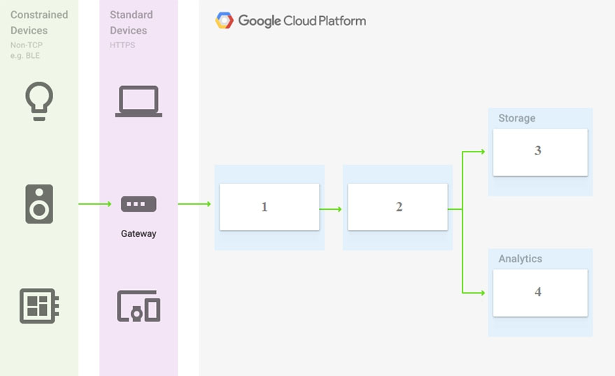
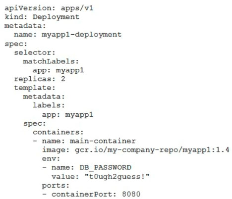
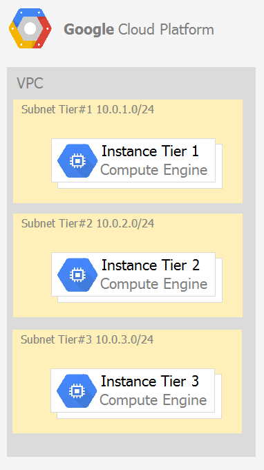
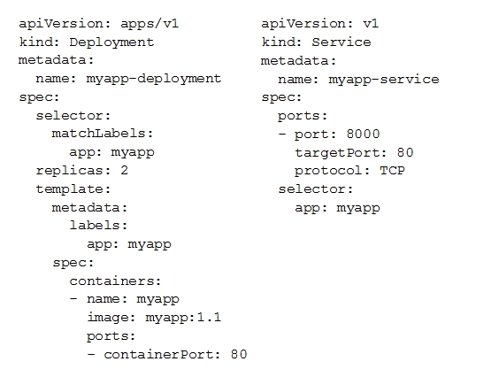
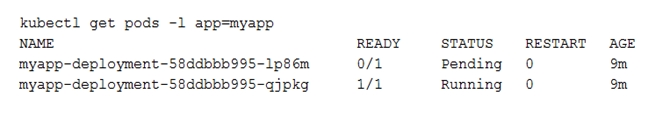
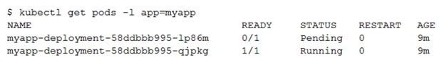
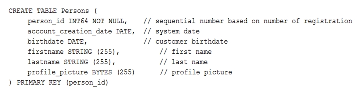
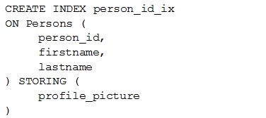

# associate cloud engineer

349 / 349 preguntas. Cobertura completa: True.

Respuestas de la fuente; revisión técnica pendiente. Las imágenes permanecen en sus campos de origen.

349 respuestas conservadas; 0 pendientes.

<a id="topics-86"></a>
## Contexto topics:86
name:
Topic 1


## Pregunta 1

Contexto: [topics:86](#topics-86)
Every employee of your company has a Google account. Your operational team needs to manage a large number of instances on Compute Engine. Each member of this team needs only administrative access to the servers. Your security team wants to ensure that the deployment of credentials is operationally efficient and must be able to determine who accessed a given instance. What should you do?

**A.** Generate a new SSH key pair. Give the private key to each member of your team. Configure the public key in the metadata of each instance.

**B.** Ask each member of the team to generate a new SSH key pair and to send you their public key. Use a configuration management tool to deploy those keys on each instance.

**C.** Ask each member of the team to generate a new SSH key pair and to add the public key to their Google account. Grant the "compute.osAdminLogin" role to the Google group corresponding to this team.

**D.** Generate a new SSH key pair. Give the private key to each member of your team. Configure the public key as a project-wide public SSH key in your Cloud Platform project and allow project-wide public SSH keys on each instance.

**Respuesta de la fuente:** C

**Explicación:** Option C is correct because it uses OS Login with the 'compute.osAdminLogin' IAM role, allowing individual users to associate their unique SSH public keys with their Google accounts. This ensures strong identity management and auditability by linking each login session to a specific user identity, unlike shared private keys which obscure the actor.
References: https://cloud.google.com/compute/docs/instances/managing-instance-access

## Pregunta 2

Contexto: [topics:86](#topics-86)
You need to create a custom VPC with a single subnet. The subnet's range must be as large as possible. Which range should you use?

**A.** 0.0.0.0/0

**B.** 10.0.0.0/8

**C.** 172.16.0.0/12

**D.** 192.168.0.0/16

**Respuesta de la fuente:** B

**Explicación:** RFC 1918 defines three private address ranges: 10.0.0.0/8, 172.16.0.0/12, and 192.168.0.0/16.
Among these options, 10.0.0.0/8 provides the largest number of host addresses (over 16 million), satisfying the requirement for the maximum possible range.
Option A is invalid because 0.0.0.0/0 represents all IP addresses and is not a valid private subnet.

## Pregunta 3

Contexto: [topics:86](#topics-86)
You want to select and configure a cost-effective solution for relational data on Google Cloud Platform. You are working with a small set of operational data in one geographic location. You need to support point-in-time recovery. What should you do?

**A.** Select Cloud SQL (MySQL). Verify that the enable binary logging option is selected.

**B.** Select Cloud SQL (MySQL). Select the create failover replicas option.

**C.** Select Cloud Spanner. Set up your instance with 2 nodes.

**D.** Select Cloud Spanner. Set up your instance as multi-regional.

**Respuesta de la fuente:** A

**Explicación:** Cloud SQL is the appropriate choice for small-scale, single-region relational data due to its cost-effectiveness compared to Cloud Spanner. Point-in-time recovery (PITR) in Cloud SQL for MySQL requires binary logging to track data changes between automated backups.

## Pregunta 4

Contexto: [topics:86](#topics-86)
You want to configure autohealing for network load balancing for a group of Compute Engine instances that run in multiple zones, using the fewest possible steps.
You need to configure re-creation of VMs if they are unresponsive after 3 attempts of 10 seconds each. What should you do?

**A.** Create an HTTP load balancer with a backend configuration that references an existing instance group. Set the health check to healthy (HTTP)

**B.** Create an HTTP load balancer with a backend configuration that references an existing instance group. Define a balancing mode and set the maximum RPS to 10.

**C.** Create a managed instance group. Set the Autohealing health check to healthy (HTTP)

**D.** Create a managed instance group. Verify that the autoscaling setting is on.

**Respuesta de la fuente:** C

**Explicación:** Autohealing is a feature of Managed Instance Groups (MIGs) that recreates unhealthy instances based on health check results. Load balancer health checks only direct traffic away from unhealthy instances and do not trigger recreation, making options A and B incorrect. Option C correctly identifies creating/configuring a MIG with an autohealing health check to achieve the desired VM re-creation behavior.

## Pregunta 5

Contexto: [topics:86](#topics-86)
You are using multiple configurations for gcloud. You want to review the configured Kubernetes Engine cluster of an inactive configuration using the fewest possible steps. What should you do?

**A.** Use gcloud config configurations describe to review the output.

**B.** Use gcloud config configurations activate and gcloud config list to review the output.

**C.** Use kubectl config get-contexts to review the output.

**D.** Use kubectl config use-context and kubectl config view to review the output.

**Respuesta de la fuente:** A

**Explicación:** No conservada en esta captura.

## Pregunta 6

Your company uses Cloud Storage to store application backup files for disaster recovery purposes. You want to follow Google's recommended practices. Which storage option should you use?

**A.** Multi-Regional Storage

**B.** Regional Storage

**C.** Nearline Storage

**D.** Coldline Storage

**Respuesta de la fuente:** D

**Explicación:** Google recommends Coldline Storage for disaster recovery because it is designed for data accessed less than once a month with a 90-day minimum storage duration. This class offers the cost-effective balance of durability and availability required for backups that are rarely restored but must be accessible quickly enough to meet recovery time objectives (RTOs), unlike Archive which has high retrieval costs/latency or Standard classes which are over-provisioned for infrequent access.

## Pregunta 7

Several employees at your company have been creating projects with Cloud Platform and paying for it with their personal credit cards, which the company reimburses. The company wants to centralize all these projects under a single, new billing account. What should you do?

**A.** Contact cloud-billing@google.com with your bank account details and request a corporate billing account for your company.

**B.** Create a ticket with Google Support and wait for their call to share your credit card details over the phone.

**C.** In the Google Platform Console, go to the Resource Manage and move all projects to the root Organizarion.

**D.** In the Google Cloud Platform Console, create a new billing account and set up a payment method.

**Respuesta de la fuente:** D

**Explicación:** The goal is to centralize billing, which requires a dedicated corporate billing account.
Creating the account and setting up the payment method in the Google Cloud Platform Console (Option D) is the correct initial step to establish this entity.
Moving projects to an organization (Option C) does not automatically change or create a billing account linkage; individual project-to-billing links must be managed separately.

## Pregunta 8

You have an application that looks for its licensing server on the IP 10.0.3.21. You need to deploy the licensing server on Compute Engine. You do not want to change the configuration of the application and want the application to be able to reach the licensing server. What should you do?

**A.** Reserve the IP 10.0.3.21 as a static internal IP address using gcloud and assign it to the licensing server.

**B.** Reserve the IP 10.0.3.21 as a static public IP address using gcloud and assign it to the licensing server.

**C.** Use the IP 10.0.3.21 as a custom ephemeral IP address and assign it to the licensing server.

**D.** Start the licensing server with an automatic ephemeral IP address, and then promote it to a static internal IP address.

**Respuesta de la fuente:** A

**Explicación:** The IP address 10.0.3.21 falls within the RFC 1918 private address range, identifying it as a private/internal IP address rather than a public one. To ensure the application can consistently reach the licensing server at this specific address without configuration changes, you must reserve it as a static internal IP address in GCP Compute Engine. Ephemeral IPs change upon instance restart, and public IP reservations are invalid for private ranges.

## Pregunta 9

You are deploying an application to App Engine. You want the number of instances to scale based on request rate. You need at least 3 unoccupied instances at all times. Which scaling type should you use?

**A.** Manual Scaling with 3 instances.

**B.** Basic Scaling with min_instances set to 3.

**C.** Basic Scaling with max_instances set to 3.

**D.** Automatic Scaling with min_idle_instances set to 3.

**Respuesta de la fuente:** D

**Explicación:** Automatic scaling is the appropriate type because it dynamically adjusts instance counts based on request rate and other metrics as required.
The min_idle_instances parameter specifically ensures a minimum number of unoccupied instances are ready to handle traffic, satisfying the requirement for at least 3 available instances at all times.

## Pregunta 10

You have a development project with appropriate IAM roles defined. You are creating a production project and want to have the same IAM roles on the new project, using the fewest possible steps. What should you do?

**A.** Use gcloud iam roles copy and specify the production project as the destination project.

**B.** Use gcloud iam roles copy and specify your organization as the destination organization.

**C.** In the Google Cloud Platform Console, use the 'create role from role' functionality.

**D.** In the Google Cloud Platform Console, use the 'create role' functionality and select all applicable permissions.

**Respuesta de la fuente:** A

**Explicación:** The gcloud iam roles copy command allows you to duplicate custom IAM roles from one project or organization to another.
Specifying the production project as the destination ensures the roles are copied directly to the target environment with minimal steps, satisfying the requirement for efficiency.
Copying to the organization (Option B) would propagate the roles broadly rather than just to the specific project, while manual creation in the console (Options C and D) is significantly more labor-intensive.

## Pregunta 11

Contexto: [topics:86](#topics-86)
You need a dynamic way of provisioning VMs on Compute Engine. The exact specifications will be in a dedicated configuration file. You want to follow Google's recommended practices. Which method should you use?

**A.** Deployment Manager

**B.** Cloud Composer

**C.** Managed Instance Group

**D.** Unmanaged Instance Group

**Respuesta de la fuente:** A

**Explicación:** Deployment Manager is the correct choice because it is Google Cloud's infrastructure-as-code service designed to deploy and manage resources using declarative configuration files (Jinja/YAML). It allows for dynamic, version-controlled provisioning of VMs and other resources, adhering to recommended practices for reproducible infrastructure. While Managed Instance Groups handle scaling, they rely on instance templates rather than a standalone configuration file for the initial deployment topology.

## Pregunta 12

Contexto: [topics:86](#topics-86)
You have a Dockerfile that you need to deploy on Kubernetes Engine. What should you do?

**A.** Use kubectl app deploy <dockerfilename>.

**B.** Use gcloud app deploy <dockerfilename>.

**C.** Create a docker image from the Dockerfile and upload it to Container Registry. Create a Deployment YAML file to point to that image. Use kubectl to create the deployment with that file.

**D.** Create a docker image from the Dockerfile and upload it to Cloud Storage. Create a Deployment YAML file to point to that image. Use kubectl to create the deployment with that file.

**Respuesta de la fuente:** C

**Explicación:** To deploy on Kubernetes Engine, you must first build a container image from the Dockerfile and push it to a container registry (historically Container Registry, now Artifact Registry), as Kubernetes pulls images from registries rather than file systems or object storage. Option D is incorrect because Cloud Storage stores files, not accessible container images for direct runtime execution. Options A and B are invalid because 'kubectl app deploy' does not exist and 'gcloud app deploy' targets App Engine, not GKE.

## Pregunta 13

Contexto: [topics:86](#topics-86)
Your development team needs a new Jenkins server for their project. You need to deploy the server using the fewest steps possible. What should you do?

**A.** Download and deploy the Jenkins Java WAR to App Engine Standard.

**B.** Create a new Compute Engine instance and install Jenkins through the command line interface.

**C.** Create a Kubernetes cluster on Compute Engine and create a deployment with the Jenkins Docker image.

**D.** Use GCP Marketplace to launch the Jenkins solution.

**Respuesta de la fuente:** D

**Explicación:** The GCP Marketplace provides pre-configured solutions that streamline deployment by handling infrastructure provisioning and software installation automatically. This method requires fewer steps than manually installing Jenkins on Compute Engine (B), configuring Kubernetes deployments (C), or deploying WAR files to App Engine (A).

## Pregunta 14

Contexto: [topics:86](#topics-86)
You need to update a deployment in Deployment Manager without any resource downtime in the deployment. Which command should you use?

**A.** gcloud deployment-manager deployments create --config <deployment-config-path>

**B.** gcloud deployment-manager deployments update --config <deployment-config-path>

**C.** gcloud deployment-manager resources create --config <deployment-config-path>

**D.** gcloud deployment-manager resources update --config <deployment-config-path>

**Respuesta de la fuente:** B

**Explicación:** The `gcloud deployment-manager deployments update` command is designed to modify an existing deployment by applying a new configuration file.
Deployment Manager calculates the difference between the current state and the desired state defined in the config, then updates resources incrementally to minimize or eliminate downtime during the transition.
Option A creates a new deployment, while Options C and D manage individual resources rather than the deployment as a whole, which does not align with the requirement to update the deployment without downtime.

## Pregunta 15

Contexto: [topics:86](#topics-86)
You need to run an important query in BigQuery but expect it to return a lot of records. You want to find out how much it will cost to run the query. You are using on-demand pricing. What should you do?

**A.** Arrange to switch to Flat-Rate pricing for this query, then move back to on-demand.

**B.** Use the command line to run a dry run query to estimate the number of bytes read. Then convert that bytes estimate to dollars using the Pricing Calculator.

**C.** Use the command line to run a dry run query to estimate the number of bytes returned. Then convert that bytes estimate to dollars using the Pricing Calculator.

**D.** Run a select count (*) to get an idea of how many records your query will look through. Then convert that number of rows to dollars using the Pricing Calculator.

**Respuesta de la fuente:** B

**Explicación:** BigQuery on-demand pricing charges based on the amount of data processed (bytes read) during query execution, not the number of rows returned or simple row counts.
Using the `--dry_run` option with the bq command-line tool allows you to estimate the total bytes that will be scanned without actually running the query or incurring costs.
This byte estimate can then be converted to a cost using Google Cloud's Pricing Calculator, providing an accurate prediction of expenses before execution.

## Pregunta 16

Contexto: [topics:86](#topics-86)
You have a single binary application that you want to run on Google Cloud Platform. You decided to automatically scale the application based on underlying infrastructure CPU usage. Your organizational policies require you to use virtual machines directly. You need to ensure that the application scaling is operationally efficient and completed as quickly as possible. What should you do?

**A.** Create a Google Kubernetes Engine cluster, and use horizontal pod autoscaling to scale the application.

**B.** Create an instance template, and use the template in a managed instance group with autoscaling configured.

**C.** Create an instance template, and use the template in a managed instance group that scales up and down based on the time of day.

**D.** Use a set of third-party tools to build automation around scaling the application up and down, based on Stackdriver CPU usage monitoring.

**Respuesta de la fuente:** B

**Explicación:** Option B is correct because Managed Instance Groups (MIGs) with autoscaling allow for direct VM management and automatic scaling based on CPU usage metrics.
Option A uses Kubernetes, violating the requirement to use VMs directly.
Option C scales by schedule rather than dynamic load, ignoring the CPU metric requirement.
Option D relies on third-party tools instead of native, operationally efficient GCP features.

## Pregunta 17

Contexto: [topics:86](#topics-86)
You are analyzing Google Cloud Platform service costs from three separate projects. You want to use this information to create service cost estimates by service type, daily and monthly, for the next six months using standard query syntax. What should you do?

**A.** Export your bill to a Cloud Storage bucket, and then import into Cloud Bigtable for analysis.

**B.** Export your bill to a Cloud Storage bucket, and then import into Google Sheets for analysis.

**C.** Export your transactions to a local file, and perform analysis with a desktop tool.

**D.** Export your bill to a BigQuery dataset, and then write time window-based SQL queries for analysis.

**Respuesta de la fuente:** D

**Explicación:** Option D is correct because GCP allows direct export of billing data to BigQuery, which natively supports standard SQL syntax required for the analysis. BigQuery enables efficient aggregation and forecasting using time-window-based queries across multiple projects.

## Pregunta 18

Contexto: [topics:86](#topics-86)
You need to set up a policy so that videos stored in a specific Cloud Storage Regional bucket are moved to Coldline after 90 days, and then deleted after one year from their creation. How should you set up the policy?

**A.** Use Cloud Storage Object Lifecycle Management using Age conditions with SetStorageClass and Delete actions. Set the SetStorageClass action to 90 days and the Delete action to 275 days (365 — 90)

**B.** Use Cloud Storage Object Lifecycle Management using Age conditions with SetStorageClass and Delete actions. Set the SetStorageClass action to 90 days and the Delete action to 365 days.

**C.** Use gsutil rewrite and set the Delete action to 275 days (365-90).

**D.** Use gsutil rewrite and set the Delete action to 365 days.

**Respuesta de la fuente:** B

**Explicación:** Object Lifecycle Management evaluates age based on the original object creation time, which does not reset when a SetStorageClass action is applied.
Therefore, to delete objects exactly one year after their initial creation, the Delete action must be set to 365 days, independent of the earlier transition to Coldline at 90 days.

## Pregunta 19

Contexto: [topics:86](#topics-86)
You have a Linux VM that must connect to Cloud SQL. You created a service account with the appropriate access rights. You want to make sure that the VM uses this service account instead of the default Compute Engine service account. What should you do?

**A.** When creating the VM via the web console, specify the service account under the 'Identity and API Access' section.

**B.** Download a JSON Private Key for the service account. On the Project Metadata, add that JSON as the value for the key compute-engine-service- account.

**C.** Download a JSON Private Key for the service account. On the Custom Metadata of the VM, add that JSON as the value for the key compute-engine- service-account.

**D.** Download a JSON Private Key for the service account. After creating the VM, ssh into the VM and save the JSON under ~/.gcloud/compute-engine-service- account.json.

**Respuesta de la fuente:** A

**Explicación:** In Google Cloud Compute Engine, the most secure and standard way to authenticate a VM is by attaching a specific service account to the instance via the 'Identity and API Access' settings.

While the question implies an existing VM, Option A describes the correct configuration mechanism (using instance-level IAM identity rather than managing static private keys in metadata or local files).

For existing instances, you must stop the VM, update the service account in the console, and restart it to apply the change.

## Pregunta 20

Contexto: [topics:86](#topics-86)
You created an instance of SQL Server 2017 on Compute Engine to test features in the new version. You want to connect to this instance using the fewest number of steps. What should you do?

**A.** Install a RDP client on your desktop. Verify that a firewall rule for port 3389 exists.

**B.** Install a RDP client in your desktop. Set a Windows username and password in the GCP Console. Use the credentials to log in to the instance.

**C.** Set a Windows password in the GCP Console. Verify that a firewall rule for port 22 exists. Click the RDP button in the GCP Console and supply the credentials to log in.

**D.** Set a Windows username and password in the GCP Console. Verify that a firewall rule for port 3389 exists. Click the RDP button in the GCP Console, and supply the credentials to log in.

**Respuesta de la fuente:** D

**Explicación:** No conservada en esta captura.

## Pregunta 21

You have one GCP account running in your default region and zone and another account running in a non-default region and zone. You want to start a new
Compute Engine instance in these two Google Cloud Platform accounts using the command line interface. What should you do?

**A.** Create two configurations using gcloud config configurations create [NAME]. Run gcloud config configurations activate [NAME] to switch between accounts when running the commands to start the Compute Engine instances.

**B.** Create two configurations using gcloud config configurations create [NAME]. Run gcloud configurations list to start the Compute Engine instances.

**C.** Activate two configurations using gcloud configurations activate [NAME]. Run gcloud config list to start the Compute Engine instances.

**D.** Activate two configurations using gcloud configurations activate [NAME]. Run gcloud configurations list to start the Compute Engine instances.

**Respuesta de la fuente:** A

**Explicación:** Option A is correct because it properly uses `gcloud config configurations create` to establish separate environments for each account and `gcloud config configurations activate` to switch the active context before provisioning resources.
Options B, C, and D are incorrect because they suggest using listing commands (`list`) to start instances, which only displays configuration data rather than executing resource creation.

## Pregunta 22

You significantly changed a complex Deployment Manager template and want to confirm that the dependencies of all defined resources are properly met before committing it to the project. You want the most rapid feedback on your changes. What should you do?

**A.** Use granular logging statements within a Deployment Manager template authored in Python.

**B.** Monitor activity of the Deployment Manager execution on the Stackdriver Logging page of the GCP Console.

**C.** Execute the Deployment Manager template against a separate project with the same configuration, and monitor for failures.

**D.** Execute the Deployment Manager template using the —-preview option in the same project, and observe the state of interdependent resources.

**Respuesta de la fuente:** D

**Explicación:** The --preview option in Deployment Manager expands the configuration and creates 'shell' resources without instantiating actual infrastructure. This allows you to validate dependency resolution and configuration syntax immediately within the same project, providing the fastest feedback loop before committing changes.

## Pregunta 23

You are building a pipeline to process time-series data. Which Google Cloud Platform services should you put in boxes 1,2,3, and 4?
[Imagen: sin descripción]
Imagen · question_text · sin descripción

OCR: automatic_unverified · Revisión visual pendiente.
```text
Constrained Standard
Devices Devices © Google Cloud Platform
° O
Storage
Analytics
4
```

**A.** Cloud Pub/Sub, Cloud Dataflow, Cloud Datastore, BigQuery

**B.** Firebase Messages, Cloud Pub/Sub, Cloud Spanner, BigQuery

**C.** Cloud Pub/Sub, Cloud Storage, BigQuery, Cloud Bigtable

**D.** Cloud Pub/Sub, Cloud Dataflow, Cloud Bigtable, BigQuery

**Respuesta de la fuente:** D

**Explicación:** Cloud Pub/Sub is the standard ingestion point for high-throughput streaming data from IoT or time-series sources. Cloud Dataflow provides the necessary stream processing capabilities to transform and analyze this data in real-time.
Cloud Bigtable is a NoSQL wide-column store optimized specifically for storing large-scale time-series data, unlike Datastore which is better suited for general-purpose document storage.
Finally, BigQuery serves as the analytics engine to query the processed data stored in Bigtable for insights.

## Pregunta 24

You have a project for your App Engine application that serves a development environment. The required testing has succeeded and you want to create a new project to serve as your production environment. What should you do?

**A.** Use gcloud to create the new project, and then deploy your application to the new project.

**B.** Use gcloud to create the new project and to copy the deployed application to the new project.

**C.** Create a Deployment Manager configuration file that copies the current App Engine deployment into a new project.

**D.** Deploy your application again using gcloud and specify the project parameter with the new project name to create the new project.

**Respuesta de la fuente:** A

**Explicación:** GCP projects are distinct resource containers that must be explicitly created before any application code or resources can be deployed to them. Therefore, the correct workflow is to first use `gcloud projects create` to establish the new production project ID, and then use `gcloud app deploy` (targeting the new project) to push the application. Options B, C, and D are incorrect because there is no native `gcloud app cp` command, Deployment Manager creates resources rather than copying deployed states, and `gcloud app deploy` cannot create a non-existent project.

## Pregunta 25

You need to configure IAM access audit logging in BigQuery for external auditors. You want to follow Google-recommended practices. What should you do?

**A.** Add the auditors group to the 'logging.viewer' and 'bigQuery.dataViewer' predefined IAM roles.

**B.** Add the auditors group to two new custom IAM roles.

**C.** Add the auditor user accounts to the 'logging.viewer' and 'bigQuery.dataViewer' predefined IAM roles.

**D.** Add the auditor user accounts to two new custom IAM roles.

**Respuesta de la fuente:** A

**Explicación:** Google Cloud IAM best practices recommend using predefined roles to minimize configuration effort and relying on security teams for role updates. Additionally, managing access via groups rather than individual user accounts simplifies lifecycle management and ensures consistent permissions for all members of the auditor group.

## Pregunta 26

Contexto: [topics:86](#topics-86)
You need to set up permissions for a set of Compute Engine instances to enable them to write data into a particular Cloud Storage bucket. You want to follow
Google-recommended practices. What should you do?

**A.** Create a service account with an access scope. Use the access scope 'https://www.googleapis.com/auth/devstorage.write_only'.

**B.** Create a service account with an access scope. Use the access scope 'https://www.googleapis.com/auth/cloud-platform'.

**C.** Create a service account and add it to the IAM role 'storage.objectCreator' for that bucket.

**D.** Create a service account and add it to the IAM role 'storage.objectAdmin' for that bucket.

**Respuesta de la fuente:** C

**Explicación:** Google recommends using Identity and Access Management (IAM) roles for fine-grained permissions rather than legacy access scopes. The principle of least privilege dictates granting only the necessary permissions; 'storage.objectCreator' allows writing objects without providing read, delete, or list capabilities.
Therefore, creating a service account and assigning the 'storage.objectCreator' role to the specific bucket is the correct approach.

## Pregunta 27

Contexto: [topics:86](#topics-86)
You have sensitive data stored in three Cloud Storage buckets and have enabled data access logging. You want to verify activities for a particular user for these buckets, using the fewest possible steps. You need to verify the addition of metadata labels and which files have been viewed from those buckets. What should you do?

**A.** Using the GCP Console, filter the Activity log to view the information.

**B.** Using the GCP Console, filter the Stackdriver log to view the information.

**C.** View the bucket in the Storage section of the GCP Console.

**D.** Create a trace in Stackdriver to view the information.

**Respuesta de la fuente:** B

**Explicación:** No conservada en esta captura.

## Pregunta 28

Contexto: [topics:86](#topics-86)
You are the project owner of a GCP project and want to delegate control to colleagues to manage buckets and files in Cloud Storage. You want to follow Google- recommended practices. Which IAM roles should you grant your colleagues?

**A.** Project Editor

**B.** Storage Admin

**C.** Storage Object Admin

**D.** Storage Object Creator

**Respuesta de la fuente:** B

**Explicación:** The requirement is to manage both buckets and files. The Storage Admin role grants full control over Cloud Storage resources, including creating, modifying, and deleting buckets as well as managing objects within them.

In contrast, Project Editor grants excessive permissions across all project resources, while Storage Object Admin lacks the necessary permissions to create or modify bucket configurations.

## Pregunta 29

Contexto: [topics:86](#topics-86)
You have an object in a Cloud Storage bucket that you want to share with an external company. The object contains sensitive data. You want access to the content to be removed after four hours. The external company does not have a Google account to which you can grant specific user-based access privileges. You want to use the most secure method that requires the fewest steps. What should you do?

**A.** Create a signed URL with a four-hour expiration and share the URL with the company.

**B.** Set object access to 'public' and use object lifecycle management to remove the object after four hours.

**C.** Configure the storage bucket as a static website and furnish the object's URL to the company. Delete the object from the storage bucket after four hours.

**D.** Create a new Cloud Storage bucket specifically for the external company to access. Copy the object to that bucket. Delete the bucket after four hours have passed.

**Respuesta de la fuente:** A

**Explicación:** Signed URLs are the recommended method for granting temporary, secure access to Cloud Storage objects without creating user accounts or making resources public. By setting a four-hour expiration, access is automatically revoked after the specified time, satisfying the security requirement efficiently.
Other options fail because making the object public (B) or configuring static website hosting (C) exposes sensitive data indefinitely until manual deletion, while creating and deleting a bucket (D) is operationally complex and unnecessary.

## Pregunta 30

Contexto: [topics:86](#topics-86)
You are creating a Google Kubernetes Engine (GKE) cluster with a cluster autoscaler feature enabled. You need to make sure that each node of the cluster will run a monitoring pod that sends container metrics to a third-party monitoring solution. What should you do?

**A.** Deploy the monitoring pod in a StatefulSet object.

**B.** Deploy the monitoring pod in a DaemonSet object.

**C.** Reference the monitoring pod in a Deployment object.

**D.** Reference the monitoring pod in a cluster initializer at the GKE cluster creation time.

**Respuesta de la fuente:** B

**Explicación:** A DaemonSet is designed to run exactly one instance of a Pod on each node in the cluster. This ensures that as the GKE cluster autoscaler adds new nodes, the monitoring pod is automatically scheduled on them without manual intervention.
In contrast, Deployments manage replica counts rather than per-node coverage, StatefulSets are for stateful applications requiring stable identities, and cluster initializers do not handle ongoing node lifecycle events.

## Pregunta 31

Contexto: [topics:86](#topics-86)
You want to send and consume Cloud Pub/Sub messages from your App Engine application. The Cloud Pub/Sub API is currently disabled. You will use a service account to authenticate your application to the API. You want to make sure your application can use Cloud Pub/Sub. What should you do?

**A.** Enable the Cloud Pub/Sub API in the API Library on the GCP Console.

**B.** Rely on the automatic enablement of the Cloud Pub/Sub API when the Service Account accesses it.

**C.** Use Deployment Manager to deploy your application. Rely on the automatic enablement of all APIs used by the application being deployed.

**D.** Grant the App Engine Default service account the role of Cloud Pub/Sub Admin. Have your application enable the API on the first connection to Cloud Pub/ Sub.

**Respuesta de la fuente:** A

**Explicación:** In Google Cloud Platform, most APIs are disabled by default to minimize costs and security risks. To use Cloud Pub/Sub, the API must be explicitly enabled in the project via the API Library or CLI before any application code can interact with it. Automatic enablement does not occur upon first access or through standard service account authentication.

## Pregunta 32

Contexto: [topics:86](#topics-86)
You need to monitor resources that are distributed over different projects in Google Cloud Platform. You want to consolidate reporting under the same Stackdriver
Monitoring dashboard. What should you do?

**A.** Use Shared VPC to connect all projects, and link Stackdriver to one of the projects.

**B.** For each project, create a Stackdriver account. In each project, create a service account for that project and grant it the role of Stackdriver Account Editor in all other projects.

**C.** Configure a single Stackdriver account, and link all projects to the same account.

**D.** Configure a single Stackdriver account for one of the projects. In Stackdriver, create a Group and add the other project names as criteria for that Group.

**Respuesta de la fuente:** C

**Explicación:** To consolidate monitoring data from multiple projects into a single dashboard, you must use a Cloud Monitoring workspace that can link to multiple GCP projects.
Option C correctly describes configuring a single Stackdriver (Cloud Monitoring) account and linking all relevant projects to it via the workspace settings.
Option D is incorrect because Groups are designed for organizing resources like VMs or load balancers, not for aggregating entire projects into a unified monitoring view.

## Pregunta 33

Contexto: [topics:86](#topics-86)
You are deploying an application to a Compute Engine VM in a managed instance group. The application must be running at all times, but only a single instance of the VM should run per GCP project. How should you configure the instance group?

**A.** Set autoscaling to On, set the minimum number of instances to 1, and then set the maximum number of instances to 1.

**B.** Set autoscaling to Off, set the minimum number of instances to 1, and then set the maximum number of instances to 1.

**C.** Set autoscaling to On, set the minimum number of instances to 1, and then set the maximum number of instances to 2.

**D.** Set autoscaling to Off, set the minimum number of instances to 1, and then set the maximum number of instances to 2.

**Respuesta de la fuente:** A

**Explicación:** To ensure exactly one instance runs at all times, autoscaling must be enabled so the manager actively maintains the target count against failures or deletions.
With autoscaling On and both min/max set to 1, the system guarantees a single running instance by automatically recreating it if it stops.
Setting autoscaling Off (Choice B) leaves the static instance vulnerable to staying down after a crash unless autohealing is explicitly configured separately.

## Pregunta 34

Contexto: [topics:86](#topics-86)
You want to verify the IAM users and roles assigned within a GCP project named my-project. What should you do?

**A.** Run gcloud iam roles list. Review the output section.

**B.** Run gcloud iam service-accounts list. Review the output section.

**C.** Navigate to the project and then to the IAM section in the GCP Console. Review the members and roles.

**D.** Navigate to the project and then to the Roles section in the GCP Console. Review the roles and status.

**Respuesta de la fuente:** C

**Explicación:** The IAM section in the GCP Console explicitly maps principals (users and roles) to their assigned permissions within a specific project.
Option A lists only available role definitions, Option B lists only service accounts, and Option D focuses on role definitions rather than assignments.

## Pregunta 35

Contexto: [topics:86](#topics-86)
You need to create a new billing account and then link it with an existing Google Cloud Platform project. What should you do?

**A.** Verify that you are Project Billing Manager for the GCP project. Update the existing project to link it to the existing billing account.

**B.** Verify that you are Project Billing Manager for the GCP project. Create a new billing account and link the new billing account to the existing project.

**C.** Verify that you are Billing Administrator for the billing account. Create a new project and link the new project to the existing billing account.

**D.** Verify that you are Billing Administrator for the billing account. Update the existing project to link it to the existing billing account.

**Respuesta de la fuente:** B

**Explicación:** The question requires creating a NEW billing account and linking it to an EXISTING project. Option B is the only choice that explicitly mentions creating a 'new billing account' and linking it to an 'existing project'. Although the permission model described in the options is technically imprecise (as Billing Account Administrators manage but do not typically create accounts, requiring a specific creator role or organization admin privileges), Option B is the best fit by process of elimination against options that reference non-existent resources or incorrect actions.

## Pregunta 36

You have one project called proj-sa where you manage all your service accounts. You want to be able to use a service account from this project to take snapshots of VMs running in another project called proj-vm. What should you do?

**A.** Download the private key from the service account, and add it to each VMs custom metadata.

**B.** Download the private key from the service account, and add the private key to each VM's SSH keys.

**C.** Grant the service account the IAM Role of Compute Storage Admin in the project called proj-vm.

**D.** When creating the VMs, set the service account's API scope for Compute Engine to read/write.

**Respuesta de la fuente:** C

**Explicación:** To allow a service account from one project (proj-sa) to perform actions in another project (proj-vm), you must grant that service account the necessary IAM permissions directly on the target project.
Granting the 'Compute Storage Admin' role in proj-vm provides the specific privileges required to create, modify, and delete snapshots for VMs running within that project.
Options A and B are insecure and unnecessary workarounds, while Option D refers to legacy scopes that do not enable cross-project access.

## Pregunta 37

You created a Google Cloud Platform project with an App Engine application inside the project. You initially configured the application to be served from the us- central region. Now you want the application to be served from the asia-northeast1 region. What should you do?

**A.** Change the default region property setting in the existing GCP project to asia-northeast1.

**B.** Change the region property setting in the existing App Engine application from us-central to asia-northeast1.

**C.** Create a second App Engine application in the existing GCP project and specify asia-northeast1 as the region to serve your application.

**D.** Create a new GCP project and create an App Engine application inside this new project. Specify asia-northeast1 as the region to serve your application.

**Respuesta de la fuente:** D

**Explicación:** Google Cloud Platform enforces a one-to-one relationship between a project and an App Engine application, meaning each project can only host a single App Engine app. Additionally, the region location for an App Engine application is immutable once it is created; it cannot be changed after initial setup. Therefore, to serve the application from asia-northeast1, you must create a new GCP project and initialize a new App Engine application within that project with the desired region.

## Pregunta 38

You need to grant access for three users so that they can view and edit table data on a Cloud Spanner instance. What should you do?

**A.** Run gcloud iam roles describe roles/spanner.databaseUser. Add the users to the role.

**B.** Run gcloud iam roles describe roles/spanner.databaseUser. Add the users to a new group. Add the group to the role.

**C.** Run gcloud iam roles describe roles/spanner.viewer - -project my-project. Add the users to the role.

**D.** Run gcloud iam roles describe roles/spanner.viewer - -project my-project. Add the users to a new group. Add the group to the role.

**Respuesta de la fuente:** B

**Explicación:** The `roles/spanner.databaseUser` role is required to view and edit table data, whereas `roles/spanner.viewer` only provides read-only access.
According to GCP IAM best practices, you should assign roles to groups rather than individual users to simplify permission management and reduce administrative overhead.

## Pregunta 39

You create a new Google Kubernetes Engine (GKE) cluster and want to make sure that it always runs a supported and stable version of Kubernetes. What should you do?

**A.** Enable the Node Auto-Repair feature for your GKE cluster.

**B.** Enable the Node Auto-Upgrades feature for your GKE cluster.

**C.** Select the latest available cluster version for your GKE cluster.

**D.** Select "Container-Optimized OS (cos)" as a node image for your GKE cluster.

**Respuesta de la fuente:** B

**Explicación:** To ensure a GKE cluster *always* runs a supported and stable version, you must enable automatic updates, as manual selection only sets the initial state. Node Auto-Upgrades automatically manages the Kubernetes version lifecycle by upgrading nodes to the latest available stable version when it becomes ready.

Node Auto-Repair (A) fixes broken nodes but does not upgrade software versions. Selecting the latest version at creation (C) is a one-time action that does not guarantee future compliance. Container-Optimized OS (D) affects the node's underlying OS, not the Kubernetes control plane or kubelet version management.

## Pregunta 40

You have an instance group that you want to load balance. You want the load balancer to terminate the client SSL session. The instance group is used to serve a public web application over HTTPS. You want to follow Google-recommended practices. What should you do?

**A.** Configure an HTTP(S) load balancer.

**B.** Configure an internal TCP load balancer.

**C.** Configure an external SSL proxy load balancer.

**D.** Configure an external TCP proxy load balancer.

**Respuesta de la fuente:** A

**Explicación:** Option A is the correct choice because HTTP(S) Load Balancing is Google's recommended solution for public-facing web applications and provides built-in SSL termination capabilities.

In contrast, SSL Proxy and TCP Proxy load balancers are designed for non-HTTP traffic or scenarios requiring end-to-end encryption where the proxy does not decrypt the payload, while Internal Load Balancers are restricted to private network communication.

## Pregunta 41

Contexto: [topics:86](#topics-86)
You have 32 GB of data in a single file that you need to upload to a Nearline Storage bucket. The WAN connection you are using is rated at 1 Gbps, and you are the only one on the connection. You want to use as much of the rated 1 Gbps as possible to transfer the file rapidly. How should you upload the file?

**A.** Use the GCP Console to transfer the file instead of gsutil.

**B.** Enable parallel composite uploads using gsutil on the file transfer.

**C.** Decrease the TCP window size on the machine initiating the transfer.

**D.** Change the storage class of the bucket from Nearline to Multi-Regional.

**Respuesta de la fuente:** B

**Explicación:** To maximize throughput for a large file over a high-bandwidth connection, gsutil's parallel composite uploads split the file into multiple parts and upload them concurrently. This utilizes multiple threads to saturate the available bandwidth more effectively than a single-threaded transfer.

Note: While parallel composite uploads incur additional costs for Nearline storage due to early deletion charges on component objects, it remains the technically correct method for maximizing raw upload speed among the given choices.

## Pregunta 42

Contexto: [topics:86](#topics-86)
You've deployed a microservice called myapp1 to a Google Kubernetes Engine cluster using the YAML file specified below:
[Imagen: sin descripción]
You need to refactor this configuration so that the database password is not stored in plain text. You want to follow Google-recommended practices. What should you do?
Imagen · question_text · sin descripción

OCR: automatic_unverified · Revisión visual pendiente.
```text
apiversion: apps/v1
kind: Deployment
metadata:
name: myapp1-deployment
spec:
selector:
matchLabels:
app: myappl
replicas: 2
template
metadata:
label:
app: myappl
sper
containers:
- name: main-container
image: gcr.io/my-company-repo/myapp1:1.4
env:
- name: DB_PASSWORD
value: tOugh2guess!
ports:
= containerPort: 8080
```

**A.** Store the database password inside the Docker image of the container, not in the YAML file.

**B.** Store the database password inside a Secret object. Modify the YAML file to populate the DB_PASSWORD environment variable from the Secret.

**C.** Store the database password inside a ConfigMap object. Modify the YAML file to populate the DB_PASSWORD environment variable from the ConfigMap.

**D.** Store the database password in a file inside a Kubernetes persistent volume, and use a persistent volume claim to mount the volume to the container.

**Respuesta de la fuente:** B

**Explicación:** Google recommends using Kubernetes Secrets to store and manage sensitive information such as database passwords, rather than exposing them in plain text within YAML configurations or Docker images. ConfigMaps are intended for non-confidential configuration data like port numbers or environment settings, making them unsuitable for credentials.
Reference: https://cloud.google.com/kubernetes-engine/docs/concepts/secret

## Pregunta 43

Contexto: [topics:86](#topics-86)
You are running an application on multiple virtual machines within a managed instance group and have autoscaling enabled. The autoscaling policy is configured so that additional instances are added to the group if the CPU utilization of instances goes above 80%. VMs are added until the instance group reaches its maximum limit of five VMs or until CPU utilization of instances lowers to 80%. The initial delay for HTTP health checks against the instances is set to 30 seconds.
The virtual machine instances take around three minutes to become available for users. You observe that when the instance group autoscales, it adds more instances then necessary to support the levels of end-user traffic. You want to properly maintain instance group sizes when autoscaling. What should you do?

**A.** Set the maximum number of instances to 1.

**B.** Decrease the maximum number of instances to 3.

**C.** Use a TCP health check instead of an HTTP health check.

**D.** Increase the initial delay of the HTTP health check to 200 seconds.

**Respuesta de la fuente:** D

**Explicación:** The issue is that the initial health check delay (30 seconds) is shorter than the time required for VMs to become ready (3 minutes), causing newly added instances to be marked unhealthy prematurely.
This triggers autoscaling to add even more instances in an attempt to compensate, leading to over-provisioning.
Increasing the initial delay to 200 seconds ensures that the first health check occurs only after the instance has fully booted and is ready to serve traffic.

## Pregunta 44

Contexto: [topics:86](#topics-86)
You need to select and configure compute resources for a set of batch processing jobs. These jobs take around 2 hours to complete and are run nightly. You want to minimize service costs. What should you do?

**A.** Select Google Kubernetes Engine. Use a single-node cluster with a small instance type.

**B.** Select Google Kubernetes Engine. Use a three-node cluster with micro instance types.

**C.** Select Compute Engine. Use preemptible VM instances of the appropriate standard machine type.

**D.** Select Compute Engine. Use VM instance types that support micro bursting.

**Respuesta de la fuente:** C

**Explicación:** Preemptible VM instances are the most cost-effective option for batch processing workloads, offering discounts of up to 80% compared to standard Compute Engine instances.
Since the jobs are fault-tolerant, intermittent in nature (nightly), and have a short duration (2 hours), they fit the criteria for preemptible usage where availability is not guaranteed but cost minimization is the primary goal.

## Pregunta 45

Contexto: [topics:86](#topics-86)
You recently deployed a new version of an application to App Engine and then discovered a bug in the release. You need to immediately revert to the prior version of the application. What should you do?

**A.** Run gcloud app restore.

**B.** On the App Engine page of the GCP Console, select the application that needs to be reverted and click Revert.

**C.** On the App Engine Versions page of the GCP Console, route 100% of the traffic to the previous version.

**D.** Deploy the original version as a separate application. Then go to App Engine settings and split traffic between applications so that the original version serves 100% of the requests.

**Respuesta de la fuente:** C

**Explicación:** Google App Engine retains all deployed versions of a service, allowing you to revert by changing traffic allocation rather than redeploying code.
To immediately fix the issue, navigate to the App Engine Versions page in the GCP Console and migrate 100% of traffic to the previous stable version.
Options A and B are incorrect because 'gcloud app restore' is deprecated/non-existent for this purpose and there is no 'Revert' button; Option D is unnecessary as the old version already exists.

## Pregunta 46

Contexto: [topics:86](#topics-86)
You deployed an App Engine application using gcloud app deploy, but it did not deploy to the intended project. You want to find out why this happened and where the application deployed. What should you do?

**A.** Check the app.yaml file for your application and check project settings.

**B.** Check the web-application.xml file for your application and check project settings.

**C.** Go to Deployment Manager and review settings for deployment of applications.

**D.** Go to Cloud Shell and run gcloud config list to review the Google Cloud configuration used for deployment.

**Respuesta de la fuente:** D

**Explicación:** The gcloud CLI uses the active configuration context to determine the target project if no --project flag is provided during deployment. Running gcloud config list displays the current core settings, including the default project ID, allowing you to identify why the application deployed to an unexpected location. While app.yaml may contain a project ID in some Standard environment cases, it is ignored in Flexible environments and often absent, making the CLI configuration check the definitive diagnostic step.

## Pregunta 47

Contexto: [topics:86](#topics-86)
You want to configure 10 Compute Engine instances for availability when maintenance occurs. Your requirements state that these instances should attempt to automatically restart if they crash. Also, the instances should be highly available including during system maintenance. What should you do?

**A.** Create an instance template for the instances. Set the 'Automatic Restart' to on. Set the 'On-host maintenance' to Migrate VM instance. Add the instance template to an instance group.

**B.** Create an instance template for the instances. Set 'Automatic Restart' to off. Set 'On-host maintenance' to Terminate VM instances. Add the instance template to an instance group.

**C.** Create an instance group for the instances. Set the 'Autohealing' health check to healthy (HTTP).

**D.** Create an instance group for the instance. Verify that the 'Advanced creation options' setting for 'do not retry machine creation' is set to off.

**Respuesta de la fuente:** A

**Explicación:** To meet the requirement for automatic restart upon crash, you must enable the 'Automatic Restart' setting on the instance template. To ensure high availability during system maintenance without downtime, you must set the 'On-host maintenance' policy to 'Migrate VM instance', which triggers live migration instead of termination.
Creating these instances within an instance group ensures they are managed as a scalable and highly available unit.

## Pregunta 48

Contexto: [topics:86](#topics-86)
You host a static website on Cloud Storage. Recently, you began to include links to PDF files on this site. Currently, when users click on the links to these PDF files, their browsers prompt them to save the file onto their local system. Instead, you want the clicked PDF files to be displayed within the browser window directly, without prompting the user to save the file locally. What should you do?

**A.** Enable Cloud CDN on the website frontend.

**B.** Enable 'Share publicly' on the PDF file objects.

**C.** Set Content-Type metadata to application/pdf on the PDF file objects.

**D.** Add a label to the storage bucket with a key of Content-Type and value of application/pdf.

**Respuesta de la fuente:** C

**Explicación:** Browsers determine how to handle downloaded files based on the Content-Type header sent by the server. Setting this metadata to 'application/pdf' signals the browser that the file is a PDF, enabling it to render the document in the built-in viewer instead of triggering a download.

Labels (Option D) are for organization and do not affect HTTP headers, while CDN (Option A) and public access settings (Option B) handle performance and permissions, respectively, not content rendering behavior.

## Pregunta 49

Contexto: [topics:86](#topics-86)
You have a virtual machine that is currently configured with 2 vCPUs and 4 GB of memory. It is running out of memory. You want to upgrade the virtual machine to have 8 GB of memory. What should you do?

**A.** Rely on live migration to move the workload to a machine with more memory.

**B.** Use gcloud to add metadata to the VM. Set the key to required-memory-size and the value to 8 GB.

**C.** Stop the VM, change the machine type to n1-standard-8, and start the VM.

**D.** Stop the VM, increase the memory to 8 GB, and start the VM.

**Respuesta de la fuente:** D

**Explicación:** In Google Compute Engine, modifying the memory allocation of a virtual machine requires stopping the instance first, as live resizing is not supported for standard machines.
Option D is correct because it follows the mandatory stop-edit-start workflow without unnecessarily changing other resources.
Option C is incorrect because switching to an n1-standard-8 machine type would drastically increase vCPUs and memory beyond the specific requirement of 8 GB, leading to overprovisioning.

## Pregunta 50

Contexto: [topics:86](#topics-86)
You have production and test workloads that you want to deploy on Compute Engine. Production VMs need to be in a different subnet than the test VMs. All the
VMs must be able to reach each other over Internal IP without creating additional routes. You need to set up VPC and the 2 subnets. Which configuration meets these requirements?

**A.** Create a single custom VPC with 2 subnets. Create each subnet in a different region and with a different CIDR range.

**B.** Create a single custom VPC with 2 subnets. Create each subnet in the same region and with the same CIDR range.

**C.** Create 2 custom VPCs, each with a single subnet. Create each subnet in a different region and with a different CIDR range.

**D.** Create 2 custom VPCs, each with a single subnet. Create each subnet in the same region and with the same CIDR range.

**Respuesta de la fuente:** A

**Explicación:** Google Cloud VPCs are global resources where all subnets within the same network must have non-overlapping CIDR ranges, making option B invalid. Subnets in the same VPC automatically route to each other via internal IP without requiring manual configuration, satisfying the connectivity requirement. Option A correctly implements a single VPC with distinct, non-overlapping subnets in different regions to separate production and test workloads while maintaining seamless communication.

## Pregunta 51

You need to create an autoscaling managed instance group for an HTTPS web application. You want to make sure that unhealthy VMs are recreated. What should you do?

**A.** Create a health check on port 443 and use that when creating the Managed Instance Group.

**B.** Select Multi-Zone instead of Single-Zone when creating the Managed Instance Group.

**C.** In the Instance Template, add the label 'health-check'.

**D.** In the Instance Template, add a startup script that sends a heartbeat to the metadata server.

**Respuesta de la fuente:** A

**Explicación:** To automatically recreate unhealthy VMs in a Managed Instance Group (MIG), you must configure autohealing using a health check.
Since the application is HTTPS, the health check should probe port 443 to verify the instance's responsiveness.
When an instance fails this health check for the configured period, the MIG controller marks it unhealthy and recreates it with the specified instance template.

## Pregunta 52

Your company has a Google Cloud Platform project that uses BigQuery for data warehousing. Your data science team changes frequently and has few members.
You need to allow members of this team to perform queries. You want to follow Google-recommended practices. What should you do?

**A.** 1. Create an IAM entry for each data scientist's user account. 2. Assign the BigQuery jobUser role to the group.

**B.** 1. Create an IAM entry for each data scientist's user account. 2. Assign the BigQuery dataViewer user role to the group.

**C.** 1. Create a dedicated Google group in Cloud Identity. 2. Add each data scientist's user account to the group. 3. Assign the BigQuery jobUser role to the group.

**D.** 1. Create a dedicated Google group in Cloud Identity. 2. Add each data scientist's user account to the group. 3. Assign the BigQuery dataViewer user role to the group.

**Respuesta de la fuente:** C

**Explicación:** Google recommends managing access via groups rather than individual IAM entries to simplify administration for teams with frequent turnover.
The BigQuery Job User role is required to run jobs, including queries, whereas the Data Viewer role only permits reading data and listing resources but does not grant the permissions necessary to execute query jobs.

## Pregunta 53

Your company has a 3-tier solution running on Compute Engine. The configuration of the current infrastructure is shown below.
[Imagen: sin descripción]
Each tier has a service account that is associated with all instances within it. You need to enable communication on TCP port 8080 between tiers as follows:
* Instances in tier #1 must communicate with tier #2.
* Instances in tier #2 must communicate with tier #3.
What should you do?
Imagen · question_text · sin descripción

OCR: automatic_unverified · Revisión visual pendiente.
```text
¢ ) Google Cloud Platform
VPC
Subnet Tier#1 10.0.1.0/24
Instance Tier 1
Compute Engine
Subnet Tier#2 10.0.2.0/24
Instance Tier 2
Compute Engine
Subnet Tier#3 10.0.3.0/24
Instance Tier 3
Compute Engine
```

**A.** 1. Create an ingress firewall rule with the following settings: "¢ Targets: all instances "¢ Source filter: IP ranges (with the range set to 10.0.2.0/24) "¢ Protocols: allow all 2. Create an ingress firewall rule with the following settings: "¢ Targets: all instances "¢ Source filter: IP ranges (with the range set to 10.0.1.0/24) "¢ Protocols: allow all

**B.** 1. Create an ingress firewall rule with the following settings: "¢ Targets: all instances with tier #2 service account "¢ Source filter: all instances with tier #1 service account "¢ Protocols: allow TCP:8080 2. Create an ingress firewall rule with the following settings: "¢ Targets: all instances with tier #3 service account "¢ Source filter: all instances with tier #2 service account "¢ Protocols: allow TCP: 8080

**C.** 1. Create an ingress firewall rule with the following settings: "¢ Targets: all instances with tier #2 service account "¢ Source filter: all instances with tier #1 service account "¢ Protocols: allow all 2. Create an ingress firewall rule with the following settings: "¢ Targets: all instances with tier #3 service account "¢ Source filter: all instances with tier #2 service account "¢ Protocols: allow all

**D.** 1. Create an egress firewall rule with the following settings: "¢ Targets: all instances "¢ Source filter: IP ranges (with the range set to 10.0.2.0/24) "¢ Protocols: allow TCP: 8080 2. Create an egress firewall rule with the following settings: "¢ Targets: all instances "¢ Source filter: IP ranges (with the range set to 10.0.1.0/24) "¢ Protocols: allow TCP: 8080

**Respuesta de la fuente:** B

**Explicación:** GCP firewall rules are evaluated for inbound traffic using ingress rules, and the principle of least privilege dictates restricting access to only the necessary port (TCP 8080) rather than allowing all protocols. Furthermore, using service accounts as targets and sources provides precise, identity-based control compared to broader IP range filters, ensuring that only instances in specific tiers can communicate with each other.

## Pregunta 54

You are given a project with a single Virtual Private Cloud (VPC) and a single subnetwork in the us-central1 region. There is a Compute Engine instance hosting an application in this subnetwork. You need to deploy a new instance in the same project in the europe-west1 region. This new instance needs access to the application. You want to follow Google-recommended practices. What should you do?

**A.** 1. Create a subnetwork in the same VPC, in europe-west1. 2. Create the new instance in the new subnetwork and use the first instance's private address as the endpoint.

**B.** 1. Create a VPC and a subnetwork in europe-west1. 2. Expose the application with an internal load balancer. 3. Create the new instance in the new subnetwork and use the load balancer's address as the endpoint.

**C.** 1. Create a subnetwork in the same VPC, in europe-west1. 2. Use Cloud VPN to connect the two subnetworks. 3. Create the new instance in the new subnetwork and use the first instance's private address as the endpoint.

**D.** 1. Create a VPC and a subnetwork in europe-west1. 2. Peer the 2 VPCs. 3. Create the new instance in the new subnetwork and use the first instance's private address as the endpoint.

**Respuesta de la fuente:** A

**Explicación:** Google Cloud VPC networks are global resources that span all regions within a single project. To connect instances across different regions (us-central1 and europe-west1) in the same VPC, you simply need to create a subnetwork in the target region.

Once the new instance is deployed in the europe-west1 subnetwork, it can communicate directly with the existing instance using its private IP address without requiring Cloud VPN, VPC peering, or load balancers, as these are unnecessary for intra-VPC communication.

## Pregunta 55

Your projects incurred more costs than you expected last month. Your research reveals that a development GKE container emitted a huge number of logs, which resulted in higher costs. You want to disable the logs quickly using the minimum number of steps. What should you do?

**A.** 1. Go to the Logs ingestion window in Stackdriver Logging, and disable the log source for the GKE container resource.

**B.** 1. Go to the Logs ingestion window in Stackdriver Logging, and disable the log source for the GKE Cluster Operations resource.

**C.** 1. Go to the GKE console, and delete existing clusters. 2. Recreate a new cluster. 3. Clear the option to enable legacy Stackdriver Logging.

**D.** 1. Go to the GKE console, and delete existing clusters. 2. Recreate a new cluster. 3. Clear the option to enable legacy Stackdriver Monitoring.

**Respuesta de la fuente:** A

**Explicación:** The issue is specifically caused by a GKE container emitting excessive logs, so the solution must target that resource type directly.
Disabling the log ingestion for the 'GKE Container' resource in the Logging console immediately stops the costly log entries without requiring destructive actions like deleting and recreating clusters.
Options C and D involve unnecessary cluster recreation, while Option B targets cluster operations rather than the container logs themselves.

## Pregunta 56

Contexto: [topics:86](#topics-86)
You have a website hosted on App Engine standard environment. You want 1% of your users to see a new test version of the website. You want to minimize complexity. What should you do?

**A.** Deploy the new version in the same application and use the --migrate option.

**B.** Deploy the new version in the same application and use the --splits option to give a weight of 99 to the current version and a weight of 1 to the new version.

**C.** Create a new App Engine application in the same project. Deploy the new version in that application. Use the App Engine library to proxy 1% of the requests to the new version.

**D.** Create a new App Engine application in the same project. Deploy the new version in that application. Configure your network load balancer to send 1% of the traffic to that new application.

**Respuesta de la fuente:** B

**Explicación:** App Engine supports multi-versioning within a single application, allowing you to split traffic between versions using weights (e.g., --splits) without needing external load balancers or multiple applications.
Option B is correct because it utilizes this native feature to route 1% of traffic to the new version and 99% to the current one, minimizing architectural complexity.
Options C and D are incorrect because a GCP project can only host one App Engine application, making the creation of a 'new application' impossible within the same project context.

## Pregunta 57

Contexto: [topics:86](#topics-86)
You have a web application deployed as a managed instance group. You have a new version of the application to gradually deploy. Your web application is currently receiving live web traffic. You want to ensure that the available capacity does not decrease during the deployment. What should you do?

**A.** Perform a rolling-action start-update with maxSurge set to 0 and maxUnavailable set to 1.

**B.** Perform a rolling-action start-update with maxSurge set to 1 and maxUnavailable set to 0.

**C.** Create a new managed instance group with an updated instance template. Add the group to the backend service for the load balancer. When all instances in the new managed instance group are healthy, delete the old managed instance group.

**D.** Create a new instance template with the new application version. Update the existing managed instance group with the new instance template. Delete the instances in the managed instance group to allow the managed instance group to recreate the instance using the new instance template.

**Respuesta de la fuente:** B

**Explicación:** To ensure available capacity does not decrease during a rolling update in Google Cloud Managed Instance Groups (MIGs), you must set maxUnavailable to 0. This parameter dictates that no instances are removed from service until their replacements are created and healthy, thereby maintaining the original target size throughout the process. Setting maxSurge to 1 allows the MIG to temporarily create one additional instance above the target size to facilitate this swap without downtime.

## Pregunta 58

Contexto: [topics:86](#topics-86)
You are building an application that stores relational data from users. Users across the globe will use this application. Your CTO is concerned about the scaling requirements because the size of the user base is unknown. You need to implement a database solution that can scale with your user growth with minimum configuration changes. Which storage solution should you use?

**A.** Cloud SQL

**B.** Cloud Spanner

**C.** Cloud Firestore

**D.** Cloud Datastore

**Respuesta de la fuente:** B

**Explicación:** Cloud Spanner is the correct choice because it is a fully managed, horizontally scalable relational database service that supports ACID transactions and SQL semantics. It automatically handles scaling and global distribution with minimal configuration, directly addressing the need for relational data storage under unknown growth conditions. In contrast, Cloud SQL requires manual intervention to scale and lacks native global synchronous replication, while Firestore and Datastore are NoSQL solutions unsuitable for strict relational requirements.

## Pregunta 59

Contexto: [topics:86](#topics-86)
You are the organization and billing administrator for your company. The engineering team has the Project Creator role on the organization. You do not want the engineering team to be able to link projects to the billing account. Only the finance team should be able to link a project to a billing account, but they should not be able to make any other changes to projects. What should you do?

**A.** Assign the finance team only the Billing Account User role on the billing account.

**B.** Assign the engineering team only the Billing Account User role on the billing account.

**C.** Assign the finance team the Billing Account User role on the billing account and the Project Billing Manager role on the organization.

**D.** Assign the engineering team the Billing Account User role on the billing account and the Project Billing Manager role on the organization.

**Respuesta de la fuente:** C

**Explicación:** To link a project to a billing account in Google Cloud, two specific permissions are required: the ability to manage projects (Project Billing Manager) and the ability to manage billing accounts (Billing Account User).

Option C is correct because it assigns the Finance team the **Project Billing Manager** role on the organization (granting the right to link/unlink projects from billing accounts without other resource access) and the **Billing Account User** role on the billing account (granting the right to associate projects with that specific account).

Option A is incorrect because the Billing Account User role alone does not grant the permission to link projects; it must be combined with Project Billing Manager. Options B and D are incorrect because they assign permissions to the Engineering team, who are explicitly prohibited from linking projects.

## Pregunta 60

Contexto: [topics:86](#topics-86)
You have an application running in Google Kubernetes Engine (GKE) with cluster autoscaling enabled. The application exposes a TCP endpoint. There are several replicas of this application. You have a Compute Engine instance in the same region, but in another Virtual Private Cloud (VPC), called gce-network, that has no overlapping IP ranges with the first VPC. This instance needs to connect to the application on GKE. You want to minimize effort. What should you do?

**A.** 1. In GKE, create a Service of type LoadBalancer that uses the application's Pods as backend. 2. Set the service's externalTrafficPolicy to Cluster. 3. Configure the Compute Engine instance to use the address of the load balancer that has been created.

**B.** 1. In GKE, create a Service of type NodePort that uses the application's Pods as backend. 2. Create a Compute Engine instance called proxy with 2 network interfaces, one in each VPC. 3. Use iptables on this instance to forward traffic from gce-network to the GKE nodes. 4. Configure the Compute Engine instance to use the address of proxy in gce-network as endpoint.

**C.** 1. In GKE, create a Service of type LoadBalancer that uses the application's Pods as backend. 2. Add an annotation to this service: cloud.google.com/load-balancer-type: Internal 3. Peer the two VPCs together. 4. Configure the Compute Engine instance to use the address of the load balancer that has been created.

**D.** 1. In GKE, create a Service of type LoadBalancer that uses the application's Pods as backend. 2. Add a Cloud Armor Security Policy to the load balancer that whitelists the internal IPs of the MIG's instances. 3. Configure the Compute Engine instance to use the address of the load balancer that has been created.

**Respuesta de la fuente:** C

**Explicación:** No conservada en esta captura.

## Pregunta 61

Contexto: [topics:86](#topics-86)
Your organization is a financial company that needs to store audit log files for 3 years. Your organization has hundreds of Google Cloud projects. You need to implement a cost-effective approach for log file retention. What should you do?

**A.** Create an export to the sink that saves logs from Cloud Audit to BigQuery.

**B.** Create an export to the sink that saves logs from Cloud Audit to a Coldline Storage bucket.

**C.** Write a custom script that uses logging API to copy the logs from Stackdriver logs to BigQuery.

**D.** Export these logs to Cloud Pub/Sub and write a Cloud Dataflow pipeline to store logs to Cloud SQL.

**Respuesta de la fuente:** B

**Explicación:** The requirement is for a cost-effective long-term retention strategy (3 years) for audit logs that are infrequently accessed.
Cloud Storage Coldline is specifically designed for archival data and offers significantly lower storage costs compared to BigQuery or Standard storage classes, making it the most economical choice for this use case.
Exporting via a Log Sink is the native, managed, and efficient method to route Cloud Audit logs to Cloud Storage without the overhead of custom scripts or complex Dataflow pipelines.

## Pregunta 62

Contexto: [topics:86](#topics-86)
You want to run a single caching HTTP reverse proxy on GCP for a latency-sensitive website. This specific reverse proxy consumes almost no CPU. You want to have a 30-GB in-memory cache, and need an additional 2 GB of memory for the rest of the processes. You want to minimize cost. How should you run this reverse proxy?

**A.** Create a Cloud Memorystore for Redis instance with 32-GB capacity.

**B.** Run it on Compute Engine, and choose a custom instance type with 6 vCPUs and 32 GB of memory.

**C.** Package it in a container image, and run it on Kubernetes Engine, using n1-standard-32 instances as nodes.

**D.** Run it on Compute Engine, choose the instance type n1-standard-1, and add an SSD persistent disk of 32 GB.

**Respuesta de la fuente:** A

**Explicación:** Cloud Memorystore for Redis is the optimal choice because it provides a dedicated, managed in-memory cache environment that minimizes operational overhead and cost compared to provisioning a general-purpose VM.
A 32-GB Memorystore instance satisfies the requirement for 30 GB of cache plus 2 GB for overhead without paying for unnecessary CPU cycles, which would be charged in Compute Engine or GKE solutions.

## Pregunta 63

Contexto: [topics:86](#topics-86)
You are hosting an application on bare-metal servers in your own data center. The application needs access to Cloud Storage. However, security policies prevent the servers hosting the application from having public IP addresses or access to the internet. You want to follow Google-recommended practices to provide the application with access to Cloud Storage. What should you do?

**A.** 1. Use nslookup to get the IP address for storage.googleapis.com. 2. Negotiate with the security team to be able to give a public IP address to the servers. 3. Only allow egress traffic from those servers to the IP addresses for storage.googleapis.com.

**B.** 1. Using Cloud VPN, create a VPN tunnel to a Virtual Private Cloud (VPC) in Google Cloud. 2. In this VPC, create a Compute Engine instance and install the Squid proxy server on this instance. 3. Configure your servers to use that instance as a proxy to access Cloud Storage.

**C.** 1. Use Migrate for Compute Engine (formerly known as Velostrata) to migrate those servers to Compute Engine. 2. Create an internal load balancer (ILB) that uses storage.googleapis.com as backend. 3. Configure your new instances to use this ILB as proxy.

**D.** 1. Using Cloud VPN or Interconnect, create a tunnel to a VPC in Google Cloud. 2. Use Cloud Router to create a custom route advertisement for 199.36.153.4/30. Announce that network to your on-premises network through the VPN tunnel. 3. In your on-premises network, configure your DNS server to resolve *.googleapis.com as a CNAME to restricted.googleapis.com.

**Respuesta de la fuente:** D

**Explicación:** Option D is correct because it implements Private Google Access via a hybrid connection (Cloud VPN or Interconnect), allowing on-premises servers without public IPs to reach Google services securely. By advertising the specific private IP range 199.36.153.4/30 and resolving DNS to restricted.googleapis.com, traffic is routed through the private tunnel rather than the public internet.

## Pregunta 64

Contexto: [topics:86](#topics-86)
You want to deploy an application on Cloud Run that processes messages from a Cloud Pub/Sub topic. You want to follow Google-recommended practices. What should you do?

**A.** 1. Create a Cloud Function that uses a Cloud Pub/Sub trigger on that topic. 2. Call your application on Cloud Run from the Cloud Function for every message.

**B.** 1. Grant the Pub/Sub Subscriber role to the service account used by Cloud Run. 2. Create a Cloud Pub/Sub subscription for that topic. 3. Make your application pull messages from that subscription.

**C.** 1. Create a service account. 2. Give the Cloud Run Invoker role to that service account for your Cloud Run application. 3. Create a Cloud Pub/Sub subscription that uses that service account and uses your Cloud Run application as the push endpoint.

**D.** 1. Deploy your application on Cloud Run on GKE with the connectivity set to Internal. 2. Create a Cloud Pub/Sub subscription for that topic. 3. In the same Google Kubernetes Engine cluster as your application, deploy a container that takes the messages and sends them to your application.

**Respuesta de la fuente:** C

**Explicación:** Option C is correct because Google recommends using Cloud Pub/Sub push subscriptions to integrate with Cloud Run.
This architecture allows Cloud Run services to scale to zero when idle, as the service only scales up in response to incoming HTTP requests from Pub/Sub.
Using pull subscriptions (Option B) requires the service to stay alive to poll for messages, preventing true scale-to-zero behavior and increasing costs.

## Pregunta 65

Contexto: [topics:86](#topics-86)
You need to deploy an application, which is packaged in a container image, in a new project. The application exposes an HTTP endpoint and receives very few requests per day. You want to minimize costs. What should you do?

**A.** Deploy the container on Cloud Run.

**B.** Deploy the container on Cloud Run on GKE.

**C.** Deploy the container on App Engine Flexible.

**D.** Deploy the container on GKE with cluster autoscaling and horizontal pod autoscaling enabled.

**Respuesta de la fuente:** A

**Explicación:** Cloud Run is a fully managed serverless platform that scales down to zero instances when there is no traffic. Since the application receives very few requests, this pay-per-request pricing model minimizes costs compared to always-on infrastructure like GKE or App Engine Flexible.

## Pregunta 66

Your company has an existing GCP organization with hundreds of projects and a billing account. Your company recently acquired another company that also has hundreds of projects and its own billing account. You would like to consolidate all GCP costs of both GCP organizations onto a single invoice. You would like to consolidate all costs as of tomorrow. What should you do?

**A.** Link the acquired company's projects to your company's billing account.

**B.** Configure the acquired company's billing account and your company's billing account to export the billing data into the same BigQuery dataset.

**C.** Migrate the acquired company's projects into your company's GCP organization. Link the migrated projects to your company's billing account.

**D.** Create a new GCP organization and a new billing account. Migrate the acquired company's projects and your company's projects into the new GCP organization and link the projects to the new billing account.

**Respuesta de la fuente:** A

**Explicación:** The requirement is to consolidate costs onto a single invoice immediately ('as of tomorrow'). BigQuery exports (Option B) provide data for analysis but do not change the billing entity or generate a unified invoice from Google. Migrating projects between organizations (Options C and D) is a complex process requiring GCP Support involvement and cannot be completed overnight. Linking the acquired company's projects directly to your existing billing account (Option A) is technically supported across different organizations and immediately consolidates charges under one payment source.

## Pregunta 67

You built an application on Google Cloud that uses Cloud Spanner. Your support team needs to monitor the environment but should not have access to table data.
You need a streamlined solution to grant the correct permissions to your support team, and you want to follow Google-recommended practices. What should you do?

**A.** Add the support team group to the roles/monitoring.viewer role

**B.** Add the support team group to the roles/spanner.databaseUser role.

**C.** Add the support team group to the roles/spanner.databaseReader role.

**D.** Add the support team group to the roles/stackdriver.accounts.viewer role.

**Respuesta de la fuente:** A

**Explicación:** The requirement is to allow monitoring without accessing table data. The `roles/monitoring.viewer` role grants read-only access to Cloud Monitoring data, enabling the support team to view metrics and logs relevant to Cloud Spanner health and performance.

In contrast, `roles/spanner.databaseUser` and `roles/spanner.databaseReader` grant permissions to query or modify table data, violating the restriction. `roles/stackdriver.accounts.viewer` only allows viewing account structure metadata, not operational monitoring data.

## Pregunta 68

For analysis purposes, you need to send all the logs from all of your Compute Engine instances to a BigQuery dataset called platform-logs. You have already installed the Cloud Logging agent on all the instances. You want to minimize cost. What should you do?

**A.** 1. Give the BigQuery Data Editor role on the platform-logs dataset to the service accounts used by your instances. 2. Update your instances' metadata to add the following value: logs-destination: bq://platform-logs.

**B.** 1. In Cloud Logging, create a logs export with a Cloud Pub/Sub topic called logs as a sink. 2. Create a Cloud Function that is triggered by messages in the logs topic. 3. Configure that Cloud Function to drop logs that are not from Compute Engine and to insert Compute Engine logs in the platform-logs dataset.

**C.** 1. In Cloud Logging, create a filter to view only Compute Engine logs. 2. Click Create Export. 3. Choose BigQuery as Sink Service, and the platform-logs dataset as Sink Destination.

**D.** 1. Create a Cloud Function that has the BigQuery User role on the platform-logs dataset. 2. Configure this Cloud Function to create a BigQuery Job that executes this query: INSERT INTO dataset.platform-logs (timestamp, log) SELECT timestamp, log FROM compute.logs WHERE timestamp > DATE_SUB(CURRENT_DATE(), INTERVAL 1 DAY) 3. Use Cloud Scheduler to trigger this Cloud Function once a day.

**Respuesta de la fuente:** C

**Explicación:** Option C is the correct approach because it uses Cloud Logging's native export feature with a filter to selectively send only Compute Engine logs to BigQuery.
This method minimizes cost by reducing data volume and storage compared to exporting all logs or using additional services like Pub/Sub and Cloud Functions.
The other options introduce unnecessary complexity, higher latency, or incur significant compute costs through custom code execution.

## Pregunta 69

You are using Deployment Manager to create a Google Kubernetes Engine cluster. Using the same Deployment Manager deployment, you also want to create a
DaemonSet in the kube-system namespace of the cluster. You want a solution that uses the fewest possible services. What should you do?

**A.** Add the cluster's API as a new Type Provider in Deployment Manager, and use the new type to create the DaemonSet.

**B.** Use the Deployment Manager Runtime Configurator to create a new Config resource that contains the DaemonSet definition.

**C.** With Deployment Manager, create a Compute Engine instance with a startup script that uses kubectl to create the DaemonSet.

**D.** In the cluster's definition in Deployment Manager, add a metadata that has kube-system as key and the DaemonSet manifest as value.

**Respuesta de la fuente:** A

**Explicación:** Adding the GKE cluster API as a Type Provider in Deployment Manager allows you to manage Kubernetes resources like DaemonSets directly within your Deployment Manager configuration.
This approach uses the fewest services because it relies solely on Deployment Manager and GKE, avoiding the need for additional Compute Engine instances or startup scripts.
Other options introduce extra infrastructure overhead or are technically invalid for direct resource creation.

## Pregunta 70

You are building an application that will run in your data center. The application will use Google Cloud Platform (GCP) services like AutoML. You created a service account that has appropriate access to AutoML. You need to enable authentication to the APIs from your on-premises environment. What should you do?

**A.** Use service account credentials in your on-premises application.

**B.** Use gcloud to create a key file for the service account that has appropriate permissions.

**C.** Set up direct interconnect between your data center and Google Cloud Platform to enable authentication for your on-premises applications.

**D.** Go to the IAM & admin console, grant a user account permissions similar to the service account permissions, and use this user account for authentication from your data center.

**Respuesta de la fuente:** B

**Explicación:** Service accounts running outside of Google Cloud (on-premises) require a service account key file to authenticate because they cannot automatically retrieve short-lived tokens.
Generating a JSON key file using `gcloud` or the console provides the necessary private key for the on-premises application to sign requests and prove its identity to GCP APIs.

## Pregunta 71

Contexto: [topics:86](#topics-86)
You are using Container Registry to centrally store your company's container images in a separate project. In another project, you want to create a Google
Kubernetes Engine (GKE) cluster. You want to ensure that Kubernetes can download images from Container Registry. What should you do?

**A.** In the project where the images are stored, grant the Storage Object Viewer IAM role to the service account used by the Kubernetes nodes.

**B.** When you create the GKE cluster, choose the Allow full access to all Cloud APIs option under 'Access scopes'.

**C.** Create a service account, and give it access to Cloud Storage. Create a P12 key for this service account and use it as an imagePullSecrets in Kubernetes.

**D.** Configure the ACLs on each image in Cloud Storage to give read-only access to the default Compute Engine service account.

**Respuesta de la fuente:** A

**Explicación:** Container Registry stores images in Cloud Storage buckets, so access is governed by Cloud IAM permissions on those storage objects.
To allow a GKE cluster in a different project to pull images, you must grant the node service account (e.g., 'Storage Object Viewer') read access within the project hosting the registry.
This cross-project IAM assignment ensures the Kubernetes nodes have the necessary identity-based permissions to download the container images.

## Pregunta 72

Contexto: [topics:86](#topics-86)
You deployed a new application inside your Google Kubernetes Engine cluster using the YAML file specified below.
[Imagen: sin descripción]
You check the status of the deployed pods and notice that one of them is still in PENDING status:
[Imagen: sin descripción]
You want to find out why the pod is stuck in pending status. What should you do?
Imagen · question_text · sin descripción

OCR: automatic_unverified · Revisión visual pendiente.
```text
apiversion:
ind: Deployment
metadata:
myapp-deployment
name:
spec:
selector:
matchLabels:
app: myapp
replicas: 2
template:
metadata:
labels:
ap)
spec:
myapp
containers:
myapp
image: myapp:1.1
ports:
- containerPort:
- name:
80
apiversion: vi
kind: Service
metadata:
name: myapp-service
spec:
ports:
- port: 8000
targetPort: 80
protocol: TCP
selector:
app: myapp
```
Imagen · question_text · sin descripción

OCR: automatic_unverified · Revisión visual pendiente.
```text
kubect1 get pods -1 app=myapp
NAME READY STATUS RESTART AGE
myapp-deployment-S8ddbbb995-1p8én ost Pending 0 9m
myapp-deployment-S8ddbbb995-qjpkg asa Running 0 9m
```

**A.** Review details of the myapp-service Service object and check for error messages.

**B.** Review details of the myapp-deployment Deployment object and check for error messages.

**C.** Review details of myapp-deployment-58ddbbb995-lp86m Pod and check for warning messages.

**D.** View logs of the container in myapp-deployment-58ddbbb995-lp86m pod and check for warning messages.

**Respuesta de la fuente:** C

**Explicación:** When a pod is stuck in Pending status, it indicates that the Kubernetes scheduler has not yet assigned the pod to a node. To diagnose scheduling issues (such as insufficient resources, node selectors, or taints), you must inspect the pod's events and conditions using kubectl describe.

Reviewing the Service (A) or Deployment (B) objects will not show specific pod-level scheduling failures, and viewing logs (D) is ineffective because the container has not started running yet.

## Pregunta 73

Contexto: [topics:86](#topics-86)
You are setting up a Windows VM on Compute Engine and want to make sure you can log in to the VM via RDP. What should you do?

**A.** After the VM has been created, use your Google Account credentials to log in into the VM.

**B.** After the VM has been created, use gcloud compute reset-windows-password to retrieve the login credentials for the VM.

**C.** When creating the VM, add metadata to the instance using 'windows-password' as the key and a password as the value.

**D.** After the VM has been created, download the JSON private key for the default Compute Engine service account. Use the credentials in the JSON file to log in to the VM.

**Respuesta de la fuente:** B

**Explicación:** Google Compute Engine provides a built-in mechanism to manage local administrator passwords for Windows instances via the `gcloud compute reset-windows-password` command. This command allows you to retrieve or reset the password for an existing user (like Administrator) or create a new account, returning the credentials needed for RDP login.

Other options are incorrect because Google Account credentials (A) do not authenticate local Windows accounts, custom metadata keys like 'windows-password' (C) are not standard supported methods for setting initial passwords in this context, and Service Account JSON keys (D) are used for API authentication, not interactive RDP sessions.

## Pregunta 74

Contexto: [topics:86](#topics-86)
You want to configure an SSH connection to a single Compute Engine instance for users in the dev1 group. This instance is the only resource in this particular
Google Cloud Platform project that the dev1 users should be able to connect to. What should you do?

**A.** Set metadata to enable-oslogin=true for the instance. Grant the dev1 group the compute.osLogin role. Direct them to use the Cloud Shell to ssh to that instance.

**B.** Set metadata to enable-oslogin=true for the instance. Set the service account to no service account for that instance. Direct them to use the Cloud Shell to ssh to that instance.

**C.** Enable block project wide keys for the instance. Generate an SSH key for each user in the dev1 group. Distribute the keys to dev1 users and direct them to use their third-party tools to connect.

**D.** Enable block project wide keys for the instance. Generate an SSH key and associate the key with that instance. Distribute the key to dev1 users and direct them to use their third-party tools to connect.

**Respuesta de la fuente:** A

**Explicación:** Option A is correct because it utilizes OS Login at the instance level (via metadata), ensuring only this specific VM respects IAM-based SSH authentication rather than project-wide settings. Granting the dev1 group the compute.osLogin role provides precise, auditable access control without the security risks of distributing static SSH keys.

## Pregunta 75

Contexto: [topics:86](#topics-86)
You need to produce a list of the enabled Google Cloud Platform APIs for a GCP project using the gcloud command line in the Cloud Shell. The project name is my-project. What should you do?

**A.** Run gcloud projects list to get the project ID, and then run gcloud services list --project <project ID>.

**B.** Run gcloud init to set the current project to my-project, and then run gcloud services list --available.

**C.** Run gcloud info to view the account value, and then run gcloud services list --account <Account>.

**D.** Run gcloud projects describe <project ID> to verify the project value, and then run gcloud services list --available.

**Respuesta de la fuente:** A

**Explicación:** To list only the enabled APIs for a specific project, you must use `gcloud services list` with the `--project` flag targeting that project ID.
Options using `--available` (B and D) are incorrect because they display all APIs available for enabling in the service catalog, rather than just those currently enabled in the project.

## Pregunta 76

Contexto: [topics:86](#topics-86)
You are building a new version of an application hosted in an App Engine environment. You want to test the new version with 1% of users before you completely switch your application over to the new version. What should you do?

**A.** Deploy a new version of your application in Google Kubernetes Engine instead of App Engine and then use GCP Console to split traffic.

**B.** Deploy a new version of your application in a Compute Engine instance instead of App Engine and then use GCP Console to split traffic.

**C.** Deploy a new version as a separate app in App Engine. Then configure App Engine using GCP Console to split traffic between the two apps.

**D.** Deploy a new version of your application in App Engine. Then go to App Engine settings in GCP Console and split traffic between the current version and newly deployed versions accordingly.

**Respuesta de la fuente:** D

**Explicación:** Google App Engine natively supports deploying multiple versions of an application within the same service. You can configure traffic splitting directly in the App Engine settings via the GCP Console to route a specific percentage (e.g., 1%) of requests to the new version for testing purposes, without needing to migrate to other services or create separate apps.

## Pregunta 77

Contexto: [topics:86](#topics-86)
You need to provide a cost estimate for a Kubernetes cluster using the GCP pricing calculator for Kubernetes. Your workload requires high IOPs, and you will also be using disk snapshots. You start by entering the number of nodes, average hours, and average days. What should you do next?

**A.** Fill in local SSD. Fill in persistent disk storage and snapshot storage.

**B.** Fill in local SSD. Add estimated cost for cluster management.

**C.** Select Add GPUs. Fill in persistent disk storage and snapshot storage.

**D.** Select Add GPUs. Add estimated cost for cluster management.

**Respuesta de la fuente:** A

**Explicación:** The requirement for high IOPS necessitates selecting Local SSDs, which provide the highest performance block storage in GCP. Since disk snapshots are also explicitly required, you must configure both Local SSD and persistent disk snapshot storage fields to generate an accurate cost estimate.

## Pregunta 78

Contexto: [topics:86](#topics-86)
You are using Google Kubernetes Engine with autoscaling enabled to host a new application. You want to expose this new application to the public, using HTTPS on a public IP address. What should you do?

**A.** Create a Kubernetes Service of type NodePort for your application, and a Kubernetes Ingress to expose this Service via a Cloud Load Balancer.

**B.** Create a Kubernetes Service of type ClusterIP for your application. Configure the public DNS name of your application using the IP of this Service.

**C.** Create a Kubernetes Service of type NodePort to expose the application on port 443 of each node of the Kubernetes cluster. Configure the public DNS name of your application with the IP of every node of the cluster to achieve load-balancing.

**D.** Create a HAProxy pod in the cluster to load-balance the traffic to all the pods of the application. Forward the public traffic to HAProxy with an iptable rule. Configure the DNS name of your application using the public IP of the node HAProxy is running on.

**Respuesta de la fuente:** A

**Explicación:** Option A is correct because Kubernetes Ingress resources in GKE automatically provision a Global HTTP(S) Load Balancer, which provides a single public IP address and handles SSL/TLS termination for HTTPS traffic.

ClusterIP services (B) are internal-only and cannot be exposed directly to the public internet.

NodePort services (C) expose individual node IPs rather than a unified load-balanced endpoint, requiring external DNS management that GKE does not provide automatically.

Option D is incorrect because manually managing HAProxy pods and iptables rules bypasses GKE's native load balancing capabilities and is not the recommended approach for public HTTPS exposure.

## Pregunta 79

Contexto: [topics:86](#topics-86)
You need to enable traffic between multiple groups of Compute Engine instances that are currently running two different GCP projects. Each group of Compute
Engine instances is running in its own VPC. What should you do?

**A.** Verify that both projects are in a GCP Organization. Create a new VPC and add all instances.

**B.** Verify that both projects are in a GCP Organization. Share the VPC from one project and request that the Compute Engine instances in the other project use this shared VPC.

**C.** Verify that you are the Project Administrator of both projects. Create two new VPCs and add all instances.

**D.** Verify that you are the Project Administrator of both projects. Create a new VPC and add all instances.

**Respuesta de la fuente:** B

**Explicación:** Shared VPC is the recommended GCP architecture pattern for enabling communication between Compute Engine instances across multiple projects within the same organization.
It allows a central host project to manage network resources while granting service projects access to those resources, ensuring centralized security and management.
The other options incorrectly suggest migrating instances to new VPCs or imply administrative requirements not strictly necessary for network connectivity configuration.

## Pregunta 80

Contexto: [topics:86](#topics-86)
You want to add a new auditor to a Google Cloud Platform project. The auditor should be allowed to read, but not modify, all project items.
How should you configure the auditor's permissions?

**A.** Create a custom role with view-only project permissions. Add the user's account to the custom role.

**B.** Create a custom role with view-only service permissions. Add the user's account to the custom role.

**C.** Select the built-in IAM project Viewer role. Add the user's account to this role.

**D.** Select the built-in IAM service Viewer role. Add the user's account to this role.

**Respuesta de la fuente:** C

**Explicación:** The built-in IAM Project Viewer role is specifically designed to provide read-only access to all resources within a project without allowing modifications.
While custom roles are recommended for strict least-privilege adherence in production, the requirement to grant read access to *all* project items makes the predefined Viewer role the most appropriate and efficient choice, as creating a custom role would require manually aggregating thousands of individual view permissions.

## Pregunta 81

You are operating a Google Kubernetes Engine (GKE) cluster for your company where different teams can run non-production workloads. Your Machine Learning
(ML) team needs access to Nvidia Tesla P100 GPUs to train their models. You want to minimize effort and cost. What should you do?

**A.** Ask your ML team to add the "accelerator: gpu" annotation to their pod specification.

**B.** Recreate all the nodes of the GKE cluster to enable GPUs on all of them.

**C.** Create your own Kubernetes cluster on top of Compute Engine with nodes that have GPUs. Dedicate this cluster to your ML team.

**D.** Add a new, GPU-enabled, node pool to the GKE cluster. Ask your ML team to add the cloud.google.com/gke -accelerator: nvidia-tesla-p100 nodeSelector to their pod specification.

**Respuesta de la fuente:** D

**Explicación:** Creating a separate GPU-enabled node pool minimizes cost by isolating expensive GPU resources to only the ML workloads that need them, rather than provisioning GPUs for the entire cluster.
It minimizes effort compared to rebuilding existing nodes or managing a standalone cluster, while adhering to GKE best practices for running GPUs.

## Pregunta 82

Your VMs are running in a subnet that has a subnet mask of 255.255.255.240. The current subnet has no more free IP addresses and you require an additional
10 IP addresses for new VMs. The existing and new VMs should all be able to reach each other without additional routes. What should you do?

**A.** Use gcloud to expand the IP range of the current subnet.

**B.** Delete the subnet, and recreate it using a wider range of IP addresses.

**C.** Create a new project. Use Shared VPC to share the current network with the new project.

**D.** Create a new subnet with the same starting IP but a wider range to overwrite the current subnet.

**Respuesta de la fuente:** A

**Explicación:** In Google Cloud VPC networks, you can expand the primary IPv4 range of an existing subnet to add more IP addresses without disrupting connectivity.
This is achieved using the `gcloud compute networks subnets expand-ip-range` command or through the Console.
Other options are incorrect because you cannot simply overwrite a subnet with a wider range (D), and deleting/recreating the subnet (B) would require updating all existing VM network interfaces, causing downtime.

## Pregunta 83

Your organization uses G Suite for communication and collaboration. All users in your organization have a G Suite account. You want to grant some G Suite users access to your Cloud Platform project. What should you do?

**A.** Enable Cloud Identity in the GCP Console for your domain.

**B.** Grant them the required IAM roles using their G Suite email address.

**C.** Create a CSV sheet with all users' email addresses. Use the gcloud command line tool to convert them into Google Cloud Platform accounts.

**D.** In the G Suite console, add the users to a special group called cloud-console-users@yourdomain.com. Rely on the default behavior of the Cloud Platform to grant users access if they are members of this group.

**Respuesta de la fuente:** B

**Explicación:** Google Cloud Platform supports G Suite users directly as principals in Identity and Access Management (IAM).
You grant access by assigning the required IAM roles to these users using their existing G Suite email addresses.
No special conversion, group membership, or Cloud Identity activation is needed to utilize this native integration.

## Pregunta 84

You have a Google Cloud Platform account with access to both production and development projects. You need to create an automated process to list all compute instances in development and production projects on a daily basis. What should you do?

**A.** Create two configurations using gcloud config. Write a script that sets configurations as active, individually. For each configuration, use gcloud compute instances list to get a list of compute resources.

**B.** Create two configurations using gsutil config. Write a script that sets configurations as active, individually. For each configuration, use gsutil compute instances list to get a list of compute resources.

**C.** Go to Cloud Shell and export this information to Cloud Storage on a daily basis.

**D.** Go to GCP Console and export this information to Cloud SQL on a daily basis.

**Respuesta de la fuente:** A

**Explicación:** The gcloud CLI tool supports multiple named configurations via `gcloud config`, allowing a script to switch contexts between projects programmatically.
The `gcloud compute instances list` command is the standard method for retrieving Compute Engine instance metadata, making Option A the correct technical approach.
Option B is incorrect because `gsutil` is designed for Cloud Storage operations, not Compute Engine. Options C and D describe manual export workflows that do not constitute an automated listing process via script.

## Pregunta 85

You have a large 5-TB AVRO file stored in a Cloud Storage bucket. Your analysts are proficient only in SQL and need access to the data stored in this file. You want to find a cost-effective way to complete their request as soon as possible. What should you do?

**A.** Load data in Cloud Datastore and run a SQL query against it.

**B.** Create a BigQuery table and load data in BigQuery. Run a SQL query on this table and drop this table after you complete your request.

**C.** Create external tables in BigQuery that point to Cloud Storage buckets and run a SQL query on these external tables to complete your request.

**D.** Create a Hadoop cluster and copy the AVRO file to NDFS by compressing it. Load the file in a hive table and provide access to your analysts so that they can run SQL queries.

**Respuesta de la fuente:** C

**Explicación:** Option C is correct because BigQuery external tables allow you to query data directly from Cloud Storage without the cost and time overhead of loading 5 TB into BigQuery storage.
This satisfies the requirement for SQL access while remaining the most cost-effective and fastest solution, as it avoids data transfer charges and ingestion latency.

## Pregunta 86

Contexto: [topics:86](#topics-86)
You need to verify that a Google Cloud Platform service account was created at a particular time. What should you do?

**A.** Filter the Activity log to view the Configuration category. Filter the Resource type to Service Account.

**B.** Filter the Activity log to view the Configuration category. Filter the Resource type to Google Project.

**C.** Filter the Activity log to view the Data Access category. Filter the Resource type to Service Account.

**D.** Filter the Activity log to view the Data Access category. Filter the Resource type to Google Project.

**Respuesta de la fuente:** A

**Explicación:** Verifying the creation of a service account requires checking logs related to infrastructure changes, which fall under the Configuration audit log category rather than Data Access.
Filtering by the Service Account resource type specifically isolates events pertaining to that identity, allowing you to locate the exact timestamp of its creation.

## Pregunta 87

Contexto: [topics:86](#topics-86)
You deployed an LDAP server on Compute Engine that is reachable via TLS through port 636 using UDP. You want to make sure it is reachable by clients over that port. What should you do?

**A.** Add the network tag allow-udp-636 to the VM instance running the LDAP server.

**B.** Create a route called allow-udp-636 and set the next hop to be the VM instance running the LDAP server.

**C.** Add a network tag of your choice to the instance. Create a firewall rule to allow ingress on UDP port 636 for that network tag.

**D.** Add a network tag of your choice to the instance running the LDAP server. Create a firewall rule to allow egress on UDP port 636 for that network tag.

**Respuesta de la fuente:** C

**Explicación:** To allow external clients to reach the LDAP server, you must configure an inbound (ingress) firewall rule permitting traffic on UDP port 636. In Google Cloud, firewall rules are scoped using network tags applied to target VM instances, making option C the correct procedural approach.

## Pregunta 88

Contexto: [topics:86](#topics-86)
You need to set a budget alert for use of Compute Engineer services on one of the three Google Cloud Platform projects that you manage. All three projects are linked to a single billing account. What should you do?

**A.** Verify that you are the project billing administrator. Select the associated billing account and create a budget and alert for the appropriate project.

**B.** Verify that you are the project billing administrator. Select the associated billing account and create a budget and a custom alert.

**C.** Verify that you are the project administrator. Select the associated billing account and create a budget for the appropriate project.

**D.** Verify that you are project administrator. Select the associated billing account and create a budget and a custom alert.

**Respuesta de la fuente:** A

**Explicación:** Creating budgets requires Billing Account Administrator permissions, which eliminates options relying on Project Administrator roles (C and D).
Option A is correct because standard Google Cloud budgets allow you to scope alerts to specific projects within a shared billing account without needing custom alert configurations.

## Pregunta 89

Contexto: [topics:86](#topics-86)
You are migrating a production-critical on-premises application that requires 96 vCPUs to perform its task. You want to make sure the application runs in a similar environment on GCP. What should you do?

**A.** When creating the VM, use machine type n1-standard-96.

**B.** When creating the VM, use Intel Skylake as the CPU platform.

**C.** Create the VM using Compute Engine default settings. Use gcloud to modify the running instance to have 96 vCPUs.

**D.** Start the VM using Compute Engine default settings, and adjust as you go based on Rightsizing Recommendations.

**Respuesta de la fuente:** A

**Explicación:** The n1-standard machine type series supports configurations with up to 96 vCPUs and 360 GB of memory, making n1-standard-96 the correct choice to meet the specific hardware requirement.
Option B is incorrect because selecting a CPU platform does not define the instance's core count or memory size.
Option C is invalid because you cannot modify the number of vCPUs on a running Compute Engine instance; this change requires stopping and deleting the disk or creating a new instance.
Option D is insufficient because rightsizing recommendations are advisory and do not automatically provision the specific high-core count required by the application.

## Pregunta 90

Contexto: [topics:86](#topics-86)
You want to configure a solution for archiving data in a Cloud Storage bucket. The solution must be cost-effective. Data with multiple versions should be archived after 30 days. Previous versions are accessed once a month for reporting. This archive data is also occasionally updated at month-end. What should you do?

**A.** Add a bucket lifecycle rule that archives data with newer versions after 30 days to Coldline Storage.

**B.** Add a bucket lifecycle rule that archives data with newer versions after 30 days to Nearline Storage.

**C.** Add a bucket lifecycle rule that archives data from regional storage after 30 days to Coldline Storage.

**D.** Add a bucket lifecycle rule that archives data from regional storage after 30 days to Nearline Storage.

**Respuesta de la fuente:** B

**Explicación:** Option B is correct because it uses the `NumberOfNewerVersions` condition to target previous object versions for archiving after 30 days, aligning with the requirement to archive data with multiple versions.

Nearline Storage is the most cost-effective choice given the access pattern of once per month, as Coldline has a 90-day minimum retention period and associated early deletion fees that would make it more expensive for monthly reporting access.

## Pregunta 91

Contexto: [topics:86](#topics-86)
Your company's infrastructure is on-premises, but all machines are running at maximum capacity. You want to burst to Google Cloud. The workloads on Google
Cloud must be able to directly communicate to the workloads on-premises using a private IP range. What should you do?

**A.** In Google Cloud, configure the VPC as a host for Shared VPC.

**B.** In Google Cloud, configure the VPC for VPC Network Peering.

**C.** Create bastion hosts both in your on-premises environment and on Google Cloud. Configure both as proxy servers using their public IP addresses.

**D.** Set up Cloud VPN between the infrastructure on-premises and Google Cloud.

**Respuesta de la fuente:** D

**Explicación:** Cloud VPN (Option D) establishes a secure IPsec tunnel that enables direct private IP communication between on-premises infrastructure and Google Cloud VPCs. VPC Network Peering (Option B) only connects two distinct VPC networks within GCP, not on-premises environments. Shared VPC (Option A) manages access across projects in GCP but does not extend connectivity to local data centers. Bastion hosts (Option C) use public IPs and proxy traffic, failing the requirement for direct private IP range communication.

## Pregunta 92

Contexto: [topics:86](#topics-86)
You want to select and configure a solution for storing and archiving data on Google Cloud Platform. You need to support compliance objectives for data from one geographic location. This data is archived after 30 days and needs to be accessed annually. What should you do?

**A.** Select Multi-Regional Storage. Add a bucket lifecycle rule that archives data after 30 days to Coldline Storage.

**B.** Select Multi-Regional Storage. Add a bucket lifecycle rule that archives data after 30 days to Nearline Storage.

**C.** Select Regional Storage. Add a bucket lifecycle rule that archives data after 30 days to Nearline Storage.

**D.** Select Regional Storage. Add a bucket lifecycle rule that archives data after 30 days to Coldline Storage.

**Respuesta de la fuente:** D

**Explicación:** Regional Storage is required to meet the compliance objective of keeping data in one specific geographic location. Coldline Storage is the correct archival class because the data is accessed only annually, which is far less frequent than Nearline's monthly usage pattern.

## Pregunta 93

Contexto: [topics:86](#topics-86)
Your company uses BigQuery for data warehousing. Over time, many different business units in your company have created 1000+ datasets across hundreds of projects. Your CIO wants you to examine all datasets to find tables that contain an employee_ssn column. You want to minimize effort in performing this task.
What should you do?

**A.** Go to Data Catalog and search for employee_ssn in the search box.

**B.** Write a shell script that uses the bq command line tool to loop through all the projects in your organization.

**C.** Write a script that loops through all the projects in your organization and runs a query on INFORMATION_SCHEMA.COLUMNS view to find the employee_ssn column.

**D.** Write a Cloud Dataflow job that loops through all the projects in your organization and runs a query on INFORMATION_SCHEMA.COLUMNS view to find employee_ssn column.

**Respuesta de la fuente:** A

**Explicación:** Google Cloud Data Catalog is a fully managed metadata management service designed specifically to discover and understand data across an organization. By searching for 'employee_ssn' in the Data Catalog UI, you can instantly locate all tables containing that column without writing scripts or querying INFORMATION_SCHEMA views manually. This approach minimizes effort by leveraging built-in search capabilities rather than requiring custom automation.

## Pregunta 94

Contexto: [topics:86](#topics-86)
You create a Deployment with 2 replicas in a Google Kubernetes Engine cluster that has a single preemptible node pool. After a few minutes, you use kubectl to examine the status of your Pod and observe that one of them is still in Pending status:
[Imagen: sin descripción]
What is the most likely cause?
Imagen · question_text · sin descripción

OCR: automatic_unverified · Revisión visual pendiente.
```text
$ kubect1 get pods -1 app=myapp
NAME READY © STATUS-«RESTART AGE
myapp-deployment-S8ddbbb995-1p86m oft Pending 0 om
myapp-deployment-S8ddbbb995-ajpkg wi Running 0 om
```

**A.** The pending Pod's resource requests are too large to fit on a single node of the cluster.

**B.** Too many Pods are already running in the cluster, and there are not enough resources left to schedule the pending Pod.

**C.** The node pool is configured with a service account that does not have permission to pull the container image used by the pending Pod.

**D.** The pending Pod was originally scheduled on a node that has been preempted between the creation of the Deployment and your verification of the Pods' status. It is currently being rescheduled on a new node.

**Respuesta de la fuente:** D

**Explicación:** A single node pool in GKE can contain multiple nodes, so the preemption of one specific node would cause only the pods scheduled on that node to become pending while others remain running. Option B is incorrect because if resources were globally insufficient, neither pod would likely schedule successfully on a small cluster. The scenario describes a transient state where a preemptible node was terminated, leaving its assigned pod pending until the scheduler places it on an available node within the pool.

## Pregunta 95

Contexto: [topics:86](#topics-86)
You want to find out when users were added to Cloud Spanner Identity Access Management (IAM) roles on your Google Cloud Platform (GCP) project. What should you do in the GCP Console?

**A.** Open the Cloud Spanner console to review configurations.

**B.** Open the IAM & admin console to review IAM policies for Cloud Spanner roles.

**C.** Go to the Stackdriver Monitoring console and review information for Cloud Spanner.

**D.** Go to the Stackdriver Logging console, review admin activity logs, and filter them for Cloud Spanner IAM roles.

**Respuesta de la fuente:** D

**Explicación:** To determine when specific IAM changes occurred, you must consult the audit trail rather than static configuration views.
Cloud Audit Logs (accessible via Cloud Logging) record administrative activity events, including who made changes to IAM policies and when those changes were applied.
The IAM & Admin console displays current policy assignments but lacks historical timestamps for role additions, while Monitoring focuses on performance metrics.

## Pregunta 96

Your company implemented BigQuery as an enterprise data warehouse. Users from multiple business units run queries on this data warehouse. However, you notice that query costs for BigQuery are very high, and you need to control costs. Which two methods should you use? (Choose two.)

**A.** Split the users from business units to multiple projects.

**B.** Apply a user- or project-level custom query quota for BigQuery data warehouse.

**C.** Create separate copies of your BigQuery data warehouse for each business unit.

**D.** Split your BigQuery data warehouse into multiple data warehouses for each business unit.

**E.** Change your BigQuery query model from on-demand to flat rate. Apply the appropriate number of slots to each Project.

**Respuesta de la fuente:** B, E

**Explicación:** To control BigQuery costs, applying custom query quotas (Option B) directly limits the amount of data processed per user or project, preventing runaway expenses from expensive queries. Additionally, switching to flat-rate pricing (Option E) with allocated slots allows you to pay a fixed fee regardless of usage volume, which is cost-effective and predictable for high-volume environments where slot utilization is optimized.

## Pregunta 97

You are building a product on top of Google Kubernetes Engine (GKE). You have a single GKE cluster. For each of your customers, a Pod is running in that cluster, and your customers can run arbitrary code inside their Pod. You want to maximize the isolation between your customers' Pods. What should you do?

**A.** Use Binary Authorization and whitelist only the container images used by your customers' Pods.

**B.** Use the Container Analysis API to detect vulnerabilities in the containers used by your customers' Pods.

**C.** Create a GKE node pool with a sandbox type configured to gvisor. Add the parameter runtimeClassName: gvisor to the specification of your customers' Pods.

**D.** Use the cos_containerd image for your GKE nodes. Add a nodeSelector with the value cloud.google.com/gke-os-distribution: cos_containerd to the specification of your customers' Pods.

**Respuesta de la fuente:** C

**Explicación:** To maximize isolation for workloads running arbitrary or untrusted code, GKE Sandbox using gVisor is the recommended solution. gVisor provides an additional layer of isolation by intercepting system calls and preventing containers from accessing the node's kernel directly, thereby mitigating the risk of kernel exploits.
Options A and B focus on image integrity and vulnerability scanning rather than runtime isolation, while Option D only changes the node OS without providing a sandboxed execution environment for the Pods.

## Pregunta 98

Your customer has implemented a solution that uses Cloud Spanner and notices some read latency-related performance issues on one table. This table is accessed only by their users using a primary key. The table schema is shown below.
[Imagen: sin descripción]
You want to resolve the issue. What should you do?
Imagen · question_text · sin descripción

OCR: automatic_unverified · Revisión visual pendiente.
```text
CREATE TABLE Persons (
person_id INT64 NOT NULL, // sequential number based on number of registration
account_creation_date DATE, // system date
birthdate DATE, // customer birthdate
firstname STRING (255), // first name
lastname STRING (255), // last name
profile picture BYTES (255) // profile picture
) PRIMARY KEY (person_id)
```

**A.** Remove the profile_picture field from the table.

**B.** Add a secondary index on the person_id column.

**C.** Change the primary key to not have monotonically increasing values.

**D.** Create a secondary index using the following Data Definition Language (DDL): [Imagen: sin descripción]
Imagen · choices[3].text · sin descripción

OCR: automatic_unverified · Revisión visual pendiente.
```text
CREATE INDEX person_id ix
ON Persons (
person_id,
firstname,
lastname
) STORING (
profile picture
```

**Respuesta de la fuente:** C

**Explicación:** Cloud Spanner distributes data based on the primary key range. If the primary key uses monotonically increasing values (like a sequential ID), all new writes and reads for recent records concentrate on a single node, causing a hotspot that degrades performance.
Changing the primary key to use non-monotonic values (such as hashed keys or UUIDs) distributes the load evenly across nodes, resolving the latency issue.

## Pregunta 99

Your finance team wants to view the billing report for your projects. You want to make sure that the finance team does not get additional permissions to the project. What should you do?

**A.** Add the group for the finance team to roles/billing user role.

**B.** Add the group for the finance team to roles/billing admin role.

**C.** Add the group for the finance team to roles/billing viewer role.

**D.** Add the group for the finance team to roles/billing project/Manager role.

**Respuesta de la fuente:** C

**Explicación:** The `roles/billing.viewer` role grants read-only access to billing account cost information and transactions, allowing the finance team to view reports without modifying settings.
Unlike the User or Admin roles, the Viewer role does not provide permissions to link or unlink projects from the billing account, ensuring they do not gain additional project management privileges.

## Pregunta 100

Your organization has strict requirements to control access to Google Cloud projects. You need to enable your Site Reliability Engineers (SREs) to approve requests from the Google Cloud support team when an SRE opens a support case. You want to follow Google-recommended practices. What should you do?

**A.** Add your SREs to roles/iam.roleAdmin role.

**B.** Add your SREs to roles/accessapproval.approver role.

**C.** Add your SREs to a group and then add this group to roles/iam.roleAdmin.role.

**D.** Add your SREs to a group and then add this group to roles/accessapproval.approver role.

**Respuesta de la fuente:** D

**Explicación:** The Access Approval API requires assigning the `roles/accessapproval.approver` role to manage case approvals, whereas `iam.roleAdmin` is unrelated. To adhere to Google-recommended identity management best practices, permissions should be granted to groups rather than individual users to simplify administration and reduce the risk of orphaned access.

## Pregunta 101

Contexto: [topics:86](#topics-86)
You need to host an application on a Compute Engine instance in a project shared with other teams. You want to prevent the other teams from accidentally causing downtime on that application. Which feature should you use?

**A.** Use a Shielded VM.

**B.** Use a Preemptible VM.

**C.** Use a sole-tenant node.

**D.** Enable deletion protection on the instance.

**Respuesta de la fuente:** D

**Explicación:** Deletion protection is the specific feature designed to prevent Compute Engine instances from being accidentally deleted by users with the compute.instances.delete permission. While Shielded VMs focus on security against rootkits and sole-tenant nodes provide physical isolation, neither prevents operational mistakes like deletion. Preemptible VMs actually increase downtime risk due to their nature, making deletion protection the correct control for this scenario.

## Pregunta 102

Contexto: [topics:86](#topics-86)
Your organization needs to grant users access to query datasets in BigQuery but prevent them from accidentally deleting the datasets. You want a solution that follows Google-recommended practices. What should you do?

**A.** Add users to roles/bigquery user role only, instead of roles/bigquery dataOwner.

**B.** Add users to roles/bigquery dataEditor role only, instead of roles/bigquery dataOwner.

**C.** Create a custom role by removing delete permissions, and add users to that role only.

**D.** Create a custom role by removing delete permissions. Add users to the group, and then add the group to the custom role.

**Respuesta de la fuente:** D

**Explicación:** Option D is the correct answer because it strictly adheres to Google Cloud IAM best practices by using groups rather than individual users for role assignment, which simplifies policy management and reduces drift.
While pre-defined roles are generally preferred, none of them perfectly match the requirement to query without *any* ability to create datasets (which grants Data Owner permissions allowing deletion).
Therefore, a custom role tailored to remove delete/create permissions and assigned to a group is the most secure and manageable solution.

## Pregunta 103

Contexto: [topics:86](#topics-86)
You have a developer laptop with the Cloud SDK installed on Ubuntu. The Cloud SDK was installed from the Google Cloud Ubuntu package repository. You want to test your application locally on your laptop with Cloud Datastore. What should you do?

**A.** Export Cloud Datastore data using gcloud datastore export.

**B.** Create a Cloud Datastore index using gcloud datastore indexes create.

**C.** Install the google-cloud-sdk-datastore-emulator component using the apt get install command.

**D.** Install the cloud-datastore-emulator component using the gcloud components install command.

**Respuesta de la fuente:** C

**Explicación:** When the Cloud SDK is installed via a package manager like APT on Ubuntu, the gcloud component manager is disabled by design.
Therefore, attempting to use 'gcloud components install' (Option D) will fail with an error indicating that the component manager is not available for this installation method.
To install the Datastore emulator in this environment, you must use the system package manager with 'apt-get install google-cloud-sdk-datastore-emulator' as specified in Option C.

## Pregunta 104

Contexto: [topics:86](#topics-86)
Your company set up a complex organizational structure on Google Cloud. The structure includes hundreds of folders and projects. Only a few team members should be able to view the hierarchical structure. You need to assign minimum permissions to these team members, and you want to follow Google-recommended practices. What should you do?

**A.** Add the users to roles/browser role.

**B.** Add the users to roles/iam.roleViewer role.

**C.** Add the users to a group, and add this group to roles/browser.

**D.** Add the users to a group, and add this group to roles/iam.roleViewer role.

**Respuesta de la fuente:** C

**Explicación:** To follow Google-recommended practices for identity management, permissions should be assigned to groups rather than individual users.

The `roles/browser` role is the correct minimal permission set because it explicitly grants read access to browse the resource hierarchy (folders, projects, and organization structure) without granting access to view specific resource data or IAM policy details beyond browsing.

## Pregunta 105

Contexto: [topics:86](#topics-86)
Your company has a single sign-on (SSO) identity provider that supports Security Assertion Markup Language (SAML) integration with service providers. Your company has users in Cloud Identity. You would like users to authenticate using your company's SSO provider. What should you do?

**A.** In Cloud Identity, set up SSO with Google as an identity provider to access custom SAML apps.

**B.** In Cloud Identity, set up SSO with a third-party identity provider with Google as a service provider.

**C.** Obtain OAuth 2.0 credentials, configure the user consent screen, and set up OAuth 2.0 for Mobile & Desktop Apps.

**D.** Obtain OAuth 2.0 credentials, configure the user consent screen, and set up OAuth 2.0 for Web Server Applications.

**Respuesta de la fuente:** B

**Explicación:** The scenario requires users to authenticate via the company's existing SSO provider, making it the Identity Provider (IdP) and Google Cloud Identity the Service Provider (SP). In this SAML federation model, Cloud Identity consumes the authentication assertion from the third-party IdP.
Option B correctly describes configuring a third-party IdP with Google as the SP, whereas Option A incorrectly reverses these roles.

## Pregunta 106

Contexto: [topics:86](#topics-86)
Your organization has a dedicated person who creates and manages all service accounts for Google Cloud projects. You need to assign this person the minimum role for projects. What should you do?

**A.** Add the user to roles/iam.roleAdmin role.

**B.** Add the user to roles/iam.securityAdmin role.

**C.** Add the user to roles/iam.serviceAccountUser role.

**D.** Add the user to roles/iam.serviceAccountAdmin role.

**Respuesta de la fuente:** D

**Explicación:** The question requires the ability to create and manage service accounts.
The `roles/iam.serviceAccountAdmin` role includes permissions to list, get details, create, update, and delete service accounts, as well as modify their IAM policies.
In contrast, `roles/iam.serviceAccountUser` only allows listing and impersonating service accounts, lacking the necessary create/delete privileges.

## Pregunta 107

Contexto: [topics:86](#topics-86)
You are building an archival solution for your data warehouse and have selected Cloud Storage to archive your data. Your users need to be able to access this archived data once a quarter for some regulatory requirements. You want to select a cost-efficient option. Which storage option should you use?

**A.** Cold Storage

**B.** Nearline Storage

**C.** Regional Storage

**D.** Multi-Regional Storage

**Respuesta de la fuente:** A

**Explicación:** The question specifies data access once a quarter for regulatory requirements, which aligns with the use case for Coldline storage. In Google Cloud Platform terminology, 'Cold Storage' is often used as a general category or shorthand for low-frequency access classes like Coldline and Archive. Since 'Cold Storage' is the only option referencing this low-frequency tier (as Nearline is for monthly access), it is the correct choice despite the imprecise naming.

## Pregunta 108

Contexto: [topics:86](#topics-86)
A team of data scientists infrequently needs to use a Google Kubernetes Engine (GKE) cluster that you manage. They require GPUs for some long-running, non- restartable jobs. You want to minimize cost. What should you do?

**A.** Enable node auto-provisioning on the GKE cluster.

**B.** Create a VerticalPodAutscaler for those workloads.

**C.** Create a node pool with preemptible VMs and GPUs attached to those VMs.

**D.** Create a node pool of instances with GPUs, and enable autoscaling on this node pool with a minimum size of 1.

**Respuesta de la fuente:** A

**Explicación:** The correct answer is A because Node Auto-provisioning (NAP) dynamically creates and deletes node pools based on pending pod resource requests, including GPUs. This ensures that expensive GPU resources are only provisioned when the infrequent jobs require them, rather than idling in a fixed node pool with a minimum size of 1 (Option D), which minimizes cost.

Preemptible VMs (Option C) are unsuitable because the jobs are non-restartable and long-running, meaning any preemption would cause job failure. Vertical Pod Autoscaler (Option B) adjusts resource requests for pods but does not manage the underlying node provisioning or GPU availability.

## Pregunta 109

Contexto: [topics:86](#topics-86)
Your organization has user identities in Active Directory. Your organization wants to use Active Directory as their source of truth for identities. Your organization wants to have full control over the Google accounts used by employees for all Google services, including your Google Cloud Platform (GCP) organization. What should you do?

**A.** Use Google Cloud Directory Sync (GCDS) to synchronize users into Cloud Identity.

**B.** Use the cloud Identity APIs and write a script to synchronize users to Cloud Identity.

**C.** Export users from Active Directory as a CSV and import them to Cloud Identity via the Admin Console.

**D.** Ask each employee to create a Google account using self signup. Require that each employee use their company email address and password.

**Respuesta de la fuente:** A

**Explicación:** Google Cloud Directory Sync (GCDS) is the official tool designed to synchronize user and group data from Active Directory or LDAP services to Google Cloud domains. Using GCDS ensures that Active Directory remains the single source of truth while maintaining consistent identity management across all Google services.
Manual CSV imports or custom scripts do not provide continuous synchronization, and self-signup prevents organizational control over accounts.

## Pregunta 110

Contexto: [topics:86](#topics-86)
You have successfully created a development environment in a project for an application. This application uses Compute Engine and Cloud SQL. Now you need to create a production environment for this application. The security team has forbidden the existence of network routes between these 2 environments and has asked you to follow Google-recommended practices. What should you do?

**A.** Create a new project, enable the Compute Engine and Cloud SQL APIs in that project, and replicate the setup you have created in the development environment.

**B.** Create a new production subnet in the existing VPC and a new production Cloud SQL instance in your existing project, and deploy your application using those resources.

**C.** Create a new project, modify your existing VPC to be a Shared VPC, share that VPC with your new project, and replicate the setup you have in the development environment in that new project in the Shared VPC.

**D.** Ask the security team to grant you the Project Editor role in an existing production project used by another division of your company. Once they grant you that role, replicate the setup you have in the development environment in that project.

**Respuesta de la fuente:** A

**Explicación:** The requirement to forbid network routes between environments mandates complete isolation, which is best achieved by using separate projects for development and production. Google Cloud best practices recommend organizing resources into distinct projects per environment to enforce security boundaries and independent IAM policies. Creating a new project (Option A) ensures that the production Compute Engine and Cloud SQL resources are isolated from the development environment without any shared networking infrastructure.

## Pregunta 111

Your management has asked an external auditor to review all the resources in a specific project. The security team has enabled the Organization Policy called
Domain Restricted Sharing on the organization node by specifying only your Cloud Identity domain. You want the auditor to only be able to view, but not modify, the resources in that project. What should you do?

**A.** Ask the auditor for their Google account, and give them the Viewer role on the project.

**B.** Ask the auditor for their Google account, and give them the Security Reviewer role on the project.

**C.** Create a temporary account for the auditor in Cloud Identity, and give that account the Viewer role on the project.

**D.** Create a temporary account for the auditor in Cloud Identity, and give that account the Security Reviewer role on the project.

**Respuesta de la fuente:** C

**Explicación:** Because the 'Domain Restricted Sharing' organization policy is enabled, resources cannot be shared with identities outside the specified Cloud Identity domain, making options A and B invalid. To grant the auditor access, you must create a temporary account within the allowed domain in Cloud Identity.

The 'Viewer' role provides read-only permissions to view resources without allowing modifications, which satisfies the requirement that the auditor can only view but not modify data.

## Pregunta 112

You have a workload running on Compute Engine that is critical to your business. You want to ensure that the data on the boot disk of this workload is backed up regularly. You need to be able to restore a backup as quickly as possible in case of disaster. You also want older backups to be cleaned automatically to save on cost. You want to follow Google-recommended practices. What should you do?

**A.** Create a Cloud Function to create an instance template.

**B.** Create a snapshot schedule for the disk using the desired interval.

**C.** Create a cron job to create a new disk from the disk using gcloud.

**D.** Create a Cloud Task to create an image and export it to Cloud Storage.

**Respuesta de la fuente:** B

**Explicación:** Creating a snapshot schedule is the Google-recommended best practice for regularly backing up persistent disks. It natively supports automatic retention policies to delete old backups, satisfying the cost-saving requirement, while ensuring consistent data protection without the operational overhead of custom scripts.

## Pregunta 113

You need to assign a Cloud Identity and Access Management (Cloud IAM) role to an external auditor. The auditor needs to have permissions to review your
Google Cloud Platform (GCP) Audit Logs and also to review your Data Access logs. What should you do?

**A.** Assign the auditor the IAM role roles/logging.privateLogViewer. Perform the export of logs to Cloud Storage.

**B.** Assign the auditor the IAM role roles/logging.privateLogViewer. Direct the auditor to also review the logs for changes to Cloud IAM policy.

**C.** Assign the auditor's IAM user to a custom role that has logging.privateLogEntries.list permission. Perform the export of logs to Cloud Storage.

**D.** Assign the auditor's IAM user to a custom role that has logging.privateLogEntries.list permission. Direct the auditor to also review the logs for changes to Cloud IAM policy.

**Respuesta de la fuente:** B

**Explicación:** The roles/logging.privateLogViewer role is specifically designed to grant access to Data Access audit logs, which are disabled by default due to volume and cost.
Assigning this role allows the external auditor to review both Admin Activity logs (accessible via standard viewer roles often bundled or implied in comprehensive auditing scenarios) and the requested Data Access logs directly within Cloud Logging without requiring a separate export process.

## Pregunta 114

You are managing several Google Cloud Platform (GCP) projects and need access to all logs for the past 60 days. You want to be able to explore and quickly analyze the log contents. You want to follow Google-recommended practices to obtain the combined logs for all projects. What should you do?

**A.** Navigate to Stackdriver Logging and select resource.labels.project_id="*"

**B.** Create a Stackdriver Logging Export with a Sink destination to a BigQuery dataset. Configure the table expiration to 60 days.

**C.** Create a Stackdriver Logging Export with a Sink destination to Cloud Storage. Create a lifecycle rule to delete objects after 60 days.

**D.** Configure a Cloud Scheduler job to read from Stackdriver and store the logs in BigQuery. Configure the table expiration to 60 days.

**Respuesta de la fuente:** B

**Explicación:** Google Cloud Logging has a default retention period of only 30 days for most log types, making it impossible to query the full 60-day history directly in the Logging viewer (eliminating A). BigQuery is the recommended destination for detailed analysis and querying of large datasets, whereas Cloud Storage is better suited for archival rather than interactive exploration (eliminating C). Configuring a logging sink to export logs to BigQuery allows you to retain the data beyond the standard limit and use SQL for fast analysis. Setting the table expiration to 60 days ensures cost-effective management by automatically removing older logs once they fall outside the required retention window.

## Pregunta 115

You need to reduce GCP service costs for a division of your company using the fewest possible steps. You need to turn off all configured services in an existing
GCP project. What should you do?

**A.** 1. Verify that you are assigned the Project Owners IAM role for this project. 2. Locate the project in the GCP console, click Shut down and then enter the project ID.

**B.** 1. Verify that you are assigned the Project Owners IAM role for this project. 2. Switch to the project in the GCP console, locate the resources and delete them.

**C.** 1. Verify that you are assigned the Organizational Administrator IAM role for this project. 2. Locate the project in the GCP console, enter the project ID and then click Shut down.

**D.** 1. Verify that you are assigned the Organizational Administrators IAM role for this project. 2. Switch to the project in the GCP console, locate the resources and delete them.

**Respuesta de la fuente:** A

**Explicación:** To shut down a Google Cloud project, you need the Project Owner IAM role, as it grants the necessary permissions to manage resources and billing, unlike the Organizational Administrator role which lacks direct project deletion rights. The correct procedural step is to select 'Shut down' for the specific project in the console and confirm by entering the project ID, which immediately stops billing and terminates services.

## Pregunta 116

Contexto: [topics:86](#topics-86)
You are configuring service accounts for an application that spans multiple projects. Virtual machines (VMs) running in the web-applications project need access to BigQuery datasets in crm-databases-proj. You want to follow Google-recommended practices to give access to the service account in the web-applications project. What should you do?

**A.** Give "project owner" for web-applications appropriate roles to crm-databases-proj.

**B.** Give "project owner" role to crm-databases-proj and the web-applications project.

**C.** Give "project owner" role to crm-databases-proj and bigquery.dataViewer role to web-applications.

**D.** Give bigquery.dataViewer role to crm-databases-proj and appropriate roles to web-applications.

**Respuesta de la fuente:** D

**Explicación:** Google-recommended practices emphasize the Principle of Least Privilege, requiring service accounts to receive only the permissions necessary for their specific tasks. Granting the 'Project Owner' role (as in options A, B, and C) provides excessive administrative access that violates security best practices. Option D is the correct choice because it assigns the `bigquery.dataViewer` role, which grants the minimum required read-only access to the BigQuery datasets needed by the web applications.

## Pregunta 117

Contexto: [topics:86](#topics-86)
An employee was terminated, but their access to Google Cloud was not removed until 2 weeks later. You need to find out if this employee accessed any sensitive customer information after their termination. What should you do?

**A.** View System Event Logs in Cloud Logging. Search for the user's email as the principal.

**B.** View System Event Logs in Cloud Logging. Search for the service account associated with the user.

**C.** View Data Access audit logs in Cloud Logging. Search for the user's email as the principal.

**D.** View the Admin Activity log in Cloud Logging. Search for the service account associated with the user.

**Respuesta de la fuente:** C

**Explicación:** Data access audit logs specifically record API calls that read user-provided data, such as accessing sensitive customer information. System event logs only track administrative changes to resource configuration and metadata, not the content itself. Therefore, searching Data Access logs for the terminated user's email is the correct method to verify data retrieval.

## Pregunta 118

Contexto: [topics:86](#topics-86)
You need to create a custom IAM role for use with a GCP service. All permissions in the role must be suitable for production use. You also want to clearly share with your organization the status of the custom role. This will be the first version of the custom role. What should you do?

**A.** Use permissions in your role that use the 'supported' support level for role permissions. Set the role stage to ALPHA while testing the role permissions.

**B.** Use permissions in your role that use the 'supported' support level for role permissions. Set the role stage to BETA while testing the role permissions.

**C.** Use permissions in your role that use the 'testing' support level for role permissions. Set the role stage to ALPHA while testing the role permissions.

**D.** Use permissions in your role that use the 'testing' support level for role permissions. Set the role stage to BETA while testing the role permissions.

**Respuesta de la fuente:** A

**Explicación:** To ensure permissions are suitable for production use, you must select permissions with a 'supported' support level, as the 'testing' level is explicitly not recommended for production due to potential unexpected behavior.
Since this is the first version of the custom role and it is being developed or tested, the launch stage should be set to ALPHA, which indicates the role is not yet ready for widespread use.

## Pregunta 119

Contexto: [topics:86](#topics-86)
Your company has a large quantity of unstructured data in different file formats. You want to perform ETL transformations on the data. You need to make the data accessible on Google Cloud so it can be processed by a Dataflow job. What should you do?

**A.** Upload the data to BigQuery using the bq command line tool.

**B.** Upload the data to Cloud Storage using the gsutil command line tool.

**C.** Upload the data into Cloud SQL using the import function in the console.

**D.** Upload the data into Cloud Spanner using the import function in the console.

**Respuesta de la fuente:** B

**Explicación:** Google Cloud Storage is the object storage service designed specifically for storing large quantities of unstructured data in various file formats.
Dataflow jobs natively read from and write to Cloud Storage, making it the standard landing zone for raw data before ETL transformations.
BigQuery is optimized for structured analytics queries, while Cloud SQL and Spanner are relational databases unsuited for raw, multi-format file ingestion.

## Pregunta 120

Contexto: [topics:86](#topics-86)
You need to manage multiple Google Cloud projects in the fewest steps possible. You want to configure the Google Cloud SDK command line interface (CLI) so that you can easily manage multiple projects. What should you do?

**A.** 1. Create a configuration for each project you need to manage. 2. Activate the appropriate configuration when you work with each of your assigned Google Cloud projects.

**B.** 1. Create a configuration for each project you need to manage. 2. Use gcloud init to update the configuration values when you need to work with a non-default project

**C.** 1. Use the default configuration for one project you need to manage. 2. Activate the appropriate configuration when you work with each of your assigned Google Cloud projects.

**D.** 1. Use the default configuration for one project you need to manage. 2. Use gcloud init to update the configuration values when you need to work with a non-default project.

**Respuesta de la fuente:** A

**Explicación:** The Google Cloud SDK supports multiple named configurations to isolate settings like project ID and account for different environments. You should use `gcloud config configurations create` to establish a distinct configuration profile for each project you manage. Then, use `gcloud config configurations activate` to switch the active context between these profiles efficiently, avoiding the need to re-run initialization or manually override every setting.

## Pregunta 121

Contexto: [topics:86](#topics-86)
Your managed instance group raised an alert stating that new instance creation has failed to create new instances. You need to maintain the number of running instances specified by the template to be able to process expected application traffic. What should you do?

**A.** Create an instance template that contains valid syntax which will be used by the instance group. Delete any persistent disks with the same name as instance names.

**B.** Create an instance template that contains valid syntax that will be used by the instance group. Verify that the instance name and persistent disk name values are not the same in the template.

**C.** Verify that the instance template being used by the instance group contains valid syntax. Delete any persistent disks with the same name as instance names. Set the disks.autoDelete property to true in the instance template.

**D.** Delete the current instance template and replace it with a new instance template. Verify that the instance name and persistent disk name values are not the same in the template. Set the disks.autoDelete property to true in the instance template.

**Respuesta de la fuente:** A

**Explicación:** Instance templates are immutable resources in Google Cloud, meaning they cannot be directly updated or deleted if they are currently in use by a managed instance group. This immutability eliminates options C and D, which incorrectly suggest modifying the existing template's `autoDelete` property. Option B is incorrect because it suggests verifying name uniqueness within the template definition rather than resolving the conflicting persistent disks already provisioned in the project. Option A is the correct remediation: you must create a new valid instance template with `disks.autoDelete` set to true and manually delete the orphaned persistent disks that are preventing new instances from being created due to naming conflicts.

## Pregunta 122

Contexto: [topics:86](#topics-86)
Your company is moving from an on-premises environment to Google Cloud. You have multiple development teams that use Cassandra environments as backend databases. They all need a development environment that is isolated from other Cassandra instances. You want to move to Google Cloud quickly and with minimal support effort. What should you do?

**A.** 1. Build an instruction guide to install Cassandra on Google Cloud. 2. Make the instruction guide accessible to your developers.

**B.** 1. Advise your developers to go to Cloud Marketplace. 2. Ask the developers to launch a Cassandra image for their development work.

**C.** 1. Build a Cassandra Compute Engine instance and take a snapshot of it. 2. Use the snapshot to create instances for your developers.

**D.** 1. Build a Cassandra Compute Engine instance and take a snapshot of it. 2. Upload the snapshot to Cloud Storage and make it accessible to your developers. 3. Build instructions to create a Compute Engine instance from the snapshot so that developers can do it themselves.

**Respuesta de la fuente:** B

**Explicación:** Option B is correct because deploying a pre-configured image from the Google Cloud Marketplace allows developers to launch isolated environments in minutes with minimal administrative oversight. This approach directly satisfies the requirements for speed and reduced support effort, unlike manual installations or snapshot management which involve higher operational overhead.

## Pregunta 123

Contexto: [topics:86](#topics-86)
You have a Compute Engine instance hosting a production application. You want to receive an email if the instance consumes more than 90% of its CPU resources for more than 15 minutes. You want to use Google services. What should you do?

**A.** 1. Create a consumer Gmail account. 2. Write a script that monitors the CPU usage. 3. When the CPU usage exceeds the threshold, have that script send an email using the Gmail account and smtp.gmail.com on port 25 as SMTP server.

**B.** 1. Create a Cloud Monitoring Workspace and associate your Google Cloud Platform (GCP) project with it. 2. Create a Cloud Monitoring Alerting Policy that uses the threshold as a trigger condition. 3. Configure your email address in the notification channel.

**C.** 1. Create a Cloud Monitoring Workspace and associate your GCP project with it. 2. Write a script that monitors the CPU usage and sends it as a custom metric to Cloud Monitoring. 3. Create an uptime check for the instance in Cloud Monitoring.

**D.** 1. In Cloud Logging, create a logs-based metric to extract the CPU usage by using this regular expression: CPU Usage: ([0-9] {1,3})% 2. In Cloud Monitoring, create an Alerting Policy based on this metric. 3. Configure your email address in the notification channel.

**Respuesta de la fuente:** B

**Explicación:** Option B is the correct approach because Cloud Monitoring natively collects CPU usage metrics for Compute Engine instances without requiring custom scripts or manual metric creation. You can define an Alerting Policy that triggers when the CPU utilization exceeds 90% for a sustained period of 15 minutes, and configure an email notification channel to receive the alert. Options A and C involve unnecessary custom scripting, while Option D incorrectly suggests creating a logs-based metric from scratch when system metrics are already available.

## Pregunta 124

Contexto: [topics:86](#topics-86)
You have an application that uses Cloud Spanner as a backend database. The application has a very predictable traffic pattern. You want to automatically scale up or down the number of Spanner nodes depending on traffic. What should you do?

**A.** Create a cron job that runs on a scheduled basis to review Cloud Monitoring metrics, and then resize the Spanner instance accordingly.

**B.** Create a Cloud Monitoring alerting policy to send an alert to oncall SRE emails when Cloud Spanner CPU exceeds the threshold. SREs would scale resources up or down accordingly.

**C.** Create a Cloud Monitoring alerting policy to send an alert to Google Cloud Support email when Cloud Spanner CPU exceeds your threshold. Google support would scale resources up or down accordingly.

**D.** Create a Cloud Monitoring alerting policy to send an alert to webhook when Cloud Spanner CPU is over or under your threshold. Create a Cloud Function that listens to HTTP and resizes Spanner resources accordingly.

**Respuesta de la fuente:** D

**Explicación:** Cloud Spanner does not support automatic scaling natively; it requires manual intervention or custom automation to change node counts.
Option D provides the best automated solution by using Cloud Monitoring to detect threshold breaches and triggering a Cloud Function via webhook to execute the resize operation programmatically.
This approach ensures immediate response to traffic changes without relying on fixed schedules (Option A) or human intervention (Options B and C).

## Pregunta 125

Contexto: [topics:86](#topics-86)
Your company publishes large files on an Apache web server that runs on a Compute Engine instance. The Apache web server is not the only application running in the project. You want to receive an email when the egress network costs for the server exceed 100 dollars for the current month as measured by Google Cloud.
What should you do?

**A.** Set up a budget alert on the project with an amount of 100 dollars, a threshold of 100%, and notification type of "email."

**B.** Set up a budget alert on the billing account with an amount of 100 dollars, a threshold of 100%, and notification type of "email."

**C.** Export the billing data to BigQuery. Create a Cloud Function that uses BigQuery to sum the egress network costs of the exported billing data for the Apache web server for the current month and sends an email if it is over 100 dollars. Schedule the Cloud Function using Cloud Scheduler to run hourly.

**D.** Use the Cloud Logging Agent to export the Apache web server logs to Cloud Logging. Create a Cloud Function that uses BigQuery to parse the HTTP response log data in Cloud Logging for the current month and sends an email if the size of all HTTP responses, multiplied by current Google Cloud egress prices, totals over 100 dollars. Schedule the Cloud Function using Cloud Scheduler to run hourly.

**Respuesta de la fuente:** C

**Explicación:** Budget alerts (Options A and B) apply to the entire project or billing account, making it impossible to isolate costs for a single resource like the Apache web server.
Option D attempts to calculate costs manually from logs, which does not meet the requirement to measure costs 'as measured by Google Cloud.'
Option C correctly exports official billing data to BigQuery, allowing you to filter specifically for the egress network costs of that server and trigger an alert based on accurate GCP billing records.

## Pregunta 126

You have designed a solution on Google Cloud that uses multiple Google Cloud products. Your company has asked you to estimate the costs of the solution. You need to provide estimates for the monthly total cost. What should you do?

**A.** For each Google Cloud product in the solution, review the pricing details on the products pricing page. Use the pricing calculator to total the monthly costs for each Google Cloud product.

**B.** For each Google Cloud product in the solution, review the pricing details on the products pricing page. Create a Google Sheet that summarizes the expected monthly costs for each product.

**C.** Provision the solution on Google Cloud. Leave the solution provisioned for 1 week. Navigate to the Billing Report page in the Cloud Console. Multiply the 1 week cost to determine the monthly costs.

**D.** Provision the solution on Google Cloud. Leave the solution provisioned for 1 week. Use Cloud Monitoring to determine the provisioned and used resource amounts. Multiply the 1 week cost to determine the monthly costs.

**Respuesta de la fuente:** A

**Explicación:** The Google Cloud Pricing Calculator is the designated tool for estimating monthly costs before provisioning resources. It allows you to aggregate prices for multiple products based on expected usage without incurring actual charges or waiting for real-world data accumulation. Provisioning the solution first (Options C and D) generates unnecessary expenses, while creating a manual spreadsheet (Option B) lacks the automation and accuracy of the official calculator.

## Pregunta 127

You have an application that receives SSL-encrypted TCP traffic on port 443. Clients for this application are located all over the world. You want to minimize latency for the clients. Which load balancing option should you use?

**A.** HTTPS Load Balancer

**B.** Network Load Balancer

**C.** SSL Proxy Load Balancer

**D.** Internal TCP/UDP Load Balancer. Add a firewall rule allowing ingress traffic from 0.0.0.0/0 on the target instances.

**Respuesta de la fuente:** C

**Explicación:** The question specifies SSL-encrypted TCP traffic, which implies a generic Layer 4 load balancing requirement rather than HTTP/HTTPS application-layer logic.
SSL Proxy Load Balancer is a global, anycast-based service designed specifically for terminating SSL connections on supported ports (including 443) and forwarding decrypted traffic to backend instances.
This configuration minimizes latency for global clients by leveraging the nearest Google edge point, whereas Network Load Balancer is regional and Internal LB is not suitable for public ingress.

## Pregunta 128

You have an application on a general-purpose Compute Engine instance that is experiencing excessive disk read throttling on its Zonal SSD Persistent Disk. The application primarily reads large files from disk. The disk size is currently 350 GB. You want to provide the maximum amount of throughput while minimizing costs.
What should you do?

**A.** Increase the size of the disk to 1 TB.

**B.** Increase the allocated CPU to the instance.

**C.** Migrate to use a Local SSD on the instance.

**D.** Migrate to use a Regional SSD on the instance.

**Respuesta de la fuente:** C

**Explicación:** Local SSDs provide significantly higher throughput and IOPS compared to Persistent Disks, addressing the throttling issue more effectively. Although Local SSDs are ephemeral, the scenario does not require data persistence across instance stops, making this a valid optimization. Additionally, Local SSDs offer better performance-to-cost efficiency for high-throughput workloads than scaling up Persistent Disk size.

## Pregunta 129

Your Dataproc cluster runs in a single Virtual Private Cloud (VPC) network in a single subnet with range 172.16.20.128/25. There are no private IP addresses available in the VPC network. You want to add new VMs to communicate with your cluster using the minimum number of steps. What should you do?

**A.** Modify the existing subnet range to 172.16.20.0/24.

**B.** Create a new Secondary IP Range in the VPC and configure the VMs to use that range.

**C.** Create a new VPC network for the VMs. Enable VPC Peering between the VMs' VPC network and the Dataproc cluster VPC network.

**D.** Create a new VPC network for the VMs with a subnet of 172.32.0.0/16. Enable VPC network Peering between the Dataproc VPC network and the VMs VPC network. Configure a custom Route exchange.

**Respuesta de la fuente:** A

**Explicación:** In Google Cloud, subnets can be expanded to use unused IP space within the same VPC network range, even if the specific subnet is currently full. Since the VPC itself is not fully utilized (only one /25 subnet exists), expanding the subnet from /25 to /24 provides additional IP addresses for new VMs. This approach requires fewer steps than creating a new VPC or configuring peering, satisfying the 'minimum number of steps' requirement.

## Pregunta 130

You manage an App Engine Service that aggregates and visualizes data from BigQuery. The application is deployed with the default App Engine Service account.
The data that needs to be visualized resides in a different project managed by another team. You do not have access to this project, but you want your application to be able to read data from the BigQuery dataset. What should you do?

**A.** Ask the other team to grant your default App Engine Service account the role of BigQuery Job User.

**B.** Ask the other team to grant your default App Engine Service account the role of BigQuery Data Viewer.

**C.** In Cloud IAM of your project, ensure that the default App Engine service account has the role of BigQuery Data Viewer.

**D.** In Cloud IAM of your project, grant a newly created service account from the other team the role of BigQuery Job User in your project.

**Respuesta de la fuente:** B

**Explicación:** The application needs to read data from a BigQuery dataset located in a different project, which requires cross-project IAM permissions.
The BigQuery Data Viewer role (roles/bigquery.dataViewer) grants the permission to read data and metadata from tables and datasets.
Since the resource is in the other team's project, they must grant this role to your service account; you cannot grant it yourself via your project's IAM.

## Pregunta 131

Contexto: [topics:86](#topics-86)
You need to create a copy of a custom Compute Engine virtual machine (VM) to facilitate an expected increase in application traffic due to a business acquisition.
What should you do?

**A.** Create a Compute Engine snapshot of your base VM. Create your images from that snapshot.

**B.** Create a Compute Engine snapshot of your base VM. Create your instances from that snapshot.

**C.** Create a custom Compute Engine image from a snapshot. Create your images from that image.

**D.** Create a custom Compute Engine image from a snapshot. Create your instances from that image.

**Respuesta de la fuente:** D

**Explicación:** In Google Cloud Platform, you create new VM instances from images, not directly from snapshots. While snapshots are point-in-time backups of disks, custom images serve as templates that encapsulate the OS and configuration required to provision identical or similar instances efficiently. Creating a custom image from a snapshot ensures consistency and handles metadata correctly when scaling for increased traffic.

## Pregunta 132

Contexto: [topics:86](#topics-86)
You have deployed an application on a single Compute Engine instance. The application writes logs to disk. Users start reporting errors with the application. You want to diagnose the problem. What should you do?

**A.** Navigate to Cloud Logging and view the application logs.

**B.** Connect to the instance's serial console and read the application logs.

**C.** Configure a Health Check on the instance and set a Low Healthy Threshold value.

**D.** Install and configure the Cloud Logging Agent and view the logs from Cloud Logging.

**Respuesta de la fuente:** D

**Explicación:** No conservada en esta captura.

## Pregunta 133

Contexto: [topics:86](#topics-86)
An application generates daily reports in a Compute Engine virtual machine (VM). The VM is in the project corp-iot-insights. Your team operates only in the project corp-aggregate-reports and needs a copy of the daily exports in the bucket corp-aggregate-reports-storage. You want to configure access so that the daily reports from the VM are available in the bucket corp-aggregate-reports-storage and use as few steps as possible while following Google-recommended practices. What should you do?

**A.** Move both projects under the same folder.

**B.** Grant the VM Service Account the role Storage Object Creator on corp-aggregate-reports-storage.

**C.** Create a Shared VPC network between both projects. Grant the VM Service Account the role Storage Object Creator on corp-iot-insights.

**D.** Make corp-aggregate-reports-storage public and create a folder with a pseudo-randomized suffix name. Share the folder with the IoT team.

**Respuesta de la fuente:** B

**Explicación:** To allow the VM in `corp-iot-insights` to write daily reports to the bucket in `corp-aggregate-reports`, you must grant the VM's service account permission to create objects on that specific bucket.
Granting the `Storage Object Creator` role (Option B) provides exactly this capability with the least privilege, adhering to Google's recommended practices.
Options A, C, and D involve unnecessary architectural changes or violate security best practices by making data public.

## Pregunta 134

Contexto: [topics:86](#topics-86)
You built an application on your development laptop that uses Google Cloud services. Your application uses Application Default Credentials for authentication and works fine on your development laptop. You want to migrate this application to a Compute Engine virtual machine (VM) and set up authentication using Google- recommended practices and minimal changes. What should you do?

**A.** Assign appropriate access for Google services to the service account used by the Compute Engine VM.

**B.** Create a service account with appropriate access for Google services, and configure the application to use this account.

**C.** Store credentials for service accounts with appropriate access for Google services in a config file, and deploy this config file with your application.

**D.** Store credentials for your user account with appropriate access for Google services in a config file, and deploy this config file with your application.

**Respuesta de la fuente:** A

**Explicación:** Application Default Credentials (ADC) automatically detect the service account attached to a Compute Engine VM instance.
To adhere to security best practices (principle of least privilege) and require minimal code changes, you should create a custom service account with specific permissions and assign it to the VM, rather than using user credentials or modifying application configuration files.

## Pregunta 135

Contexto: [topics:86](#topics-86)
You need to create a Compute Engine instance in a new project that doesn't exist yet. What should you do?

**A.** Using the Cloud SDK, create a new project, enable the Compute Engine API in that project, and then create the instance specifying your new project.

**B.** Enable the Compute Engine API in the Cloud Console, use the Cloud SDK to create the instance, and then use the --project flag to specify a new project.

**C.** Using the Cloud SDK, create the new instance, and use the --project flag to specify the new project. Answer yes when prompted by Cloud SDK to enable the Compute Engine API.

**D.** Enable the Compute Engine API in the Cloud Console. Go to the Compute Engine section of the Console to create a new instance, and look for the Create In A New Project option in the creation form.

**Respuesta de la fuente:** A

**Explicación:** In Google Cloud, a project must exist before any resources can be created within it, as projects serve as the fundamental container for billing and IAM.
Therefore, the correct sequence is to first create the new project, enable the required Compute Engine API, and then create the instance.
Attempting to create an instance in a non-existent project will fail.

## Pregunta 136

Contexto: [topics:86](#topics-86)
Your company runs one batch process in an on-premises server that takes around 30 hours to complete. The task runs monthly, can be performed offline, and must be restarted if interrupted. You want to migrate this workload to the cloud while minimizing cost. What should you do?

**A.** Migrate the workload to a Compute Engine Preemptible VM.

**B.** Migrate the workload to a Google Kubernetes Engine cluster with Preemptible nodes.

**C.** Migrate the workload to a Compute Engine VM. Start and stop the instance as needed.

**D.** Create an Instance Template with Preemptible VMs On. Create a Managed Instance Group from the template and adjust Target CPU Utilization. Migrate the workload.

**Respuesta de la fuente:** C

**Explicación:** Preemptible VMs have a maximum lifetime of 24 hours and can be terminated at any time by Google. Since the batch process takes 30 hours and must restart from scratch if interrupted, using Preemptible VMs (Options A, B, D) would result in data loss or incomplete execution. Option C allows you to start a standard Compute Engine VM only during the monthly run window and stop it immediately after completion, ensuring the job finishes while minimizing costs by avoiding idle time.

## Pregunta 137

Contexto: [topics:86](#topics-86)
You are developing a new application and are looking for a Jenkins installation to build and deploy your source code. You want to automate the installation as quickly and easily as possible. What should you do?

**A.** Deploy Jenkins through the Google Cloud Marketplace.

**B.** Create a new Compute Engine instance. Run the Jenkins executable.

**C.** Create a new Kubernetes Engine cluster. Create a deployment for the Jenkins image.

**D.** Create an instance template with the Jenkins executable. Create a managed instance group with this template.

**Respuesta de la fuente:** A

**Explicación:** The question emphasizes automating installation 'as quickly and easily as possible.' The Google Cloud Marketplace (Option A) provides pre-configured, one-click deployment solutions for Jenkins, significantly reducing manual setup time compared to manually creating instances, configuring clusters, or building instance templates.

Options B, C, and D require manual provisioning steps and configuration, which contradict the goal of speed and simplicity.

## Pregunta 138

Contexto: [topics:86](#topics-86)
You have downloaded and installed the gcloud command line interface (CLI) and have authenticated with your Google Account. Most of your Compute Engine instances in your project run in the europe-west1-d zone. You want to avoid having to specify this zone with each CLI command when managing these instances.
What should you do?

**A.** Set the europe-west1-d zone as the default zone using the gcloud config subcommand.

**B.** In the Settings page for Compute Engine under Default location, set the zone to europe—west1-d.

**C.** In the CLI installation directory, create a file called default.conf containing zone=europe—west1—d.

**D.** Create a Metadata entry on the Compute Engine page with key compute/zone and value europe—west1—d.

**Respuesta de la fuente:** A

**Explicación:** The gcloud CLI maintains local configuration properties that define defaults for commands. To avoid repeatedly specifying the zone, you must set the `compute/zone` property in your active configuration using the `gcloud config set compute/zone europe-west1-d` command.
This persistently applies the default zone to subsequent zonal Compute Engine operations within that CLI context.

## Pregunta 139

Contexto: [topics:86](#topics-86)
The core business of your company is to rent out construction equipment at large scale. All the equipment that is being rented out has been equipped with multiple sensors that send event information every few seconds. These signals can vary from engine status, distance traveled, fuel level, and more. Customers are billed based on the consumption monitored by these sensors. You expect high throughput `" up to thousands of events per hour per device `" and need to retrieve consistent data based on the time of the event. Storing and retrieving individual signals should be atomic. What should you do?

**A.** Create a file in Cloud Storage per device and append new data to that file.

**B.** Create a file in Cloud Filestore per device and append new data to that file.

**C.** Ingest the data into Datastore. Store data in an entity group based on the device.

**D.** Ingest the data into Cloud Bigtable. Create a row key based on the event timestamp.

**Respuesta de la fuente:** D

**Explicación:** Cloud Bigtable is the optimal choice because it is a wide-column NoSQL database designed for high-throughput, low-latency time-series data from IoT sensors. It supports atomic reads and writes at the row level, satisfying the requirement for atomic signal storage, while scaling to petabytes of data efficiently. In contrast, Cloud Storage lacks query capabilities for real-time retrieval, and Datastore has write throughput limits on entity groups that would bottleneck high-frequency sensor updates.

## Pregunta 140

Contexto: [topics:86](#topics-86)
You are asked to set up application performance monitoring on Google Cloud projects A, B, and C as a single pane of glass. You want to monitor CPU, memory, and disk. What should you do?

**A.** Enable API and then share charts from project A, B, and C.

**B.** Enable API and then give the metrics.reader role to projects A, B, and C.

**C.** Enable API and then use default dashboards to view all projects in sequence.

**D.** Enable API, create a workspace under project A, and then add projects B and C.

**Respuesta de la fuente:** D

**Explicación:** Google Cloud Monitoring Workspaces are designed to aggregate metrics from multiple resources into a single pane of glass.
By creating a workspace in one project (Project A) and adding the other projects (B and C) as monitored resources, you consolidate CPU, memory, and disk metrics for all three.
Other options like sharing charts or using default dashboards do not provide a unified monitoring environment across distinct projects.

## Pregunta 141

You created several resources in multiple Google Cloud projects. All projects are linked to different billing accounts. To better estimate future charges, you want to have a single visual representation of all costs incurred. You want to include new cost data as soon as possible. What should you do?

**A.** Configure Billing Data Export to BigQuery and visualize the data in Data Studio.

**B.** Visit the Cost Table page to get a CSV export and visualize it using Data Studio.

**C.** Fill all resources in the Pricing Calculator to get an estimate of the monthly cost.

**D.** Use the Reports view in the Cloud Billing Console to view the desired cost information.

**Respuesta de la fuente:** A

**Explicación:** Option A is correct because exporting billing data to BigQuery allows for the aggregation of cost information across multiple projects and billing accounts into a single dataset. This granular data can then be visualized in Data Studio (Looker Studio) to create a unified, real-time cost dashboard, whereas the Cloud Billing Console reports are limited to individual billing accounts.

## Pregunta 142

Your company has workloads running on Compute Engine and on-premises. The Google Cloud Virtual Private Cloud (VPC) is connected to your WAN over a
Virtual Private Network (VPN). You need to deploy a new Compute Engine instance and ensure that no public Internet traffic can be routed to it. What should you do?

**A.** Create the instance without a public IP address.

**B.** Create the instance with Private Google Access enabled.

**C.** Create a deny-all egress firewall rule on the VPC network.

**D.** Create a route on the VPC to route all traffic to the instance over the VPN tunnel.

**Respuesta de la fuente:** A

**Explicación:** To prevent public Internet traffic from reaching a Compute Engine instance, the most effective method is to create the instance without a public (external) IP address. Without a public IP, the instance has no routable address from the Internet, effectively blocking all inbound public traffic regardless of firewall settings.

## Pregunta 143

Your team maintains the infrastructure for your organization. The current infrastructure requires changes. You need to share your proposed changes with the rest of the team. You want to follow Google's recommended best practices. What should you do?

**A.** Use Deployment Manager templates to describe the proposed changes and store them in a Cloud Storage bucket.

**B.** Use Deployment Manager templates to describe the proposed changes and store them in Cloud Source Repositories.

**C.** Apply the changes in a development environment, run gcloud compute instances list, and then save the output in a shared Storage bucket.

**D.** Apply the changes in a development environment, run gcloud compute instances list, and then save the output in Cloud Source Repositories.

**Respuesta de la fuente:** B

**Explicación:** Deployment Manager templates are Infrastructure as Code (IaC), which require version control for collaboration, review, and rollback capabilities. Google's best practices recommend storing IaC in a source code repository like Cloud Source Repositories rather than object storage like Cloud Storage.

## Pregunta 144

You have a Compute Engine instance hosting an application used between 9 AM and 6 PM on weekdays. You want to back up this instance daily for disaster recovery purposes. You want to keep the backups for 30 days. You want the Google-recommended solution with the least management overhead and the least number of services. What should you do?

**A.** 1. Update your instances' metadata to add the following value: snapshot—schedule: 0 1 * * * 2. Update your instances' metadata to add the following value: snapshot—retention: 30

**B.** 1. In the Cloud Console, go to the Compute Engine Disks page and select your instance's disk. 2. In the Snapshot Schedule section, select Create Schedule and configure the following parameters: - Schedule frequency: Daily - Start time: 1:00 AM — 2:00 AM - Autodelete snapshots after: 30 days

**C.** 1. Create a Cloud Function that creates a snapshot of your instance's disk. 2. Create a Cloud Function that deletes snapshots that are older than 30 days. 3. Use Cloud Scheduler to trigger both Cloud Functions daily at 1:00 AM.

**D.** 1. Create a bash script in the instance that copies the content of the disk to Cloud Storage. 2. Create a bash script in the instance that deletes data older than 30 days in the backup Cloud Storage bucket. 3. Configure the instance's crontab to execute these scripts daily at 1:00 AM.

**Respuesta de la fuente:** B

**Explicación:** Option B is correct because Google Cloud provides native scheduled snapshots for persistent disks, which automates creation and retention without requiring custom code or additional services.

This approach minimizes management overhead and uses the fewest services compared to building custom solutions with Cloud Functions (Option C) or instance-level scripts (Option D).

Option A is incorrect because snapshot schedules are not configured via instance metadata.

## Pregunta 145

Your existing application running in Google Kubernetes Engine (GKE) consists of multiple pods running on four GKE n1`"standard`"2 nodes. You need to deploy additional pods requiring n2`"highmem`"16 nodes without any downtime. What should you do?

**A.** Use gcloud container clusters upgrade. Deploy the new services.

**B.** Create a new Node Pool and specify machine type n2—highmem—16. Deploy the new pods.

**C.** Create a new cluster with n2—highmem—16 nodes. Redeploy the pods and delete the old cluster.

**D.** Create a new cluster with both n1—standard—2 and n2—highmem—16 nodes. Redeploy the pods and delete the old cluster.

**Respuesta de la fuente:** B

**Explicación:** In GKE, a single cluster can contain multiple Node Pools with different machine types.
Creating a new Node Pool allows you to add n2-highmem-16 nodes alongside existing n1-standard-2 nodes without disrupting current workloads.
This enables zero-downtime deployment of new pods requiring specific resources while maintaining availability.

## Pregunta 146

Contexto: [topics:86](#topics-86)
You have an application that uses Cloud Spanner as a database backend to keep current state information about users. Cloud Bigtable logs all events triggered by users. You export Cloud Spanner data to Cloud Storage during daily backups. One of your analysts asks you to join data from Cloud Spanner and Cloud
Bigtable for specific users. You want to complete this ad hoc request as efficiently as possible. What should you do?

**A.** Create a dataflow job that copies data from Cloud Bigtable and Cloud Storage for specific users.

**B.** Create a dataflow job that copies data from Cloud Bigtable and Cloud Spanner for specific users.

**C.** Create a Cloud Dataproc cluster that runs a Spark job to extract data from Cloud Bigtable and Cloud Storage for specific users.

**D.** Create two separate BigQuery external tables on Cloud Storage and Cloud Bigtable. Use the BigQuery console to join these tables through user fields, and apply appropriate filters.

**Respuesta de la fuente:** D

**Explicación:** For an ad hoc request, creating persistent Dataflow jobs or Dataproc clusters (Options A, B, C) is inefficient in terms of setup time and cost. BigQuery supports external tables that allow querying data directly from Cloud Storage (where Spanner backups reside) and Cloud Bigtable without copying it. This enables immediate joins using SQL filters for specific users, satisfying the 'efficiently' and 'ad hoc' requirements.

## Pregunta 147

Contexto: [topics:86](#topics-86)
You are hosting an application from Compute Engine virtual machines (VMs) in us`"central1`"a. You want to adjust your design to support the failure of a single
Compute Engine zone, eliminate downtime, and minimize cost. What should you do?

**A.** — Create Compute Engine resources in us—central1—b. — Balance the load across both us—central1—a and us—central1—b.

**B.** — Create a Managed Instance Group and specify us—central1—a as the zone. — Configure the Health Check with a short Health Interval.

**C.** — Create an HTTP(S) Load Balancer. — Create one or more global forwarding rules to direct traffic to your VMs.

**D.** — Perform regular backups of your application. — Create a Cloud Monitoring Alert and be notified if your application becomes unavailable. — Restore from backups when notified.

**Respuesta de la fuente:** A

**Explicación:** To survive the failure of a single zone (us-central1-a), you must distribute your workload across multiple availability zones within the same region.
Option A achieves this by deploying resources to us-central1-b and balancing traffic between both zones, ensuring redundancy if one zone goes down.
Options B, C, and D fail to provide multi-zone redundancy as described in their specific steps (B specifies a single zone, C lacks backend distribution details, D relies on reactive backups causing downtime).

## Pregunta 148

Contexto: [topics:86](#topics-86)
A colleague handed over a Google Cloud Platform project for you to maintain. As part of a security checkup, you want to review who has been granted the Project
Owner role. What should you do?

**A.** In the console, validate which SSH keys have been stored as project-wide keys.

**B.** Navigate to Identity-Aware Proxy and check the permissions for these resources.

**C.** Enable Audit Logs on the IAM & admin page for all resources, and validate the results.

**D.** Use the command gcloud projects get—iam—policy to view the current role assignments.

**Respuesta de la fuente:** D

**Explicación:** The `gcloud projects get-iam-policy` command directly retrieves the Identity and Access Management (IAM) policy for a GCP project. This policy explicitly lists all bindings, allowing you to identify which members have been assigned specific roles, such as Project Owner. Other options like SSH keys or Audit Logs do not provide a direct, comprehensive view of current static role assignments.

## Pregunta 149

Contexto: [topics:86](#topics-86)
You are running multiple VPC-native Google Kubernetes Engine clusters in the same subnet. The IPs available for the nodes are exhausted, and you want to ensure that the clusters can grow in nodes when needed. What should you do?

**A.** Create a new subnet in the same region as the subnet being used.

**B.** Add an alias IP range to the subnet used by the GKE clusters.

**C.** Create a new VPC, and set up VPC peering with the existing VPC.

**D.** Expand the CIDR range of the relevant subnet for the cluster.

**Respuesta de la fuente:** D

**Explicación:** GKE node IPs are allocated from the primary IP range of the subnet. Since the available IPs for nodes are exhausted, you must increase the number of usable addresses in that specific subnet.
Google Cloud allows you to expand the primary IP address range (CIDR) of an existing subnet at any time, even while resources are using it, which directly resolves the node IP exhaustion issue.

## Pregunta 150

Contexto: [topics:86](#topics-86)
You have a batch workload that runs every night and uses a large number of virtual machines (VMs). It is fault-tolerant and can tolerate some of the VMs being terminated. The current cost of VMs is too high. What should you do?

**A.** Run a test using simulated maintenance events. If the test is successful, use preemptible N1 Standard VMs when running future jobs.

**B.** Run a test using simulated maintenance events. If the test is successful, use N1 Standard VMs when running future jobs.

**C.** Run a test using a managed instance group. If the test is successful, use N1 Standard VMs in the managed instance group when running future jobs.

**D.** Run a test using N1 standard VMs instead of N2. If the test is successful, use N1 Standard VMs when running future jobs.

**Respuesta de la fuente:** A

**Explicación:** Preemptible VMs offer significant cost savings compared to standard instances but can be terminated by Google Cloud with little notice.
Since the workload is explicitly fault-tolerant and batch-oriented, it is well-suited for preemptible instances provided it can handle unexpected terminations.
Simulated maintenance events validate this resilience before committing to the lower-cost option.

## Pregunta 151

Contexto: [topics:86](#topics-86)
You are working with a user to set up an application in a new VPC behind a firewall. The user is concerned about data egress. You want to configure the fewest open egress ports. What should you do?

**A.** Set up a low-priority (65534) rule that blocks all egress and a high-priority rule (1000) that allows only the appropriate ports.

**B.** Set up a high-priority (1000) rule that pairs both ingress and egress ports.

**C.** Set up a high-priority (1000) rule that blocks all egress and a low-priority (65534) rule that allows only the appropriate ports.

**D.** Set up a high-priority (1000) rule to allow the appropriate ports.

**Respuesta de la fuente:** A

**Explicación:** In Google Cloud Firewall rules, lower numerical values indicate higher priority. To restrict egress traffic while allowing specific ports, you must create a low-priority rule (high number like 65534) that blocks all egress by default.
A high-priority rule (low number like 1000) is then applied to explicitly allow only the necessary ports, overriding the block for those specific connections.

## Pregunta 152

Contexto: [topics:86](#topics-86)
Your company runs its Linux workloads on Compute Engine instances. Your company will be working with a new operations partner that does not use Google
Accounts. You need to grant access to the instances to your operations partner so they can maintain the installed tooling. What should you do?

**A.** Enable Cloud IAP for the Compute Engine instances, and add the operations partner as a Cloud IAP Tunnel User.

**B.** Tag all the instances with the same network tag. Create a firewall rule in the VPC to grant TCP access on port 22 for traffic from the operations partner to instances with the network tag.

**C.** Set up Cloud VPN between your Google Cloud VPC and the internal network of the operations partner.

**D.** Ask the operations partner to generate SSH key pairs, and add the public keys to the VM instances.

**Respuesta de la fuente:** D

**Explicación:** No conservada en esta captura.

## Pregunta 153

Contexto: [topics:86](#topics-86)
You have created a code snippet that should be triggered whenever a new file is uploaded to a Cloud Storage bucket. You want to deploy this code snippet. What should you do?

**A.** Use App Engine and configure Cloud Scheduler to trigger the application using Pub/Sub.

**B.** Use Cloud Functions and configure the bucket as a trigger resource.

**C.** Use Google Kubernetes Engine and configure a CronJob to trigger the application using Pub/Sub.

**D.** Use Dataflow as a batch job, and configure the bucket as a data source.

**Respuesta de la fuente:** B

**Explicación:** Cloud Functions is the serverless compute service designed to run small snippets of code in response to specific events.
By configuring a Cloud Storage bucket as the trigger resource, the function automatically executes upon the 'google.storage.object.finalize' event, which occurs when a new file is uploaded.

## Pregunta 154

Contexto: [topics:86](#topics-86)
You have been asked to set up Object Lifecycle Management for objects stored in storage buckets. The objects are written once and accessed frequently for 30 days. After 30 days, the objects are not read again unless there is a special need. The objects should be kept for three years, and you need to minimize cost.
What should you do?

**A.** Set up a policy that uses Nearline storage for 30 days and then moves to Archive storage for three years.

**B.** Set up a policy that uses Standard storage for 30 days and then moves to Archive storage for three years.

**C.** Set up a policy that uses Nearline storage for 30 days, then moves the Coldline for one year, and then moves to Archive storage for two years.

**D.** Set up a policy that uses Standard storage for 30 days, then moves to Coldline for one year, and then moves to Archive storage for two years.

**Respuesta de la fuente:** B

**Explicación:** Standard storage is required because the objects are accessed frequently for the first 30 days, and using Nearline would incur high early-deletion penalties due to its 30-day minimum retention period.
Archive storage provides the lowest cost for long-term retention of data that is rarely accessed (less than once a year), satisfying the requirement to minimize costs after the initial active period.

## Pregunta 155

Contexto: [topics:86](#topics-86)
You are storing sensitive information in a Cloud Storage bucket. For legal reasons, you need to be able to record all requests that read any of the stored data. You want to make sure you comply with these requirements. What should you do?

**A.** Enable the Identity Aware Proxy API on the project.

**B.** Scan the bucket using the Data Loss Prevention API.

**C.** Allow only a single Service Account access to read the data.

**D.** Enable Data Access audit logs for the Cloud Storage API.

**Respuesta de la fuente:** D

**Explicación:** Data Access audit logs are specifically designed to record all API operations that read or modify data, including reading objects from Cloud Storage. Unlike Admin Activity logs, which track configuration changes, Data Access logs provide the necessary audit trail of every data read event required for legal compliance.

## Pregunta 156

You are the team lead of a group of 10 developers. You provided each developer with an individual Google Cloud Project that they can use as their personal sandbox to experiment with different Google Cloud solutions. You want to be notified if any of the developers are spending above $500 per month on their sandbox environment. What should you do?

**A.** Create a single budget for all projects and configure budget alerts on this budget.

**B.** Create a separate billing account per sandbox project and enable BigQuery billing exports. Create a Data Studio dashboard to plot the spending per billing account.

**C.** Create a budget per project and configure budget alerts on all of these budgets.

**D.** Create a single billing account for all sandbox projects and enable BigQuery billing exports. Create a Data Studio dashboard to plot the spending per project.

**Respuesta de la fuente:** C

**Explicación:** The requirement is to be notified if *any* individual developer exceeds $500, which necessitates tracking spending at the project level rather than aggregating costs. Option A creates a single budget for all projects, so you would only receive alerts when the total collective spend exceeds the threshold, missing individual overages. Option C correctly implements a separate budget per project with configured alerts, ensuring immediate notification if any single sandbox project surpasses the $500 limit.

## Pregunta 157

You are deploying a production application on Compute Engine. You want to prevent anyone from accidentally destroying the instance by clicking the wrong button. What should you do?

**A.** Disable the flag "Delete boot disk when instance is deleted."

**B.** Enable delete protection on the instance.

**C.** Disable Automatic restart on the instance.

**D.** Enable Preemptibility on the instance.

**Respuesta de la fuente:** B

**Explicación:** Enable delete protection on the instance to set the deletionProtection property, which explicitly blocks deletion requests via the Cloud Console or API.
This feature prevents accidental deletion of critical production resources, requiring an administrator with specific permissions to remove the flag before deletion is allowed.

## Pregunta 158

Your company uses a large number of Google Cloud services centralized in a single project. All teams have specific projects for testing and development. The
DevOps team needs access to all of the production services in order to perform their job. You want to prevent Google Cloud product changes from broadening their permissions in the future. You want to follow Google-recommended practices. What should you do?

**A.** Grant all members of the DevOps team the role of Project Editor on the organization level.

**B.** Grant all members of the DevOps team the role of Project Editor on the production project.

**C.** Create a custom role that combines the required permissions. Grant the DevOps team the custom role on the production project.

**D.** Create a custom role that combines the required permissions. Grant the DevOps team the custom role on the organization level.

**Respuesta de la fuente:** C

**Explicación:** The requirement to prevent Google Cloud product changes from broadening permissions mandates the use of a custom role, as predefined roles like Project Editor are automatically updated by Google when new permissions are added.
Granting access at the production project level adheres to the principle of least privilege, ensuring the DevOps team has access only where necessary rather than across the entire organization.

## Pregunta 159

You are building an application that processes data files uploaded from thousands of suppliers. Your primary goals for the application are data security and the expiration of aged data. You need to design the application to:
* Restrict access so that suppliers can access only their own data.
* Give suppliers write access to data only for 30 minutes.
* Delete data that is over 45 days old.
You have a very short development cycle, and you need to make sure that the application requires minimal maintenance. Which two strategies should you use?
(Choose two.)

**A.** Build a lifecycle policy to delete Cloud Storage objects after 45 days.

**B.** Use signed URLs to allow suppliers limited time access to store their objects.

**C.** Set up an SFTP server for your application, and create a separate user for each supplier.

**D.** Build a Cloud function that triggers a timer of 45 days to delete objects that have expired.

**E.** Develop a script that loops through all Cloud Storage buckets and deletes any buckets that are older than 45 days.

**Respuesta de la fuente:** A, B

**Explicación:** Option A is correct because Cloud Storage lifecycle management policies automatically delete objects after a specified age (45 days), satisfying the data expiration requirement with zero maintenance.

Option B is correct because signed URLs provide time-limited, granular access control, allowing suppliers to upload data only within the required 30-minute window without needing complex identity management systems.

## Pregunta 160

Your company wants to standardize the creation and management of multiple Google Cloud resources using Infrastructure as Code. You want to minimize the amount of repetitive code needed to manage the environment. What should you do?

**A.** Develop templates for the environment using Cloud Deployment Manager.

**B.** Use curl in a terminal to send a REST request to the relevant Google API for each individual resource.

**C.** Use the Cloud Console interface to provision and manage all related resources.

**D.** Create a bash script that contains all requirement steps as gcloud commands.

**Respuesta de la fuente:** A

**Explicación:** Cloud Deployment Manager is Google Cloud's native Infrastructure as Code (IaC) service, designed to standardize resource creation and management through reusable templates.
By defining resources in configuration files (YAML/Python), you minimize repetitive code and ensure consistent, reproducible deployments across environments.
Other options like using the Console, curl commands, or bash scripts do not provide a unified IaC framework for managing complex dependencies or reducing boilerplate code effectively.

## Pregunta 161

Contexto: [topics:86](#topics-86)
You are performing a monthly security check of your Google Cloud environment and want to know who has access to view data stored in your Google Cloud
Project. What should you do?

**A.** Enable Audit Logs for all APIs that are related to data storage.

**B.** Review the IAM permissions for any role that allows for data access.

**C.** Review the Identity-Aware Proxy settings for each resource.

**D.** Create a Data Loss Prevention job.

**Respuesta de la fuente:** B

**Explicación:** Identity and Access Management (IAM) defines the current permissions and roles assigned to users and service accounts within a Google Cloud Project. Reviewing IAM policies reveals exactly who has the authorization to view data at the present moment.

In contrast, Audit Logs record historical activity of who accessed resources in the past, not necessarily who currently holds permission if they have not recently acted.

## Pregunta 162

Contexto: [topics:86](#topics-86)
Your company has embraced a hybrid cloud strategy where some of the applications are deployed on Google Cloud. A Virtual Private Network (VPN) tunnel connects your Virtual Private Cloud (VPC) in Google Cloud with your company's on-premises network. Multiple applications in Google Cloud need to connect to an on-premises database server, and you want to avoid having to change the IP configuration in all of your applications when the IP of the database changes.
What should you do?

**A.** Configure Cloud NAT for all subnets of your VPC to be used when egressing from the VM instances.

**B.** Create a private zone on Cloud DNS, and configure the applications with the DNS name.

**C.** Configure the IP of the database as custom metadata for each instance, and query the metadata server.

**D.** Query the Compute Engine internal DNS from the applications to retrieve the IP of the database.

**Respuesta de la fuente:** B

**Explicación:** Using a Cloud DNS private zone with outbound forwarding allows applications to resolve the database by hostname rather than IP address. When the on-premises database IP changes, you only need to update the corresponding DNS record, eliminating the need to reconfigure individual application instances.
Cloud NAT (A) manages IP translation for internet egress and does not handle name resolution or internal hybrid connectivity metadata. Custom metadata (C) requires manual updates per instance, failing the requirement to avoid changing configurations.

## Pregunta 163

Contexto: [topics:86](#topics-86)
You have developed a containerized web application that will serve internal colleagues during business hours. You want to ensure that no costs are incurred outside of the hours the application is used. You have just created a new Google Cloud project and want to deploy the application. What should you do?

**A.** Deploy the container on Cloud Run for Anthos, and set the minimum number of instances to zero.

**B.** Deploy the container on Cloud Run (fully managed), and set the minimum number of instances to zero.

**C.** Deploy the container on App Engine flexible environment with autoscaling, and set the value min_instances to zero in the app.yaml.

**D.** Deploy the container on App Engine flexible environment with manual scaling, and set the value instances to zero in the app.yaml.

**Respuesta de la fuente:** B

**Explicación:** Cloud Run (fully managed) is the correct choice because it supports scaling to zero instances when there is no traffic, ensuring no compute costs are incurred during inactive hours.
In contrast, App Engine Flexible environment requires at least one instance to be running, which incurs ongoing costs even when idle.
Cloud Run for Anthos requires an underlying GKE cluster, which also incurs persistent node costs and adds unnecessary complexity for a simple deployment on a new project.

## Pregunta 164

Contexto: [topics:86](#topics-86)
You have experimented with Google Cloud using your own credit card and expensed the costs to your company. Your company wants to streamline the billing process and charge the costs of your projects to their monthly invoice. What should you do?

**A.** Grant the financial team the IAM role of "Billing Account User" on the billing account linked to your credit card.

**B.** Set up BigQuery billing export and grant your financial department IAM access to query the data.

**C.** Create a ticket with Google Billing Support to ask them to send the invoice to your company.

**D.** Change the billing account of your projects to the billing account of your company.

**Respuesta de la fuente:** D

**Explicación:** The goal is to redirect charges from a personal credit card to the company's monthly invoice, which requires moving the projects to a corporate billing account.
In Google Cloud Platform, individual resources and projects are billed through their associated billing account.
To change who pays, you must reassign the project from your personal billing account to your company's billing account (Option D).
Options A, B, and C only provide visibility or minor permissions on the existing personal account but do not transfer the financial liability.

## Pregunta 165

Contexto: [topics:86](#topics-86)
You are running a data warehouse on BigQuery. A partner company is offering a recommendation engine based on the data in your data warehouse. The partner company is also running their application on Google Cloud. They manage the resources in their own project, but they need access to the BigQuery dataset in your project. You want to provide the partner company with access to the dataset. What should you do?

**A.** Create a Service Account in your own project, and grant this Service Account access to BigQuery in your project.

**B.** Create a Service Account in your own project, and ask the partner to grant this Service Account access to BigQuery in their project.

**C.** Ask the partner to create a Service Account in their project, and have them give the Service Account access to BigQuery in their project.

**D.** Ask the partner to create a Service Account in their project, and grant their Service Account access to the BigQuery dataset in your project.

**Respuesta de la fuente:** D

**Explicación:** To grant a partner company access to resources in your project, the best practice is to use a Service Account that represents their workload. The partner must create this Service Account in their own project so they retain control over its credentials and usage.
You then grant the necessary IAM roles to that external Service Account on your BigQuery dataset, allowing them to authenticate and access your data securely without sharing individual user credentials.

## Pregunta 166

Contexto: [topics:86](#topics-86)
Your web application has been running successfully on Cloud Run for Anthos. You want to evaluate an updated version of the application with a specific percentage of your production users (canary deployment). What should you do?

**A.** Create a new service with the new version of the application. Split traffic between this version and the version that is currently running.

**B.** Create a new revision with the new version of the application. Split traffic between this version and the version that is currently running.

**C.** Create a new service with the new version of the application. Add an HTTP Load Balancer in front of both services.

**D.** Create a new revision with the new version of the application. Add an HTTP Load Balancer in front of both revisions.

**Respuesta de la fuente:** B

**Explicación:** In Cloud Run for Anthos (and standard Cloud Run), a deployment update is managed by creating a new revision within the existing service, not by creating a separate service.
Cloud Run provides built-in traffic splitting capabilities at the service level, allowing you to route a specific percentage of traffic between different revisions for canary testing.

## Pregunta 167

Contexto: [topics:86](#topics-86)
Your company developed a mobile game that is deployed on Google Cloud. Gamers are connecting to the game with their personal phones over the Internet. The game sends UDP packets to update the servers about the gamers' actions while they are playing in multiplayer mode. Your game backend can scale over multiple virtual machines (VMs), and you want to expose the VMs over a single IP address. What should you do?

**A.** Configure an SSL Proxy load balancer in front of the application servers.

**B.** Configure an Internal UDP load balancer in front of the application servers.

**C.** Configure an External HTTP(s) load balancer in front of the application servers.

**D.** Configure an External Network load balancer in front of the application servers.

**Respuesta de la fuente:** D

**Explicación:** The requirement to handle UDP traffic eliminates SSL Proxy (TCP-only) and HTTP(s) Load Balancers (HTTP/HTTPS only).
Between the remaining options, External Network Load Balancing is required because clients are connecting from the Internet, whereas Internal Load Balancing is restricted to VPC internal traffic.
External Network Load Balancer supports raw TCP/UDP forwarding and exposes a single external IP for backend VMs.

## Pregunta 168

Contexto: [topics:86](#topics-86)
You are working for a hospital that stores its medical images in an on-premises data room. The hospital wants to use Cloud Storage for archival storage of these images. The hospital wants an automated process to upload any new medical images to Cloud Storage. You need to design and implement a solution. What should you do?

**A.** Create a Pub/Sub topic, and enable a Cloud Storage trigger for the Pub/Sub topic. Create an application that sends all medical images to the Pub/Sub topic.

**B.** Deploy a Dataflow job from the batch template, "Datastore to Cloud Storage." Schedule the batch job on the desired interval.

**C.** Create a script that uses the gsutil command line interface to synchronize the on-premises storage with Cloud Storage. Schedule the script as a cron job.

**D.** In the Cloud Console, go to Cloud Storage. Upload the relevant images to the appropriate bucket.

**Respuesta de la fuente:** C

**Explicación:** Option C is correct because gsutil rsync provides a robust, automated way to synchronize on-premises directories with Cloud Storage buckets.
Scheduling the script via cron meets the requirement for an automated process without the complexity of Pub/Sub (which is not designed for large binary data transfer) or Dataflow (which is overkill for simple file synchronization).
Option A is technically flawed as Pub/Sub has message size limits unsuitable for medical images, and Option D requires manual intervention.

## Pregunta 169

Contexto: [topics:86](#topics-86)
Your auditor wants to view your organization's use of data in Google Cloud. The auditor is most interested in auditing who accessed data in Cloud Storage buckets. You need to help the auditor access the data they need. What should you do?

**A.** Turn on Data Access Logs for the buckets they want to audit, and then build a query in the log viewer that filters on Cloud Storage.

**B.** Assign the appropriate permissions, and then create a Data Studio report on Admin Activity Audit Logs.

**C.** Assign the appropriate permissions, and then use Cloud Monitoring to review metrics.

**D.** Use the export logs API to provide the Admin Activity Audit Logs in the format they want.

**Respuesta de la fuente:** A

**Explicación:** Data Access Audit Logs for Cloud Storage are not enabled by default because they generate a high volume of entries. To audit who accessed the data, you must first explicitly enable these logs on the relevant buckets and then query them using the Log Viewer.

## Pregunta 170

Contexto: [topics:86](#topics-86)
You received a JSON file that contained a private key of a Service Account in order to get access to several resources in a Google Cloud project. You downloaded and installed the Cloud SDK and want to use this private key for authentication and authorization when performing gcloud commands. What should you do?

**A.** Use the command gcloud auth login and point it to the private key.

**B.** Use the command gcloud auth activate-service-account and point it to the private key.

**C.** Place the private key file in the installation directory of the Cloud SDK and rename it to "credentials.json".

**D.** Place the private key file in your home directory and rename it to "GOOGLE_APPLICATION_CREDENTIALS".

**Respuesta de la fuente:** B

**Explicación:** The correct method to authenticate gcloud CLI with a service account key file is using `gcloud auth activate-service-account` with the `--key-file` flag. This command imports the credentials and sets the service account as the active identity in your Cloud SDK configuration.

Option A (`gcloud auth login`) is primarily for interactive user authentication, though newer versions support service accounts via specific flags not mentioned here. Option D refers to Application Default Credentials (ADC), which are used by applications running on GCP or locally with a specific environment variable, not for direct CLI activation via a key file path argument.

## Pregunta 171

You are working with a Cloud SQL MySQL database at your company. You need to retain a month-end copy of the database for three years for audit purposes.
What should you do?

**A.** Set up an export job for the first of the month. Write the export file to an Archive class Cloud Storage bucket.

**B.** Save the automatic first-of-the-month backup for three years. Store the backup file in an Archive class Cloud Storage bucket.

**C.** Set up an on-demand backup for the first of the month. Write the backup to an Archive class Cloud Storage bucket.

**D.** Convert the automatic first-of-the-month backup to an export file. Write the export file to a Coldline class Cloud Storage bucket.

**Respuesta de la fuente:** A

**Explicación:** Option A is correct because Cloud SQL automatic backups have a retention limit (max 365 days) and cannot be directly stored in specific storage classes like Archive.
To retain data for three years at the lowest cost, you must manually schedule an export job to write a dump file to a Cloud Storage bucket configured with the Archive storage class.
Options B and C are invalid because backups cannot be moved to external storage buckets, and Option D is technically impossible as backups cannot be converted to export files.

## Pregunta 172

You are monitoring an application and receive user feedback that a specific error is spiking. You notice that the error is caused by a Service Account having insufficient permissions. You are able to solve the problem but want to be notified if the problem recurs. What should you do?

**A.** In the Log Viewer, filter the logs on severity 'Error' and the name of the Service Account.

**B.** Create a sink to BigQuery to export all the logs. Create a Data Studio dashboard on the exported logs.

**C.** Create a custom log-based metric for the specific error to be used in an Alerting Policy.

**D.** Grant Project Owner access to the Service Account.

**Respuesta de la fuente:** C

**Explicación:** To be automatically notified when a specific error recurs, you must trigger an alert based on that error's occurrence. Creating a custom log-based metric allows you to count instances of the specific error, which can then feed into an Alerting Policy to send notifications. Filtering logs (A) requires manual review, BigQuery exports (B) are for analytics rather than real-time alerts, and granting excessive permissions (D) violates security best practices.

## Pregunta 173

You are developing a financial trading application that will be used globally. Data is stored and queried using a relational structure, and clients from all over the world should get the exact identical state of the data. The application will be deployed in multiple regions to provide the lowest latency to end users. You need to select a storage option for the application data while minimizing latency. What should you do?

**A.** Use Cloud Bigtable for data storage.

**B.** Use Cloud SQL for data storage.

**C.** Use Cloud Spanner for data storage.

**D.** Use Firestore for data storage.

**Respuesta de la fuente:** C

**Explicación:** Cloud Spanner is the only solution that combines global scalability with full relational (ACID) compliance and strong consistency. It allows deployment across multiple regions to minimize latency while ensuring all clients see the exact identical state of the data, unlike Cloud SQL which is regional or Firestore/Bigtable which are NoSQL.

## Pregunta 174

You are about to deploy a new Enterprise Resource Planning (ERP) system on Google Cloud. The application holds the full database in-memory for fast data access, and you need to configure the most appropriate resources on Google Cloud for this application. What should you do?

**A.** Provision preemptible Compute Engine instances.

**B.** Provision Compute Engine instances with GPUs attached.

**C.** Provision Compute Engine instances with local SSDs attached.

**D.** Provision Compute Engine instances with M1 machine type.

**Respuesta de la fuente:** D

**Explicación:** The application requires holding the full database in-memory for fast access, which necessitates a machine type optimized for high memory capacity and performance.
M1 machine types are specifically designed for memory-intensive workloads such as SAP HANA and other in-memory databases.
Other options like preemptible instances lack reliability for ERP systems, GPUs are for parallel compute tasks, and local SSDs address storage I/O rather than the primary need for large RAM capacity.

## Pregunta 175

You have developed an application that consists of multiple microservices, with each microservice packaged in its own Docker container image. You want to deploy the entire application on Google Kubernetes Engine so that each microservice can be scaled individually. What should you do?

**A.** Create and deploy a Custom Resource Definition per microservice.

**B.** Create and deploy a Docker Compose File.

**C.** Create and deploy a Job per microservice.

**D.** Create and deploy a Deployment per microservice.

**Respuesta de la fuente:** D

**Explicación:** In Kubernetes, a Deployment is the standard workload controller for managing stateless applications like microservices. It allows you to define the desired number of replicas and update strategies, enabling independent horizontal scaling for each individual service. Other options are incorrect because CRDs define new resource types rather than deploying workloads, Docker Compose is not used for GKE deployments, and Jobs are designed for finite tasks that terminate upon completion.

## Pregunta 176

Contexto: [topics:86](#topics-86)
You will have several applications running on different Compute Engine instances in the same project. You want to specify at a more granular level the service account each instance uses when calling Google Cloud APIs. What should you do?

**A.** When creating the instances, specify a Service Account for each instance.

**B.** When creating the instances, assign the name of each Service Account as instance metadata.

**C.** After starting the instances, use gcloud compute instances update to specify a Service Account for each instance.

**D.** After starting the instances, use gcloud compute instances update to assign the name of the relevant Service Account as instance metadata.

**Respuesta de la fuente:** A

**Explicación:** Google Cloud allows you to associate a specific service account with a Compute Engine instance directly during its creation via the Console, API, or gcloud CLI. This association defines which identity the instance uses when authenticating requests to other Google Cloud APIs. Specifying this at creation time is the standard and most secure method for granular access control.

## Pregunta 177

Contexto: [topics:86](#topics-86)
You are creating an application that will run on Google Kubernetes Engine. You have identified MongoDB as the most suitable database system for your application and want to deploy a managed MongoDB environment that provides a support SLA. What should you do?

**A.** Create a Cloud Bigtable cluster, and use the HBase API.

**B.** Deploy MongoDB Atlas from the Google Cloud Marketplace.

**C.** Download a MongoDB installation package, and run it on Compute Engine instances.

**D.** Download a MongoDB installation package, and run it on a Managed Instance Group.

**Respuesta de la fuente:** B

**Explicación:** The question requires a managed MongoDB environment with a support SLA. Options C and D involve self-managed deployments on Compute Engine, which lack the guaranteed support SLA of a fully managed service. Option A suggests Cloud Bigtable, which is not MongoDB. Deploying MongoDB Atlas via the Google Cloud Marketplace provides a fully managed database service with official support agreements.

## Pregunta 178

Contexto: [topics:86](#topics-86)
You are managing a project for the Business Intelligence (BI) department in your company. A data pipeline ingests data into BigQuery via streaming. You want the users in the BI department to be able to run the custom SQL queries against the latest data in BigQuery. What should you do?

**A.** Create a Data Studio dashboard that uses the related BigQuery tables as a source and give the BI team view access to the Data Studio dashboard.

**B.** Create a Service Account for the BI team and distribute a new private key to each member of the BI team.

**C.** Use Cloud Scheduler to schedule a batch Dataflow job to copy the data from BigQuery to the BI team's internal data warehouse.

**D.** Assign the IAM role of BigQuery User to a Google Group that contains the members of the BI team.

**Respuesta de la fuente:** D

**Explicación:** The BI team needs the ability to execute custom SQL queries directly against BigQuery. Assigning the `BigQuery User` role via IAM provides the necessary permissions to run jobs and query data.
Using a Google Group ensures efficient management of access for all team members without distributing individual keys or creating unnecessary intermediate dashboards.

## Pregunta 179

Contexto: [topics:86](#topics-86)
Your company is moving its entire workload to Compute Engine. Some servers should be accessible through the Internet, and other servers should only be accessible over the internal network. All servers need to be able to talk to each other over specific ports and protocols. The current on-premises network relies on a demilitarized zone (DMZ) for the public servers and a Local Area Network (LAN) for the private servers. You need to design the networking infrastructure on
Google Cloud to match these requirements. What should you do?

**A.** 1. Create a single VPC with a subnet for the DMZ and a subnet for the LAN. 2. Set up firewall rules to open up relevant traffic between the DMZ and the LAN subnets, and another firewall rule to allow public ingress traffic for the DMZ.

**B.** 1. Create a single VPC with a subnet for the DMZ and a subnet for the LAN. 2. Set up firewall rules to open up relevant traffic between the DMZ and the LAN subnets, and another firewall rule to allow public egress traffic for the DMZ.

**C.** 1. Create a VPC with a subnet for the DMZ and another VPC with a subnet for the LAN. 2. Set up firewall rules to open up relevant traffic between the DMZ and the LAN subnets, and another firewall rule to allow public ingress traffic for the DMZ.

**D.** 1. Create a VPC with a subnet for the DMZ and another VPC with a subnet for the LAN. 2. Set up firewall rules to open up relevant traffic between the DMZ and the LAN subnets, and another firewall rule to allow public egress traffic for the DMZ.

**Respuesta de la fuente:** A

**Explicación:** A single VPC should be used to host both the DMZ and LAN subnets because subnets within the same VPC communicate directly via internal IP addresses without requiring complex configurations like VPC peering.
Firewall rules are necessary to explicitly allow public ingress traffic to the DMZ subnet (since inbound traffic is denied by default) and to control specific port/protocol access between the two subnets, ensuring proper segmentation.

## Pregunta 180

Contexto: [topics:86](#topics-86)
You have just created a new project which will be used to deploy a globally distributed application. You will use Cloud Spanner for data storage. You want to create a Cloud Spanner instance. You want to perform the first step in preparation of creating the instance. What should you do?

**A.** Enable the Cloud Spanner API.

**B.** Configure your Cloud Spanner instance to be multi-regional.

**C.** Create a new VPC network with subnetworks in all desired regions.

**D.** Grant yourself the IAM role of Cloud Spanner Admin.

**Respuesta de la fuente:** A

**Explicación:** Before using any Google Cloud service, including Cloud Spanner, the corresponding API must be enabled in your project. This is a mandatory prerequisite step that unlocks access to the service's resources and functionality via both the Console and the gcloud CLI.

## Pregunta 181

Contexto: [topics:86](#topics-86)
You have created a new project in Google Cloud through the gcloud command line interface (CLI) and linked a billing account. You need to create a new Compute
Engine instance using the CLI. You need to perform the prerequisite steps. What should you do?

**A.** Create a Cloud Monitoring Workspace.

**B.** Create a VPC network in the project.

**C.** Enable the compute googleapis.com API.

**D.** Grant yourself the IAM role of Computer Admin.

**Respuesta de la fuente:** C

**Explicación:** To use Compute Engine resources via the gcloud CLI or API, the compute.googleapis.com API must be explicitly enabled in the project.
This is a mandatory prerequisite because new projects do not have this API active by default, preventing any instance creation attempts until it is turned on.

## Pregunta 182

Contexto: [topics:86](#topics-86)
Your company has developed a new application that consists of multiple microservices. You want to deploy the application to Google Kubernetes Engine (GKE), and you want to ensure that the cluster can scale as more applications are deployed in the future. You want to avoid manual intervention when each new application is deployed. What should you do?

**A.** Deploy the application on GKE, and add a HorizontalPodAutoscaler to the deployment.

**B.** Deploy the application on GKE, and add a VerticalPodAutoscaler to the deployment.

**C.** Create a GKE cluster with autoscaling enabled on the node pool. Set a minimum and maximum for the size of the node pool.

**D.** Create a separate node pool for each application, and deploy each application to its dedicated node pool.

**Respuesta de la fuente:** C

**Explicación:** The requirement to ensure the 'cluster can scale' and avoid manual intervention when deploying new applications points to cluster-level autoscaling.
While Horizontal Pod Autoscalers (Option A) scale the number of pods, they do not add new nodes if resources are exhausted, which is necessary for accommodating entirely new workloads.
Option C configures Node Auto Scaling on the node pool, allowing GKE to automatically add or remove nodes based on resource demand without manual intervention.

## Pregunta 183

Contexto: [topics:86](#topics-86)
You need to manage a third-party application that will run on a Compute Engine instance. Other Compute Engine instances are already running with default configuration. Application installation files are hosted on Cloud Storage. You need to access these files from the new instance without allowing other virtual machines (VMs) to access these files. What should you do?

**A.** Create the instance with the default Compute Engine service account. Grant the service account permissions on Cloud Storage.

**B.** Create the instance with the default Compute Engine service account. Add metadata to the objects on Cloud Storage that matches the metadata on the new instance.

**C.** Create a new service account and assign this service account to the new instance. Grant the service account permissions on Cloud Storage.

**D.** Create a new service account and assign this service account to the new instance. Add metadata to the objects on Cloud Storage that matches the metadata on the new instance.

**Respuesta de la fuente:** C

**Explicación:** Using the default Compute Engine service account (Options A and B) grants access to all instances sharing that identity, violating the requirement to restrict access from other VMs. Option C creates a unique service account for the new instance and uses IAM permissions to grant specific access to Cloud Storage, ensuring only that instance can retrieve the files. Metadata matching (Options B and D) is not a standard or secure method for controlling resource access in Google Cloud.

## Pregunta 184

Contexto: [topics:86](#topics-86)
You need to configure optimal data storage for files stored in Cloud Storage for minimal cost. The files are used in a mission-critical analytics pipeline that is used continually. The users are in Boston, MA (United States). What should you do?

**A.** Configure regional storage for the region closest to the users. Configure a Nearline storage class.

**B.** Configure regional storage for the region closest to the users. Configure a Standard storage class.

**C.** Configure dual-regional storage for the dual region closest to the users. Configure a Nearline storage class.

**D.** Configure dual-regional storage for the dual region closest to the users. Configure a Standard storage class.

**Respuesta de la fuente:** B

**Explicación:** The requirement for 'minimal cost' combined with users in a single location (Boston) dictates choosing Regional storage over the more expensive Dual-Regional option, as the latter introduces unnecessary redundancy costs for a localized user base.
Since the data is used in a pipeline that is accessed 'continually,' the Standard storage class is required to avoid the high retrieval fees and minimum retention periods associated with Nearline, Coldline, or Archive classes.

## Pregunta 185

Contexto: [topics:86](#topics-86)
You are developing a new web application that will be deployed on Google Cloud Platform. As part of your release cycle, you want to test updates to your application on a small portion of real user traffic. The majority of the users should still be directed towards a stable version of your application. What should you do?

**A.** Deploy the application on App Engine. For each update, create a new version of the same service. Configure traffic splitting to send a small percentage of traffic to the new version.

**B.** Deploy the application on App Engine. For each update, create a new service. Configure traffic splitting to send a small percentage of traffic to the new service.

**C.** Deploy the application on Kubernetes Engine. For a new release, update the deployment to use the new version.

**D.** Deploy the application on Kubernetes Engine. For a new release, create a new deployment for the new version. Update the service to use the new deployment.

**Respuesta de la fuente:** A

**Explicación:** Google App Engine natively supports deploying multiple versions of a single service and configuring traffic splitting between them.
This feature allows you to route a small percentage of real user traffic to a new version for testing while maintaining the stable version for the majority of users.
Kubernetes Engine does not provide native, built-in traffic splitting features in the same direct manner; it requires additional controllers like Istio or manual replica set adjustments.

## Pregunta 186

You need to add a group of new users to Cloud Identity. Some of the users already have existing Google accounts. You want to follow one of Google's recommended practices and avoid conflicting accounts. What should you do?

**A.** Invite the user to transfer their existing account.

**B.** Invite the user to use an email alias to resolve the conflict.

**C.** Tell the user that they must delete their existing account.

**D.** Tell the user to remove all personal email from the existing account.

**Respuesta de la fuente:** A

**Explicación:** Google's recommended practice for resolving account conflicts when migrating to Cloud Identity is to invite the user to transfer their existing consumer account.

This process allows the organization to convert the personal Google account into a managed account while preserving access rights and data, thereby avoiding the complexity of duplicate accounts.

## Pregunta 187

You need to manage a Cloud Spanner instance for best query performance. Your instance in production runs in a single Google Cloud region. You need to improve performance in the shortest amount of time. You want to follow Google best practices for service configuration. What should you do?

**A.** Create an alert in Cloud Monitoring to alert when the percentage of high priority CPU utilization reaches 45%. If you exceed this threshold, add nodes to your instance.

**B.** Create an alert in Cloud Monitoring to alert when the percentage of high priority CPU utilization reaches 45%. Use database query statistics to identify queries that result in high CPU usage, and then rewrite those queries to optimize their resource usage.

**C.** Create an alert in Cloud Monitoring to alert when the percentage of high priority CPU utilization reaches 65%. If you exceed this threshold, add nodes to your instance.

**D.** Create an alert in Cloud Monitoring to alert when the percentage of high priority CPU utilization reaches 65%. Use database query statistics to identify queries that result in high CPU usage, and then rewrite those queries to optimize their resource usage.

**Respuesta de la fuente:** C

**Explicación:** Google Cloud Spanner best practices recommend maintaining high-priority CPU utilization below 65% for single-region instances to ensure stable performance and headroom.
Exceeding this threshold indicates that the instance requires more compute capacity, so adding nodes is the correct scaling action.
The 45% threshold applies to multi-region instances, making options A and B incorrect for this specific scenario.

## Pregunta 188

Your company has an internal application for managing transactional orders. The application is used exclusively by employees in a single physical location. The application requires strong consistency, fast queries, and ACID guarantees for multi-table transactional updates. The first version of the application is implemented in PostgreSQL, and you want to deploy it to the cloud with minimal code changes. Which database is most appropriate for this application?

**A.** BigQuery

**B.** Cloud SQL

**C.** Cloud Spanner

**D.** Cloud Datastore

**Respuesta de la fuente:** B

**Explicación:** Cloud SQL is the most appropriate choice because it provides a fully managed PostgreSQL environment, ensuring minimal code changes for an existing PostgreSQL application.
It natively supports ACID transactions and strong consistency required for multi-table updates, whereas BigQuery and Datastore are not relational databases suitable for this workload.
While Cloud Spanner offers ACID compliance, Cloud SQL is the standard lift-and-shift solution for single-location applications to preserve the exact PostgreSQL interface without architectural overhead.

## Pregunta 189

You are assigned to maintain a Google Kubernetes Engine (GKE) cluster named 'dev' that was deployed on Google Cloud. You want to manage the GKE configuration using the command line interface (CLI). You have just downloaded and installed the Cloud SDK. You want to ensure that future CLI commands by default address this specific cluster What should you do?

**A.** Use the command gcloud config set container/cluster dev.

**B.** Use the command gcloud container clusters update dev.

**C.** Create a file called gke.default in the ~/.gcloud folder that contains the cluster name.

**D.** Create a file called defaults.json in the ~/.gcloud folder that contains the cluster name.

**Respuesta de la fuente:** A

**Explicación:** To configure a default cluster for gcloud commands, you must set the 'container/cluster' property using the 'gcloud config set' command.
Option A correctly uses 'gcloud config set container/cluster dev' to establish this default context.
The other options involve incorrect commands for setting defaults or non-existent configuration files.

## Pregunta 190

The sales team has a project named Sales Data Digest that has the ID acme-data-digest. You need to set up similar Google Cloud resources for the marketing team but their resources must be organized independently of the sales team. What should you do?

**A.** Grant the Project Editor role to the Marketing team for acme-data-digest.

**B.** Create a Project Lien on acme-data-digest and then grant the Project Editor role to the Marketing team.

**C.** Create another project with the ID acme-marketing-data-digest for the Marketing team and deploy the resources there.

**D.** Create a new project named Marketing Data Digest and use the ID acme-data-digest. Grant the Project Editor role to the Marketing team.

**Respuesta de la fuente:** C

**Explicación:** Option C is correct because Google Cloud projects are the fundamental unit for organizing resources and applying Identity and Access Management (IAM) policies. Creating a separate project ensures that the marketing team's resources are isolated from the sales team, preventing cross-team access conflicts and maintaining independent billing and configuration management. Options A, B, and D fail to provide this structural separation by attempting to share the existing project or misuse project lienis.

## Pregunta 191

Contexto: [topics:86](#topics-86)
You have deployed multiple Linux instances on Compute Engine. You plan on adding more instances in the coming weeks. You want to be able to access all of these instances through your SSH client over the internet without having to configure specific access on the existing and new instances. You do not want the
Compute Engine instances to have a public IP. What should you do?

**A.** Configure Cloud Identity-Aware Proxy for HTTPS resources.

**B.** Configure Cloud Identity-Aware Proxy for SSH and TCP resources

**C.** Create an SSH keypair and store the public key as a project-wide SSH Key.

**D.** Create an SSH keypair and store the private key as a project-wide SSH Key.

**Respuesta de la fuente:** B

**Explicación:** Cloud Identity-Aware Proxy (IAP) TCP forwarding enables secure SSH access to Compute Engine instances without requiring external IP addresses.
By configuring IAP for SSH and TCP resources, you can tunnel connections through Google's infrastructure, bypassing the need for public IPs on individual VMs.
This approach centralizes access control via IAM policies, ensuring new instances are automatically accessible if the user has the correct permissions.

## Pregunta 192

Contexto: [topics:86](#topics-86)
You have created an application that is packaged into a Docker image. You want to deploy the Docker image as a workload on Google Kubernetes Engine. What should you do?

**A.** Upload the image to Cloud Storage and create a Kubernetes Service referencing the image.

**B.** Upload the image to Cloud Storage and create a Kubernetes Deployment referencing the image.

**C.** Upload the image to Container Registry and create a Kubernetes Service referencing the image.

**D.** Upload the image to Container Registry and create a Kubernetes Deployment referencing the image.

**Respuesta de la fuente:** D

**Explicación:** Google Kubernetes Engine requires container images to be stored in a registry, such as Container Registry (now Artifact Registry), rather than Cloud Storage which is for general object storage.
To deploy the application as a workload, you must create a Deployment resource, which manages the creation and scaling of Pods running the image; Services are used only for network exposure, not for defining the workload itself.

## Pregunta 193

Contexto: [topics:86](#topics-86)
You are using Data Studio to visualize a table from your data warehouse that is built on top of BigQuery. Data is appended to the data warehouse during the day.
At night, the daily summary is recalculated by overwriting the table. You just noticed that the charts in Data Studio are broken, and you want to analyze the problem. What should you do?

**A.** Review the Error Reporting page in the Cloud Console to find any errors.

**B.** Use the BigQuery interface to review the nightly job and look for any errors.

**C.** Use Cloud Debugger to find out why the data was not refreshed correctly.

**D.** In Cloud Logging, create a filter for your Data Studio report.

**Respuesta de la fuente:** B

**Explicación:** The issue stems from the nightly data overwrite process in BigQuery, so reviewing the job history in the BigQuery interface is the most direct way to identify execution errors or failures. Cloud Debugger is designed for application code inspection and is irrelevant for data pipeline jobs, while Error Reporting and Cloud Logging are less targeted for diagnosing specific SQL query outcomes.

## Pregunta 194

Contexto: [topics:86](#topics-86)
You have been asked to set up the billing configuration for a new Google Cloud customer. Your customer wants to group resources that share common IAM policies. What should you do?

**A.** Use labels to group resources that share common IAM policies.

**B.** Use folders to group resources that share common IAM policies.

**C.** Set up a proper billing account structure to group IAM policies.

**D.** Set up a proper project naming structure to group IAM policies.

**Respuesta de la fuente:** B

**Explicación:** Google Cloud Resource Manager uses folders to create a hierarchical structure for organizing projects and other folders.
Folders enable administrators to group resources and apply common IAM policies at the folder level, which then inherit down to all contained child resources.
Labels are metadata tags and do not support IAM policy inheritance, while billing accounts handle costs rather than access control.

## Pregunta 195

Contexto: [topics:86](#topics-86)
You have been asked to create robust Virtual Private Network (VPN) connectivity between a new Virtual Private Cloud (VPC) and a remote site. Key requirements include dynamic routing, a shared address space of 10.19.0.1/22, and no overprovisioning of tunnels during a failover event. You want to follow Google- recommended practices to set up a high availability Cloud VPN. What should you do?

**A.** Use a custom mode VPC network, configure static routes, and use active/passive routing.

**B.** Use an automatic mode VPC network, configure static routes, and use active/active routing.

**C.** Use a custom mode VPC network, use Cloud Router border gateway protocol (BGP) routes, and use active/passive routing.

**D.** Use an automatic mode VPC network, use Cloud Router border gateway protocol (BGP) routes, and configure policy-based routing.

**Respuesta de la fuente:** C

**Explicación:** A custom mode VPC network is required to manually define the specific subnet range (10.19.0.1/22) rather than using auto-generated subnets. Dynamic routing is achieved via Cloud Router and BGP, which automatically propagates route changes without manual intervention. Finally, an active/passive tunnel configuration ensures that only one tunnel handles traffic at a time, preventing the overprovisioning of bandwidth during failover events.

## Pregunta 196

Contexto: [topics:86](#topics-86)
You are running multiple microservices in a Kubernetes Engine cluster. One microservice is rendering images. The microservice responsible for the image rendering requires a large amount of CPU time compared to the memory it requires. The other microservices are workloads that are optimized for n1-standard machine types. You need to optimize your cluster so that all workloads are using resources as efficiently as possible. What should you do?

**A.** Assign the pods of the image rendering microservice a higher pod priority than the other microservices.

**B.** Create a node pool with compute-optimized machine type nodes for the image rendering microservice. Use the node pool with general-purpose machine type nodes for the other microservices.

**C.** Use the node pool with general-purpose machine type nodes for the image rendering microservice. Create a node pool with compute-optimized machine type nodes for the other microservices.

**D.** Configure the required amount of CPU and memory in the resource requests specification of the image rendering microservice deployment. Keep the resource requests for the other microservices at the default.

**Respuesta de la fuente:** B

**Explicación:** To optimize resource efficiency and cost, workloads should match their specific resource profiles to appropriate machine types. The image rendering service is CPU-intensive with low memory usage, making it a perfect candidate for compute-optimized instances (e.g., C2), which offer a higher CPU-to-memory ratio at a lower price point than general-purpose nodes. Meanwhile, the other microservices are already optimized for n1-standard (general-purpose) types, so keeping them on their current node pool avoids unnecessary migration or performance loss.

## Pregunta 197

Contexto: [topics:86](#topics-86)
Your organization has three existing Google Cloud projects. You need to bill the Marketing department for only their Google Cloud services for a new initiative within their group. What should you do?

**A.** 1. Verify that you are assigned the Billing Administrator IAM role for your organization's Google Cloud Project for the Marketing department. 2. Link the new project to a Marketing Billing Account.

**B.** 1. Verify that you are assigned the Billing Administrator IAM role for your organization's Google Cloud account. 2. Create a new Google Cloud Project for the Marketing department. 3. Set the default key-value project labels to department:marketing for all services in this project.

**C.** 1. Verify that you are assigned the Organization Administrator IAM role for your organization's Google Cloud account. 2. Create a new Google Cloud Project for the Marketing department. 3. Link the new project to a Marketing Billing Account.

**D.** 1. Verify that you are assigned the Organization Administrator IAM role for your organization's Google Cloud account. 2. Create a new Google Cloud Project for the Marketing department. 3. Set the default key-value project labels to department:marketing for all services in this project.

**Respuesta de la fuente:** A

**Explicación:** To isolate billing for a specific department, you must link their dedicated Google Cloud project to a specific billing account. The Billing Administrator role is required to manage billing account access and link projects, whereas the Organization Administrator role does not have permissions to modify billing configurations. Therefore, verifying Billing Administrator rights and linking the new Marketing project to a Marketing Billing Account correctly satisfies the requirement.

## Pregunta 198

Contexto: [topics:86](#topics-86)
You deployed an application on a managed instance group in Compute Engine. The application accepts Transmission Control Protocol (TCP) traffic on port 389 and requires you to preserve the IP address of the client who is making a request. You want to expose the application to the internet by using a load balancer. What should you do?

**A.** Expose the application by using an external TCP Network Load Balancer.

**B.** Expose the application by using a TCP Proxy Load Balancer.

**C.** Expose the application by using an SSL Proxy Load Balancer.

**D.** Expose the application by using an internal TCP Network Load Balancer.

**Respuesta de la fuente:** A

**Explicación:** An external TCP Network Load Balancer operates at Layer 4 and preserves the original client source IP address by default without requiring additional configuration like PROXY protocol. In contrast, Proxy-based load balancers (TCP or SSL) terminate the connection, which masks the client IP unless specific headers or protocols are explicitly configured.

## Pregunta 199

Contexto: [topics:86](#topics-86)
You are building a multi-player gaming application that will store game information in a database. As the popularity of the application increases, you are concerned about delivering consistent performance. You need to ensure an optimal gaming performance for global users, without increasing the management complexity. What should you do?

**A.** Use Cloud SQL database with cross-region replication to store game statistics in the EU, US, and APAC regions.

**B.** Use Cloud Spanner to store user data mapped to the game statistics.

**C.** Use BigQuery to store game statistics with a Redis on Memorystore instance in the front to provide global consistency.

**D.** Store game statistics in a Bigtable database partitioned by username.

**Respuesta de la fuente:** B

**Explicación:** Cloud Spanner is designed for globally distributed applications requiring strong consistency and high availability across regions without the management overhead of manual replication. It provides the optimal performance for global users through its multi-region architecture while maintaining relational database simplicity, directly addressing the requirement to avoid increased management complexity.

## Pregunta 200

Contexto: [topics:86](#topics-86)
You are building an application that stores relational data from users. Users across the globe will use this application. Your CTO is concerned about the scaling requirements because the size of the user base is unknown. You need to implement a database solution that can scale with your user growth with minimum configuration changes. Which storage solution should you use?

**A.** Cloud SQL

**B.** Firestore

**C.** Cloud Spanner

**D.** Bigtable

**Respuesta de la fuente:** C

**Explicación:** Cloud Spanner is the only solution that provides relational data consistency and horizontal scalability across global regions with minimal administrative configuration. Cloud SQL requires manual sharding or replication setup for global scale, while Firestore and Bigtable are non-relational NoSQL databases.

## Pregunta 201

Your company has multiple projects linked to a single billing account in Google Cloud. You need to visualize the costs with specific metrics that should be dynamically calculated based on company-specific criteria. You want to automate the process. What should you do?

**A.** In the Google Cloud console, visualize the costs related to the projects in the Reports section.

**B.** In the Google Cloud console, visualize the costs related to the projects in the Cost breakdown section.

**C.** In the Google Cloud console, use the export functionality of the Cost table. Create a Looker Studio dashboard on top of the CSV export.

**D.** Configure Cloud Billing data export to BigQuery for the billing account. Create a Looker Studio dashboard on top of the BigQuery export.

**Respuesta de la fuente:** D

**Explicación:** Exporting Cloud Billing data to BigQuery is the native method for automating access to granular billing details, which the Console's Reports section (A) and Cost breakdown (B) cannot provide with dynamic custom metrics. Option C involves a manual CSV export, failing the automation requirement, whereas Option D establishes an automated pipeline allowing Looker Studio to calculate and visualize company-specific criteria dynamically.

## Pregunta 202

You have an application that runs on Compute Engine VM instances in a custom Virtual Private Cloud (VPC). Your company’s security policies only allow the use of internal IP addresses on VM instances and do not let VM instances connect to the internet. You need to ensure that the application can access a file hosted in a Cloud Storage bucket within your project. What should you do?

**A.** Enable Private Service Access on the Cloud Storage Bucket.

**B.** Add storage.googleapis.com to the list of restricted services in a VPC Service Controls perimeter and add your project to the list of protected projects.

**C.** Enable Private Google Access on the subnet within the custom VPC.

**D.** Deploy a Cloud NAT instance and route the traffic to the dedicated IP address of the Cloud Storage bucket.

**Respuesta de la fuente:** C

**Explicación:** Private Google Access enables VM instances with only internal IP addresses to access Google APIs and services, such as Cloud Storage, without requiring an external IP address.
This directly satisfies the security policy restriction that prohibits internet connectivity while allowing necessary service access.
Option A is incorrect because Private Service Access supports specific regional services (like Cloud SQL or Redis) but does not support global multi-tenant services like Cloud Storage.

## Pregunta 203

Your company completed the acquisition of a startup and is now merging the IT systems of both companies. The startup had a production Google Cloud project in their organization. You need to move this project into your organization and ensure that the project is billed to your organization. You want to accomplish this task with minimal effort. What should you do?

**A.** Use the projects.move method to move the project to your organization. Update the billing account of the project to that of your organization.

**B.** Ensure that you have an Organization Administrator Identity and Access Management (IAM) role assigned to you in both organizations. Navigate to the Resource Manager in the startup’s Google Cloud organization, and drag the project to your company's organization.

**C.** Create a Private Catalog for the Google Cloud Marketplace, and upload the resources of the startup's production project to the Catalog. Share the Catalog with your organization, and deploy the resources in your company’s project.

**D.** Create an infrastructure-as-code template for all resources in the project by using Terraform, and deploy that template to a new project in your organization. Delete the project from the startup’s Google Cloud organization.

**Respuesta de la fuente:** A

**Explicación:** The `projects.move` API method (or equivalent CLI command) is the designated mechanism for migrating a Google Cloud project between organizations with minimal disruption to resources and identities. This approach preserves existing configurations while allowing you to update the billing account to align with your organization, satisfying both requirements efficiently.

## Pregunta 204

All development (dev) teams in your organization are located in the United States. Each dev team has its own Google Cloud project. You want to restrict access so that each dev team can only create cloud resources in the United States (US). What should you do?

**A.** Create a folder to contain all the dev projects. Create an organization policy to limit resources in US locations.

**B.** Create an organization to contain all the dev projects. Create an Identity and Access Management (IAM) policy to limit the resources in US regions.

**C.** Create an Identity and Access Management (IAM) policy to restrict the resources locations in the US. Apply the policy to all dev projects.

**D.** Create an Identity and Access Management (IAM) policy to restrict the resources locations in all dev projects. Apply the policy to all dev roles.

**Respuesta de la fuente:** A

**Explicación:** Option A is correct because Organization Policies are the designated mechanism in Google Cloud for restricting resource configuration parameters, such as allowed locations (via constraints like `constraints/gcp.resourceLocations`).
IAM policies control access permissions (who can do what) and cannot enforce structural or configurational restrictions like geographic location.
Creating a folder allows the policy to be applied hierarchically to all current and future dev projects within that scope.

## Pregunta 205

You are configuring Cloud DNS. You want to create DNS records to point home.mydomain.com, mydomain.com, and www.mydomain.com to the IP address of your Google Cloud load balancer. What should you do?

**A.** Create one CNAME record to point mydomain.com to the load balancer, and create two A records to point WWW and HOME to mydomain.com respectively.

**B.** Create one CNAME record to point mydomain.com to the load balancer, and create two AAAA records to point WWW and HOME to mydomain.com respectively.

**C.** Create one A record to point mydomain.com to the load balancer, and create two CNAME records to point WWW and HOME to mydomain.com respectively.

**D.** Create one A record to point mydomain.com to the load balancer, and create two NS records to point WWW and HOME to mydomain.com respectively.

**Respuesta de la fuente:** C

**Explicación:** You must use an A record for the apex domain (mydomain.com) to map it directly to the load balancer's IPv4 address, as CNAME records are not permitted at the root zone level in standard DNS configurations. The subdomains www.mydomain.com and home.mydomain.com should use CNAME records to alias them to the apex domain or another canonical name.

## Pregunta 206

Contexto: [topics:86](#topics-86)
You have two subnets (subnet-a and subnet-b) in the default VPC. Your database servers are running in subnet-a. Your application servers and web servers are running in subnet-b. You want to configure a firewall rule that only allows database traffic from the application servers to the database servers. What should you do?

**A.** •	Create service accounts sa-app and sa-db.
•	Associate service account sa-app with the application servers and the service account sa-db with the database servers.
•	Create an ingress firewall rule to allow network traffic from source service account sa-app to target service account sa-db.

**B.** •	Create network tags app-server and db-server.
•	Add the app-server tag to the application servers and the db-server tag to the database servers.
•	Create an egress firewall rule to allow network traffic from source network tag app-server to target network tag db-server.

**C.** •	Create a service account sa-app and a network tag db-server.
•	Associate the service account sa-app with the application servers and the network tag db-server with the database servers.
•	Create an ingress firewall rule to allow network traffic from source VPC IP addresses and target the subnet-a IP addresses.

**D.** •	Create a network tag app-server and service account sa-db.
•	Add the tag to the application servers and associate the service account with the database servers.
•	Create an egress firewall rule to allow network traffic from source network tag app-server to target service account sa-db.

**Respuesta de la fuente:** A

**Explicación:** Option A is correct because Google Cloud firewall rules that control traffic entering an instance must be defined as ingress rules.
While both network tags and service accounts can identify target instances, the question requires restricting access specifically from application servers to database servers, which is best achieved by using service accounts as source targets in an ingress rule.
Options B and D are incorrect because they propose egress rules; GCP firewalls are primarily evaluated at the destination instance (ingress), so defining permissions via egress is not the standard method for controlling inbound database traffic.

## Pregunta 207

Contexto: [topics:86](#topics-86)
Your team wants to deploy a specific content management system (CMS) solution to Google Cloud. You need a quick and easy way to deploy and install the solution. What should you do?

**A.** Search for the CMS solution in Google Cloud Marketplace. Use gcloud CLI to deploy the solution.

**B.** Search for the CMS solution in Google Cloud Marketplace. Deploy the solution directly from Cloud Marketplace.

**C.** Search for the CMS solution in Google Cloud Marketplace. Use Terraform and the Cloud Marketplace ID to deploy the solution with the appropriate parameters.

**D.** Use the installation guide of the CMS provider. Perform the installation through your configuration management system.

**Respuesta de la fuente:** B

**Explicación:** Google Cloud Marketplace is designed specifically to provide a quick and easy way to deploy third-party solutions like CMS software with minimal configuration.
Deploying directly from the marketplace interface streamlines the process by handling resource provisioning and installation automatically, whereas using CLI, Terraform, or manual guides adds unnecessary complexity and time.

## Pregunta 208

Contexto: [topics:86](#topics-86)
You are working for a startup that was officially registered as a business 6 months ago. As your customer base grows, your use of Google Cloud increases. You want to allow all engineers to create new projects without asking them for their credit card information. What should you do?

**A.** Create a Billing account, associate a payment method with it, and provide all project creators with permission to associate that billing account with their projects.

**B.** Grant all engineers permission to create their own billing accounts for each new project.

**C.** Apply for monthly invoiced billing, and have a single invoice for the project paid by the finance team.

**D.** Create a billing account, associate it with a monthly purchase order (PO), and send the PO to Google Cloud.

**Respuesta de la fuente:** A

**Explicación:** Option A is correct because it centralizes billing management by linking a single payment method to one Billing Account, which can then be associated with multiple projects.
Granting engineers the necessary IAM permissions (such as Billing Account User) allows them to create and link projects without needing individual credit card details.
Options C and D are invalid because monthly invoiced billing requires the business to be registered for at least one year, whereas this startup is only 6 months old.
Option B is inefficient and insecure as it decentralizes payment management.

## Pregunta 209

Contexto: [topics:86](#topics-86)
Your continuous integration and delivery (CI/CD) server can’t execute Google Cloud actions in a specific project because of permission issues. You need to validate whether the used service account has the appropriate roles in the specific project.

What should you do?

**A.** Open the Google Cloud console, and check the Identity and Access Management (IAM) roles assigned to the service account at the project or inherited from the folder or organization levels.

**B.** Open the Google Cloud console, and check the organization policies.

**C.** Open the Google Cloud console, and run a query to determine which resources this service account can access.

**D.** Open the Google Cloud console, and run a query of the audit logs to find permission denied errors for this service account.

**Respuesta de la fuente:** A

**Explicación:** To resolve permission issues for a service account, you must verify its Identity and Access Management (IAM) bindings.
Checking IAM roles assigned at the project, folder, or organization level directly confirms if the account has the necessary permissions to execute Google Cloud actions.

## Pregunta 210

Contexto: [topics:86](#topics-86)
Your team is using Linux instances on Google Cloud. You need to ensure that your team logs in to these instances in the most secure and cost efficient way. What should you do?

**A.** Attach a public IP to the instances and allow incoming connections from the internet on port 22 for SSH.

**B.** Use the gcloud compute ssh command with the --tunnel-through-iap flag. Allow ingress traffic from the IP range 35.235.240.0/20 on port 22.

**C.** Use a third party tool to provide remote access to the instances.

**D.** Create a bastion host with public internet access. Create the SSH tunnel to the instance through the bastion host.

**Respuesta de la fuente:** B

**Explicación:** Using IAP TCP forwarding (Option B) is the most secure and cost-efficient method because it eliminates the need for a public IP on the instance, thereby removing exposure to the internet.
The required firewall rule allowing traffic from 35.235.240.0/20 enables IAP to proxy SSH connections without opening port 22 directly to the public internet.
Options A, C, and D either expose instances to broader internet threats or incur additional infrastructure costs for bastion hosts.

## Pregunta 211

Contexto: [topics:86](#topics-86)
An external member of your team needs list access to compute images and disks in one of your projects. You want to follow Google-recommended practices when you grant the required permissions to this user. What should you do?

**A.** Create a custom role, and add all the required compute.disks.list and compute.images.list permissions as includedPermissions. Grant the custom role to the user at the project level.

**B.** Create a custom role based on the Compute Image User role. Add the compute.disks.list to the includedPermissions field. Grant the custom role to the user at the project level.

**C.** Create a custom role based on the Compute Storage Admin role. Exclude unnecessary permissions from the custom role. Grant the custom role to the user at the project level.

**D.** Grant the Compute Storage Admin role at the project level.

**Respuesta de la fuente:** A

**Explicación:** Google recommends following the principle of least privilege by creating a custom role that includes only the specific permissions required for the task. Since the user needs only list access (compute.disks.list and compute.images.list), adding these specific permissions to a new custom role ensures they cannot perform other actions like modifying or using the images/disks. Options B and D grant broader permissions than necessary, violating this security best practice.

## Pregunta 212

Contexto: [topics:86](#topics-86)
You are running a web application on Cloud Run for a few hundred users. Some of your users complain that the initial web page of the application takes much longer to load than the following pages. You want to follow Google’s recommendations to mitigate the issue. What should you do?

**A.** Set the minimum number of instances for your Cloud Run service to 3.

**B.** Set the concurrency number to 1 for your Cloud Run service.

**C.** Set the maximum number of instances for your Cloud Run service to 100.

**D.** Update your web application to use the protocol HTTP/2 instead of HTTP/1.1.

**Respuesta de la fuente:** A

**Explicación:** The scenario describes a 'cold start' issue, where the first request takes longer because Cloud Run scales down to zero instances when idle. Setting a minimum number of instances (Option A) keeps containers running and warm, ensuring immediate response times for initial requests. This aligns with Google's official recommendations for optimizing performance by reducing cold start latency.

## Pregunta 213

Contexto: [topics:86](#topics-86)
You are building a data lake on Google Cloud for your Internet of Things (IoT) application. The IoT application has millions of sensors that are constantly streaming structured and unstructured data to your backend in the cloud. You want to build a highly available and resilient architecture based on Google-recommended practices. What should you do?

**A.** Stream data to Pub/Sub, and use Dataflow to send data to Cloud Storage.

**B.** Stream data to Pub/Sub, and use Storage Transfer Service to send data to BigQuery.

**C.** Stream data to Dataflow, and use Dataprep by Trifacta to send data to Bigtable.

**D.** Stream data to Dataflow, and use Storage Transfer Service to send data to BigQuery.

**Respuesta de la fuente:** A

**Explicación:** Pub/Sub is the recommended service for ingesting high-volume IoT streams due to its scalability and decoupling of ingestion from processing.
Dataflow processes this stream efficiently, while Cloud Storage serves as the durable, scalable object storage layer suitable for a data lake containing both structured and unstructured data.
Options involving BigQuery or Bigtable are less appropriate as primary data lake storage because they require structured schemas or are not general-purpose object stores.

## Pregunta 214

Contexto: [topics:86](#topics-86)
You are running out of primary internal IP addresses in a subnet for a custom mode VPC. The subnet has the IP range 10.0.0.0/20, and the IP addresses are primarily used by virtual machines in the project. You need to provide more IP addresses for the virtual machines. What should you do?

**A.** Add a secondary IP range 10.1.0.0/20 to the subnet.

**B.** Change the subnet IP range from 10.0.0.0/20 to 10.0.0.0/18.

**C.** Change the subnet IP range from 10.0.0.0/20 to 10.0.0.0/22.

**D.** Convert the subnet IP range from IPv4 to IPv6.

**Respuesta de la fuente:** B

**Explicación:** Expanding the primary IPv4 range of a subnet in Custom Mode VPC is the most direct method to increase available internal IP addresses for VMs.
Option B correctly expands the address space from /20 to /18, providing more IPs without requiring changes to existing VM configurations or disrupting connectivity.
Option A adds complexity by introducing secondary ranges, which are typically used for specific workload segregation rather than general IP exhaustion, and Option C reduces the available address space.

## Pregunta 215

Contexto: [topics:86](#topics-86)
Your company requires all developers to have the same permissions, regardless of the Google Cloud project they are working on. Your company’s security policy also restricts developer permissions to Compute Engine, Cloud Functions, and Cloud SQL. You want to implement the security policy with minimal effort. What should you do?

**A.** •	Create a custom role with Compute Engine, Cloud Functions, and Cloud SQL permissions in one project within the Google Cloud organization.
•	Copy the role across all projects created within the organization with the gcloud iam roles copy command.
•	Assign the role to developers in those projects.

**B.** •	Add all developers to a Google group in Google Groups for Workspace.
•	Assign the predefined role of Compute Admin to the Google group at the Google Cloud organization level.

**C.** •	Add all developers to a Google group in Cloud Identity.
•	Assign predefined roles for Compute Engine, Cloud Functions, and Cloud SQL permissions to the Google group for each project in the Google Cloud organization.

**D.** •	Add all developers to a Google group in Cloud Identity.
•	Create a custom role with Compute Engine, Cloud Functions, and Cloud SQL permissions at the Google Cloud organization level.
•	Assign the custom role to the Google group.

**Respuesta de la fuente:** D

**Explicación:** Option D is correct because it creates a custom role at the organization level, ensuring developers receive consistent permissions across all projects without manual per-project assignment. By assigning this role to a Cloud Identity group at the organization level, you satisfy the requirement for minimal effort and restricted access to only Compute Engine, Cloud Functions, and Cloud SQL.

## Pregunta 216

You are working for a hospital that stores its medical images in an on-premises data room. The hospital wants to use Cloud Storage for archival storage of these images. The hospital wants an automated process to upload any new medical images to Cloud Storage. You need to design and implement a solution. What should you do?

**A.** Create a Pub/Sub topic, and enable a Cloud Storage trigger for the Pub/Sub topic. Create an application that sends all medical images to the Pub/Sub topic.

**B.** Create a script that uses the gcloud storage command to synchronize the on-premises storage with Cloud Storage, Schedule the script as a cron job.

**C.** Create a Pub/Sub topic, and create a Cloud Function connected to the topic that writes data to Cloud Storage. Create an application that sends all medical images to the Pub/Sub topic.

**D.** In the Google Cloud console, go to Cloud Storage. Upload the relevant images to the appropriate bucket.

**Respuesta de la fuente:** B

**Explicación:** Option B is correct because it utilizes `gsutil rsync` (referred to as `gcloud storage` in the simplified option text, but functionally equivalent for sync operations) via a cron job, which is the standard, lightweight method for automated on-premises data synchronization with Cloud Storage. This approach directly addresses the requirement for an automated process to upload new images without the complexity and overhead of a Pub/Sub/Cloud Function event-driven architecture.

## Pregunta 217

Your company has an internal application for managing transactional orders. The application is used exclusively by employees in a single physical location. The application requires strong consistency, fast queries, and ACID guarantees for multi-table transactional updates. The first version of the application is implemented in PostgreSQL, and you want to deploy it to the cloud with minimal code changes. Which database is most appropriate for this application?

**A.** Bigtable

**B.** BigQuery

**C.** Cloud SQL

**D.** Firestore

**Respuesta de la fuente:** C

**Explicación:** The application is built on PostgreSQL and requires minimal code changes, strong consistency, fast queries, and ACID guarantees for multi-table transactions.
Cloud SQL is a managed relational database service that natively supports PostgreSQL, providing full compatibility with existing PostgreSQL applications without requiring schema or query modifications.
Other options like Bigtable, BigQuery, and Firestore are NoSQL or data warehousing services that do not support standard PostgreSQL syntax or ACID-compliant multi-table transactions in the same manner.

## Pregunta 218

Your company runs one batch process in an on-premises server that takes around 30 hours to complete. The task runs monthly, can be performed offline, and must be restarted if interrupted. You want to migrate this workload to the cloud while minimizing cost. What should you do?

**A.** Create an Instance Template with Spot VMs On. Create a Managed Instance Group from the template and adjust Target CPU Utilization. Migrate the workload.

**B.** Migrate the workload to a Compute Engine VM. Start and stop the instance as needed.

**C.** Migrate the workload to a Google Kubernetes Engine cluster with Spot nodes.

**D.** Migrate the workload to a Compute Engine Spot VM.

**Respuesta de la fuente:** B

**Explicación:** Spot VMs are unsuitable because the workload must be restarted if interrupted, and Spot instances can be reclaimed with minimal notice, causing expensive restart overhead.
A standard on-demand Compute Engine VM allows you to stop the instance when not in use (charging only for storage), minimizing costs while guaranteeing uninterrupted execution.

## Pregunta 219

You are planning to migrate the following on-premises data management solutions to Google Cloud:

•	One MySQL cluster for your main database
•	Apache Kafka for your event streaming platform
•	One Cloud SQL for PostgreSQL database for your analytical and reporting needs

You want to implement Google-recommended solutions for the migration. You need to ensure that the new solutions provide global scalability and require minimal operational and infrastructure management. What should you do?

**A.** Migrate from MySQL to Cloud SQL, from Kafka to Pub/Sub, and from Cloud SQL for PostgreSQL to BigQuery.

**B.** Migrate from MySQL to Cloud Spanner, from Kafka to Pub/Sub, and from Cloud SQL for PostgreSQL to BigQuery.

**C.** Migrate from MySQL to Cloud Spanner, from Kafka to Memorystore, and from Cloud SQL for PostgreSQL to Cloud SQL.

**D.** Migrate from MySQL to Cloud SQL, from Kafka to Memorystore, and from Cloud SQL for PostgreSQL to Cloud SQL.

**Respuesta de la fuente:** B

**Explicación:** Cloud Spanner is the required choice for the main database because it provides global scalability and strong consistency, unlike Cloud SQL. Pub/Sub is the managed event streaming equivalent of Apache Kafka, offering minimal operational overhead compared to running self-managed brokers. BigQuery is the recommended serverless data warehouse for analytical workloads, replacing the PostgreSQL instance used for reporting.

## Pregunta 220

During a recent audit of your existing Google Cloud resources, you discovered several users with email addresses outside of your Google Workspace domain. You want to ensure that your resources are only shared with users whose email addresses match your domain. You need to remove any mismatched users, and you want to avoid having to audit your resources to identify mismatched users. What should you do?

**A.** Create a Cloud Scheduler task to regularly scan your projects and delete mismatched users.

**B.** Create a Cloud Scheduler task to regularly scan your resources and delete mismatched users.

**C.** Set an organizational policy constraint to limit identities by domain to automatically remove mismatched users.

**D.** Set an organizational policy constraint to limit identities by domain, and then retroactively remove the existing mismatched users

**Respuesta de la fuente:** D

**Explicación:** The 'limit identities by domain' organizational policy constraint prevents new IAM bindings from being created for users outside the specified domain. However, this constraint is not retroactive and does not automatically remove existing mismatched users already granted access. Therefore, you must first set the policy to enforce future restrictions and then manually or programmatically clean up the pre-existing violations.

## Pregunta 221

Contexto: [topics:86](#topics-86)
Your application is running on Google Cloud in a managed instance group (MIG). You see errors in Cloud Logging for one VM that one of the processes is not responsive. You want to replace this VM in the MIG quickly. What should you do?

**A.** Use the gcloud compute instances update command with a REFRESH action for the VM.

**B.** Use the gcloud compute instance-groups managed recreate-instances command to recreate the VM.

**C.** Select the MIG from the Compute Engine console and, in the menu, select Replace VMs.

**D.** Update and apply the instance template of the MIG.

**Respuesta de la fuente:** B

**Explicación:** The `gcloud compute instance-groups managed recreate-instances` command allows you to delete and immediately recreate specific instances within a Managed Instance Group based on the current instance template.
This is the most direct and efficient method to replace a single unresponsive VM without updating the group's template or performing manual console actions.

## Pregunta 222

Contexto: [topics:86](#topics-86)
You want to permanently delete a Pub/Sub topic managed by Config Connector in your Google Cloud project. What should you do?

**A.** Use kubectl to create the label deleted-by-cnrm and to change its value to true for the topic resource.

**B.** Use kubectl to delete the topic resource.

**C.** Use gcloud CLI to delete the topic.

**D.** Use gcloud CLI to update the topic label managed-by-cnrm to false.

**Respuesta de la fuente:** B

**Explicación:** Google Cloud Config Connector is a Kubernetes-native service that allows users to manage GCP resources using standard Kubernetes tools and APIs.
To delete a resource managed by Config Connector, such as a Pub/Sub topic, you must use `kubectl` to remove the corresponding custom resource from the cluster. The Config Connector controller detects this deletion and propagates the request to the Google Cloud API to permanently delete the underlying infrastructure resource.

## Pregunta 223

Contexto: [topics:86](#topics-86)
Your company is using Google Workspace to manage employee accounts. Anticipated growth will increase the number of personnel from 100 employees to 1,000 employees within 2 years. Most employees will need access to your company’s Google Cloud account. The systems and processes will need to support 10x growth without performance degradation, unnecessary complexity, or security issues. What should you do?

**A.** Migrate the users to Active Directory. Connect the Human Resources system to Active Directory. Turn on Google Cloud Directory Sync (GCDS) for Cloud Identity. Turn on Identity Federation from Cloud Identity to Active Directory.

**B.** Organize the users in Cloud Identity into groups. Enforce multi-factor authentication in Cloud Identity.

**C.** Turn on identity federation between Cloud Identity and Google Workspace. Enforce multi-factor authentication for domain wide delegation.

**D.** Use a third-party identity provider service through federation. Synchronize the users from Google Workplace to the third-party provider in real time.

**Respuesta de la fuente:** B

**Explicación:** Option B is correct because organizing users into groups enables scalable access management via Cloud IAM, avoiding the complexity of assigning permissions to thousands of individual users. Enforcing multi-factor authentication addresses security requirements without introducing unnecessary architectural changes. Options A and D introduce redundant or external identity providers, while Option C suggests a non-existent federation feature between Workspace and Cloud Identity.

## Pregunta 224

Contexto: [topics:86](#topics-86)
You want to host your video encoding software on Compute Engine. Your user base is growing rapidly, and users need to be able to encode their videos at any time without interruption or CPU limitations. You must ensure that your encoding solution is highly available, and you want to follow Google-recommended practices to automate operations. What should you do?

**A.** Deploy your solution on multiple standalone Compute Engine instances, and increase the number of existing instances when CPU utilization on Cloud Monitoring reaches a certain threshold.

**B.** Deploy your solution on multiple standalone Compute Engine instances, and replace existing instances with high-CPU instances when CPU utilization on Cloud Monitoring reaches a certain threshold.

**C.** Deploy your solution to an instance group, and increase the number of available instances whenever you see high CPU utilization in Cloud Monitoring.

**D.** Deploy your solution to an instance group, and set the autoscaling based on CPU utilization.

**Respuesta de la fuente:** D

**Explicación:** Option D is correct because Managed Instance Groups (MIGs) are the recommended Google Cloud architecture for stateless workloads requiring high availability and automated scaling.
Configuring autoscaling based on CPU utilization directly addresses the requirement to handle rapid growth and avoid CPU limitations by automatically adding instances when demand spikes.
Unlike options A and B, MIGs provide built-in health checks and distribution across zones, while option C suggests manual intervention rather than the requested automation.

## Pregunta 225

Contexto: [topics:86](#topics-86)
Your managed instance group raised an alert stating that new instance creation has failed to create new instances. You need to solve the instance creation problem. What should you do?

**A.** Create an instance template that contains valid syntax which will be used by the instance group. Delete any persistent disks with the same name as instance names.

**B.** Create an instance template that contains valid syntax that will be used by the instance group. Verify that the instance name and persistent disk name values are not the same in the template.

**C.** Verify that the instance template being used by the instance group contains valid syntax. Delete any persistent disks with the same name as instance names. Set the disks.autoDelete property to true in the instance template.

**D.** Delete the current instance template and replace it with a new instance template. Verify that the instance name and persistent disk name values are not the same in the template. Set the disks.autoDelete property to true in the instance template.

**Respuesta de la fuente:** A

**Explicación:** Instance templates in Google Cloud are immutable, meaning they cannot be modified after creation. If a managed instance group fails to create instances due to template issues, you must verify the syntax and potentially create a new valid template rather than editing the existing one.

Additionally, persistent disk names within a project must be unique; if previous failed attempts created disks with the same name as the intended instances, these conflicting resources must be deleted before new instances can be successfully provisioned.

## Pregunta 226

Contexto: [topics:86](#topics-86)
You have created an application that is packaged into a Docker image. You want to deploy the Docker image as a workload on Google Kubernetes Engine. What should you do?

**A.** Upload the image to Cloud Storage and create a Kubernetes Service referencing the image.

**B.** Upload the image to Cloud Storage and create a Kubernetes Deployment referencing the image.

**C.** Upload the image to Artifact Registry and create a Kubernetes Service referencing the image.

**D.** Upload the image to Artifact Registry and create a Kubernetes Deployment referencing the image.

**Respuesta de la fuente:** D

**Explicación:** You must store the Docker image in Artifact Registry because it is Google Cloud's managed container registry designed for GKE integration, whereas Cloud Storage is for general object storage. A Kubernetes Deployment is required to manage the lifecycle of Pods running the workload, while a Service is only used for network exposure and cannot directly run containers.

## Pregunta 227

Contexto: [topics:86](#topics-86)
You are using Looker Studio to visualize a table from your data warehouse that is built on top of BigQuery. Data is appended to the data warehouse during the day. At night, the daily summary is recalculated by overwriting the table. You just noticed that the charts in Looker Studio are broken, and you want to analyze the problem. What should you do?

**A.** In Cloud Logging, create a filter for your Looker Studio report.

**B.** Use the open source CLI tool, Snapshot Debugger, to find out why the data was not refreshed correctly.

**C.** Review the Error Reporting page in the Google Cloud console to find any errors.

**D.** Use the BigQuery interface to review the nightly job and look for any errors.

**Respuesta de la fuente:** D

**Explicación:** The data pipeline issue originates in BigQuery, where the nightly job overwrites the table. Since Looker Studio is merely visualizing this data, errors causing broken charts are likely due to failed or erroneous query execution in BigQuery. Reviewing the nightly job history in the BigQuery interface provides direct access to job status, logs, and error messages specific to that transformation process.

## Pregunta 228

Contexto: [topics:86](#topics-86)
You have a batch workload that runs every night and uses a large number of virtual machines (VMs). It is fault-tolerant and can tolerate some of the VMs being terminated. The current cost of VMs is too high. What should you do?

**A.** Run a test using simulated maintenance events. If the test is successful, use Spot N2 Standard VMs when running future jobs.

**B.** Run a test using simulated maintenance events. If the test is successful, use N2 Standard VMs when running future jobs.

**C.** Run a test using a managed instance group. If the test is successful, use N2 Standard VMs in the managed instance group when running future jobs.

**D.** Run a test using N1 standard VMs instead of N2. If the test is successful, use N1 Standard VMs when running future jobs.

**Respuesta de la fuente:** A

**Explicación:** Spot VMs are designed for fault-tolerant, interruptible workloads like batch processing, offering discounts of up to 91% compared to on-demand pricing. Since the scenario explicitly states the workload can tolerate VM termination and requires cost reduction, Spot instances are the optimal choice.

## Pregunta 229

Contexto: [topics:86](#topics-86)
You created several resources in multiple Google Cloud projects. All projects are linked to different billing accounts. To better estimate future charges, you want to have a single visual representation of all costs incurred. You want to include new cost data as soon as possible. What should you do?

**A.** Fill all resources in the Pricing Calculator to get an estimate of the monthly cost.

**B.** Use the Reports view in the Cloud Billing Console to view the desired cost information.

**C.** Visit the Cost Table page to get a CSV export and visualize it using Looker Studio.

**D.** Configure Billing Data Export to BigQuery and visualize the data in Looker Studio.

**Respuesta de la fuente:** D

**Explicación:** The requirement for a single visual representation across multiple billing accounts necessitates consolidating data, which the native Billing Console reports (Option B) cannot do as they are scoped to individual accounts. Exporting billing data to BigQuery allows you to combine costs from all projects and billing accounts into a unified dataset. Looker Studio then provides the flexible visualization capabilities needed to present this consolidated data with minimal latency.

## Pregunta 230

Contexto: [topics:86](#topics-86)
Your company has a large quantity of unstructured data in different file formats. You want to perform ETL transformations on the data. You need to make the data accessible on Google Cloud so it can be processed by a Dataflow job. What should you do?

**A.** Upload the data to BigQuery using the bq command line tool.

**B.** Upload the data to Cloud Storage using the gcloud storage command.

**C.** Upload the data into Cloud SQL using the import function in the Google Cloud console.

**D.** Upload the data into Cloud Spanner using the import function in the Google Cloud console.

**Respuesta de la fuente:** B

**Explicación:** Cloud Storage is the recommended repository for unstructured data, such as various file formats, because it provides scalable object storage without requiring a predefined schema.

BigQuery, Cloud SQL, and Cloud Spanner are designed for structured or semi-structured data analysis and management, making them unsuitable for raw file ingestion in this context.

## Pregunta 231

You have deployed an application on a single Compute Engine instance. The application writes logs to disk. Users start reporting errors with the application. You want to diagnose the problem. What should you do?

**A.** Navigate to Cloud Logging and view the application logs.

**B.** Configure a health check on the instance and set a “consecutive successes” Healthy threshold value of 1.

**C.** Connect to the instance’s serial console and read the application logs.

**D.** Install and configure the Ops agent and view the logs from Cloud Logging.

**Respuesta de la fuente:** D

**Explicación:** Since the application writes logs to disk on a local Compute Engine instance, they are not automatically sent to Cloud Logging. You must first install and configure the Ops Agent (formerly Stackdriver Logging agent) to collect these local log files and forward them to Cloud Logging for centralized analysis.

## Pregunta 232

You recently received a new Google Cloud project with an attached billing account where you will work. You need to create instances, set firewalls, and store data in Cloud Storage. You want to follow Google-recommended practices. What should you do?

**A.** Use the gcloud CLI services enable cloudresourcemanager.googleapis.com command to enable all resources.

**B.** Use the gcloud services enable compute.googleapis.com command to enable Compute Engine and the gcloud services enable storage-api.googleapis.com command to enable the Cloud Storage APIs.

**C.** Open the Google Cloud console and enable all Google Cloud APIs from the API dashboard.

**D.** Open the Google Cloud console and run gcloud init --project <project-id> in a Cloud Shell.

**Respuesta de la fuente:** B

**Explicación:** Google Cloud follows the principle of least privilege by requiring explicit API enablement before resources can be created.
Option B correctly enables the specific APIs needed for Compute Engine (instances and firewalls) and Cloud Storage, adhering to best practices.
Other options are incorrect because enabling all APIs is unnecessary and insecure, while CLI commands in other choices do not properly enable the required services.

## Pregunta 233

Your application development team has created Docker images for an application that will be deployed on Google Cloud. Your team does not want to manage the infrastructure associated with this application. You need to ensure that the application can scale automatically as it gains popularity. What should you do?

**A.** Create an instance template with the container image, and deploy a Managed Instance Group with Autoscaling.

**B.** Upload Docker images to Artifact Registry, and deploy the application on Google Kubernetes Engine using Standard mode.

**C.** Upload Docker images to the Cloud Storage, and deploy the application on Google Kubernetes Engine using Standard mode.

**D.** Upload Docker images to Artifact Registry, and deploy the application on Cloud Run.

**Respuesta de la fuente:** D

**Explicación:** Cloud Run is a fully managed serverless platform that eliminates the need to manage underlying infrastructure, directly satisfying the requirement to avoid infrastructure management.
It natively supports automatic scaling of containerized applications based on incoming request volume.
Additionally, Docker images must be stored in Artifact Registry (or Container Registry), making Option D technically accurate compared to Option C which incorrectly suggests Cloud Storage.

## Pregunta 234

You are migrating a business critical application from your local data center into Google Cloud. As part of your high-availability strategy, you want to ensure that any data used by the application will be immediately available if a zonal failure occurs. What should you do?

**A.** Store the application data on a zonal persistent disk. Create a snapshot schedule for the disk. If an outage occurs, create a new disk from the most recent snapshot and attach it to a new VM in another zone.

**B.** Store the application data on a zonal persistent disk. If an outage occurs, create an instance in another zone with this disk attached.

**C.** Store the application data on a regional persistent disk. Create a snapshot schedule for the disk. If an outage occurs, create a new disk from the most recent snapshot and attach it to a new VM in another zone.

**D.** Store the application data on a regional persistent disk. If an outage occurs, create an instance in another zone with this disk attached.

**Respuesta de la fuente:** D

**Explicación:** Regional Persistent Disks automatically replicate data synchronously across two zones within a region, ensuring immediate data availability if a single zone fails.
Unlike zonal disks, they do not require snapshots or manual restoration processes to survive a zonal outage.
You can simply create a new VM in the secondary zone and attach the existing regional disk to restore service quickly.

## Pregunta 235

The DevOps group in your organization needs full control of Compute Engine resources in your development project. However, they should not have permission to create or update any other resources in the project. You want to follow Google’s recommendations for setting permissions for the DevOps group. What should you do?

**A.** Grant the basic role roles/viewer and the predefined role roles/compute.admin to the DevOps group.

**B.** Create an IAM policy and grant all compute.instanceAdmin.* permissions to the policy. Attach the policy to the DevOps group.

**C.** Create a custom role at the folder level and grant all compute.instanceAdmin.* permissions to the role. Grant the custom role to the DevOps group.

**D.** Grant the basic role roles/editor to the DevOps group.

**Respuesta de la fuente:** A

**Explicación:** Google's best practice for IAM is to use predefined roles whenever possible to minimize complexity and maintenance overhead. The `roles/compute.admin` predefined role grants full control over Compute Engine resources, satisfying the primary requirement. Adding `roles/viewer` ensures the group has read access to other project resources (necessary for context) without granting write permissions, thereby strictly adhering to the constraint of not creating or updating non-Compute resources.

Note: While custom roles (Option C) are technically valid for least privilege, they cannot be defined at the folder level (a technical impossibility in GCP IAM), making that option incorrect. Basic roles like `roles/editor` (Option D) are too broad, and basic roles combined with predefined ones (Option A) is the standard exam pattern for this specific constraint scenario despite some community debate about custom roles being 'more' granular.

## Pregunta 236

Contexto: [topics:86](#topics-86)
Your team is running an on-premises ecommerce application. The application contains a complex set of microservices written in Python, and each microservice is running on Docker containers. Configurations are injected by using environment variables. You need to deploy your current application to a serverless Google Cloud cloud solution. What should you do?

**A.** Use your existing CI/CD pipeline. Use the generated Docker images and deploy them to Cloud Run. Update the configurations and the required endpoints.

**B.** Use your existing continuous integration and delivery (CI/CD) pipeline. Use the generated Docker images and deploy them to Cloud Function. Use the same configuration as on-premises.

**C.** Use the existing codebase and deploy each service as a separate Cloud Function. Update the configurations and the required endpoints.

**D.** Use your existing codebase and deploy each service as a separate Cloud Run. Use the same configurations as on-premises.

**Respuesta de la fuente:** A

**Explicación:** Cloud Run is the ideal serverless service for deploying existing Docker containers, allowing you to leverage your current CI/CD pipeline and container images with minimal code changes.
Unlike Cloud Functions, which may require refactoring the application entry point, Cloud Run supports stateless microservices running in standard container environments.
You must update configurations and endpoints because moving from on-premises to Google Cloud requires adjusting network connectivity, service discovery mechanisms, and environment-specific settings.

## Pregunta 237

Contexto: [topics:86](#topics-86)
You are running multiple microservices in a Kubernetes Engine cluster. One microservice is rendering images. The microservice responsible for the image rendering requires a large amount of CPU time compared to the memory it requires. The other microservices are workloads that are optimized for n2-standard machine types. You need to optimize your cluster so that all workloads are using resources as efficiently as possible. What should you do?

**A.** Assign the pods of the image rendering microservice a higher pod priority than the other microservices.

**B.** Create a node pool with compute-optimized machine type nodes for the image rendering microservice. Use the node pool with general-purpose machine type nodes for the other microservices.

**C.** Use the node pool with general-purpose machine type nodes for the image rendering microservice. Create a node pool with compute-optimized machine type nodes for the other microservices.

**D.** Configure the required amount of CPU and memory in the resource requests specification of the image rendering microservice deployment. Keep the resource requests for the other microservices at the default.

**Respuesta de la fuente:** B

**Explicación:** Kubernetes allows running different machine types in separate node pools within the same cluster. The image rendering microservice is CPU-intensive but memory-light, making compute-optimized machine types the most cost-effective and efficient choice for it. The other workloads are optimized for general-purpose (n2-standard) types, so they should remain on that pool to match their resource profile.

## Pregunta 238

Contexto: [topics:86](#topics-86)
You are working in a team that has developed a new application that needs to be deployed on Kubernetes. The production application is business critical and should be optimized for reliability. You need to provision a Kubernetes cluster and want to follow Google-recommended practices. What should you do?

**A.** Create a GKE Autopilot cluster. Enroll the cluster in the rapid release channel.

**B.** Create a GKE Autopilot cluster. Enroll the cluster in the stable release channel.

**C.** Create a zonal GKE standard cluster. Enroll the cluster in the stable release channel.

**D.** Create a regional GKE standard cluster. Enroll the cluster in the rapid release channel.

**Respuesta de la fuente:** B

**Explicación:** GKE Autopilot is the Google-recommended cluster type as it automates infrastructure management, allowing teams to focus on application logic. For business-critical applications optimized for reliability, the Stable release channel is required because it provides fully tested and validated GKE updates, minimizing the risk of disruptions compared to Rapid or Regular channels.

## Pregunta 239

Contexto: [topics:86](#topics-86)
You are responsible for a web application on Compute Engine. You want your support team to be notified automatically if users experience high latency for at least 5 minutes. You need a Google-recommended solution with no development cost. What should you do?

**A.** Export Cloud Monitoring metrics to BigQuery and use a Looker Studio dashboard to monitor your web application’s latency.

**B.** Create an alert policy to send a notification when the HTTP response latency exceeds the specified threshold.

**C.** Implement an App Engine service which invokes the Cloud Monitoring API and sends a notification in case of anomalies.

**D.** Use the Cloud Monitoring dashboard to observe latency and take the necessary actions when the response latency exceeds the specified threshold.

**Respuesta de la fuente:** B

**Explicación:** Option B is correct because Cloud Monitoring alert policies are the native, no-code mechanism for automatically notifying teams when metrics like latency exceed thresholds over a specified duration. Options A and C involve development or complex setup costs, violating the 'no development cost' constraint, while Option D relies on manual observation rather than automatic notification.

## Pregunta 240

Contexto: [topics:86](#topics-86)
You have an on-premises data analytics set of binaries that processes data files in memory for about 45 minutes every midnight. The sizes of those data files range from 1 gigabyte to 16 gigabytes. You want to migrate this application to Google Cloud with minimal effort and cost. What should you do?

**A.** Create a container for the set of binaries. Use Cloud Scheduler to start a Cloud Run job for the container.

**B.** Create a container for the set of binaries. Deploy the container to Google Kubernetes Engine (GKE) and use the Kubernetes scheduler to start the application.

**C.** Upload the code to Cloud Functions. Use Cloud Scheduler to start the application.

**D.** Lift and shift to a VM on Compute Engine. Use an instance schedule to start and stop the instance.

**Respuesta de la fuente:** D

**Explicación:** Option D is correct because 'lift and shift' to Compute Engine requires the least development effort, as it avoids the need to containerize the existing binaries. By using instance scheduling to start the VM at midnight and stop it after processing, you minimize costs by only paying for compute resources during the active 45-minute window.

## Pregunta 241

Contexto: [topics:86](#topics-86)
You used the gcloud container clusters command to create two Google Cloud Kubernetes (GKE) clusters: prod-cluster and dev-cluster.

•	prod-cluster is a standard cluster.
•	dev-cluster is an auto-pilot cluster.

When you run the kubectl get nodes command, you only see the nodes from prod-cluster. Which commands should you run to check the node status for dev-cluster?

**A.** gcloud container clusters get-credentials dev-cluster
kubectl get nodes

**B.** gcloud container clusters update -generate-password dev-cluster kubectl get nodes

**C.** kubectl config set-context dev-cluster
kubectl cluster-info

**D.** kubectl config set-credentials dev-cluster
kubectl cluster-info

**Respuesta de la fuente:** A

**Explicación:** The gcloud container clusters get-credentials command is the standard method to update the kubeconfig file with the API server endpoint and authentication tokens for a specific GKE cluster. This action switches the active kubectl context, allowing subsequent commands like kubectl get nodes to target the specified dev-cluster instead of the default or previously selected cluster.

## Pregunta 242

Contexto: [topics:86](#topics-86)
You recently discovered that your developers are using many service account keys during their development process. While you work on a long term improvement, you need to quickly implement a process to enforce short-lived service account credentials in your company. You have the following requirements:

•	All service accounts that require a key should be created in a centralized project called pj-sa.
•	Service account keys should only be valid for one day.

You need a Google-recommended solution that minimizes cost. What should you do?

**A.** Implement a Cloud Run job to rotate all service account keys periodically in pj-sa. Enforce an org policy to deny service account key creation with an exception to pj-sa.

**B.** Implement a Kubernetes CronJob to rotate all service account keys periodically. Disable attachment of service accounts to resources in all projects with an exception to pj-sa.

**C.** Enforce an org policy constraint allowing the lifetime of service account keys to be 24 hours. Enforce an org policy constraint denying service account key creation with an exception on pj-sa.

**D.** Enforce a DENY org policy constraint over the lifetime of service account keys for 24 hours. Disable attachment of service accounts to resources in all projects with an exception to pj-sa.

**Respuesta de la fuente:** C

**Explicación:** Option C is correct because it uses Organization Policies to enforce the specific security requirements without incurring compute costs for rotation scripts.
The `constraints/iam.allowServiceAccountKeyCreation` constraint with an exception for `pj-sa` ensures keys are only created in the centralized project, while `constraints/iam.serviceAccountKeyLifetimeLimitDays` enforces the 24-hour validity period.
This approach is Google-recommended and minimizes cost by relying on native IAM policies rather than running Cloud Run jobs or Kubernetes CronJobs for key rotation.

## Pregunta 243

Contexto: [topics:86](#topics-86)
Your company is running a three-tier web application on virtual machines that use a MySQL database. You need to create an estimated total cost of cloud infrastructure to run this application on Google Cloud instances and Cloud SQL. What should you do?

**A.** Create a Google spreadsheet with multiple Google Cloud resource combinations. On a separate sheet, import the current Google Cloud prices and use these prices for the calculations within formulas.

**B.** Use the Google Cloud Pricing Calculator and select the Cloud Operations template to define your web application with as much detail as possible.

**C.** Implement a similar architecture on Google Cloud, and run a reasonable load test on a smaller scale. Check the billing information, and calculate the estimated costs based on the real load your system usually handles.

**D.** Use the Google Cloud Pricing Calculator to determine the cost of every Google Cloud resource you expect to use. Use similar size instances for the web server, and use your current on-premises machines as a comparison for Cloud SQL.

**Respuesta de la fuente:** D

**Explicación:** The Google Cloud Pricing Calculator is the designated tool for estimating infrastructure costs without incurring charges or deploying resources. Option D correctly describes using this calculator to model specific resources (Compute Engine instances and Cloud SQL) based on your current on-premises configurations for an accurate estimate. Options A, B, and C are incorrect because they involve manual spreadsheet work, non-existent templates, or unnecessary implementation of test infrastructure.

## Pregunta 244

Contexto: [topics:86](#topics-86)
You have a Bigtable instance that consists of three nodes that store personally identifiable information (PII) data. You need to log all read or write operations, including any metadata or configuration reads of this database table, in your company’s Security Information and Event Management (SIEM) system. What should you do?

**A.** •	Navigate to Cloud Monitoring in the Google Cloud console, and create a custom monitoring job for the Bigtable instance to track all changes.
•	Create an alert by using webhook endpoints, with the SIEM endpoint as a receiver.

**B.** •	Navigate to the Audit Logs page in the Google Cloud console, and enable Admin Write logs for the Bigtable instance.
•	Create a Cloud Functions instance to export logs from Cloud Logging to your SIEM.

**C.** •	Navigate to the Audit Logs page in the Google Cloud console, and enable Data Read, Data Write and Admin Read logs for the Bigtable instance.
•	Create a Pub/Sub topic as a Cloud Logging sink destination, and add your SIEM as a subscriber to the topic.

**D.** •	Install the Ops Agent on the Bigtable instance during configuration.
•	Create a service account with read permissions for the Bigtable instance.
•	Create a custom Dataflow job with this service account to export logs to the company’s SIEM system.

**Respuesta de la fuente:** C

**Explicación:** To log all read and write operations on Bigtable data (including PII), you must enable Data Access audit logs (Data Read and Data Write), as they are disabled by default. Cloud Logging sinks provide the native mechanism to export these logs directly to a Pub/Sub topic, allowing your SIEM to subscribe and receive the data stream without custom code.

## Pregunta 245

Contexto: [topics:86](#topics-86)
You want to set up a Google Kubernetes Engine cluster. Verifiable node identity and integrity are required for the cluster, and nodes cannot be accessed from the internet. You want to reduce the operational cost of managing your cluster, and you want to follow Google-recommended practices. What should you do?

**A.** Deploy a private autopilot cluster.

**B.** Deploy a public autopilot cluster.

**C.** Deploy a standard public cluster and enable shielded nodes.

**D.** Deploy a standard private cluster and enable shielded nodes.

**Respuesta de la fuente:** A

**Explicación:** To minimize operational costs and follow Google-recommended practices, you should choose GKE Autopilot, which fully manages node provisioning and scaling. The requirement for nodes to be inaccessible from the internet mandates a private cluster configuration. Shielded GKE Nodes, which provide the required verifiable node identity and integrity, are enabled by default in Autopilot clusters.

## Pregunta 246

Your company wants to migrate their on-premises workloads to Google Cloud. The current on-premises workloads consist of:

•	A Flask web application
•	A backend API
•	A scheduled long-running background job for ETL and reporting

You need to keep operational costs low. You want to follow Google-recommended practices to migrate these workloads to serverless solutions on Google Cloud. What should you do?

**A.** Migrate the web application to App Engine and the backend API to Cloud Run. Use Cloud Tasks to run your background job on Compute Engine.

**B.** Migrate the web application to App Engine and the backend API to Cloud Run. Use Cloud Tasks to run your background job on Cloud Run.

**C.** Run the web application on a Cloud Storage bucket and the backend API on Cloud Run. Use Cloud Tasks to run your background job on Cloud Run.

**D.** Run the web application on a Cloud Storage bucket and the backend API on Cloud Run. Use Cloud Tasks to run your background job on Compute Engine.

**Respuesta de la fuente:** B

**Explicación:** Options A and D are incorrect because Compute Engine is a virtual machine service, not a serverless solution. Option C is invalid because Cloud Storage is designed for static content hosting, not for running dynamic Flask web applications. Option B correctly utilizes fully serverless services: App Engine for the web app, Cloud Run for the API and background tasks via Cloud Tasks, ensuring low operational costs.

## Pregunta 247

Your company is moving its continuous integration and delivery (CI/CD) pipeline to Compute Engine instances. The pipeline will manage the entire cloud infrastructure through code. How can you ensure that the pipeline has appropriate permissions while your system is following security best practices?

**A.** •	Attach a single service account to the compute instances.
•	Add minimal rights to the service account.
•	Allow the service account to impersonate a Cloud Identity user with elevated permissions to create, update, or delete resources.

**B.** •	Add a step for human approval to the CI/CD pipeline before the execution of the infrastructure provisioning.
•	Use the human approvals IAM account for the provisioning.

**C.** •	Attach a single service account to the compute instances.
•	Add all required Identity and Access Management (IAM) permissions to this service account to create, update, or delete resources.

**D.** •	Create multiple service accounts, one for each pipeline with the appropriate minimal Identity and Access Management (IAM) permissions.
•	Use a secret manager service to store the key files of the service accounts.
•	Allow the CI/CD pipeline to request the appropriate secrets during the execution of the pipeline.

**Respuesta de la fuente:** D

**Explicación:** Option D is correct because it enforces the Principle of Least Privilege by creating distinct service accounts with minimal IAM permissions for each pipeline stage.

Storing credentials in Secret Manager ensures keys are not exposed on the instance filesystem and are retrieved securely only during execution, adhering to security best practices.

## Pregunta 248

Your application stores files on Cloud Storage by using the Standard Storage class. The application only requires access to files created in the last 30 days. You want to automatically save costs on files that are no longer accessed by the application. What should you do?

**A.** Create an object lifecycle on the storage bucket to change the storage class to Archive Storage for objects with an age over 30 days.

**B.** Create a cron job in Cloud Scheduler to call a Cloud Functions instance every day to delete files older than 30 days.

**C.** Create a retention policy on the storage bucket of 30 days, and lock the bucket by using a retention policy lock.

**D.** Enable object versioning on the storage bucket and add lifecycle rules to expire non-current versions after 30 days.

**Respuesta de la fuente:** A

**Explicación:** Option A is correct because Google Cloud Storage lifecycle management allows automatic transitions between storage classes based on object age.
Moving objects to Archive Storage after 30 days significantly reduces storage costs while retaining the data, which aligns with best practices for cost optimization without risking data loss via deletion.

## Pregunta 249

Your manager asks you to deploy a workload to a Kubernetes cluster. You are not sure of the workload's resource requirements or how the requirements might vary depending on usage patterns, external dependencies, or other factors. You need a solution that makes cost-effective recommendations regarding CPU and memory requirements, and allows the workload to function consistently in any situation. You want to follow Google-recommended practices. What should you do?

**A.** Configure the Horizontal Pod Autoscaler for availability, and configure the cluster autoscaler for suggestions.

**B.** Configure the Horizontal Pod Autoscaler for availability, and configure the Vertical Pod Autoscaler recommendations for suggestions.

**C.** Configure the Vertical Pod Autoscaler recommendations for availability, and configure the Cluster autoscaler for suggestions.

**D.** Configure the Vertical Pod Autoscaler recommendations for availability, and configure the Horizontal Pod Autoscaler for suggestions.

**Respuesta de la fuente:** B

**Explicación:** The Vertical Pod Autoscaler (VPA) in recommendation mode analyzes historical resource usage to provide cost-effective suggestions for CPU and memory requests/limits, addressing the uncertainty in requirements.
The Horizontal Pod Autoscaler (HPA) ensures availability by automatically scaling the number of pod replicas based on real-time metrics like CPU utilization.
Using VPA for sizing suggestions and HPA for dynamic availability management aligns with Google-recommended Kubernetes best practices.

## Pregunta 250

You need to migrate invoice documents stored on-premises to Cloud Storage. The documents have the following storage requirements:

•	Documents must be kept for five years.
•	Up to five revisions of the same invoice document must be stored, to allow for corrections.
•	Documents older than 365 days should be moved to lower cost storage tiers.

You want to follow Google-recommended practices to minimize your operational and development costs. What should you do?

**A.** Enable retention policies on the bucket, and use Cloud Scheduler to invoke a Cloud Function to move or delete your documents based on their metadata.

**B.** Enable retention policies on the bucket, use lifecycle rules to change the storage classes of the objects, set the number of versions, and delete old files.

**C.** Enable object versioning on the bucket, and use Cloud Scheduler to invoke a Cloud Functions instance to move or delete your documents based on their metadata.

**D.** Enable object versioning on the bucket, use lifecycle conditions to change the storage class of the objects, set the number of versions, and delete old files.

**Respuesta de la fuente:** D

**Explicación:** Object versioning is required to retain multiple revisions of the same invoice document, as retention policies are mutually exclusive with versioning.
Lifecycle rules provide the automated, low-cost mechanism to transition objects older than 365 days to lower-cost storage classes and manage version cleanup.
Using Cloud Scheduler and Cloud Functions (Options A and C) incurs higher operational and development costs compared to native lifecycle automation.

## Pregunta 251

Contexto: [topics:86](#topics-86)
You installed the Google Cloud CLI on your workstation and set the proxy configuration. However, you are worried that your proxy credentials will be recorded in the gcloud CLI logs. You want to prevent your proxy credential from being logged. What should you do?

**A.** Configure username and password by using gcloud config set proxy/username and gcloud config set proxy/password commands.

**B.** Encode username and password in sha256 encoding, and save in to a text file. Use filename as a value in the gcloud config set core/custom_ca_certs_file command.

**C.** Provide values for CLOUDSDK_PROXY_USERNAME and CLOUDSDK_PROXY_PASSWORD in the gcloud CLI tool configuration file.

**D.** Set the CLOUDSDK_PROXY_USERNAME and CLOUDSDK_PROXY_PASSWORD properties by using environment variables in your command line tool.

**Respuesta de la fuente:** D

**Explicación:** Setting proxy credentials via environment variables (CLOUDSDK_PROXY_USERNAME and CLOUDSDK_PROXY_PASSWORD) ensures they are not persisted in the gcloud configuration file or logged by the CLI, addressing security concerns about credential exposure.
In contrast, using 'gcloud config set' stores values in the configuration file, which may be logged or visible, while custom CA cert files are unrelated to proxy authentication.

## Pregunta 252

Contexto: [topics:86](#topics-86)
Your company developed an application to deploy on Google Kubernetes Engine. Certain parts of the application are not fault-tolerant and are allowed to have downtime. Other parts of the application are critical and must always be available. You need to configure a Google Kubernetes Engine cluster while optimizing for cost. What should you do?

**A.** Create a cluster with a single node-pool by using standard VMs. Label he fault-tolerant Deployments as spot_true.

**B.** Create a cluster with a single node-pool by using Spot VMs. Label the critical Deployments as spot_false.

**C.** Create a cluster with both a Spot VM node pool and a node pool by using standard VMs. Deploy the critical deployments on the Spot VM node pool and the fault-tolerant deployments on the node pool by using standard VMs.

**D.** Create a cluster with both a Spot VM node pool and a nods pool by using standard VMs. Deploy the critical deployments on the node pool by using standard VMs and the fault-tolerant deployments on the Spot VM node pool.

**Respuesta de la fuente:** D

**Explicación:** Spot VMs provide significant cost savings but can be preempted by the cloud provider with little notice, making them suitable only for fault-tolerant workloads that tolerate interruptions.

Critical components requiring high availability must run on standard VMs to ensure reliability and prevent disruption from preemption.

Therefore, you should create separate node pools: deploy fault-tolerant parts on Spot VMs to optimize cost and critical parts on standard VMs to guarantee uptime.

## Pregunta 253

Contexto: [topics:86](#topics-86)
You need to deploy an application in Google Cloud using serverless technology. You want to test a new version of the application with a small percentage of production traffic. What should you do?

**A.** Deploy the application to Cloud Run. Use gradual rollouts for traffic splitting.

**B.** Deploy the application to Google Kubernetes Engine. Use Anthos Service Mash for traffic splitting.

**C.** Deploy the application to Cloud Functions. Specify the version number in the functions name.

**D.** Deploy the application to App Engine. For each new version, create a new service.

**Respuesta de la fuente:** A

**Explicación:** Cloud Run is a fully managed serverless platform that supports traffic splitting between different revisions of the same service.
By using tags and the `gcloud run services update-traffic` command, you can gradually shift a specific percentage of production traffic to a new version for testing.
Other options are incorrect because GKE is not strictly serverless, Cloud Functions do not support native traffic splitting by function name, and App Engine requires updating the same service rather than creating new services for versions.

## Pregunta 254

Contexto: [topics:86](#topics-86)
Your company's security vulnerability management policy wants a member of the security team to have visibility into vulnerabilities and other OS metadata for a specific Compute Engine instance. This Compute Engine instance hosts a critical application in your Google Cloud project. You need to implement your company's security vulnerability management policy. What should you do?

**A.** •	Ensure that the Ops Agent is installed on the Compute Engine instance.
•	Create a custom metric in the Cloud Monitoring dashboard.
•	Provide the security team member with access to this dashboard.

**B.** •	Ensure that the Ops Agent is installed on the Compute Engine instance.
•	Provide the security team member roles/osconfig.inventoryViewer permission.

**C.** •	Ensure that the OS Config agent is installed on the Compute Engine instance.
•	Provide the security team member roles/osconfig.vulnerabilityReportViewer permission.

**D.** •	Ensure that the OS Config agent is installed on the Compute Engine instance.
•	Create a log sink to BigQuery dataset.
•	Provide the security team member with access to this dataset.

**Respuesta de la fuente:** C

**Explicación:** The OS Config agent is required to collect vulnerability data and OS inventory metadata from Compute Engine instances, whereas the Ops Agent focuses on metrics and logs.
Granting the roles/osconfig.vulnerabilityReportViewer IAM role provides the security team member with the specific visibility into vulnerabilities needed by the policy, adhering to the principle of least privilege.

## Pregunta 255

Contexto: [topics:86](#topics-86)
You want to enable your development team to deploy new features to an existing Cloud Run service in production. To minimize the risk associated with a new revision, you want to reduce the number of customers who might be affected by an outage without introducing any development or operational costs to your customers. You want to follow Google-recommended practices for managing revisions to a service. What should you do?

**A.** Ask your customers to retry access to your service with exponential backoff to mitigate any potential problems after the new revision is deployed.

**B.** Gradually roll out the new revision and split customer traffic between the revisions to allow rollback in case a problem occurs.

**C.** Send all customer traffic to the new revision, and roll back to a previous revision if you witness any problems in production.

**D.** Deploy your application to a second Cloud Run service, and ask your customers to use the second Cloud Run service.

**Respuesta de la fuente:** B

**Explicación:** Gradually rolling out the new revision allows you to split traffic between revisions, minimizing the blast radius of a potential outage by limiting initial exposure. This approach aligns with Google-recommended practices for risk mitigation and ensures no development or operational costs are incurred by customers.

## Pregunta 256

Contexto: [topics:86](#topics-86)
You have deployed an application on a Compute Engine instance. An external consultant needs to access the Linux-based instance. The consultant is connected to your corporate network through a VPN connection, but the consultant has no Google account. What should you do?

**A.** Instruct the external consultant to use the gcloud compute ssh command line tool by using Identity-Aware Proxy to access the instance.

**B.** Instruct the external consultant to use the gcloud compute ssh command line tool by using the public IP address of the instance to access it.

**C.** Instruct the external consultant to generate an SSH key pair, and request the public key from the consultant. Add the public key to the instance yourself, and have the consultant access the instance through SSH with their private key.

**D.** Instruct the external consultant to generate an SSH key pair, and request the private key from the consultant. Add the private key to the instance yourself, and have the consultant access the instance through SSH with their public key.

**Respuesta de la fuente:** C

**Explicación:** Option C is correct because it follows standard SSH security practices by having the user generate a key pair and only share the public key for authentication on the instance. This method allows access without requiring a Google account, unlike Identity-Aware Proxy (IAP) which typically relies on identity providers or external identities that add unnecessary complexity here. Option D is incorrect because sharing private keys is a severe security risk.

## Pregunta 257

Contexto: [topics:86](#topics-86)
After a recent security incident, your startup company wants better insight into what is happening in the Google Cloud environment. You need to monitor unexpected firewall changes and instance creation. Your company prefers simple solutions. What should you do?

**A.** Create a log sink to forward Cloud Audit Logs filtered for firewalls and compute instances to Cloud Storage. Use BigQuery to periodically analyze log events in the storage bucket.

**B.** Use Cloud Logging filters to create log-based metrics for firewall and instance actions. Monitor the changes and set up reasonable alerts.

**C.** Install Kibana on a compute instance. Create a log sink to forward Cloud Audit Logs filtered for firewalls and compute instances to Pub/Sub. Target the Pub/Sub topic to push messages to the Kibana instance. Analyze the logs on Kibana in real time.

**D.** Turn on Google Cloud firewall rules logging, and set up alerts for any insert, update, or delete events.

**Respuesta de la fuente:** B

**Explicación:** The requirement for a 'simple solution' to monitor specific audit log events points directly to native Cloud Logging features. Option B uses log-based metrics and alerting policies, which provide immediate notification of unexpected changes without the infrastructure complexity of external tools like Kibana or storage overhead from BigQuery.

## Pregunta 258

Contexto: [topics:86](#topics-86)
You are configuring service accounts for an application that spans multiple projects. Virtual machines (VMs) running in the web-applications project need access to BigQuery datasets in the crm-databases project. You want to follow Google-recommended practices to grant access to the service account in the web-applications project. What should you do?

**A.** Grant "project owner" for web-applications appropriate roles to crm-databases.

**B.** Grant "project owner" role to crm-databases and the web-applications project.

**C.** Grant "project owner" role to crm-databases and roles/bigquery.dataViewer role to web-applications.

**D.** Grant roles/bigquery.dataViewer role to crm-databases and appropriate roles to web-applications.

**Respuesta de la fuente:** D

**Explicación:** The principle of least privilege requires granting only the specific permissions necessary for the task, making broad roles like Project Owner inappropriate. To access BigQuery datasets in the crm-databases project, the service account must be granted a specific BigQuery role (e.g., BigQuery Data Viewer) on that target resource/project.
Options involving Project Owner violate least privilege by granting excessive administrative rights.

## Pregunta 259

Contexto: [topics:86](#topics-86)
Your Dataproc cluster runs in a single Virtual Private Cloud (VPC) network in a single subnetwork with range 172.16.20.128/25. There are no private IP addresses available in the subnetwork. You want to add new VMs to communicate with your cluster using the minimum number of steps. What should you do?

**A.** Modify the existing subnet range to 172.16.20.0/24.

**B.** Create a new Secondary IP Range in the VPC and configure the VMs to use that range.

**C.** Create a new VPC network for the VMs. Enable VPC Peering between the VMs'VPC network and the Dataproc cluster VPC network.

**D.** Create a new VPC network for the VMs with a subnet of 172.32.0.0/16. Enable VPC network Peering between the Dataproc VPC network and the VMs VPC network. Configure a custom Route exchange.

**Respuesta de la fuente:** A

**Explicación:** Option A is correct because GCP allows you to expand the primary IP range of an existing subnetwork using the `expand-ip-range` command.
This directly resolves the shortage of available private IPs within the same network, enabling new VMs to join and communicate with the Dataproc cluster without complex peering or secondary range configurations.

## Pregunta 260

Contexto: [topics:86](#topics-86)
You are building a backend service for an ecommerce platform that will persist transaction data from mobile and web clients. After the platform is launched, you expect a large volume of global transactions. Your business team wants to run SQL queries to analyze the data. You need to build a highly available and scalable data store for the platform. What should you do?

**A.** Create a multi-region Cloud Spanner instance with an optimized schema.

**B.** Create a multi-region Firestore database with aggregation query enabled.

**C.** Create a multi-region Cloud SQL for PostgreSQL database with optimized indexes.

**D.** Create a multi-region BigQuery dataset with optimized tables.

**Respuesta de la fuente:** A

**Explicación:** Cloud Spanner is the correct choice because it provides global high availability and horizontal scalability required for a large volume of global transactions.
Unlike Cloud SQL (Option C), which has replication latency limits in multi-region setups, or Firestore/BigQuery (Options B and D) which are NoSQL and OLAP-focused respectively, Spanner supports full SQL semantics with strong consistency across regions.

## Pregunta 261

You are in charge of provisioning access for all Google Cloud users in your organization. Your company recently acquired a startup company that has their own Google Cloud organization. You need to ensure that your Site Reliability Engineers (SREs) have the same project permissions in the startup company's organization as in your own organization. What should you do?

**A.** In the Google Cloud console for your organization, select Create role from selection, and choose destination as the startup company's organization.

**B.** In the Google Cloud console for the startup company, select Create role from selection and choose source as the startup company's Google Cloud organization.

**C.** Use the gcloud iam roles copy command, and provide the Organization ID of the startup company's Google Cloud Organization as the destination.

**D.** Use the gcloud iam roles copy command, and provide the project IDs of all projects in the startup company's organization as the destination.

**Respuesta de la fuente:** C

**Explicación:** The gcloud iam roles copy command is the standard tool for duplicating custom IAM roles across different resource levels. To apply these permissions broadly to all projects within the acquired startup's organization efficiently, you should specify the destination Organization ID (Option C) rather than listing individual project IDs (Option D), which would be impractical and prone to error.

## Pregunta 262

You need to extract text from audio files by using the Speech-to-Text API. The audio files are pushed to a Cloud Storage bucket. You need to implement a fully managed, serverless compute solution that requires authentication and aligns with Google-recommended practices. You want to automate the call to the API by submitting each file to the API as the audio file arrives in the bucket. What should you do?

**A.** Create an App Engine standard environment triggered by Cloud Storage bucket events to submit the file URI to the Google Speech-to-TextAPI.

**B.** Run a Kubernetes job to scan the bucket regularly for incoming files, and call the Speech-to-Text API for each unprocessed file.

**C.** Run a Python script by using a Linux cron job in Compute Engine to scan the bucket regularly for incoming files, and call the Speech-to-Text API for each unprocessed file.

**D.** Create a Cloud Function triggered by Cloud Storage bucket events to submit the file URI to the Google Speech-to-Text API.

**Respuesta de la fuente:** D

**Explicación:** Cloud Functions provide a fully managed, serverless compute environment that can be directly triggered by Cloud Storage bucket events.
This event-driven architecture ensures immediate processing upon file arrival without the need for infrastructure management or polling mechanisms.
It aligns with Google-recommended practices for scalable automation and handles authentication via service accounts securely.

## Pregunta 263

Your customer wants you to create a secure website with autoscaling based on the compute instance CPU load. You want to enhance performance by storing static content in Cloud Storage. Which resources are needed to distribute the user traffic?

**A.** An external HTTP(S) load balancer with a managed SSL certificate to distribute the load and a URL map to target the requests for the static content to the Cloud Storage backend.

**B.** An external network load balancer pointing to the backend instances to distribute the load evenly. The web servers will forward the request to the Cloud Storage as needed.

**C.** An internal HTTP(S) load balancer together with Identity-Aware Proxy to allow only HTTPS traffic.

**D.** An external HTTP(S) load balancer to distribute the load and a URL map to target the requests for the static content to the Cloud Storage backend. Install the HTTPS certificates on the instance.

**Respuesta de la fuente:** A

**Explicación:** Option A is correct because an external HTTP(S) load balancer supports direct routing to Cloud Storage backends for static content via URL maps, enhancing performance. Using a managed SSL certificate offloads certificate management from autoscaling instances, simplifying operations and ensuring consistent security.

## Pregunta 264

The core business of your company is to rent out construction equipment at large scale. All the equipment that is being rented out has been equipped with multiple sensors that send event information every few seconds. These signals can vary from engine status, distance traveled, fuel level, and more. Customers are billed based on the consumption monitored by these sensors. You expect high throughput – up to thousands of events per hour per device – and need to retrieve consistent data based on the time of the event. Storing and retrieving individual signals should be atomic. What should you do?

**A.** Create files in Cloud Storage as data comes in.

**B.** Create a file in Filestore per device, and append new data to that file.

**C.** Ingest the data into Cloud SQL. Use multiple read replicas to match the throughput.

**D.** Ingest the data into Bigtable. Create a row key based on the event timestamp.

**Respuesta de la fuente:** D

**Explicación:** Google Bigtable is a fully managed, scalable NoSQL database designed for low-latency, high-throughput workloads involving large volumes of data like sensor events.
Using the event timestamp in the row key enables efficient, consistent retrieval and atomic access to individual signals, which file-based storage (A/B) or relational databases like Cloud SQL (C) cannot handle as effectively at this scale.

## Pregunta 265

You just installed the Google Cloud CLI on your new corporate laptop. You need to list the existing instances of your company on Google Cloud. What must you do before you run the gcloud compute instances list command? (Choose two.)

**A.** Run gcloud auth login, enter your login credentials in the dialog window, and paste the received login token to gcloud CLI.

**B.** Create a Google Cloud service account, and download the service account key. Place the key file in a folder on your machine where gcloud CLI can find it.

**C.** Download your Cloud Identity user account key. Place the key file in a folder on your machine where gcloud CLI can find it.

**D.** Run gcloud config set compute/zone $my_zone to set the default zone for gcloud CLI.

**E.** Run gcloud config set project $my_project to set the default project for gcloud CLI.

**Respuesta de la fuente:** A

**Explicación:** No conservada en esta captura.

## Pregunta 266

Contexto: [topics:86](#topics-86)
You are planning to migrate your on-premises data to Google Cloud. The data includes:

•	200 TB of video files in SAN storage
•	Data warehouse data stored on Amazon Redshift
•	20 GB of PNG files stored on an S3 bucket

You need to load the video files into a Cloud Storage bucket, transfer the data warehouse data into BigQuery, and load the PNG files into a second Cloud Storage bucket. You want to follow Google-recommended practices and avoid writing any code for the migration. What should you do?

**A.** Use gcloud storage for the video files, Dataflow for the data warehouse data, and Storage Transfer Service for the PNG files.

**B.** Use Transfer Appliance for the videos, BigQuery Data Transfer Service for the data warehouse data, and Storage Transfer Service for the PNG files.

**C.** Use Storage Transfer Service for the video files, BigQuery Data Transfer Service for the data warehouse data, and Storage Transfer Service for the PNG files.

**D.** Use Cloud Data Fusion for the video files, Dataflow for the data warehouse data, and Storage Transfer Service for the PNG files.

**Respuesta de la fuente:** B

**Explicación:** The 200 TB of video files are on-premises SAN storage, which is not a supported source for Storage Transfer Service; therefore, the Google Cloud Transfer Appliance is required for this large-scale physical migration. BigQuery Data Transfer Service supports automated, no-code migrations from Amazon Redshift to BigQuery. Finally, Storage Transfer Service is the correct tool to move data from Amazon S3 to Cloud Storage without writing custom code.

## Pregunta 267

Contexto: [topics:86](#topics-86)
You want to deploy a new containerized application into Google Cloud by using a Kubernetes manifest. You want to have full control over the Kubernetes deployment, and at the same time, you want to minimize configuring infrastructure. What should you do?

**A.** Deploy the application on GKE Autopilot.

**B.** Deploy the application on Cloud Run.

**C.** Deploy the application on GKE Standard.

**D.** Deploy the application on Cloud Functions.

**Respuesta de la fuente:** A

**Explicación:** GKE Autopilot is the correct choice because it is a fully managed serverless control plane and node pool option for Google Kubernetes Engine.
It automatically handles cluster infrastructure, scaling, and patching, thereby minimizing infrastructure configuration efforts.
Crucially, unlike Cloud Run or Functions, GKE Autopilot allows you to deploy arbitrary Kubernetes manifests and retain full control over workload configurations.

## Pregunta 268

Contexto: [topics:86](#topics-86)
Your team is building a website that handles votes from a large user population. The incoming votes will arrive at various rates. You want to optimize the storage and processing of the votes. What should you do?

**A.** Save the incoming votes to Firestore. Use Cloud Scheduler to trigger a Cloud Functions instance to periodically process the votes.

**B.** Use a dedicated instance to process the incoming votes. Send the votes directly to this instance.

**C.** Save the incoming votes to a JSON file on Cloud Storage. Process the votes in a batch at the end of the day.

**D.** Save the incoming votes to Pub/Sub. Use the Pub/Sub topic to trigger a Cloud Functions instance to process the votes.

**Respuesta de la fuente:** D

**Explicación:** Option D is correct because Pub/Sub acts as a high-throughput, durable buffer that decouples the vote ingestion from processing, allowing the system to handle varying arrival rates and traffic bursts without data loss.
Triggering Cloud Functions via Pub/Sub ensures automatic scaling to process messages in near real-time, optimizing both storage efficiency (by avoiding unnecessary persistent database writes for every single event) and processing latency.

## Pregunta 269

Contexto: [topics:86](#topics-86)
You are deploying an application on Google Cloud that requires a relational database for storage. To satisfy your company’s security policies, your application must connect to your database through an encrypted and authenticated connection that requires minimal management and integrates with Identity and Access Management (IAM). What should you do?

**A.** Deploy a Cloud SQL database with the SSL mode set to encrypted only, configure SSL/TLS client certificates, and configure a database user and password.

**B.** Deploy a Cloud SQL database with the SSL mode set to encrypted only, configure SSL/TLS client certificates, and configure IAM database authentication.

**C.** Deploy a Cloud SQL database and configure IAM database authentication. Access the database through the Cloud SQL Auth Proxy.

**D.** Deploy a Cloud SQL database and configure a database user and password. Access the database through the Cloud SQL Auth Proxy.

**Respuesta de la fuente:** C

**Explicación:** The Cloud SQL Auth Proxy handles SSL/TLS encryption automatically, satisfying the 'minimal management' requirement by eliminating manual certificate configuration. It integrates with IAM to provide authenticated access without requiring database-specific credentials, directly addressing the security policy constraints.

## Pregunta 270

Contexto: [topics:86](#topics-86)
You have two Google Cloud projects: project-a with VPC vpc-a (10.0.0.0/16) and project-b with VPC vpc-b (10.8.0.0/16). Your frontend application resides in vpc-a and the backend API services are deployed in vpc-b. You need to efficiently and cost-effectively enable communication between these Google Cloud projects. You also want to follow Google-recommended practices. What should you do?

**A.** Create an OpenVPN connection between vpc-a and vpc-b.

**B.** Create VPC Network Peering between vpc-a and vpc-b.

**C.** Configure a Cloud Router in vpc-a and another Cloud Router in vpc-b.

**D.** Configure a Cloud Interconnect connection between vpc-a and vpc-b.

**Respuesta de la fuente:** B

**Explicación:** VPC Network Peering is the native Google Cloud solution for connecting VPCs across projects, providing high-bandwidth, low-latency private communication without traversing the public internet.
It is more cost-effective and simpler to manage than OpenVPN (which requires third-party software) or Cloud Interconnect (which is designed for hybrid on-premises connectivity).
Cloud Routers alone do not establish connectivity between separate VPCs; they are used for dynamic routing with VPNs or interconnects.

## Pregunta 271

Contexto: [topics:86](#topics-86)
Your company is running a critical workload on a single Compute Engine VM instance. Your company's disaster recovery policies require you to back up the entire instance’s disk data every day. The backups must be retained for 7 days. You must configure a backup solution that complies with your company’s security policies and requires minimal setup and configuration. What should you do?

**A.** Configure the instance to use persistent disk asynchronous replication.

**B.** Configure daily scheduled persistent disk snapshots with a retention period of 7 days.

**C.** Configure Cloud Scheduler to trigger a Cloud Function each day that creates a new machine image and deletes machine images that are older than 7 days.

**D.** Configure a bash script using gsutil to run daily through a cron job. Copy the disk’s files to a Cloud Storage bucket with archive storage class and an object lifecycle rule to delete the objects after 7 days.

**Respuesta de la fuente:** B

**Explicación:** Option B is correct because Persistent Disk snapshots are the native, fully managed solution for backing up entire disk data in Google Cloud. They support automated scheduling and retention policies directly within the Compute Engine interface, satisfying the 'minimal setup and configuration' requirement without needing custom scripts or serverless functions.

## Pregunta 272

Contexto: [topics:86](#topics-86)
Your company requires that Google Cloud products are created with a specific configuration to comply with your company’s security policies. You need to implement a mechanism that will allow software engineers at your company to deploy and update Google Cloud products in a preconfigured and approved manner. What should you do?

**A.** Create Java packages that utilize the Google Cloud Client Libraries for Java to configure Google Cloud products. Store and share the packages in a source code repository.

**B.** Create bash scripts that utilize the Google Cloud CLI to configure Google Cloud products. Store and share the bash scripts in a source code repository.

**C.** Use the Google Cloud APIs by using curl to configure Google Cloud products. Store and share the curl commands in a source code repository.

**D.** Create Terraform modules that utilize the Google Cloud Terraform Provider to configure Google Cloud products. Store and share the modules in a source code repository.

**Respuesta de la fuente:** D

**Explicación:** Terraform is an Infrastructure as Code (IaC) tool that enables declarative configuration of Google Cloud resources, ensuring consistent and compliant deployments.
Using Terraform modules allows engineers to reuse pre-approved configurations, enforcing security policies while simplifying deployment and updates across the organization.

## Pregunta 273

Contexto: [topics:86](#topics-86)
You are a Google Cloud organization administrator. You need to configure organization policies and log sinks on Google Cloud projects that cannot be removed by project users to comply with your company's security policies. The security policies are different for each company department. Each company department has a user with the Project Owner role assigned to their projects. What should you do?

**A.** Use a standard naming convention for projects that includes the department name. Configure organization policies on the organization and log sinks on the projects.

**B.** Use a standard naming convention for projects that includes the department name. Configure both organization policies and log sinks on the projects.

**C.** Organize projects under folders for each department. Configure both organization policies and log sinks on the folders.

**D.** Organize projects under folders for each department. Configure organization policies on the organization and log sinks on the folders.

**Respuesta de la fuente:** C

**Explicación:** Organizing projects into folders allows you to apply department-specific constraints while ensuring they cannot be overridden by project-level users. Configuring both Organization Policies and Log Sinks at the folder level enforces inheritance down to the projects, preventing Project Owners from removing these security controls.

## Pregunta 274

Contexto: [topics:86](#topics-86)
You are deploying a web application using Compute Engine. You created a managed instance group (MIG) to host the application. You want to follow Google-recommended practices to implement a secure and highly available solution. What should you do?

**A.** Use SSL proxy load balancing for the MIG and an A record in your DNS private zone with the load balancer's IP address.

**B.** Use SSL proxy load balancing for the MIG and a CNAME record in your DNS public zone with the load balancer’s IP address.

**C.** Use HTTP(S) load balancing for the MIG and a CNAME record in your DNS private zone with the load balancer’s IP address.

**D.** Use HTTP(S) load balancing for the MIG and an A record in your DNS public zone with the load balancer’s IP address.

**Respuesta de la fuente:** D

**Explicación:** HTTP(S) load balancing is the Google-recommended solution for web applications because it handles SSL termination, provides global distribution, and supports health checking natively.
Since the goal is a publicly accessible web application, you must use a public DNS zone so external users can resolve the domain name.
An A record is required to map the hostname to the load balancer's fixed static IP address; CNAME records cannot directly point to an IP address in standard DNS.

## Pregunta 275

Contexto: [topics:86](#topics-86)
You have several hundred microservice applications running in a Google Kubernetes Engine (GKE) cluster. Each microservice is a deployment with resource limits configured for each container in the deployment. You've observed that the resource limits for memory and CPU are not appropriately set for many of the microservices. You want to ensure that each microservice has right sized limits for memory and CPU. What should you do?

**A.** Configure a Vertical Pod Autoscaler for each microservice.

**B.** Modify the cluster's node pool machine type and choose a machine type with more memory and CPU.

**C.** Configure a Horizontal Pod Autoscaler for each microservice.

**D.** Configure GKE cluster autoscaling.

**Respuesta de la fuente:** A

**Explicación:** The Vertical Pod Autoscaler (VPA) is specifically designed to automatically adjust the resource requests and limits (CPU and memory) for pods based on their historical usage data. This ensures each microservice has right-sized resources without manual intervention, addressing the core issue of misconfigured limits. In contrast, HPA scales the number of pod replicas, while Cluster Autoscaler manages node capacity, neither of which directly optimizes individual container resource definitions.

## Pregunta 276

Your company uses BigQuery to store and analyze data. Upon submitting your query in BigQuery, the query fails with a quotaExceeded error. You need to diagnose the issue causing the error. What should you do? (Choose two.)

**A.** Use BigQuery BI Engine to analyze the issue.

**B.** Use the INFORMATION_SCHEMA views to analyze the underlying issue.

**C.** Configure Cloud Trace to analyze the issue.

**D.** Search errors in Cloud Audit Logs to analyze the issue.

**E.** View errors in Cloud Monitoring to analyze the issue.

**Respuesta de la fuente:** B, D

**Explicación:** Google's official documentation for troubleshooting BigQuery quota errors specifically recommends two diagnostic steps.
First, query INFORMATION_SCHEMA views (such as JOBS_BY_PROJECT) to identify specific queries consuming excessive resources or triggering limits.
Second, search Cloud Audit Logs for 'quotaExceeded' error messages to determine the exact resource and context causing the failure.

## Pregunta 277

Your team has developed a stateless application which requires it to be run directly on virtual machines. The application is expected to receive a fluctuating amount of traffic and needs to scale automatically. You need to deploy the application. What should you do?

**A.** Deploy the application on a managed instance group and configure autoscaling.

**B.** Deploy the application on a Kubernetes Engine cluster and configure node pool autoscaling.

**C.** Deploy the application on Cloud Functions and configure the maximum number instances.

**D.** Deploy the application on Cloud Run and configure autoscaling.

**Respuesta de la fuente:** A

**Explicación:** The question explicitly requires the application to run directly on virtual machines, which eliminates serverless options like Cloud Functions and Cloud Run.
Managed Instance Groups (MIGs) are designed specifically for managing identical VMs, providing native support for stateless applications through built-in autoscaling capabilities that adjust instance count based on traffic metrics.

## Pregunta 278

Your web application is hosted on Cloud Run and needs to query a Cloud SQL database. Every morning during a traffic spike, you notice API quota errors in Cloud SQL logs. The project has already reached the maximum API quota. You want to make a configuration change to mitigate the issue. What should you do?

**A.** Modify the minimum number of Cloud Run instances.

**B.** Use traffic splitting.

**C.** Modify the maximum number of Cloud Run instances.

**D.** Set a minimum concurrent requests environment variable for the application.

**Respuesta de la fuente:** A

**Explicación:** Cloud Run services can scale to zero, causing cold starts during traffic spikes that generate a burst of API calls for initialization and database connection pooling. Setting a minimum number of instances ensures these connections are established proactively, preventing the sudden surge in Cloud SQL API requests that triggers quota errors.

## Pregunta 279

You need to deploy a single stateless web application with a web interface and multiple endpoints. For security reasons, the web application must be reachable from an internal IP address from your company's private VPC and on-premises network. You also need to update the web application multiple times per day with minimal effort and want to manage a minimal amount of cloud infrastructure. What should you do?

**A.** Deploy the web application on Google Kubernetes Engine standard edition with an internal ingress.

**B.** Deploy the web application on Cloud Run with Private Google Access configured.

**C.** Deploy the web application on Cloud Run with Private Service Connect configured.

**D.** Deploy the web application to GKE Autopilot with Private Google Access configured.

**Respuesta de la fuente:** C

**Explicación:** Cloud Run is the ideal choice for minimizing infrastructure management and handling frequent updates with minimal effort.
Private Service Connect (PSC) is required because it allows the service to be accessed via an internal IP address from both the VPC and connected on-premises networks, whereas Private Google Access only permits resources within a private subnet to reach Google APIs/services without assigning them public IPs.

## Pregunta 280

You use Cloud Logging to capture application logs. You now need to use SQL to analyze the application logs in Cloud Logging, and you want to follow Google-recommended practices. What should you do?

**A.** Develop SQL queries by using Gemini for Google Cloud.

**B.** Enable Log Analytics for the log bucket and create a linked dataset in BigQuery.

**C.** Create a schema for the storage bucket and run SQL queries for the data in the bucket.

**D.** Export logs to a storage bucket and create an external view in BigQuery.

**Respuesta de la fuente:** B

**Explicación:** Google-recommended practices for analyzing Cloud Logging data with SQL involve using Log Analytics to create a linked dataset in BigQuery. This approach provides native, real-time integration and avoids the latency and complexity associated with exporting logs to Cloud Storage or setting up external views.

## Pregunta 281

Contexto: [topics:86](#topics-86)
You need to deploy a third-party software application onto a single Compute Engine VM instance. The application requires the highest speed read and write disk access for the internal database. You need to ensure the instance will recover on failure. What should you do?

**A.** Create an instance template. Set the disk type to be an SSD Persistent Disk. Launch the instance template as part of a stateful managed instance group.

**B.** Create an instance template. Set the disk type to be an SSD Persistent Disk. Launch the instance template as part of a stateless managed instance group.

**C.** Create an instance template. Set the disk type to be Hyperdisk Extreme. Launch the instance template as part of a stateful managed instance group.

**D.** Create an instance template. Set the disk type to be Hyperdisk Extreme. Launch the instance template as part of a stateless managed instance group.

**Respuesta de la fuente:** C

**Explicación:** Hyperdisk Extreme provides the highest IOPS and throughput with sub-millisecond latency, making it superior to standard SSD Persistent Disks for performance-critical database workloads. A stateful Managed Instance Group is required because it preserves disk attachments during instance recovery, ensuring data persistence and preventing data loss when the VM fails and restarts.

## Pregunta 282

Contexto: [topics:86](#topics-86)
You have a VM instance running in a VPC with single-stack subnets. You need to ensure that the VM instance has a fixed IP address so that other services hosted in the same VPC can communicate with the VM. You want to follow Google-recommended practices while minimizing cost. What should you do?

**A.** Promote the existing IP address of the VM to become a static external IP address.

**B.** Promote the existing IP address of the VM to become a static internal IP address.

**C.** Reserve a new static external IPv6 address and assign the new IP address to the VM.

**D.** Reserve a new static external IP address and assign the new IP address to the VM.

**Respuesta de la fuente:** B

**Explicación:** Since communication occurs entirely within the same VPC, using an external IP is unnecessary and incurs additional costs. Promoting the existing ephemeral internal IP to a static internal IP ensures address permanence for service discovery while avoiding charges associated with external static IPs.

## Pregunta 283

Contexto: [topics:86](#topics-86)
Your preview application, deployed on a single-zone Google Kubernetes Engine (GKE) cluster in us-central1, has gained popularity. You are now ready to make the application generally available. You need to deploy the application to production while ensuring high availability and resilience. You also want to follow Google-recommended practices. What should you do?

**A.** Use the gcloud container clusters create command with the options --enable-multi-networking and --enable-autoscaling to create an autoscaling zonal cluster and deploy the application to it.

**B.** Use the gcloud container clusters create-auto command to create an autopilot cluster and deploy the application to it.

**C.** Use the gcloud container clusters update command with the option --region us-central1 to update the cluster and deploy the application to it.

**D.** Use the gcloud container clusters update command with the option --node-locations us-central1-a,us-central1-b to update the cluster and deploy the application to the nodes.

**Respuesta de la fuente:** B

**Explicación:** No conservada en esta captura.

## Pregunta 284

Contexto: [topics:86](#topics-86)
You are developing an application that will be deployed on Google Cloud. The application will use a service account to retrieve data from BigQuery. Before you deploy your application, you want to test the permissions of this service account from your local machine to ensure there will be no authentication issues. You want to ensure that you use the most secure method while following Google-recommended practices. What should you do?

**A.** Generate a service account key, and configure the gcloud CLI to use this key. Issue a relevant BigQuery request through the gdoud CLI to test the access.

**B.** Grant the service account the BigQuery Administrator IAM role to ensure the service account has all required access.

**C.** Configure the gcloud CLI to use service account impersonation. Issue a relevant BigQuery request through the gcloud CLI to test the access.

**D.** Configure the gcloud CLI with Application Default Credentials using your user account. Issue a relevant BigQuery request through the gcloud CLI to test the access.

**Respuesta de la fuente:** C

**Explicación:** Google Cloud recommends avoiding long-lived service account keys due to security risks associated with storing and managing static credentials. Service account impersonation allows you to test permissions using your own user credentials while adopting the service account's identity, adhering to the principle of least privilege and avoiding key distribution.

## Pregunta 285

Contexto: [topics:86](#topics-86)
Your organization is migrating to Google Cloud. You want only users with company-issued Google accounts to access your Google Cloud environment. You must ensure that users of the same department can only access resources within their own department. You want to minimize operational costs while following Google-recommended practices. What should you do?

**A.** Assign users to the relevant Google Groups, and provide access to cloud resources through Identity and Access Management (IAM) roles. Periodically identify and remove non-company issued Google accounts.

**B.** Assign users to the relevant Google Groups, and provide access to cloud resources through Identity and Access Management (IAM) roles. Use organization policies to block non-company issued emails.

**C.** Create a folder for each department in Resource Manager. Grant the users of each department the Folder Admin role on the folder of their department.

**D.** Create a folder for each department in Resource Manager. Grant all company users the Folder Admin role on the organization level.

**Respuesta de la fuente:** B

**Explicación:** Option B is correct because it uses Organization Policies to centrally restrict authentication to company-issued accounts, satisfying the security requirement with minimal ongoing operational overhead compared to manual auditing.
Assigning users to Google Groups and granting IAM roles allows for granular, department-specific access control while adhering to Google-recommended practices for scalable identity management.

## Pregunta 286

Contexto: [topics:86](#topics-86)
You are deploying an application to Cloud Run. Your application requires the use of an API that runs on Google Kubernetes Engine (GKE). You need to ensure that your Cloud Run service can privately reach the API on GKE, and you want to follow Google-recommended practices. What should you do?

**A.** Deploy an ingress resource on the GKE cluster to expose the API to the internet. Use Cloud Armor to filter for IP addresses that can connect to the API. On the Cloud Run service, configure the application to fetch its public IP address and update the Cloud Armor policy on startup to allow this IP address to call the API on ports 80 and 443.

**B.** Create an ingress firewall rule on the VPC to allow connections from 0.0.0.0/0 on ports 80 and 443.

**C.** Create an egress firewall rule on the VPC to allow connections to 0.0.0.0/ on ports 80 and 443.

**D.** Deploy an internal Application Load Balancer to expose the API on GKE to the VPC. Configure Cloud DNS with the IP address of the internal Application Load Balancer. Deploy a Serverless VPC Access connector to allow the Cloud Run service to call the API through the FQDN on Cloud DNS.

**Respuesta de la fuente:** D

**Explicación:** Cloud Run services are isolated from VPCs by default and require a Serverless VPC Access connector (or Direct VPC Egress) to establish private connectivity. Using an Internal Application Load Balancer ensures the GKE API remains inaccessible from the public internet, adhering to security best practices. This combination provides secure, private communication without exposing sensitive endpoints.

## Pregunta 287

Contexto: [topics:86](#topics-86)
Your company uses a multi-cloud strategy that includes Google Cloud. You want to centralize application logs in a third-party software-as-a-service (SaaS) tool from all environments. You need to integrate logs originating from Cloud Logging, and you want to ensure the export occurs with the least amount of delay possible. What should you do?

**A.** Create a Cloud Logging sink and configure BigQuery as the destination. Configure the SaaS tool to query BigQuery to retrieve the logs.

**B.** Create a Cloud Logging sink and configure Pub/Sub as the destination. Configure the SaaS tool to subscribe to the Pub/Sub topic to retrieve the logs.

**C.** Create a Cloud Logging sink and configure Cloud Storage as the destination. Configure the SaaS tool to read the Cloud Storage bucket to retrieve the logs.

**D.** Use a Cloud Scheduler cron job to trigger a Cloud Function that queries Cloud Logging and sends the logs to the SaaS tool.

**Respuesta de la fuente:** B

**Explicación:** To achieve the least amount of delay, you must use a near-real-time transport mechanism rather than batch-oriented storage.
Cloud Pub/Sub is a fully managed real-time messaging service that delivers log entries immediately upon publication.
In contrast, BigQuery and Cloud Storage involve processing latency or polling intervals, introducing higher delays.

## Pregunta 288

Contexto: [topics:86](#topics-86)
You are planning to migrate a database and a backend application to a Standard Google Kubernetes Engine (GKE) cluster. You need to prevent data loss and make sure there are enough nodes available for your backend application based on the demands of your workloads. You want to follow Google-recommended practices and minimize the amount of manual work required. What should you do?

**A.** Run your database as a StatefulSet. Configure cluster autoscaling to handle changes in the demands of your workloads.

**B.** Run your database as a single Pod. Run the resize command when you notice changes in the demands of your workloads.

**C.** Run your database as a DaemonSet. Run the resize command when you notice changes in the demands of your workloads.

**D.** Run your database as a Deployment. Configure cluster autoscaling to handle changes in the demands of your workloads.

**Respuesta de la fuente:** A

**Explicación:** Databases require stable, unique network identifiers and persistent storage to prevent data loss, which are provided by StatefulSets rather than Deployments or DaemonSets.
Cluster Autoscaling automatically adjusts the number of nodes based on workload demand, minimizing manual intervention compared to running resize commands.

## Pregunta 289

Contexto: [topics:86](#topics-86)
You are the Organization Administrator for your company's Google Cloud resources. Your company has strict compliance rules that require you to be notified about any modifications to files and documents hosted on Cloud Storage. In a recent incident, one of your team members was able to modify files and you did not receive any notifications, causing other production jobs to fail. You must ensure that you receive notifications for all changes to files and documents in Cloud Storage while minimizing management overhead. What should you do?

**A.** View Cloud Audit logs for all Cloud Storage files in Logs Explorer. Filter by Admin Activity logs.

**B.** Enable Cloud Storage object versioning on your bucket. Configure Pub/Sub notifications for your Cloud Storage buckets.

**C.** Enable versioning on the Cloud Storage bucket. Set up a custom script that scans versions of Cloud Storage objects being modified and alert the admin by using the script.

**D.** Configure Object change notifications on the Cloud Storage buckets. Send the events to Pub/Sub.

**Respuesta de la fuente:** D

**Explicación:** Option D is the correct answer because it directly addresses the requirement for notifications with minimal overhead.
Cloud Storage object change notifications sent to Pub/Sub provide real-time alerts for file modifications without the additional storage costs and management complexity associated with enabling versioning (Options B and C).
While Audit logs (Option A) record changes, they require manual querying or log-based alert configuration, which is less direct and efficient than native Pub/Sub notifications for this specific use case.

## Pregunta 290

Contexto: [topics:86](#topics-86)
Your company would like to store invoices and other financial documents in Google Cloud. You need to identify a Google-managed solution to store this information for your company. You must ensure that the documents are kept for a duration of three years. Your company’s analysts need frequent access to invoices from the past six months. After six months, invoices should be archived for audit purposes only. You want to minimize costs and follow Google-recommended practices. What should you do?

**A.** Use Cloud Storage with Object Lifecycle Management to change the object storage class to Coldline after six months.

**B.** Use Cloud Storage with Object Lifecycle Management to change the object storage class to Standard after six months.

**C.** Store your documents on Filestore, and move the documents to Cloud Storage with object storage class set to Coldline after six months.

**D.** Store your documents on Filestore, and move the documents to Cloud Storage with object storage class set to Standard after six months.

**Respuesta de la fuente:** A

**Explicación:** Cloud Storage is the recommended Google-managed solution for storing unstructured data like documents, whereas Filestore is a managed NFS service better suited for shared file systems.
Object Lifecycle Management allows automatic transitions between storage classes based on age; moving objects to Coldline after six months satisfies the audit-only access requirement while minimizing costs compared to Standard storage.

## Pregunta 291

You are planning to migrate your containerized workloads to Google Kubernetes Engine (GKE). You need to determine which GKE option to use. Your solution must have high availability, minimal downtime, and the ability to promptly apply security updates to your nodes. You also want to pay only for the compute resources that your workloads use without managing nodes. You want to follow Google-recommended practices and minimize operational costs. What should you do?

**A.** Configure a Standard regional GKE duster.

**B.** Configure a Standard zonal GKE duster.

**C.** Configure a Standard multi-zonal GKE cluster.

**D.** Configure an Autopilot GKE cluster.

**Respuesta de la fuente:** D

**Explicación:** Autopilot is the Google-recommended solution for workloads where you do not want to manage node infrastructure or capacity.
It automatically handles node provisioning, scaling, and patching, ensuring high availability and prompt security updates without manual intervention.
You only pay for the actual resources consumed by your pods, satisfying the requirement to avoid paying for idle node compute.

## Pregunta 292

Your company stores data from multiple sources that have different data storage requirements. These data include:
1. Customer data that is structured and read with complex queries
2. Historical log data that is large in volume and accessed infrequently
3. Real-time sensor data with high-velocity writes, which needs to be available for analysis but can tolerate some data loss

You need to design the most cost-effective storage solution that fulfills all data storage requirements. What should you do?

**A.** Use Firestore for customer data, Cloud Storage (Nearline) for historical logs, and Bigtable for sensor data.

**B.** Use Cloud SQL for customer data. Cloud Storage (Coldline) for historical logs, and BigQuery for sensor data.

**C.** Use Cloud SQL for customer data. Cloud Storage (Archive) for historical logs, and Bigtable for sensor data.

**D.** Use Spanner for all data.

**Respuesta de la fuente:** C

**Explicación:** Cloud SQL is the correct choice for structured customer data requiring complex queries, as Firestore is a NoSQL document database not optimized for relational joins. Cloud Storage (Archive) provides the most cost-effective solution for large volumes of infrequently accessed historical log data compared to Nearline or Coldline tiers.
Bigtable is designed for high-velocity write workloads and real-time sensor data, whereas BigQuery is an analytics warehouse not suited for sustained ultra-high ingestion rates.

## Pregunta 293

You work for a financial services company that operates as a stock market broker. Your company is planning to migrate to Google Cloud. You need to plan the network design in Google Cloud. Your design must:
•	Minimize the latency between all production systems.
•	Minimize costs related to your development environment.

What should you do?

**A.** Create a VPC in the Standard Tier and one in the Premium Tier. Deploy production workloads in the Standard Tier and development workloads in the Premium Tier.

**B.** Create a VPC in the Standard Tier and one in the Premium Tier. Deploy development workloads in the Standard Tier and production workloads in the Premium Tier.

**C.** Create a VPC in the Premium Tier, and deploy both production and development workloads on this VPC.

**D.** Create a VPC in the Standard Tier, and deploy both production and development workloads on this VPC.

**Respuesta de la fuente:** B

**Explicación:** To minimize latency for production systems, you should deploy them in the Premium Tier, which leverages Google's global, high-performance backbone network.

To minimize costs for the development environment, you should use the Standard Tier, as it has lower egress pricing and is suitable for non-latency-critical workloads.

## Pregunta 294

You are managing a fleet of Compute Engine Linux instances in a Google Cloud project. Your company's engineering team requires SSH access to all instances to perform routine maintenance tasks. You need to manage the SSH access for the engineering team, and you want to minimize operational overhead when engineers join or leave the team. What should you do?

**A.** Create a single SSH key pair to be shared by all engineering team members. Add the public SSH key to project metadata.

**B.** Create an SSH key pair for each engineer on the team, and add the public SSH key to the metadata of the relevant instances.

**C.** Create a Google Group for all engineering team members, and grant them the Compute Viewer IAM role. Manage group membership when engineers join or leave the team.

**D.** Create a Google Group for all engineering team members, and set up OS Login for this group on the project. Manage group membership when engineers join or leave the team.

**Respuesta de la fuente:** D

**Explicación:** Option D is correct because OS Login maps IAM permissions to SSH access, eliminating the need for manual key management.
By using a Google Group and managing membership within it, administrative overhead is minimized when engineers join or leave the team.
Options A and B require manual maintenance of SSH keys, while Option C only grants viewing rights without enabling actual SSH connectivity.

## Pregunta 295

Your company was recently impacted by a service disruption that caused multiple Dataflow jobs to get stuck, resulting in significant downtime in downstream applications and revenue loss. You were able to resolve the issue by identifying and fixing an error you found in the code. You need to design a solution with minimal management effort to identify when jobs are stuck in the future to ensure that this issue does not occur again. What should you do?

**A.** Update the Dataflow job configurations to send messages to a Pub/Sub topic when there are delays. Configure a backup Dataflow job to process jobs that are delayed. Use Cloud Tasks to trigger an alert when messages are pushed to the Pub/Sub topic.

**B.** Set up Cloud Monitoring alerts on the data freshness metric for the Dataflow jobs to receive a notification when a certain threshold is reached.

**C.** Set up Error Reporting to identify stack traces that indicate slowdowns in Dataflow jobs. Set up alerts based on these log entries.

**D.** Use the Personalized Service Health dashboard to identify issues with Dataflow jobs across regions.

**Respuesta de la fuente:** B

**Explicación:** Option B is the correct choice because it utilizes native Cloud Monitoring alerts on the built-in 'data freshness' metric, which directly detects when Dataflow jobs fall behind or get stuck.

This approach requires minimal management effort as it leverages automatic metric collection without custom code or complex infrastructure like Pub/Sub topics and Cloud Tasks (Option A).

Error Reporting (Option C) only captures stack traces from crashes, not logical stalls, while the Service Health dashboard (Option D) reflects Google's service uptime rather than specific job performance issues.

## Pregunta 296

Contexto: [topics:86](#topics-86)
Your company is modernizing its applications and refactoring them to containerized microservices. You need to deploy the infrastructure on Google Cloud so that teams can deploy their applications. The applications cannot be exposed publicly. You want to minimize management and operational overhead. What should you do?

**A.** Provision a Google Kubernetes Engine (GKE) Autopilot cluster.

**B.** Provision a fleet of Compute Engine instances and install Kubernetes.

**C.** Provision a Standard regional Google Kubernetes Engine (GKE) cluster.

**D.** Provision a Standard zonal Google Kubernetes Engine (GKE) cluster.

**Respuesta de la fuente:** A

**Explicación:** Google Kubernetes Engine (GKE) Autopilot is the correct choice because it is specifically designed to minimize management and operational overhead by fully managing node infrastructure, scaling, and security patching.
This allows teams to focus solely on deploying containerized microservices without maintaining cluster nodes, directly satisfying the requirement for reduced operational burden.

## Pregunta 297

Contexto: [topics:86](#topics-86)
You have an application running inside a Compute Engine instance. You want to provide the application with secure access to a BigQuery dataset. You must ensure that credentials are only valid for a short period of time, and your application will only have access to the intended BigQuery dataset. You want to follow Google-recommended practices and minimize your operational costs. What should you do?

**A.** Attach a new service account to the instance every hour, and grant the service account the BigQuery Data Viewer IAM role on the project.

**B.** Attach a custom service account to the instance, and grant the service account the BigQuery Data Viewer IAM role on the dataset.

**C.** Attach a new service account to the instance every hour, and grant the service account the BigQuery Data Viewer IAM role on the dataset.

**D.** Attach a custom service account to the instance, and grant the service account the BigQuery Data Viewer IAM role on the project.

**Respuesta de la fuente:** B

**Explicación:** Attaching a custom service account provides long-term, stable identity management without the operational overhead of rotating accounts hourly.
Granting the BigQuery Data Viewer role at the dataset level ensures least privilege by restricting access strictly to the intended dataset, rather than the entire project.
This approach minimizes costs and aligns with Google Cloud best practices for secure, efficient resource access.

## Pregunta 298

Contexto: [topics:86](#topics-86)
You have an application that is currently processing transactions by using a group of managed VM instances. You need to migrate the application so that it is serverless and scalable. You want to implement an asynchronous transaction processing system, while minimizing management overhead. What should you do?

**A.** Install Kafka on VM instances to acknowledge incoming transactions. Use Cloud Run to process transactions.

**B.** Use Pub/Sub to acknowledge incoming transactions. Use VM instances to process transactions.

**C.** Use Pub/Sub to acknowledge incoming transactions. Use Cloud Run to process transactions.

**D.** Install Kafka on VM instances to acknowledge incoming transactions. Use VM instances to process transactions.

**Respuesta de la fuente:** C

**Explicación:** The requirement for a serverless environment rules out using managed VM instances (Options B and D).
Between the remaining options, Pub/Sub is the native Google Cloud service for asynchronous event streaming and acknowledges transactions without management overhead, whereas installing Kafka on VMs introduces significant infrastructure maintenance.
Therefore, combining Pub/Sub for ingestion with Cloud Run for serverless processing minimizes management overhead while meeting scalability requirements.

## Pregunta 299

Contexto: [topics:86](#topics-86)
Your company has many legacy third-party applications that rely on a shared NFS server for file sharing between these workloads. You want to modernize the NFS server by using a Google Cloud managed service. You need to select the solution that requires the least amount of change to the application. What should you do?

**A.** Create a Compute Engine instance and configure an NFS server on the instance. Point all NFS mounts to the Compute Engine instance.

**B.** Deploy a Filestore instance. Replace all NFS mounts with a Filestore mount.

**C.** Configure Firestore. Configure all applications to use Firestore instead of the NFS server.

**D.** Create a Cloud Storage bucket. Configure all applications to use Cloud Storage client libraries instead of the NFS server.

**Respuesta de la fuente:** B

**Explicación:** Google Cloud Filestore is a fully managed NFS service that presents standard NFS endpoints, allowing legacy applications to mount storage without code changes.
This satisfies the requirement for minimal application modification compared to using Compute Engine (manual management), Firestore (NoSQL database requiring API changes), or Cloud Storage (requiring client libraries).

## Pregunta 300

Contexto: [topics:86](#topics-86)
Your company is seeking a scalable solution to retain and explore application logs hosted on Compute Engine. You must be able to analyze your logs with SQL queries, and you want to be able to create charts to identify patterns and trends in your logs over time. You want to follow Google-recommended practices and minimize your operational costs. What should you do?

**A.** Use a custom script to push your application logs to BigQuery for exploration.

**B.** Ingest your application logs to Cloud Logging by using Ops Agent, and explore your logs in Logs Explorer.

**C.** Ingest your application logs to Cloud Logging by using Ops Agent, and explore your logs with Log Analytics.

**D.** Use a custom script to push your application logs to Cloud SQL for exploration.

**Respuesta de la fuente:** C

**Explicación:** Option C is correct because it uses the Ops Agent for efficient log ingestion and enables Log Analytics, which specifically supports advanced SQL queries (via Standard SQL) to analyze logs. In contrast, standard Logs Explorer (Option B) uses a different query language that does not support the full SQL dialect requested, while custom scripts (Options A and D) do not follow Google-recommended best practices for scalability or operational efficiency.

## Pregunta 301

Contexto: [topics:86](#topics-86)
You are deploying an application to Google Kubernetes Engine (GKE). The application needs to make API calls to a private Cloud Storage bucket. You need to configure your application Pods to authenticate to the Cloud Storage API, but your organization policy prevents the usage of service account keys. You want to follow Google-recommended practices. What should you do?

**A.** Create the GKE cluster with Workload Identity Federation. Configure the default node service account to access the bucket. Deploy the application into the cluster so the application can use the node service account permissions. Use Identity and Access Management (IAM) to grant the service account access to the bucket.

**B.** Create the GKE cluster with Workload Identity Federation. Create a Google service account and a Kubernetes ServiceAccount, and configure both service accounts to use Workload Identity Federation. Attach the Kubernetes ServiceAccount to the application Pods and configure the Google service account to access the bucket with Identity and Access Management (IAM).

**C.** Create the GKE cluster and deploy the application. Request a security exception to create a Google service account key. Set the constraints/iam.serviceAccountKeyExpiryHours organization policy to 24 hours.

**D.** Create the GKE cluster and deploy the application. Request a security exception to create a Google service account key. Set the constraints/iam.serviceAccountKeyExpiryHours organization policy to 8 hours.

**Respuesta de la fuente:** B

**Explicación:** Workload Identity is the Google-recommended practice for authenticating GKE workloads to Cloud services without using long-lived service account keys. Option B correctly describes binding a Kubernetes ServiceAccount to a Google Cloud service account via Workload Identity, allowing pods to authenticate securely using short-lived tokens while adhering to organization policies.

## Pregunta 302

Contexto: [topics:86](#topics-86)
Your company’s developers use an automation that you recently built to provision Linux VMs in Compute Engine within a Google Cloud project to perform various tasks. You need to manage the Linux account lifecycle and access for these users. You want to follow Google-recommended practices to simplify access management while minimizing operational costs. What should you do?

**A.** Enable OS Login for all VMs. Use IAM roles to grant user permissions.

**B.** Require your developers to create public SSH keys. Write custom startup scripts to update user permissions.

**C.** Require your developers to create public SSH keys. Make the owner of the public key the root user.

**D.** Enable OS Login for all VMs. Write custom startup scripts to update user permissions.

**Respuesta de la fuente:** A

**Explicación:** No conservada en esta captura.

## Pregunta 303

Contexto: [topics:86](#topics-86)
You are managing the security configuration of your company’s Google Cloud organization. The Operations team needs specific permissions on both a Google Kubernetes Engine (GKE) cluster and a Cloud SQL instance. Two predefined Identity and Access Management (IAM) roles exist that contain a subset of the permissions needed by the team. You need to configure the necessary IAM permissions for this team while following Google-recommended practices. What should you do?

**A.** Create a custom IAM role that combines the permissions from the two relevant predefined roles.

**B.** Grant the team the two predefined IAM roles.

**C.** Create a custom IAM role that includes only the required permissions from the predefined roles.

**D.** Grant the team the IAM roles of Kubernetes Engine Admin and Cloud SQL Admin.

**Respuesta de la fuente:** C

**Explicación:** No conservada en esta captura.

## Pregunta 304

Contexto: [topics:86](#topics-86)
Your organization has decided to deploy all its compute workloads to Kubernetes on Google Cloud and two other cloud providers. You want to build an Infrastructure-as-code solution to automate the provisioning process for all cloud resources. What should you do?

**A.** Build the solution by using Config Connector, and provision the resources.

**B.** Build the solution by using Terraform, and provision the resources.

**C.** Build solution by using Python and the cloud SDKs from all providers to provision the resources.

**D.** Build the solution by using YAML manifests, and provision the resources.

**Respuesta de la fuente:** B

**Explicación:** No conservada en esta captura.

## Pregunta 305

Contexto: [topics:86](#topics-86)
You are planning to deploy an application to Google Cloud. Your application processes asynchronous events from Google services and must be accessible from the public Internet. You need to identify how to deploy your application. You want to follow a standardized process while minimizing development costs. You also want to have no costs when your workloads are not in use. What should you do?

**A.** Deploy your code to GKE. Use Pub/Sub for event delivery.

**B.** Deploy your code to Compute Engine. Use Pub/Sub for event delivery.

**C.** Deploy your code to GKE. Use Eventarc for event delivery.

**D.** Deploy your code to Cloud Run. Use Eventarc for event delivery.

**Respuesta de la fuente:** D

**Explicación:** Cloud Run is the optimal choice because it scales to zero when idle, satisfying the requirement of no costs during inactivity. Eventarc is the standardized serverless event router for Cloud Run, replacing direct Pub/Sub integrations and simplifying asynchronous event handling.

## Pregunta 306

Your company is migrating its workloads to Google Cloud due to an expiring data center contract. The on-premises environment and Google Cloud are not connected. You have decided to follow a lift-and-shift approach, and you plan to modernize the workloads in a future project. Several old applications connect to each other through hard-coded internal IP addresses. You want to migrate these workloads quickly without modifying the application code. You also want to maintain all functionality. What should you do?

**A.** Migrate your DNS server first. Configure Cloud DNS with a forwarding zone to your migrated DNS server. Then migrate all other workloads with ephemeral internal IP addresses.

**B.** Create a VPC with non-overlapping CIDR ranges compared to your on-premises network. When migrating individual workloads, assign each workload a new static internal IP address.

**C.** Create a VPC with the same CIDR ranges as your on-premises network. When migrating individual workloads, assign each workload the same static internal IP address.

**D.** Migrate all workloads to a single VPC subnet. Configure Cloud NAT for the subnet and manually assign a static IP address to the Cloud NAT gateway.

**Respuesta de la fuente:** C

**Explicación:** No conservada en esta captura.

## Pregunta 307

You are migrating your company’s on-premises compute resources to Google Cloud. You need to deploy batch processing jobs that run every night. The jobs require significant CPU and memory for several hours but can tolerate interruptions. You must ensure that the deployment is cost-effective. What should you do?

**A.** Use the M1 machine series on Compute Engine.

**B.** Containerize the batch processing jobs and deploy them on Compute Engine.

**C.** Use Spot VMs on Compute Engine.

**D.** Use custom machine types on Compute Engine.

**Respuesta de la fuente:** C

**Explicación:** Spot VMs provide significant cost savings (up to 91% cheaper than on-demand) by utilizing Google Cloud's excess capacity, which is ideal for fault-tolerant workloads.
Since the batch jobs can tolerate interruptions and require high CPU/memory resources, Spot VMs are the most cost-effective option compared to standard or custom machine types.

## Pregunta 308

Your company has a rapidly growing social media platform and a user base primarily located in North America. Due to increasing demand, your current on-premises PostgreSQL database, hosted in your United States headquarters data center, no longer meets your needs. You need to identify a cloud-based database solution that offers automatic scaling, multi-region support for future expansion, and maintains low latency. What should you do?

**A.** Use BigQuery.

**B.** Use Spanner.

**C.** Use Cloud SQL for PostgreSQL.

**D.** Use Bigtable.

**Respuesta de la fuente:** B

**Explicación:** Google Cloud Spanner is the only option that provides strong global consistency with automatic multi-region scaling without requiring manual sharding. While Cloud SQL offers PostgreSQL compatibility, it relies on read replicas for regional distribution and does not support true multi-region write availability, making it unsuitable for low-latency global expansion.

## Pregunta 309

You are migrating your on-premises workload to Google Cloud. Your company is implementing its Cloud Billing configuration and requires access to a granular breakdown of its Google Cloud costs. You need to ensure that the Cloud Billing datasets are available in BigQuery so you can conduct a detailed analysis of costs. What should you do?

**A.** Enable Cloud Billing data export to BigQuery when you create a Cloud Billing account.

**B.** Enable Cloud Billing on the project, and link a Cloud Billing account. Then view the billing data table in the BigQuery dataset.

**C.** Create a Cloud Billing account. Enable the BigQuery Data Transfer Service API to export pricing data.

**D.** Enable the BigQuery API, and ensure that the BigQuery User IAM role is selected. Change the BigQuery dataset to select a data location.

**Respuesta de la fuente:** A

**Explicación:** To export Cloud Billing data to BigQuery, you must explicitly enable the export feature within the Cloud Billing account settings. This action creates the necessary BigQuery dataset and begins transferring cost and usage information for granular analysis. Options B, C, and D describe incorrect workflows or missing steps for this specific integration.

## Pregunta 310

Your company’s accounting department needs to run an overnight batch workload every day. You must implement a solution that minimizes the cost to run this workload and automatically retries the batch if an execution fails. What should you do?

**A.** Develop an application that runs the batch workload, and deploy the application as a Google Kubernetes Engine (GKE) CronJob.

**B.** Develop a web application that listens for incoming requests, and deploy the application as a Cloud Run service. Use Cloud Scheduler to call the HTTP endpoint.

**C.** Develop an application that runs the batch workload, and deploy the application as a Cloud Run job. Use Cloud Scheduler to trigger the job.

**D.** Develop a web application that listens for incoming requests, and deploy the application as a Google Kubernetes Engine (GKE) Deployment. Use Cloud Scheduler to call the HTTP endpoint.

**Respuesta de la fuente:** C

**Explicación:** No conservada en esta captura.

## Pregunta 311

Contexto: [topics:86](#topics-86)
You need to migrate multiple PostgreSQL databases from your on-premises data center to Google Cloud. You want to significantly improve the performance of your databases while minimizing changes to your data schema and application code. You expect to exceed 150 TB of data per geographical region. You want to follow Google-recommended practices and minimize your operational costs. What should you do?

**A.** Migrate your data to AlloyDB.

**B.** Migrate your data to Spanner.

**C.** Migrate your data to Firebase.

**D.** Migrate your data to Bigtable.

**Respuesta de la fuente:** A

**Explicación:** AlloyDB is the optimal choice because it is fully PostgreSQL-compatible, satisfying the requirement to minimize changes to schema and application code while delivering significant performance improvements over on-premises deployments.
Although a single AlloyDB cluster has storage limits (max 128 TiB), the requirement specifies migrating 'multiple' databases; thus, distributing the >150 TB workload across multiple clusters is the recommended practice to handle scale while maintaining compatibility and cost efficiency compared to re-architecting for Spanner or Bigtable.

## Pregunta 312

Contexto: [topics:86](#topics-86)
Your company's machine learning team requires a scalable and flexible platform to fine-tune large language models utilizing a large volume of proprietary data on Google Cloud. You are tasked with building a solution for this team. What should you do?

**A.** Use Dataflow as a platform to run the fine-tuning jobs

**B.** Use a Compute Engine managed instance group as a platform to deploy Jupyter Notebooks and run fine-tuning jobs.

**C.** Use Cloud Run and GPU as a platform to run the fine-tuning jobs.

**D.** Use Google Kubernetes Engine (GKE) and hardware accelerators as a platform to run the fine-tuning jobs.

**Respuesta de la fuente:** D

**Explicación:** Google Kubernetes Engine (GKE) is the recommended platform for fine-tuning large language models because it provides robust orchestration for distributed workloads and native support for hardware accelerators like GPUs/TPUs.
Unlike Dataflow, which is designed for data processing pipelines, GKE offers the necessary flexibility to manage complex containerized training jobs at scale.
While Compute Engine MIGs and Cloud Run can run workloads, they lack the advanced scheduling, auto-scaling, and resource management capabilities essential for efficient large-scale model fine-tuning.

## Pregunta 313

Contexto: [topics:86](#topics-86)
You recently discovered an issue with your rolling update in Google Kubernetes Engine (GKE). You now need to roll back a rolling update. What should you do?

**A.** Delete the deployment.

**B.** Use the kubectl rollout restart command to revert the deployment.

**C.** Use the kubectl rollout undo command.

**D.** Manually scale down the new Pods and scale up the old Pods.

**Respuesta de la fuente:** C

**Explicación:** The kubectl rollout undo command is the standard Kubernetes mechanism to revert a Deployment to a previous revision stored in its history. This ensures a safe and automated rollback without requiring manual pod scaling or deletion of the deployment resource.

## Pregunta 314

Contexto: [topics:86](#topics-86)
You are deploying an application to Google Kubernetes Engine (GKE) that needs to call an external third-party API. You need to provide the external API vendor with a list of IP addresses for their firewall to allow traffic from your application. You want to follow Google-recommended practices and avoid any risk of interrupting traffic to the API due to IP address changes. What should you do?

**A.** Configure your GKE cluster with one node, and set the node to have a static external IP address. Ensure that the GKE cluster autoscaler is off. Send the external IP address of the node to the vendor to be added to the allowlist.

**B.** Configure your GKE cluster with private nodes. Configure a Cloud NAT instance with static IP addresses. Provide these IP addresses to the vendor to be added to the allowlist.

**C.** Configure your GKE cluster with private nodes. Configure a Cloud NAT instance with dynamic IP addresses. Provide these IP addresses to the vendor to be added to the allowlist.

**D.** Configure your GKE cluster with public nodes. Write a Cloud Function that pulls the public IP addresses of each node in the cluster, Trigger the function to run every day with Cloud Scheduler. Send the list to the vendor by email every day.

**Respuesta de la fuente:** B

**Explicación:** Private nodes ensure that GKE node IPs are not exposed directly to the internet, isolating them from direct external access. Cloud NAT allows these private nodes to make outbound connections using reserved static egress IP addresses that persist across cluster updates or autoscaling events. Providing these static NAT IPs to the vendor satisfies the requirement for a stable allowlist without risk of interruption.

## Pregunta 315

Contexto: [topics:86](#topics-86)
You are planning to move your company's website and a specific asynchronous background job to Google Cloud. Your website contains only static HTML content. The background job is started through an HTTP endpoint and generates monthly invoices for your customers. Your website needs to be available in multiple geographic locations and requires autoscaling. You want to have no costs when your workloads are not in use and follow recommended practices. What should you do?

**A.** Move your website to Google Kubernetes Engine (GKE), and move your background job to Cloud Functions.

**B.** Move both your website and background job to Compute Engine.

**C.** Move both your website and background job to Cloud Run.

**D.** Move your website to Google Kubernetes Engine (GKE), and move your background job to Compute Engine.

**Respuesta de la fuente:** C

**Explicación:** No conservada en esta captura.

## Pregunta 316

Contexto: [topics:86](#topics-86)
Your company wants to provide engineers with access to explore Google Cloud freely in a sandbox environment. The total budget for testing across your organization is $1,000. You need to ensure that engineers are notified when the budget is about to be reached. You want to automate your solution as much as possible. What should you do?

**A.** Create a separate Cloud Billing account for all sandbox projects. Link a credit card with a limit of $1,000 to this billing account. Ensure all sandbox projects are linked to this new Cloud Billing account.

**B.** Create a Google Cloud Folder and ensure that all sandbox projects are located under that Folder. Create a Budget Alert for $1,000 and scope it to the Folder. Configure an email alert to billing administrators and users once the budget is 90% reached.

**C.** Create an email template reminding people to regularly check their Google Cloud spend. Create a Cloud Function that sends the email to all the project owners. Create a daily job in Cloud Scheduler that triggers the Cloud Function. Deploy this solution for each sandbox.

**D.** Configure a billing data export to a BigQuery dataset on the Cloud Billing account. Create a dashboard for all costs related to the sandbox experiments. Share the dashboard with all engineers.

**Respuesta de la fuente:** B

**Explicación:** No conservada en esta captura.

## Pregunta 317

Contexto: [topics:86](#topics-86)
You are planning to migrate your on-premises VMs to Google Cloud. You need to set up a landing zone in Google Cloud before migrating the VMs. You must ensure that all VM in your production environment can communicate with each other through private IP addresses. You need to allow all VMs in your Google Cloud organization to accept connections on specific TCP ports. You want to follow Google-recommended practices, and you need to minimize your operational costs. What should you do?

**A.** Create individual VPCs per Google Cloud project. Peer all he VPC together. Apply organization policies on the organization level.

**B.** Create individual VPCs for each Google Cloud project. Peer ail ne VPCs together. Apply hierarchical firewall policies on the organization level.

**C.** Create a host VPC project with each production project as its service project. Apply organization policies on the organization level.

**D.** Create a host VPC project with each production project as its service project. Apply hierarchical firewall policies on the organization level.

**Respuesta de la fuente:** D

**Explicación:** Shared VPC is the recommended architecture for landing zones to centralize networking and reduce operational costs by avoiding complex VPC peering.
Hierarchical firewall policies are required because organization policies cannot define specific TCP port rules, while hierarchical firewalls allow centralized network security enforcement across all service projects.

## Pregunta 318

Contexto: [topics:86](#topics-86)
You assist different engineering teams in deploying their infrastructure on Google Cloud. Your company has defined certain practices required for all workloads. You need to provide the engineering teams with a solution that enables teams to deploy their infrastructure independently without having to know all implementation details of the company’s required practices. What should you do?

**A.** Configure organization policies to enforce your company's required practices. Ask the teams to provision their infrastructure by using the Google Cloud console.

**B.** Create a service account per team, and grant the service account the Project Editor role. Ask the teams to provision their infrastructure through the Google Cloud CLI (gcloud CL), while impersonating their dedicated service account.

**C.** Write Terraform modules for each component that are compliant with the company's required practices, and ask teams to implement their infrastructure through these modules.

**D.** Provide training for all engineering teams you work with to understand the company’s required practices. Allow the engineering teams to provision the infrastructure to best meet their needs.

**Respuesta de la fuente:** C

**Explicación:** The requirement is to allow independent deployment without teams needing to know implementation details of company practices. Terraform modules encapsulate configuration and enforce compliance internally, allowing teams to deploy infrastructure by simply using the module interface.
Organization policies (Option A) restrict capabilities but do not abstract implementation details for complex infrastructure patterns. Options B and D rely on manual adherence or training, which does not satisfy the requirement of hiding implementation complexity.

## Pregunta 319

Contexto: [topics:86](#topics-86)
You ate managing an application deployed on Cloud Run. The development team has released a new version of the application. You want to deploy and redirect traffic to this new version of the application. To ensure traffic to the new version of the application is served with no startup time, you want to ensure that there are two idle instances available for incoming traffic before adjusting the traffic flow. You also want to minimize administrative overhead. What should you do?

**A.** Ensure the checkbox “Serve this revision immediately” is unchecked when deploying the new revision. Before changing the traffic rules, use a traffic simulation tool to send load to the new revision.

**B.** Configure service autoscaling and set the minimum number of instances to 2.

**C.** Configure revision autoscaling for the new revision and set the minimum number of instances to 2.

**D.** Configure revision autoscaling for the existing revision and set the minimum number of instances to 2.

**Respuesta de la fuente:** C

**Explicación:** Cloud Run autoscaling settings, including the minimum number of instances, are configured at the revision level rather than the service level. Setting the minimum instances to 2 for the new revision ensures that two idle containers are always available, eliminating cold start latency before traffic is shifted.

## Pregunta 320

Contexto: [topics:86](#topics-86)
You are managing a stateful application deployed on Google Kubernetes Engine (GKE) that can only have one replica. You recently discovered that the application becomes unstable at peak times. You have identified that the application needs more CPU than what has been configured in the manifest at these peak times. You want Kubernetes to allocate the application sufficient CPU resources during these peak times, while ensuring cost efficiency during off-peak periods. What should you do?

**A.** Enable node auto-provisioning on the GKE cluster.

**B.** Configure a Vertical Pod Autoscaler on the Deployment.

**C.** Configure a Horizontal Pod Autoscaler on the Deployment.

**D.** Enable cluster autoscaling on the GKE cluster.

**Respuesta de la fuente:** B

**Explicación:** No conservada en esta captura.

## Pregunta 321

Your company runs a variety of applications and workloads on Google Cloud, and you are responsible for managing cloud costs. You need to identify a solution that enables you to perform detailed cost analysis. You also must be able to visualize the cost data in multiple ways on the same dashboard. What should you do?

**A.** Use the cost breakdown report with the available filters from Cloud Billing to visualize the data.

**B.** Enable the Cloud Billing export to BigQuery, and use Looker Studio to visualize the data.

**C.** Run queries in Cloud Monitoring. Create dashboards to visualize the billing metrics.

**D.** Enable Cloud Monitoring metrics export to BigQuery, and use Looker to visualize the data.

**Respuesta de la fuente:** B

**Explicación:** No conservada en esta captura.

## Pregunta 322

Your digital media company stores a large number of video files on-premises. Each video file ranges from 100 MB to 100 GB. You are currently storing 150 TB of video data in your on-premises network, with no room for expansion. You need to migrate all infrequently accessed video files older than one year to Cloud Storage to ensure that on-premises storage remains available for new files. You must also minimize costs and control bandwidth usage. What should you do?

**A.** Use Storage Transfer Service to move the data from the selected on-premises file storage systems to a Cloud Storage bucket.

**B.** Use Transfer Appliance to request an appliance. Load the data locally, and ship the appliance back to Google for ingestion into Cloud Storage.

**C.** Set up a Cloud Interconnect connection between the on-premises network and Google Cloud. Establish a private endpoint for Filestore access. Transfer the data from the existing Network File System (NFS) to Filestore.

**D.** Create a Cloud Storage bucket. Establish an Identity and Access Management (IAM) role with write permissions to the bucket. Use the gsutil tool to directly copy files over the network to Cloud Storage.

**Respuesta de la fuente:** A

**Explicación:** The Storage Transfer Service (STS) is the correct choice because it explicitly supports bandwidth throttling to control network usage, which is a specific requirement of the scenario.
While the data volume (150 TB) is large, STS is designed for online migrations and allows you to manage transfer rates to avoid saturating your connection, unlike gsutil or direct transfers which lack this granular control.
The Transfer Appliance is typically reserved for cases where bandwidth is insufficient to meet a strict deadline or when data sizes exceed practical online transfer limits (often petabytes), but STS is the standard managed service for controlling bandwidth during large-scale migrations.

## Pregunta 323

You are implementing a company-wide standard to control SSH access for your Google Cloud projects. You want to simplify SSH access management to your Compute Engine instances while maintaining audit compliance and eliminating as many manual steps as possible. What should you do?

**A.** Configure a service account to add SSH keys for all VMs.

**B.** Configure metadata SSH keys to manage sudo access to instances.

**C.** Enable OS Login by using an organization policy for each Google Cloud project.

**D.** Enable OS Login with two-factor authentication for the domain.

**Respuesta de la fuente:** C

**Explicación:** No conservada en esta captura.

## Pregunta 324

You are developing an internet of things (IoT) application that captures sensor data from multiple devices that have already been set up. You need to identify the global data storage product your company should use to store this data. You must ensure that the storage solution you choose meets your requirements of sub-millisecond latency. What should you do?

**A.** Store the IoT data in Spanner. Use caches to speed up the process and avoid latencies.

**B.** Store the IoT data in Bigtable.

**C.** Capture IoT data in BigQuery datasets.

**D.** Store the IoT data in Cloud Storage. Implement caching by using Cloud CDN.

**Respuesta de la fuente:** B

**Explicación:** No conservada en esta captura.

## Pregunta 325

Your company uses Pub/Sub for event-driven workloads. You have a subscription named email-updates attached to the new-orders topic. You need to fetch and acknowledge waiting messages from this subscription. What should you do?

**A.** Use the gcloud pubsub subscriptions seek email-updates command.

**B.** Use the gcloud pubsub topics describe new-orders command.

**C.** Use the gcloud pubsub subscriptions pull email-updates --auto-ack command.

**D.** Use the gcloud pubsub topics list-subscriptions new-orders --filter="email-updates" command.

**Respuesta de la fuente:** C

**Explicación:** No conservada en esta captura.

## Pregunta 326

Contexto: [topics:86](#topics-86)
You need to create and manage service accounts for your workloads running on Google Cloud. You want to follow Google-recommended practices. What should you do? (Choose two.)

**A.** Create as few service accounts as possible.

**B.** Delete any unused service accounts immediately.

**C.** Create single-purpose service accounts.

**D.** Manage service accounts as resources.

**E.** Use random names for the service accounts.

**Respuesta de la fuente:** C, D

**Explicación:** Google's best practices for service accounts explicitly recommend managing them as resources using Infrastructure as Code (e.g., Terraform) to ensure consistency and auditability. Additionally, creating single-purpose service accounts adheres to the principle of least privilege by limiting permissions to specific tasks rather than broad access.

## Pregunta 327

Contexto: [topics:86](#topics-86)
Your company wants to migrate your data from an on-premises relational database to Google Cloud. Your current database can no longer scale with respect to the growth of your users, and you expect the number of users to rapidly grow. You need to choose a relational database that allows you to globally scale while minimizing your management and administration efforts. You also want to follow Google-recommended practices. What should you do?

**A.** Use Cloud SQL.

**B.** Use Spanner.

**C.** Use Firestore.

**D.** Use BigQuery.

**Respuesta de la fuente:** B

**Explicación:** Google Cloud Spanner is the only fully managed relational database service that supports automatic global horizontal scaling with strong consistency, directly addressing the requirement for global scalability and minimal administrative effort.
Cloud SQL requires manual sharding or read-replicas for scale and lacks native global distribution, while Firestore and BigQuery are non-relational (NoSQL and Data Warehouse respectively), disqualifying them from a relational migration.

## Pregunta 328

Contexto: [topics:86](#topics-86)
You are the Google Cloud systems administrator for your organization. User A reports that they received an error when attempting to access the Cloud SQL database in their Google Cloud project, while User B can access the database. You need to troubleshoot the issue for User A, while following Google-recommended practices. What should you do first?

**A.** Confirm that network firewall rules are not blocking traffic for User A.

**B.** Verify that User A has the Identity and Access Management (IAM) Project Owner role assigned.

**C.** Review recent configuration changes that may have caused unintended modifications to permissions.

**D.** Review the error message that User A received.

**Respuesta de la fuente:** D

**Explicación:** The fundamental first step in any troubleshooting methodology is to gather specific information about the failure. Reviewing the error message provides the necessary details (such as 'Permission Denied' vs. 'Connection Refused') to determine whether the issue stems from IAM policies, network configurations, or database availability. Without analyzing the error code, subsequent actions like checking firewalls or IAM roles are speculative and inefficient.

## Pregunta 329

Contexto: [topics:86](#topics-86)
You manage a VPC network in Google Cloud with a subnet that is rapidly approaching its private IP address capacity. You expect the number of Compute Engine VM instances in the same region to double within a week. You need to implement a Google-recommended solution that minimizes operational costs and does not require downtime. What should you do?

**A.** Create a second VPC with the same subnet IP range, and connect this VPC to the existing VPC by using VPC Network Peering.

**B.** Delete the existing subnet, and create a new subnet with double the IP range available.

**C.** Permit additional traffic from the expected range of private IP addresses to reach your VMs by configuring firewall rules.

**D.** Use the Google Cloud CLI tool to expand the primary IP range of your subnet.

**Respuesta de la fuente:** D

**Explicación:** No conservada en esta captura.

## Pregunta 330

Contexto: [topics:86](#topics-86)
You have developed a web application that serves traffic for a local event and are expecting unpredictable traffic. You have containerized the application, and you now want to deploy the application on Google Cloud. You also want to minimize costs. What should you do?

**A.** Deploy the web application as a Cloud Run job.

**B.** Deploy the web application on Google Kubernetes Engine in Standard mode.

**C.** Deploy the web application as a Cloud Run service.

**D.** Deploy the web application on Google Kubernetes Engine in Autopilot mode.

**Respuesta de la fuente:** C

**Explicación:** No conservada en esta captura.

## Pregunta 331

Contexto: [topics:86](#topics-86)
You host your website on Compute Engine. The number of global users visiting your website is rapidly expanding. You need to minimize latency and support user growth in multiple geographical regions. You also want to follow Google-recommended practices and minimize operational costs. Which two actions should you take? (Choose two.)

**A.** Use an external Application Load Balancer in Regional mode.

**B.** Deploy your VMs in multiple Google Cloud regions closest to your user’s geographical locations.

**C.** Use a Network Load Balancer.

**D.** Use an external Application Load Balancer in Global mode.

**E.** Deploy all of your VMs in a single Google Cloud region with the largest available CIDR range.

**Respuesta de la fuente:** B, D

**Explicación:** No conservada en esta captura.

## Pregunta 332

Contexto: [topics:86](#topics-86)
You are writing a shell script that includes a few gcloud CLI commands to access some Google Cloud resources. You want to test the script in your local development environment with a service account in the most secure way. What should you do?

**A.** Generate an ID token for the service account. Use the token with the gcloud CLI commands.

**B.** Enable service account impersonation, and use the gcloud config set command to use it by default.

**C.** Download the service account key file and save it in a secure location. Set the GOOGLE_APPLICATION_CREDENTIALS environment variable to the key file.

**D.** Download the service account key file, and use it to generate an access token. Use the token with the gcloud CLI commands.

**Respuesta de la fuente:** B

**Explicación:** No conservada en esta captura.

## Pregunta 333

Contexto: [topics:86](#topics-86)
Your company is active in the European Economic Area (EEA), and will adopt Google Cloud for its workloads. Projects are currently structured within different folders. You need to ensure any resources that will be deployed are using Google Cloud locations within the EEA by using the Organization Policy Service resource locations constraint. What should you do?

**A.** Configure the policy at the folder level, and add all allowed locations to the policy.

**B.** Configure the policy at the organization level, and add all allowed locations to the policy.

**C.** Configure the policy at the folder level, and add all disallowed locations to the policy.

**D.** Configure the policy at the organization level, and add all disallowed locations to the policy.

**Respuesta de la fuente:** B

**Explicación:** To enforce compliance across the entire hierarchy, configure the organization policy at the organization level.
When using an allowlist constraint like 'allowed resource locations', you must explicitly list all permitted regions (e.g., those in the EEA) rather than trying to block specific non-EEA regions, which ensures no resources are deployed outside the allowed set.

## Pregunta 334

Contexto: [topics:86](#topics-86)
You are deploying a large, multi-tiered application with more than 1,000 IP addresses in a Google Cloud project that needs to be securely isolated. The application includes the:

1. web tier with frontend servers for public traffic,
2. application tier with servers running core application logic that only need access from the web tier, and
3. database tier with database servers that only need access from the application tier.

You want to minimize cost, complexity, and administrative overhead in the network architecture. What should you do?

**A.** Create a /24 Shared VPC with separate subnets for each tier. Use firewall rules that reference network tags to control traffic.

**B.** Create one custom mode /16 VPC with three subnets. Place each tier in its own subnet and use firewall rules that reference IP subnets to control traffic.

**C.** Deploy each tier into a separate custom mode /16 VPUse VPC Network Peering to securely connect each custom mode VPManage firewall rules individually in each VPC.

**D.** Deploy each tier in a /24 VPC by using network tags to identify instances. Implement firewall rules for fine-grained network segmentation.

**Respuesta de la fuente:** B

**Explicación:** A single VPC with three subnets is the most cost-effective and least complex architecture for multi-tier isolation. Using custom mode firewall rules that restrict traffic based on source IP ranges allows precise segmentation between tiers without the overhead of Shared VPC or Network Peering.

## Pregunta 335

Contexto: [topics:86](#topics-86)
Your company is closely monitoring their cloud spend. You need to allow different teams to monitor their Google Cloud costs. You must ensure that team members receive notifications when their cloud spend reaches certain thresholds and give team members the ability to create dashboards for additional insights with detailed billing data. You want to follow Google-recommended practices and minimize engineering costs. What should you do?

**A.** Deploy Grafana to Compute Engine. Create a dashboard for each team that uses the data from the Cloud Billing API. Ask each team to create their own alerts in Cloud Monitoring.

**B.** Set up alerts for each team based on required thresholds. Create a shell script to read data from the Cloud Billing API, and push the results to BigQuery. Grant team members access to BigQuery.

**C.** Deploy Grafana to Compute Engine. Create a dashboard for each team that uses the data from the Cloud Billing Budget API. Ask each team to create their own alerts in Grafana.

**D.** Set up alerts for each team based on required thresholds. Set up billing exports to BigQuery. Grant team members access to BigQuery.

**Respuesta de la fuente:** D

**Explicación:** Option D is correct because Cloud Billing budgets provide native alerting for cost thresholds without custom code, and exporting billing data to BigQuery is the recommended method for granular analysis.
This approach minimizes engineering costs by avoiding the operational overhead of deploying and maintaining third-party tools like Grafana or writing custom scripts.
BigQuery provides the detailed, queryable data needed for teams to create their own dashboards using standard visualization tools.

## Pregunta 336

Your company plans to migrate its on-premises PostgreSQL database to Google Cloud. The workloads are demanding, requiring fast transactional and analytical performance. You need to select a fully managed database service on Google Cloud. Your solution must also be able to synchronously replicate and optimize the storage layer. What should you do?

**A.** Migrate the database to Cloud SQL for PostgreSQL by using Database Migration Service.

**B.** Use the psql client installed on a Compute Engine instance. Connect to the Cloud SQL instance to perform the database migration.

**C.** Migrate the database to AlloyDB for PostgreSQL by using Database Migration Service.

**D.** Create a Compute Engine instance. Install and configure PostgreSQL on the instance, and migrate the database.

**Respuesta de la fuente:** C

**Explicación:** AlloyDB for PostgreSQL is the correct choice because it is a fully managed service specifically designed to meet demanding transactional and analytical workloads.
It synchronously replicates data across storage nodes to optimize performance, unlike standard Cloud SQL which lacks this specific high-performance storage optimization.

## Pregunta 337

Your company’s management has chosen Google Cloud as its strategic cloud provider. You need to provision Google Cloud identities for all employees in the IT and Data departments but not to other departments. This access should automatically update when employees change departments, join, or leave the company. All employees are managed centrally in an LDAP directory, with one organizational unit (OU) for each department. What should you do?

**A.** Develop a containerized application that reads user information from the relevant OUs in the LDAP directory. Use the Directory API to create accounts in Cloud Identity for new users. Deploy the application as a scheduled Cloud Run job.

**B.** Develop a containerized application that reads user information from the relevant OUs in the LDAP directory. Use the Admin SDK to synchronize user accounts in Identity Platform with the LDAP directory. Deploy the application as a scheduled Cloud Run job.

**C.** Create a CSV file with the users from the relevant OUs. Upload the CSV file to Cloud Identity. Instruct your Human Resources department to repeat this process for any employee changes.

**D.** Configure Google Cloud Directory Sync to synchronize the relevant OUs between the LDAP directory and Cloud Identity. Set up a scheduled task that triggers a provisioning run.

**Respuesta de la fuente:** D

**Explicación:** No conservada en esta captura.

## Pregunta 338

You are deploying a new frontend service for an online game. The service was built using a micro-frontend architecture and consists of multiple containers that interact using a service mesh. You need to control the number of compute instances that are running at a given time. What should you do?

**A.** Create a Compute Engine instance template using a container-optimized virtual machine (VM) instance, and create a startup script that installs Istio service mesh. Deploy the service, and create a managed instance group with a fixed number of instances to run the service.

**B.** Create a Cloud Run service specifying the minimum and maximum number of instances, and configure the service to use Cloud Service Mesh. Deploy all the containers to the service.

**C.** Create a Google Kubernetes Engine (GKE) Autopilot cluster, and enable Cloud Service Mesh. Deploy the service, and use vertical and horizontal Pod autoscaling to control the cluster size.

**D.** Create a Google Kubernetes Engine (GKE) Standard cluster with a node pool that has a fixed number of nodes. Enable the Cloud Service Mesh add-on, and deploy the service.

**Respuesta de la fuente:** D

**Explicación:** The requirement to 'control the number of compute instances' implies managing the underlying infrastructure capacity directly. GKE Standard allows you to define node pools with a specific, fixed number of nodes, whereas GKE Autopilot abstracts away node management and automatically scales resources based on workload needs. Cloud Service Mesh is the supported solution for service mesh integration in this context.

## Pregunta 339

You are deploying a new internal web application behind an internal Application Load Balancer. The application must be accessible from both the VPC network and on-premises network using the domain name internal.altostrat.com. This name must not be resolvable from the public internet. Your on-premises network is connected to the VPC network by using Cloud VPN, and you have configured an inbound server policy. You need to resolve the domain name with the least administrative overhead. What should you do?

**A.** Create an A record on the on-premises DNS server that points to the load balancer’s IP address.

**B.** Create a Cloud DNS managed private zone, authorize the VPC network to use it, and add an A record that points to the load balancer’s IP address.

**C.** Create a Cloud DNS managed public zone, and add an A record that points to the load balancer’s IP address.

**D.** On each employee’s workstation, edit the local HOSTS file to map the domain name to the load balancer’s IP address.

**Respuesta de la fuente:** B

**Explicación:** A Cloud DNS managed private zone ensures the domain name is not resolvable from the public internet, satisfying the security requirement.
By configuring an inbound server policy for on-premises DNS servers to forward queries to Cloud DNS, both VPC and on-premises networks can resolve the internal hostname centrally with minimal administrative overhead.

## Pregunta 340

Your organization has created hundreds of service accounts for different applications hosted on-premises and in other clouds that use Google Cloud APIs. You need to audit the service account keys that have been created and identify the keys that are older than 90 days.

What should you do?

**A.** Execute the gcloud asset search-all-resources
--scope="organizations/[ORG_ID]"
--query="createTime < [DATE_90_DAYS_AGO]"
--asset-types="apikeys.googleapis.com/Key"
--order-by="createTime" command.

**B.** Execute the gcloud iam service-accounts list
--filter="createTime < [DATE_90_DAYS_AGO]" command.

**C.** Execute the gcloud tans keys list
--filter="createTime < [DATE_90_DAYS_AGO]" command.

**D.** Execute the gcloud asset search-all-resources
--scope="organizations/[ORG_ID]"
--query="createTime < [DATE_90_DAYS_AGO]"
--asset-types="iam.googleapis.com/ServiceAccountKey"
--order-by="createTime" command.

**Respuesta de la fuente:** D

**Explicación:** The correct command uses `gcloud asset search-all-resources` because it allows searching for specific resource types across the entire organization scope. The asset type `iam.googleapis.com/ServiceAccountKey` correctly identifies service account keys, whereas `apikeys.googleapis.com/Key` refers to API keys and standard IAM service-account lists do not expose key metadata for filtering by age.

## Pregunta 341

Contexto: [topics:86](#topics-86)
You are managing Google Cloud infrastructure with Terraform. The Terraform configuration files are stored in a Git repository. You need to implement a solution that enables multiple team members to work on the Terraform configurations concurrently without conflicts and ensures that sensitive values are not persisted to local machines. What should you do?

**A.** Configure a local backend in Terraform, and deploy all changes by using a shared account on a bastion server.

**B.** Configure a Cloud Storage backend in Terraform.

**C.** Configure a local backend in Terraform, and store the state file in a Git repository.

**D.** Configure a local backend in Terraform, and manually share the Terraform state file with team members after every change.

**Respuesta de la fuente:** B

**Explicación:** Configuring a Cloud Storage backend moves the Terraform state file to a remote, centralized location. This enables automatic state locking and concurrent access for multiple team members while preventing sensitive data from being persisted on local machines.

## Pregunta 342

Contexto: [topics:86](#topics-86)
You work for a large company that recently acquired three smaller startups. All of the startups’ Google Cloud resources must be centrally managed under a single Google Cloud organization. However, each startup has its own budget and financial reporting structure. You need to ensure that each startup receives a separate monthly invoice for its Google Cloud consumption. What should you do?

**A.** Create a Google Cloud organization with a folder for each startup. Share a single Cloud Billing account, and use the detailed billing export to allocate costs.

**B.** Create a Google Cloud organization with a folder for each startup. Configure each startup to have its own Cloud Billing account.

**C.** Create a Google Cloud organization for each startup. Configure each startup to have its own Cloud Billing account.

**D.** Create a Google Cloud organization for each startup. Share a single Cloud Billing account, and use the detailed billing export to allocate costs.

**Respuesta de la fuente:** B

**Explicación:** The requirement for central management under a single organization eliminates options involving multiple organizations (C and D). To generate separate monthly invoices, each startup must have its own Cloud Billing account, as a single billing account produces only one consolidated invoice regardless of folder structure (eliminating A). Therefore, creating folders within a single organization while assigning distinct billing accounts to each folder satisfies both the management and invoicing requirements.

## Pregunta 343

Contexto: [topics:86](#topics-86)
You are troubleshooting a complex application failure. You found several cryptic error messages containing no personally identifiable information (PII) in Cloud Logging that you do not recognize. You need to understand the meaning of these logs and determine what actions to take as quickly as possible. What should you do first?

**A.** Manually copy the error messages, and search for them in public forums and documentation.

**B.** Use Cloud Profiler to analyze the application’s performance during the time of the errors.

**C.** Use the “Explain this log entry” feature in Logs Explorer, and start a conversation with Gemini.

**D.** Search the application source code to determine the cause of the errors.

**Respuesta de la fuente:** C

**Explicación:** The 'Explain this log entry' feature in Cloud Logging leverages Gemini to interpret cryptic logs and suggest remediation steps, directly addressing the need for speed and understanding.
This AI-assisted tool is specifically designed to help users decode unfamiliar error messages quickly without manual search or code inspection.

## Pregunta 344

Contexto: [topics:86](#topics-86)
You are managing logging for your organization by aggregating logs into a centralized Google Cloud project. The aggregated logs come from two source projects: one for a frontend application and one for a backend application. You need to grant the frontend development team access to view all logs originating from the frontend project and only error-level logs from the backend project. The team must not be able to view any other logs. You want to follow the principle of least privilege and develop a cost-efficient solution. What should you do?

**A.** •	In the centralized logging project, craft a query that combines all logs from the frontend project and error-level logs from the backend project, and grant the logging.viewer IAM role.
•	Save and share this query with the frontend team for them to use in the Logs Explorer.
•	Request the frontend team not to use any other query.

**B.** •	Create two separate log sinks in the centralized project.
•	Configure one sink to route all frontend logs to a new, dedicated Cloud Storage bucket.
•	Configure a second sink to route only the error-level logs from the backend project to that same bucket.
•	Grant the frontend team read-only access to this bucket.

**C.** •	Grant the frontend team the logging.viewer IAM role on both the frontend project and the backend project.
•	Instruct the developers to use a specific filter in the Logs Explorer to find the logs they need.

**D.** •	In the centralized logging project, create a log view on the bucket that contains the aggregated logs.
•	Filter the view to include all logs from the frontend project and only logs with a severity level of ERROR from the backend project.
•	Grant the frontend team the logging.viewAccessor IAM role on this specific view.

**Respuesta de la fuente:** D

**Explicación:** Log Views are the most cost-efficient and precise mechanism for restricting access to specific subsets of logs without incurring additional storage or routing costs.
By granting the logging.viewAccessor role on a filtered view containing only frontend logs and backend ERROR logs, you adhere to the principle of least privilege by ensuring users cannot see any other logs.

## Pregunta 345

Contexto: [topics:86](#topics-86)
You are managing resources in a Google Cloud project. A new service account needs the ability to invoke a Cloud Run service. You need to gain the permissions to modify IAM policies for service accounts while adhering to the principle of least privilege. What should you do?

**A.** Request the roles/iam.serviceAccountAdmin role for your user account.

**B.** Request the roles/run.invoker role for your user account.

**C.** Request the Editor role for your user account.

**D.** Request the Owner role for your user account.

**Respuesta de la fuente:** A

**Explicación:** The question requires modifying IAM policies specifically for service accounts while adhering to the principle of least privilege. The `roles/iam.serviceAccountAdmin` role grants the necessary permissions to create, update, and manage service accounts and their associated IAM policies without providing broader administrative access to the entire project like the Editor or Owner roles would.

## Pregunta 346

Contexto: [topics:86](#topics-86)
You manage a Google Cloud project that contains a critical marketing application. You need to grant an external vendor read-only access to the objects stored in a specific Cloud Storage bucket. The vendor must not be able to view any other resources in the project. What should you do?

**A.** Create a custom IAM role with the storage.objects.get permission, and grant the vendor this role on the project.

**B.** Grant the vendor the Storage Object User role on the project.

**C.** Grant the vendor the Storage Object User role on the bucket.

**D.** Grant the vendor the Storage Object Viewer role on the bucket.

**Respuesta de la fuente:** D

**Explicación:** No conservada en esta captura.

## Pregunta 347

Contexto: [topics:86](#topics-86)
You manage IAM policies for your organization’s Google Cloud project. A new operations team needs the capability to start, stop, and reset existing Compute Engine VM instances within this project for basic troubleshooting. Due to strict security requirements, the operations team must be prevented from deleting any instances or modifying any networking or configuration settings. You need to grant the minimum necessary permissions to the team members. What should you do?

**A.** Grant the operations team the roles/writer IAM role, and add the resource.type =='compute.googleapis.com/Instance' condition to the role.

**B.** Grant the operations team the predefined roles/compute.instanceAdmin.v1 IAM role on the project. Apply an IAM condition to exclude the compute.instances.delete permission.

**C.** Create a custom IAM role that includes only the compute.instances.start, compute.instances.stop, and compute.instances.reset permissions. Assign this role to the operations team on the project.

**D.** Grant the operations team the predefined roles/compute.viewer IAM role to allow them to view the instances. Instruct them to use the Google Cloud Console’s basic actions such as starting, stopping, and resetting.

**Respuesta de la fuente:** C

**Explicación:** The question explicitly requires granting the *minimum necessary permissions*, which is achieved by creating a custom IAM role containing only the specific permissions for starting, stopping, and resetting instances. Predefined roles like `compute.instanceAdmin.v1` (Option B) are too permissive as they include delete and modify capabilities, even if conditions were applied, while Option A grants excessive write access and Option D lacks execution permissions entirely.

## Pregunta 348

Contexto: [topics:86](#topics-86)
You are conducting an audit of your Google Cloud organization. You need to identify all Compute Engine instances that have a public IP address. You want to implement a solution that is easy to maintain and uses Google Cloud managed services. What should you do?

**A.** Enable the compute.vmExternalIpAccess organization policy at the organization level.

**B.** Use Cloud Shell and Gemini CLI to query the Compute Engine API for instances with a public IP address.

**C.** Use Cloud Asset Inventory to query for all Compute Engine instances with a public IP address.

**D.** Create a shell script using the gcloud CLI to find all instances with a public IP address.

**Respuesta de la fuente:** C

**Explicación:** No conservada en esta captura.

## Pregunta 349

Contexto: [topics:86](#topics-86)
You are responsible for Google Cloud governance at your company and recently implemented a new, automated process for provisioning Google Cloud projects. You have discovered several projects that were manually created before the implementation of this new process. You need to identify the creators of these projects to inform them of the new process. What should you do?

**A.** Review the value of the creator label attached to the project to find the project’s creator.

**B.** Use Resource Manager to identify the responsible department from the folder and project hierarchy.

**C.** Review the Cloud Billing account linked to the project, and then contact the owner of that billing account.

**D.** Use the IAM page in the Google Cloud console to identify the user with the Owner role.

**Respuesta de la fuente:** D

**Explicación:** Every Google Cloud project must have at least one user with the Owner IAM role. By reviewing the IAM page in the console, you can identify these owners and contact them regarding the new provisioning process.