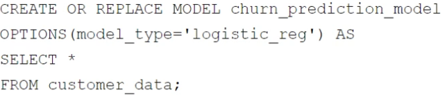
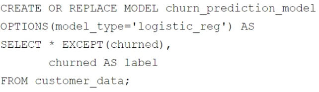
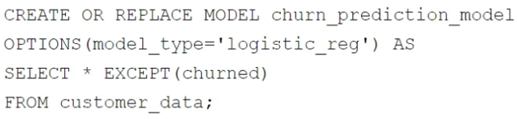
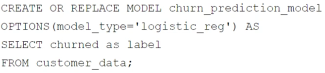
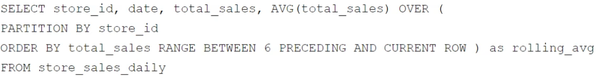
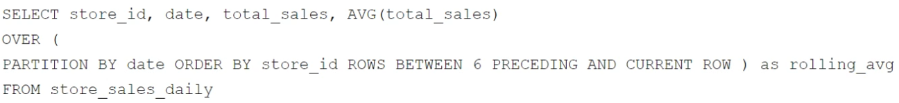
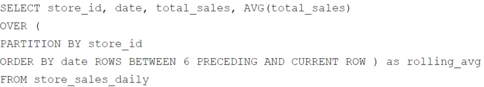
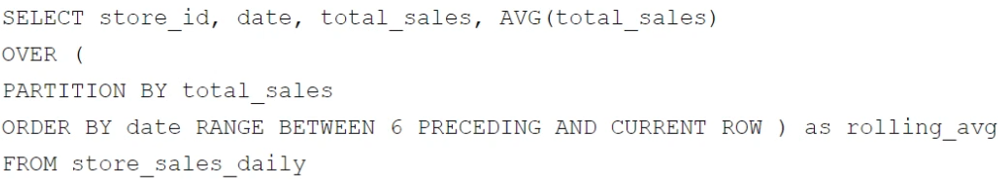

# associate data practitioner

5 / 103 preguntas. Cobertura completa: False.

Respuestas de la fuente; revisión técnica pendiente. Las imágenes permanecen en sus campos de origen.

<a id="topics-653"></a>
## Contexto topics:653
name:
Topic 1


## Pregunta 1

Contexto: [topics:653](#topics-653)
Your retail company wants to predict customer churn using historical purchase data stored in BigQuery. The dataset includes customer demographics, purchase history, and a label indicating whether the customer churned or not. You want to build a machine learning model to identify customers at risk of churning. You need to create and train a logistic regression model for predicting customer churn, using the customer_data table with the churned column as the target label. Which BigQuery ML query should you use?

**A.** [Imagen: sin descripción]
-------------------------
Imagen · choices[0].text · sin descripción

OCR: automatic_unverified · Revisión visual pendiente.
```text
CREATE OR REPLACE MODEL churn_prediction_model
OPTIONS (model_type='logistic_reg') AS
SELECT *
FROM customer data;
```

**B.** [Imagen: sin descripción]
-------------------------
Imagen · choices[1].text · sin descripción

OCR: automatic_unverified · Revisión visual pendiente.
```text
CREATE OR REPLACE MODEL churn_prediction_model
OPTIONS (model_type='logistic_reg') AS
SELECT * EXCEPT (churned),
churned AS label
FROM customer_data;
```

**C.** [Imagen: sin descripción]
-------------------------
Imagen · choices[2].text · sin descripción

OCR: automatic_unverified · Revisión visual pendiente.
```text
CREATE OR REPLACE MODEL churn_prediction_model
OPTIONS (model_type='logistic_reg') AS
SELECT * EXCEPT (churned)
FROM customer_data;
```

**D.** [Imagen: sin descripción]
-------------------------
Imagen · choices[3].text · sin descripción

OCR: automatic_unverified · Revisión visual pendiente.
```text
CREATE OR REPLACE MODEL churn_prediction_model
OPTIONS (model_type='logistic_reg') AS
SELECT churned as label
FROM customer_data;
```

**Respuesta de la fuente:** B

**Explicación:** BigQuery ML requires the query to select all feature columns and explicitly define the target variable using the 'AS label' alias. Option B correctly uses SELECT * EXCEPT(churned) to include only predictor variables and aliases the churned column as label, satisfying both requirements.

Option A fails because it includes the target in the features without aliasing it as label. Option C fails because it excludes the target entirely, preventing supervised learning. Option D fails because it omits all feature columns needed for prediction.

## Pregunta 2

Contexto: [topics:653](#topics-653)
Your company has several retail locations. Your company tracks the total number of sales made at each location each day. You want to use SQL to calculate the weekly moving average of sales by location to identify trends for each store. Which query should you use?

**A.** [Imagen: sin descripción]
-------------------------
Imagen · choices[0].text · sin descripción

OCR: automatic_unverified · Revisión visual pendiente.
```text
SELECT store_id, date, total_sales, AVG(total_sales) OVER (
PARTITION BY store_id
ORDER BY total_sales RANGE BETWEEN 6 PRECEDING AND CURRENT ROW ) as rolling_avg
FROM store sales daily
```

**B.** [Imagen: sin descripción]
-------------------------
Imagen · choices[1].text · sin descripción

OCR: automatic_unverified · Revisión visual pendiente.
```text
SELECT store id, date, total_sales, AVG(total_sales)
OVER (
PARTITION BY date ORDER BY store_id ROWS BETWEEN 6 PRECEDING AND CURRENT ROW ) as rolling avg
FROM store sales daily
```

**C.** [Imagen: sin descripción]
-------------------------
Imagen · choices[2].text · sin descripción

OCR: automatic_unverified · Revisión visual pendiente.
```text
SELECT store_id, date, total_sales, AVG(total_sales)
OVER (
PARTITION BY store_id
ORDER BY date ROWS BETWEEN 6 PRECEDING AND CURRENT ROW ) as rolling_avg
FROM store sales daily
```

**D.** [Imagen: sin descripción]
-------------------------
Imagen · choices[3].text · sin descripción

OCR: automatic_unverified · Revisión visual pendiente.
```text
SELECT store id, date, total_sales, AVG(total_sales)
OVER (
PARTITION BY total sales
ORDER BY date RANGE BETWEEN 6 PRECEDING AND CURRENT ROW ) as rolling_avg
FROM store sales daily
```

**Respuesta de la fuente:** C

**Explicación:** Option C is correct because it uses PARTITION BY store_id to isolate calculations per location and ORDER BY date to establish the chronological sequence for the moving average. The window clause ROWS BETWEEN 6 PRECEDING AND CURRENT ROW correctly defines a 7-day period (including the current day) for calculating the weekly trend.
Option A is incorrect because ordering by total_sales rather than date results in an illogical calculation based on sales magnitude rather than time. Option B partitions by date, which aggregates across all stores instead of isolating trends per location.

## Pregunta 3

Contexto: [topics:653](#topics-653)
Your company is building a near real-time streaming pipeline to process JSON telemetry data from small appliances. You need to process messages arriving at a Pub/Sub topic, capitalize letters in the serial number field, and write results to BigQuery. You want to use a managed service and write a minimal amount of code for underlying transformations. What should you do?

**A.** Use a Pub/Sub to BigQuery subscription, write results directly to BigQuery, and schedule a transformation query to run every five minutes.

**B.** Use a Pub/Sub to Cloud Storage subscription, write a Cloud Run service that is triggered when objects arrive in the bucket, performs the transformations, and writes the results to BigQuery.

**C.** Use the “Pub/Sub to BigQuery” Dataflow template with a UDF, and write the results to BigQuery.

**D.** Use a Pub/Sub push subscription, write a Cloud Run service that accepts the messages, performs the transformations, and writes the results to BigQuery.

**Respuesta de la fuente:** C

**Explicación:** Option C is the best choice because Dataflow is a fully managed service designed specifically for streaming data pipelines, and using its built-in Pub/Sub to BigQuery template with a User-Defined Function (UDF) allows for real-time transformation with minimal custom code. Option A is incorrect because scheduled queries introduce latency that violates the 'near real-time' requirement, while Options B and D involve managing Cloud Run services which requires significantly more boilerplate code for connection handling and error management compared to a simple Dataflow UDF.

## Pregunta 4

Contexto: [topics:653](#topics-653)
You want to process and load a daily sales CSV file stored in Cloud Storage into BigQuery for downstream reporting. You need to quickly build a scalable data pipeline that transforms the data while providing insights into data quality issues. What should you do?

**A.** Create a batch pipeline in Cloud Data Fusion by using a Cloud Storage source and a BigQuery sink.

**B.** Load the CSV file as a table in BigQuery, and use scheduled queries to run SQL transformation scripts.

**C.** Load the CSV file as a table in BigQuery. Create a batch pipeline in Cloud Data Fusion by using a BigQuery source and sink.

**D.** Create a batch pipeline in Dataflow by using the Cloud Storage CSV file to BigQuery batch template.

**Respuesta de la fuente:** A

**Explicación:** Cloud Data Fusion is a low-code/no-code service that allows for the rapid visual construction of scalable data pipelines. It natively provides features for handling transformations and offers built-in data quality monitoring and lineage tracking, directly addressing the requirement for insights into data quality issues.

## Pregunta 5

Contexto: [topics:653](#topics-653)
You manage a Cloud Storage bucket that stores temporary files created during data processing. These temporary files are only needed for seven days, after which they are no longer needed. To reduce storage costs and keep your bucket organized, you want to automatically delete these files once they are older than seven days. What should you do?

**A.** Set up a Cloud Scheduler job that invokes a weekly Cloud Run function to delete files older than seven days.

**B.** Configure a Cloud Storage lifecycle rule that automatically deletes objects older than seven days.

**C.** Develop a batch process using Dataflow that runs weekly and deletes files based on their age.

**D.** Create a Cloud Run function that runs daily and deletes files older than seven days.

**Respuesta de la fuente:** B

**Explicación:** Option B is the correct choice because Cloud Storage lifecycle management is a native, serverless feature designed specifically to automate object deletion based on age or other criteria without incurring additional compute costs. Options A, C, and D rely on external services like Cloud Run, Dataflow, or Cloud Scheduler, which introduce unnecessary complexity, higher operational overhead, and additional expenses for simple retention tasks.