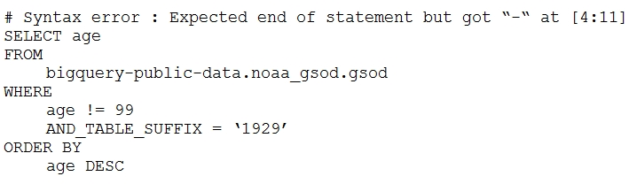
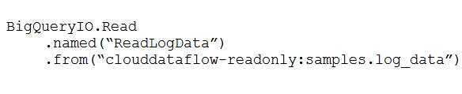
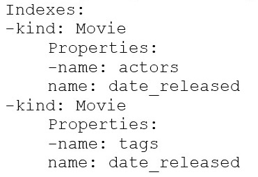
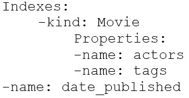
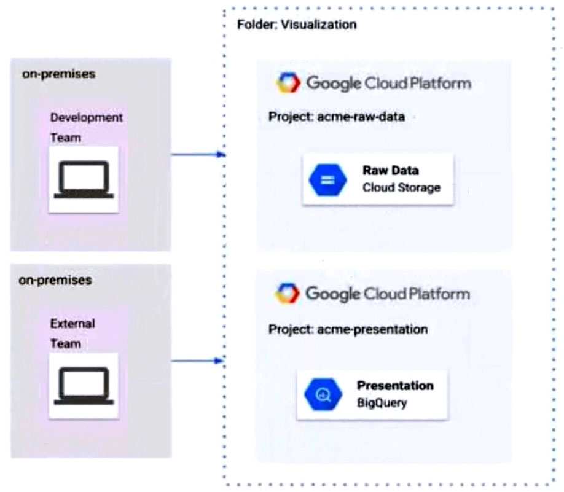
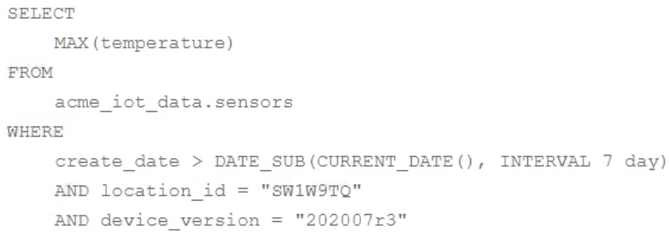
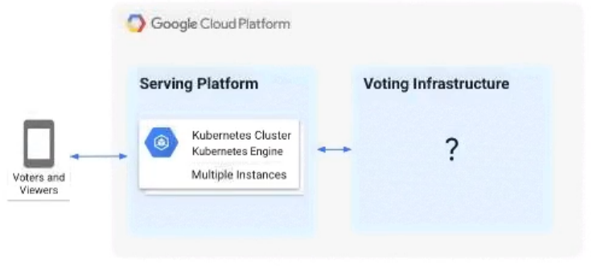
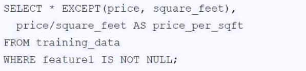
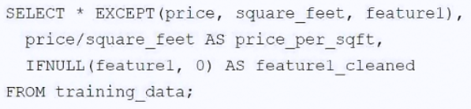
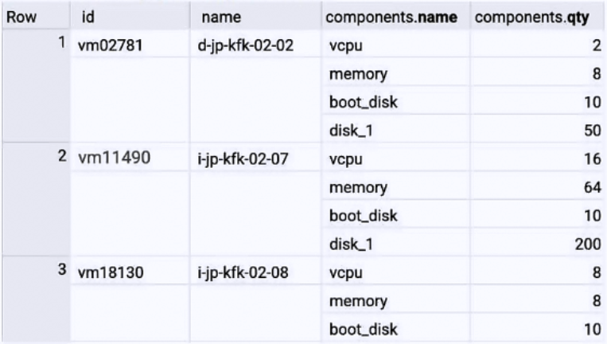

# professional data engineer

349 / 349 preguntas. Cobertura completa: True.

Respuestas de la fuente; revisión técnica pendiente. Las imágenes permanecen en sus campos de origen.

349 respuestas conservadas; 0 pendientes.

<a id="topics-105"></a>
## Contexto topics:105
name:
Topic 1


## Pregunta 1

Contexto: [topics:105](#topics-105)
Your company built a TensorFlow neutral-network model with a large number of neurons and layers. The model fits well for the training data. However, when tested against new data, it performs poorly. What method can you employ to address this?

**A.** Threading

**B.** Serialization

**C.** Dropout Methods

**D.** Dimensionality Reduction

**Respuesta de la fuente:** C

**Explicación:** The symptoms described—strong performance on training data but poor performance on new data—are the definition of overfitting. Dropout is a regularization technique that prevents overfitting by randomly disabling neurons during training, forcing the network to learn more robust features and improving generalization. Threading addresses computational speed, serialization handles model persistence, and dimensionality reduction modifies input features, none of which directly solve the structural overfitting issue caused by excessive model complexity.

## Pregunta 2

Contexto: [topics:105](#topics-105)
You are building a model to make clothing recommendations. You know a user's fashion preference is likely to change over time, so you build a data pipeline to stream new data back to the model as it becomes available. How should you use this data to train the model?

**A.** Continuously retrain the model on just the new data.

**B.** Continuously retrain the model on a combination of existing data and the new data.

**C.** Train on the existing data while using the new data as your test set.

**D.** Train on the new data while using the existing data as your test set.

**Respuesta de la fuente:** B

**Explicación:** Option B is correct because retraining on a combination of historical and new data allows the model to adapt to shifting user preferences without suffering from catastrophic forgetting of previously learned patterns. Training solely on new data (Option A) risks losing generalization capability, while using one dataset exclusively for training or testing (Options C and D) violates proper validation protocols and leads to biased performance metrics.

## Pregunta 3

Contexto: [topics:105](#topics-105)
You designed a database for patient records as a pilot project to cover a few hundred patients in three clinics. Your design used a single database table to represent all patients and their visits, and you used self-joins to generate reports. The server resource utilization was at 50%. Since then, the scope of the project has expanded. The database must now store 100 times more patient records. You can no longer run the reports, because they either take too long or they encounter errors with insufficient compute resources. How should you adjust the database design?

**A.** Add capacity (memory and disk space) to the database server by the order of 200.

**B.** Shard the tables into smaller ones based on date ranges, and only generate reports with prespecified date ranges.

**C.** Normalize the master patient-record table into the patient table and the visits table, and create other necessary tables to avoid self-join.

**D.** Partition the table into smaller tables, with one for each clinic. Run queries against the smaller table pairs, and use unions for consolidated reports.

**Respuesta de la fuente:** C

**Explicación:** The current design suffers from poor scalability due to a single table handling both patients and visits with inefficient self-joins. Normalizing the schema into separate tables for patients and visits eliminates data redundancy and removes the performance bottleneck of self-joins, allowing the database to handle the increased volume efficiently. Adding hardware (Option A) does not fix design flaws, while sharding or partitioning by date or clinic (Options B and D) adds unnecessary complexity without addressing the fundamental structural issue.

## Pregunta 4

Contexto: [topics:105](#topics-105)
You create an important report for your large team in Google Data Studio 360. The report uses Google BigQuery as its data source. You notice that visualizations are not showing data that is less than 1 hour old. What should you do?

**A.** Disable caching by editing the report settings.

**B.** Disable caching in BigQuery by editing table details.

**C.** Refresh your browser tab showing the visualizations.

**D.** Clear your browser history for the past hour then reload the tab showing the virtualizations.

**Respuesta de la fuente:** A

**Explicación:** Google Data Studio (Looker Studio) caches data from BigQuery for up to one hour by default to reduce query load and improve performance. To ensure visualizations reflect data less than an hour old, you must disable this caching mechanism in the report settings. This forces the connector to execute a fresh query against BigQuery each time the report loads or is refreshed.

## Pregunta 5

Contexto: [topics:105](#topics-105)
An external customer provides you with a daily dump of data from their database. The data flows into Google Cloud Storage GCS as comma-separated values
(CSV) files. You want to analyze this data in Google BigQuery, but the data could have rows that are formatted incorrectly or corrupted. How should you build this pipeline?

**A.** Use federated data sources, and check data in the SQL query.

**B.** Enable BigQuery monitoring in Google Stackdriver and create an alert.

**C.** Import the data into BigQuery using the gcloud CLI and set max_bad_records to 0.

**D.** Run a Google Cloud Dataflow batch pipeline to import the data into BigQuery, and push errors to another dead-letter table for analysis.

**Respuesta de la fuente:** D

**Explicación:** Option D is correct because Dataflow provides a robust ETL framework capable of validating records during ingestion. By routing malformed rows to a dead-letter table, the pipeline ensures that only clean data enters BigQuery for analysis while preserving error details for debugging. Options A and C fail to handle corruption gracefully (A lacks cleaning logic, C rejects bad records entirely), and Option B is purely for monitoring, not data processing.

## Pregunta 6

Contexto: [topics:105](#topics-105)
Your weather app queries a database every 15 minutes to get the current temperature. The frontend is powered by Google App Engine and server millions of users. How should you design the frontend to respond to a database failure?

**A.** Issue a command to restart the database servers.

**B.** Retry the query with exponential backoff, up to a cap of 15 minutes.

**C.** Retry the query every second until it comes back online to minimize staleness of data.

**D.** Reduce the query frequency to once every hour until the database comes back online.

**Respuesta de la fuente:** B

**Explicación:** Option B is correct because truncated exponential backoff is the standard best practice for handling transient database failures in Google App Engine applications. This strategy prevents overwhelming an unresponsive database with excessive connection attempts while ensuring eventual recovery without indefinite blocking.

In contrast, Option C creates a thundering herd problem that can prevent recovery, Option D provides data too stale for a weather app, and Option A is an operational task outside the scope of frontend logic.

## Pregunta 7

Contexto: [topics:105](#topics-105)
You are creating a model to predict housing prices. Due to budget constraints, you must run it on a single resource-constrained virtual machine. Which learning algorithm should you use?

**A.** Linear regression

**B.** Logistic classification

**C.** Recurrent neural network

**D.** Feedforward neural network

**Respuesta de la fuente:** A

**Explicación:** The task involves predicting housing prices, which is a regression problem requiring an algorithm for continuous numerical output, eliminating logistic classification. Among the remaining options, linear regression is computationally lightweight and efficient, making it ideal for resource-constrained environments. Neural networks (RNN and Feedforward) are significantly more complex and computationally expensive, often requiring specialized hardware like GPUs that exceed the constraints of a single virtual machine.

## Pregunta 8

Contexto: [topics:105](#topics-105)
You are building new real-time data warehouse for your company and will use Google BigQuery streaming inserts. There is no guarantee that data will only be sent in once but you do have a unique ID for each row of data and an event timestamp. You want to ensure that duplicates are not included while interactively querying data. Which query type should you use?

**A.** Include ORDER BY DESK on timestamp column and LIMIT to 1.

**B.** Use GROUP BY on the unique ID column and timestamp column and SUM on the values.

**C.** Use the LAG window function with PARTITION by unique ID along with WHERE LAG IS NOT NULL.

**D.** Use the ROW_NUMBER window function with PARTITION by unique ID along with WHERE row equals 1.

**Respuesta de la fuente:** D

**Explicación:** To handle duplicates from BigQuery streaming inserts, you must deduplicate rows based on the unique ID.
The ROW_NUMBER() window function assigned over PARTITION BY unique ID allows you to rank duplicate rows and filter for only the first occurrence (WHERE row = 1).
This ensures exactly one row per unique ID is returned, whereas GROUP BY aggregates data rather than removing duplicates, LAG filters out unique records, and ORDER BY with LIMIT returns a single row globally.

## Pregunta 9

Contexto: [topics:105](#topics-105)
Your company is using WILDCARD tables to query data across multiple tables with similar names. The SQL statement is currently failing with the following error:
[Imagen: sin descripción]
Which table name will make the SQL statement work correctly?
Imagen · question_text · sin descripción

OCR: automatic_unverified · Revisión visual pendiente.
```text
# Syntax error : Expected end of statement but got “-“ at [4:11]
SELECT age
FROM
bigquery-public-data.noaa_gsod.gsod
WHERE
age != 99
AND_TABLE_SUFFIX = ‘1929/
ORDER BY
age DESC
```

**A.** 'bigquery-public-data.noaa_gsod.gsod'

**B.** bigquery-public-data.noaa_gsod.gsod*

**C.** 'bigquery-public-data.noaa_gsod.gsod'*

**D.** 'bigquery-public-data.noaa_gsod.gsod*`

**Respuesta de la fuente:** D

**Explicación:** In BigQuery, wildcard table references (e.g., `gsod*`) must be enclosed in backticks to prevent syntax errors caused by the special `*` character.
Option D is the correct choice because it properly uses backticks around the entire dataset.table_id with the asterisk included inside.

## Pregunta 10

Contexto: [topics:105](#topics-105)
Your company is in a highly regulated industry. One of your requirements is to ensure individual users have access only to the minimum amount of information required to do their jobs. You want to enforce this requirement with Google BigQuery. Which three approaches can you take? (Choose three.)

**A.** Disable writes to certain tables.

**B.** Restrict access to tables by role.

**C.** Ensure that the data is encrypted at all times.

**D.** Restrict BigQuery API access to approved users.

**E.** Segregate data across multiple tables or databases.

**F.** Use Google Stackdriver Audit Logging to determine policy violations.

**Respuesta de la fuente:** B, D, E

**Explicación:** To enforce the principle of least privilege in BigQuery, you must actively restrict access and structure data for granular control.
Restricting access to tables by role (B) ensures users only have permissions necessary for their specific job functions.
Segregating data across multiple tables or datasets (E) allows for finer-grained access controls, preventing users from seeing unrelated sensitive information.
Restricting BigQuery API access to approved users (D) limits the pool of individuals who can query data at all.
Options A, C, and F are incorrect because read-only status still implies access beyond minimum needs, encryption is a default transparency measure not an access control, and audit logging detects rather than prevents unauthorized access.

## Pregunta 11

Contexto: [topics:105](#topics-105)
You are designing a basket abandonment system for an ecommerce company. The system will send a message to a user based on these rules:
✑ No interaction by the user on the site for 1 hour
Has added more than $30 worth of products to the basket
[Imagen: sin descripción]
✑ Has not completed a transaction
You use Google Cloud Dataflow to process the data and decide if a message should be sent. How should you design the pipeline?
Imagen · question_text · sin descripción

OCR: no_text_detected_unverified · Revisión visual pendiente.

**A.** Use a fixed-time window with a duration of 60 minutes.

**B.** Use a sliding time window with a duration of 60 minutes.

**C.** Use a session window with a gap time duration of 60 minutes.

**D.** Use a global window with a time based trigger with a delay of 60 minutes.

**Respuesta de la fuente:** C

**Explicación:** Session windows are the correct choice because they dynamically group events into sessions based on periods of activity and inactivity. By setting a gap duration of 60 minutes, the system effectively identifies users who have stopped interacting for one hour, allowing you to evaluate their basket state at that precise moment. Fixed or sliding windows would impose rigid time boundaries unrelated to user behavior, while global windows lack the built-in session isolation needed here.

## Pregunta 12

Contexto: [topics:105](#topics-105)
Your company handles data processing for a number of different clients. Each client prefers to use their own suite of analytics tools, with some allowing direct query access via Google BigQuery. You need to secure the data so that clients cannot see each other's data. You want to ensure appropriate access to the data.
Which three steps should you take? (Choose three.)

**A.** Load data into different partitions.

**B.** Load data into a different dataset for each client.

**C.** Put each client's BigQuery dataset into a different table.

**D.** Restrict a client's dataset to approved users.

**E.** Only allow a service account to access the datasets.

**F.** Use the appropriate identity and access management (IAM) roles for each client's users.

**Respuesta de la fuente:** B, D, F

**Explicación:** To ensure client data isolation in BigQuery, you should load each client's data into a separate dataset (B), as datasets are the primary units for access control. You must then restrict access to these datasets by assigning only approved users or groups (D). Finally, applying specific IAM roles (F) allows you to define granular permissions for those users, ensuring they can only access their own client's data and not others.

## Pregunta 13

Contexto: [topics:105](#topics-105)
You want to process payment transactions in a point-of-sale application that will run on Google Cloud Platform. Your user base could grow exponentially, but you do not want to manage infrastructure scaling.
Which Google database service should you use?

**A.** Cloud SQL

**B.** BigQuery

**C.** Cloud Bigtable

**D.** Cloud Datastore

**Respuesta de la fuente:** D

**Explicación:** The requirement to avoid managing infrastructure scaling points to a fully managed, serverless database that scales automatically.
Cloud SQL requires manual configuration for CPU and memory scaling (vertical scaling), whereas Cloud Datastore (Firestore in Datastore mode) handles scaling transparently.
Additionally, Google explicitly lists financial transactions as a use case for Cloud Datastore due to its ACID transaction support, making it the superior choice for this specific workload.

## Pregunta 14

Contexto: [topics:105](#topics-105)
You want to use a database of information about tissue samples to classify future tissue samples as either normal or mutated. You are evaluating an unsupervised anomaly detection method for classifying the tissue samples. Which two characteristic support this method? (Choose two.)

**A.** There are very few occurrences of mutations relative to normal samples.

**B.** There are roughly equal occurrences of both normal and mutated samples in the database.

**C.** You expect future mutations to have different features from the mutated samples in the database.

**D.** You expect future mutations to have similar features to the mutated samples in the database.

**E.** You already have labels for which samples are mutated and which are normal in the database.

**Respuesta de la fuente:** A, C

**Explicación:** Unsupervised anomaly detection relies on the assumption that anomalies are rare events, making option A correct as it reflects the class imbalance typical in such datasets.
Option C is also correct because unsupervised methods model the distribution of normal data; they detect any significant deviation from this norm, regardless of whether future mutations resemble past specific mutation patterns or exhibit novel features.

## Pregunta 15

Contexto: [topics:105](#topics-105)
You need to store and analyze social media postings in Google BigQuery at a rate of 10,000 messages per minute in near real-time. Initially, design the application to use streaming inserts for individual postings. Your application also performs data aggregations right after the streaming inserts. You discover that the queries after streaming inserts do not exhibit strong consistency, and reports from the queries might miss in-flight data. How can you adjust your application design?

**A.** Re-write the application to load accumulated data every 2 minutes.

**B.** Convert the streaming insert code to batch load for individual messages.

**C.** Load the original message to Google Cloud SQL, and export the table every hour to BigQuery via streaming inserts.

**D.** Estimate the average latency for data availability after streaming inserts, and always run queries after waiting twice as long.

**Respuesta de la fuente:** D

**Explicación:** BigQuery streaming inserts provide eventual consistency, meaning data may not be immediately available for querying due to internal buffering.
Option D is the correct answer in the context of this exam question because it suggests adjusting the application logic to wait for a period longer than the estimated latency (e.g., twice the average) before running queries, ensuring the data has been flushed and is visible.
This approach acknowledges the inherent delay of streaming inserts without switching to batch loads or external databases, which would violate the near real-time requirement.

## Pregunta 16

Contexto: [topics:105](#topics-105)
Your startup has never implemented a formal security policy. Currently, everyone in the company has access to the datasets stored in Google BigQuery. Teams have freedom to use the service as they see fit, and they have not documented their use cases. You have been asked to secure the data warehouse. You need to discover what everyone is doing. What should you do first?

**A.** Use Google Stackdriver Audit Logs to review data access.

**B.** Get the identity and access management IIAM) policy of each table

**C.** Use Stackdriver Monitoring to see the usage of BigQuery query slots.

**D.** Use the Google Cloud Billing API to see what account the warehouse is being billed to.

**Respuesta de la fuente:** A

**Explicación:** To discover what users are actually doing with the data, you must review access patterns and query history, which is provided by Google Cloud Audit Logs (formerly Stackdriver).
Audit logs record specific user actions, such as who accessed which datasets and tables, providing the necessary visibility to establish a baseline before implementing restrictions.
Options B, C, and D provide static permissions, computational resource usage, or billing data, none of which reveal actual user behavior or data access history.

## Pregunta 17

Contexto: [topics:105](#topics-105)
Your company is migrating their 30-node Apache Hadoop cluster to the cloud. They want to re-use Hadoop jobs they have already created and minimize the management of the cluster as much as possible. They also want to be able to persist data beyond the life of the cluster. What should you do?

**A.** Create a Google Cloud Dataflow job to process the data.

**B.** Create a Google Cloud Dataproc cluster that uses persistent disks for HDFS.

**C.** Create a Hadoop cluster on Google Compute Engine that uses persistent disks.

**D.** Create a Cloud Dataproc cluster that uses the Google Cloud Storage connector.

**E.** Create a Hadoop cluster on Google Compute Engine that uses Local SSD disks.

**Respuesta de la fuente:** D

**Explicación:** Cloud Dataproc is the managed service designed to run existing Hadoop and Spark jobs with minimal cluster management overhead. By using the Google Cloud Storage connector instead of local HDFS, data persists in Cloud Storage independently of the cluster's lifecycle, satisfying the requirement for long-term data retention.
Option A (Dataflow) requires rewriting jobs, while Options C and E involve self-managed Compute Engine instances.

## Pregunta 18

Contexto: [topics:105](#topics-105)
Business owners at your company have given you a database of bank transactions. Each row contains the user ID, transaction type, transaction location, and transaction amount. They ask you to investigate what type of machine learning can be applied to the data. Which three machine learning applications can you use? (Choose three.)

**A.** Supervised learning to determine which transactions are most likely to be fraudulent.

**B.** Unsupervised learning to determine which transactions are most likely to be fraudulent.

**C.** Clustering to divide the transactions into N categories based on feature similarity.

**D.** Supervised learning to predict the location of a transaction.

**E.** Reinforcement learning to predict the location of a transaction.

**F.** Unsupervised learning to predict the location of a transaction.

**Respuesta de la fuente:** B, C, D

**Explicación:** Unsupervised learning is suitable for fraud detection (B) when historical data lacks explicit labels for fraudulent transactions, allowing the model to identify anomalies or outliers.
Clustering (C) is an unsupervised technique that groups transactions based on feature similarity, such as amount and location patterns, without predefined categories.
Supervised learning can predict transaction locations (D) because the dataset contains labeled historical data linking user IDs and transaction types to specific geographic outcomes.

## Pregunta 19

Contexto: [topics:105](#topics-105)
Your company's on-premises Apache Hadoop servers are approaching end-of-life, and IT has decided to migrate the cluster to Google Cloud Dataproc. A like-for- like migration of the cluster would require 50 TB of Google Persistent Disk per node. The CIO is concerned about the cost of using that much block storage. You want to minimize the storage cost of the migration. What should you do?

**A.** Put the data into Google Cloud Storage.

**B.** Use preemptible virtual machines (VMs) for the Cloud Dataproc cluster.

**C.** Tune the Cloud Dataproc cluster so that there is just enough disk for all data.

**D.** Migrate some of the cold data into Google Cloud Storage, and keep only the hot data in Persistent Disk.

**Respuesta de la fuente:** A

**Explicación:** Google Cloud Dataproc is designed to use Google Cloud Storage (GCS) for primary data storage, which eliminates the need for expensive local Persistent Disks on every node. GCS offers significantly lower costs per TB compared to block storage and scales automatically without manual provisioning. Using preemptible VMs (Option B) reduces compute costs but does not address the high cost of the required 50 TB of storage per node.

## Pregunta 20

Contexto: [topics:105](#topics-105)
You work for a car manufacturer and have set up a data pipeline using Google Cloud Pub/Sub to capture anomalous sensor events. You are using a push subscription in Cloud Pub/Sub that calls a custom HTTPS endpoint that you have created to take action of these anomalous events as they occur. Your custom
HTTPS endpoint keeps getting an inordinate amount of duplicate messages. What is the most likely cause of these duplicate messages?

**A.** The message body for the sensor event is too large.

**B.** Your custom endpoint has an out-of-date SSL certificate.

**C.** The Cloud Pub/Sub topic has too many messages published to it.

**D.** Your custom endpoint is not acknowledging messages within the acknowledgement deadline.

**Respuesta de la fuente:** D

**Explicación:** Google Cloud Pub/Sub guarantees at-least-once delivery and redelivers messages if the push endpoint fails to send a valid HTTP 200 response within the acknowledgement deadline.
If the custom endpoint does not acknowledge messages in time, Pub/Sub treats them as unprocessed and retries delivery, resulting in duplicates.

## Pregunta 21

Contexto: [topics:105](#topics-105)
Your company uses a proprietary system to send inventory data every 6 hours to a data ingestion service in the cloud. Transmitted data includes a payload of several fields and the timestamp of the transmission. If there are any concerns about a transmission, the system re-transmits the data. How should you deduplicate the data most efficiency?

**A.** Assign global unique identifiers (GUID) to each data entry.

**B.** Compute the hash value of each data entry, and compare it with all historical data.

**C.** Store each data entry as the primary key in a separate database and apply an index.

**D.** Maintain a database table to store the hash value and other metadata for each data entry.

**Respuesta de la fuente:** A

**Explicación:** Assigning a global unique identifier (GUID) to each data entry is the most efficient method because it allows for constant-time duplicate detection using indexed lookups or database constraints.
Hash-based approaches (Options B and D) are inefficient or unreliable here because including the transmission timestamp in the hash creates unique values for retries, while excluding it risks collision between distinct inventory states at different times.

## Pregunta 22

Contexto: [topics:105](#topics-105)
Your company has hired a new data scientist who wants to perform complicated analyses across very large datasets stored in Google Cloud Storage and in a
Cassandra cluster on Google Compute Engine. The scientist primarily wants to create labelled data sets for machine learning projects, along with some visualization tasks. She reports that her laptop is not powerful enough to perform her tasks and it is slowing her down. You want to help her perform her tasks.
What should you do?

**A.** Run a local version of Jupiter on the laptop.

**B.** Grant the user access to Google Cloud Shell.

**C.** Host a visualization tool on a VM on Google Compute Engine.

**D.** Deploy Google Cloud Datalab to a virtual machine (VM) on Google Compute Engine.

**Respuesta de la fuente:** D

**Explicación:** Google Cloud Datalab (the predecessor to Vertex AI Workbench) is specifically designed as an interactive data analysis environment that runs within a Compute Engine VM, providing high-performance resources for large datasets. This addresses the laptop's performance limitations and provides the necessary interface for creating labeled datasets and visualizations using tools like Jupyter notebooks. Other options are insufficient: local execution cannot handle the volume, Cloud Shell lacks persistent high-power compute capabilities for complex ML tasks, and a generic visualization tool does not support the full data labeling workflow.

## Pregunta 23

Contexto: [topics:105](#topics-105)
You are deploying 10,000 new Internet of Things devices to collect temperature data in your warehouses globally. You need to process, store and analyze these very large datasets in real time. What should you do?

**A.** Send the data to Google Cloud Datastore and then export to BigQuery.

**B.** Send the data to Google Cloud Pub/Sub, stream Cloud Pub/Sub to Google Cloud Dataflow, and store the data in Google BigQuery.

**C.** Send the data to Cloud Storage and then spin up an Apache Hadoop cluster as needed in Google Cloud Dataproc whenever analysis is required.

**D.** Export logs in batch to Google Cloud Storage and then spin up a Google Cloud SQL instance, import the data from Cloud Storage, and run an analysis as needed.

**Respuesta de la fuente:** B

**Explicación:** Option B is the correct answer because it utilizes a streaming architecture designed for real-time processing of large datasets. Cloud Pub/Sub ingests high-volume IoT data, Cloud Dataflow processes the stream in real time, and BigQuery stores and analyzes the results efficiently.

Options A, C, and D rely on batch processing or less suitable storage mechanisms (Datastore, Hadoop/Dataproc on-demand, Cloud SQL) that do not meet the requirement for real-time analysis of very large datasets.

## Pregunta 24

Contexto: [topics:105](#topics-105)
You have spent a few days loading data from comma-separated values (CSV) files into the Google BigQuery table CLICK_STREAM. The column DT stores the epoch time of click events. For convenience, you chose a simple schema where every field is treated as the STRING type. Now, you want to compute web session durations of users who visit your site, and you want to change its data type to the TIMESTAMP. You want to minimize the migration effort without making future queries computationally expensive. What should you do?

**A.** Delete the table CLICK_STREAM, and then re-create it such that the column DT is of the TIMESTAMP type. Reload the data.

**B.** Add a column TS of the TIMESTAMP type to the table CLICK_STREAM, and populate the numeric values from the column TS for each row. Reference the column TS instead of the column DT from now on.

**C.** Create a view CLICK_STREAM_V, where strings from the column DT are cast into TIMESTAMP values. Reference the view CLICK_STREAM_V instead of the table CLICK_STREAM from now on.

**D.** Add two columns to the table CLICK STREAM: TS of the TIMESTAMP type and IS_NEW of the BOOLEAN type. Reload all data in append mode. For each appended row, set the value of IS_NEW to true. For future queries, reference the column TS instead of the column DT, with the WHERE clause ensuring that the value of IS_NEW must be true.

**E.** Construct a query to return every row of the table CLICK_STREAM, while using the built-in function to cast strings from the column DT into TIMESTAMP values. Run the query into a destination table NEW_CLICK_STREAM, in which the column TS is the TIMESTAMP type. Reference the table NEW_CLICK_STREAM instead of the table CLICK_STREAM from now on. In the future, new data is loaded into the table NEW_CLICK_STREAM.

**Respuesta de la fuente:** E

**Explicación:** Option E is the correct choice because it creates a new table with the proper TIMESTAMP data type by casting the string values during the load process, ensuring future queries do not incur computational overhead from runtime casting. Using a view (Option C) would require casting the strings to timestamps every time the view is queried, making future computations expensive as specified in the prompt requirements.

## Pregunta 25

Contexto: [topics:105](#topics-105)
You want to use Google Stackdriver Logging to monitor Google BigQuery usage. You need an instant notification to be sent to your monitoring tool when new data is appended to a certain table using an insert job, but you do not want to receive notifications for other tables. What should you do?

**A.** Make a call to the Stackdriver API to list all logs, and apply an advanced filter.

**B.** In the Stackdriver logging admin interface, and enable a log sink export to BigQuery.

**C.** In the Stackdriver logging admin interface, enable a log sink export to Google Cloud Pub/Sub, and subscribe to the topic from your monitoring tool.

**D.** Using the Stackdriver API, create a project sink with advanced log filter to export to Pub/Sub, and subscribe to the topic from your monitoring tool.

**Respuesta de la fuente:** D

**Explicación:** Option D is correct because it creates a log sink with an advanced filter to target only the specific table's insert jobs and exports them to Cloud Pub/Sub for real-time notification.

Options A and B are incorrect as they do not provide instant notifications to an external monitoring tool; Option A relies on manual filtering, while Option B simply stores logs in BigQuery.

Option C is inferior because it lacks the necessary advanced filter, meaning it would export all logs rather than restricting notifications to the specific table.

## Pregunta 26

Contexto: [topics:105](#topics-105)
You are working on a sensitive project involving private user data. You have set up a project on Google Cloud Platform to house your work internally. An external consultant is going to assist with coding a complex transformation in a Google Cloud Dataflow pipeline for your project. How should you maintain users' privacy?

**A.** Grant the consultant the Viewer role on the project.

**B.** Grant the consultant the Cloud Dataflow Developer role on the project.

**C.** Create a service account and allow the consultant to log on with it.

**D.** Create an anonymized sample of the data for the consultant to work with in a different project.

**Respuesta de la fuente:** D

**Explicación:** The primary goal is to maintain user privacy while allowing an external consultant to develop complex transformation logic.
Granting access to the production project, even with limited roles, risks exposure of sensitive data through logs or debugging.
Creating an anonymized sample in a separate isolated project ensures the consultant can validate their code without ever seeing private user data.

## Pregunta 27

Contexto: [topics:105](#topics-105)
You are building a model to predict whether or not it will rain on a given day. You have thousands of input features and want to see if you can improve training speed by removing some features while having a minimum effect on model accuracy. What can you do?

**A.** Eliminate features that are highly correlated to the output labels.

**B.** Combine highly co-dependent features into one representative feature.

**C.** Instead of feeding in each feature individually, average their values in batches of 3.

**D.** Remove the features that have null values for more than 50% of the training records.

**Respuesta de la fuente:** B

**Explicación:** Combining highly co-dependent (correlated) features reduces multicollinearity and dataset dimensionality, which accelerates training without significant loss of predictive information.
Removing features correlated with the output (A) would degrade accuracy, as these are valuable predictors.
Averaging arbitrary batches (C) destroys feature specificity, and dropping features with >50% nulls (D) discards potentially useful signals that could be imputed.

## Pregunta 28

Contexto: [topics:105](#topics-105)
Your company is performing data preprocessing for a learning algorithm in Google Cloud Dataflow. Numerous data logs are being are being generated during this step, and the team wants to analyze them. Due to the dynamic nature of the campaign, the data is growing exponentially every hour.
The data scientists have written the following code to read the data for a new key features in the logs.
[Imagen: sin descripción]
You want to improve the performance of this data read. What should you do?
Imagen · question_text · sin descripción

OCR: automatic_unverified · Revisión visual pendiente.
```text
BigQueryI0.Read
«named (“ReadLogData”)
. from (“clouddataflow-readonly:samples.log_data”)
```

**A.** Specify the TableReference object in the code.

**B.** Use .fromQuery operation to read specific fields from the table.

**C.** Use of both the Google BigQuery TableSchema and TableFieldSchema classes.

**D.** Call a transform that returns TableRow objects, where each element in the PCollection represents a single row in the table.

**Respuesta de la fuente:** B

**Explicación:** The question requires improving performance by reading only specific key features from exponentially growing logs. Using `BigQueryIO.read().fromQuery()` allows you to define a SQL SELECT statement that retrieves only the necessary columns, reducing I/O volume and processing time compared to reading entire tables or rows.
Reference: BigQuery best practices recommend avoiding `SELECT *` to minimize data scanned.

## Pregunta 29

Contexto: [topics:105](#topics-105)
Your company is streaming real-time sensor data from their factory floor into Bigtable and they have noticed extremely poor performance. How should the row key be redesigned to improve Bigtable performance on queries that populate real-time dashboards?

**A.** Use a row key of the form <timestamp>.

**B.** Use a row key of the form <sensorid>.

**C.** Use a row key of the form <timestamp>#<sensorid>.

**D.** Use a row key of the form >#<sensorid>#<timestamp>.

**Respuesta de la fuente:** D

**Explicación:** Option D is correct because placing the sensor ID before the timestamp ensures that writes for different sensors are distributed across multiple tablets, preventing hotspotting. Starting a row key with a monotonically increasing timestamp (Options A and C) concentrates write traffic on a single node, degrading performance. Option B fails because it lacks a timestamp component, causing new readings to overwrite previous ones instead of appending them.

## Pregunta 30

Contexto: [topics:105](#topics-105)
Your company's customer and order databases are often under heavy load. This makes performing analytics against them difficult without harming operations.
The databases are in a MySQL cluster, with nightly backups taken using mysqldump. You want to perform analytics with minimal impact on operations. What should you do?

**A.** Add a node to the MySQL cluster and build an OLAP cube there.

**B.** Use an ETL tool to load the data from MySQL into Google BigQuery.

**C.** Connect an on-premises Apache Hadoop cluster to MySQL and perform ETL.

**D.** Mount the backups to Google Cloud SQL, and then process the data using Google Cloud Dataproc.

**Respuesta de la fuente:** B

**Explicación:** The goal is to perform analytics with minimal impact on the production OLTP database. Using an ETL tool to load data into Google BigQuery separates the analytical workload from the transactional system, preventing heavy analytic queries from degrading operational performance.

BigQuery is Google's managed serverless data warehouse, designed specifically for large-scale analytics, making it the optimal choice over on-premises solutions or processing tools like Dataproc that require additional compute infrastructure.

## Pregunta 31

Contexto: [topics:105](#topics-105)
You have Google Cloud Dataflow streaming pipeline running with a Google Cloud Pub/Sub subscription as the source. You need to make an update to the code that will make the new Cloud Dataflow pipeline incompatible with the current version. You do not want to lose any data when making this update. What should you do?

**A.** Update the current pipeline and use the drain flag.

**B.** Update the current pipeline and provide the transform mapping JSON object.

**C.** Create a new pipeline that has the same Cloud Pub/Sub subscription and cancel the old pipeline.

**D.** Create a new pipeline that has a new Cloud Pub/Sub subscription and cancel the old pipeline.

**Respuesta de la fuente:** A

**Explicación:** Since the new code is incompatible with the current pipeline, a direct update via transform mapping (Option B) is not possible as it requires compatibility.
Canceling the pipeline immediately (Options C and D) risks data loss for in-flight elements.
The drain flag stops new message ingestion while allowing the pipeline to finish processing all buffered and in-flight data, ensuring zero data loss during the transition.

## Pregunta 32

Contexto: [topics:105](#topics-105)
Your company is running their first dynamic campaign, serving different offers by analyzing real-time data during the holiday season. The data scientists are collecting terabytes of data that rapidly grows every hour during their 30-day campaign. They are using Google Cloud Dataflow to preprocess the data and collect the feature (signals) data that is needed for the machine learning model in Google Cloud Bigtable. The team is observing suboptimal performance with reads and writes of their initial load of 10 TB of data. They want to improve this performance while minimizing cost. What should they do?

**A.** Redefine the schema by evenly distributing reads and writes across the row space of the table.

**B.** The performance issue should be resolved over time as the site of the BigDate cluster is increased.

**C.** Redesign the schema to use a single row key to identify values that need to be updated frequently in the cluster.

**D.** Redesign the schema to use row keys based on numeric IDs that increase sequentially per user viewing the offers.

**Respuesta de la fuente:** A

**Explicación:** Cloud Bigtable is a distributed datastore that achieves optimal performance when read and write operations are evenly distributed across all nodes in the cluster.
If hotspots occur due to poor row key design, performance degrades because traffic is concentrated on a subset of nodes.
Therefore, redesigning the schema to ensure even distribution across the row space resolves the bottleneck without adding costly infrastructure.

## Pregunta 33

Contexto: [topics:105](#topics-105)
Your software uses a simple JSON format for all messages. These messages are published to Google Cloud Pub/Sub, then processed with Google Cloud
Dataflow to create a real-time dashboard for the CFO. During testing, you notice that some messages are missing in the dashboard. You check the logs, and all messages are being published to Cloud Pub/Sub successfully. What should you do next?

**A.** Check the dashboard application to see if it is not displaying correctly.

**B.** Run a fixed dataset through the Cloud Dataflow pipeline and analyze the output.

**C.** Use Google Stackdriver Monitoring on Cloud Pub/Sub to find the missing messages.

**D.** Switch Cloud Dataflow to pull messages from Cloud Pub/Sub instead of Cloud Pub/Sub pushing messages to Cloud Dataflow.

**Respuesta de la fuente:** B

**Explicación:** Since messages are confirmed published to Pub/Sub but missing in the dashboard, the issue likely lies within the Dataflow processing logic.
Running a fixed dataset (Option B) allows you to isolate and debug the pipeline's transformation or filtering rules deterministically, ensuring missing messages aren't being inadvertently dropped by code errors.
This is more effective than monitoring metrics alone, which shows volume but not data correctness.

## Pregunta 34

Contexto: [topics:105](#topics-105)
Flowlogistic Case Study -

Company Overview -
Flowlogistic is a leading logistics and supply chain provider. They help businesses throughout the world manage their resources and transport them to their final destination. The company has grown rapidly, expanding their offerings to include rail, truck, aircraft, and oceanic shipping.

Company Background -
The company started as a regional trucking company, and then expanded into other logistics market. Because they have not updated their infrastructure, managing and tracking orders and shipments has become a bottleneck. To improve operations, Flowlogistic developed proprietary technology for tracking shipments in real time at the parcel level. However, they are unable to deploy it because their technology stack, based on Apache Kafka, cannot support the processing volume. In addition, Flowlogistic wants to further analyze their orders and shipments to determine how best to deploy their resources.

Solution Concept -
Flowlogistic wants to implement two concepts using the cloud:
✑ Use their proprietary technology in a real-time inventory-tracking system that indicates the location of their loads
✑ Perform analytics on all their orders and shipment logs, which contain both structured and unstructured data, to determine how best to deploy resources, which markets to expand info. They also want to use predictive analytics to learn earlier when a shipment will be delayed.

Existing Technical Environment -
Flowlogistic architecture resides in a single data center:
✑ Databases
8 physical servers in 2 clusters
- SQL Server `" user data, inventory, static data
3 physical servers
- Cassandra `" metadata, tracking messages
10 Kafka servers `" tracking message aggregation and batch insert
✑ Application servers `" customer front end, middleware for order/customs
60 virtual machines across 20 physical servers
- Tomcat `" Java services
- Nginx `" static content
- Batch servers
✑ Storage appliances
- iSCSI for virtual machine (VM) hosts
- Fibre Channel storage area network (FC SAN) `" SQL server storage
- Network-attached storage (NAS) image storage, logs, backups
✑ 10 Apache Hadoop /Spark servers
- Core Data Lake
- Data analysis workloads
✑ 20 miscellaneous servers
- Jenkins, monitoring, bastion hosts,

Business Requirements -
Build a reliable and reproducible environment with scaled panty of production.
[Imagen: sin descripción]
✑ Aggregate data in a centralized Data Lake for analysis
✑ Use historical data to perform predictive analytics on future shipments
✑ Accurately track every shipment worldwide using proprietary technology
✑ Improve business agility and speed of innovation through rapid provisioning of new resources
✑ Analyze and optimize architecture for performance in the cloud
✑ Migrate fully to the cloud if all other requirements are met

Technical Requirements -
✑ Handle both streaming and batch data
✑ Migrate existing Hadoop workloads
✑ Ensure architecture is scalable and elastic to meet the changing demands of the company.
✑ Use managed services whenever possible
✑ Encrypt data flight and at rest
✑ Connect a VPN between the production data center and cloud environment

SEO Statement -
We have grown so quickly that our inability to upgrade our infrastructure is really hampering further growth and efficiency. We are efficient at moving shipments around the world, but we are inefficient at moving data around.
We need to organize our information so we can more easily understand where our customers are and what they are shipping.

CTO Statement -
IT has never been a priority for us, so as our data has grown, we have not invested enough in our technology. I have a good staff to manage IT, but they are so busy managing our infrastructure that I cannot get them to do the things that really matter, such as organizing our data, building the analytics, and figuring out how to implement the CFO' s tracking technology.

CFO Statement -
Part of our competitive advantage is that we penalize ourselves for late shipments and deliveries. Knowing where out shipments are at all times has a direct correlation to our bottom line and profitability. Additionally, I don't want to commit capital to building out a server environment.
Flowlogistic wants to use Google BigQuery as their primary analysis system, but they still have Apache Hadoop and Spark workloads that they cannot move to
BigQuery. Flowlogistic does not know how to store the data that is common to both workloads. What should they do?
Imagen · question_text · sin descripción

OCR: no_text_detected_unverified · Revisión visual pendiente.

**A.** Store the common data in BigQuery as partitioned tables.

**B.** Store the common data in BigQuery and expose authorized views.

**C.** Store the common data encoded as Avro in Google Cloud Storage.

**D.** Store he common data in the HDFS storage for a Google Cloud Dataproc cluster.

**Respuesta de la fuente:** C

**Explicación:** Google Cloud Storage (GCS) serves as the central data lake in Google Cloud Platform, providing a unified storage layer for both BigQuery and Dataproc (Hadoop/Spark).
Avro is an open-source serialization format that is natively supported by both systems, allowing them to read the same common data without duplication or complex connector configurations.
Storing data in BigQuery tables (A/B) creates silos for Hadoop workloads, while HDFS on Dataproc (D) is ephemeral and not suitable for long-term shared storage across different processing engines.

## Pregunta 35

Contexto: [topics:105](#topics-105)
Flowlogistic Case Study -

Company Overview -
Flowlogistic is a leading logistics and supply chain provider. They help businesses throughout the world manage their resources and transport them to their final destination. The company has grown rapidly, expanding their offerings to include rail, truck, aircraft, and oceanic shipping.

Company Background -
The company started as a regional trucking company, and then expanded into other logistics market. Because they have not updated their infrastructure, managing and tracking orders and shipments has become a bottleneck. To improve operations, Flowlogistic developed proprietary technology for tracking shipments in real time at the parcel level. However, they are unable to deploy it because their technology stack, based on Apache Kafka, cannot support the processing volume. In addition, Flowlogistic wants to further analyze their orders and shipments to determine how best to deploy their resources.

Solution Concept -
Flowlogistic wants to implement two concepts using the cloud:
✑ Use their proprietary technology in a real-time inventory-tracking system that indicates the location of their loads
✑ Perform analytics on all their orders and shipment logs, which contain both structured and unstructured data, to determine how best to deploy resources, which markets to expand info. They also want to use predictive analytics to learn earlier when a shipment will be delayed.

Existing Technical Environment -
Flowlogistic architecture resides in a single data center:
✑ Databases
8 physical servers in 2 clusters
- SQL Server `" user data, inventory, static data
3 physical servers
- Cassandra `" metadata, tracking messages
10 Kafka servers `" tracking message aggregation and batch insert
✑ Application servers `" customer front end, middleware for order/customs
60 virtual machines across 20 physical servers
- Tomcat `" Java services
- Nginx `" static content
- Batch servers
✑ Storage appliances
- iSCSI for virtual machine (VM) hosts
- Fibre Channel storage area network (FC SAN) `" SQL server storage
- Network-attached storage (NAS) image storage, logs, backups
✑ 10 Apache Hadoop /Spark servers
- Core Data Lake
- Data analysis workloads
✑ 20 miscellaneous servers
- Jenkins, monitoring, bastion hosts,

Business Requirements -
✑ Build a reliable and reproducible environment with scaled panty of production.
✑ Aggregate data in a centralized Data Lake for analysis
✑ Use historical data to perform predictive analytics on future shipments
✑ Accurately track every shipment worldwide using proprietary technology
✑ Improve business agility and speed of innovation through rapid provisioning of new resources
✑ Analyze and optimize architecture for performance in the cloud
✑ Migrate fully to the cloud if all other requirements are met

Technical Requirements -
✑ Handle both streaming and batch data
✑ Migrate existing Hadoop workloads
✑ Ensure architecture is scalable and elastic to meet the changing demands of the company.
✑ Use managed services whenever possible
✑ Encrypt data flight and at rest
✑ Connect a VPN between the production data center and cloud environment

SEO Statement -
We have grown so quickly that our inability to upgrade our infrastructure is really hampering further growth and efficiency. We are efficient at moving shipments around the world, but we are inefficient at moving data around.
We need to organize our information so we can more easily understand where our customers are and what they are shipping.

CTO Statement -
IT has never been a priority for us, so as our data has grown, we have not invested enough in our technology. I have a good staff to manage IT, but they are so busy managing our infrastructure that I cannot get them to do the things that really matter, such as organizing our data, building the analytics, and figuring out how to implement the CFO' s tracking technology.

CFO Statement -
Part of our competitive advantage is that we penalize ourselves for late shipments and deliveries. Knowing where out shipments are at all times has a direct correlation to our bottom line and profitability. Additionally, I don't want to commit capital to building out a server environment.
Flowlogistic's management has determined that the current Apache Kafka servers cannot handle the data volume for their real-time inventory tracking system.
You need to build a new system on Google Cloud Platform (GCP) that will feed the proprietary tracking software. The system must be able to ingest data from a variety of global sources, process and query in real-time, and store the data reliably. Which combination of GCP products should you choose?

**A.** Cloud Pub/Sub, Cloud Dataflow, and Cloud Storage

**B.** Cloud Pub/Sub, Cloud Dataflow, and Local SSD

**C.** Cloud Pub/Sub, Cloud SQL, and Cloud Storage

**D.** Cloud Load Balancing, Cloud Dataflow, and Cloud Storage

**Respuesta de la fuente:** A

**Explicación:** Cloud Pub/Sub is the correct ingestion service for high-volume, real-time streaming data from global sources, replacing Kafka. Cloud Dataflow provides the necessary distributed stream and batch processing capabilities to handle the real-time analytics workload. Google Cloud Storage (or BigQuery) offers scalable, reliable storage for the processed data, whereas Cloud SQL lacks the scalability for this volume and Local SSD is not a durable managed storage solution.

## Pregunta 36

Contexto: [topics:105](#topics-105)
Flowlogistic Case Study -

Company Overview -
Flowlogistic is a leading logistics and supply chain provider. They help businesses throughout the world manage their resources and transport them to their final destination. The company has grown rapidly, expanding their offerings to include rail, truck, aircraft, and oceanic shipping.

Company Background -
The company started as a regional trucking company, and then expanded into other logistics market. Because they have not updated their infrastructure, managing and tracking orders and shipments has become a bottleneck. To improve operations, Flowlogistic developed proprietary technology for tracking shipments in real time at the parcel level. However, they are unable to deploy it because their technology stack, based on Apache Kafka, cannot support the processing volume. In addition, Flowlogistic wants to further analyze their orders and shipments to determine how best to deploy their resources.

Solution Concept -
Flowlogistic wants to implement two concepts using the cloud:
Use their proprietary technology in a real-time inventory-tracking system that indicates the location of their loads
[Imagen: sin descripción]
✑ Perform analytics on all their orders and shipment logs, which contain both structured and unstructured data, to determine how best to deploy resources, which markets to expand info. They also want to use predictive analytics to learn earlier when a shipment will be delayed.

Existing Technical Environment -
Flowlogistic architecture resides in a single data center:
✑ Databases
8 physical servers in 2 clusters
- SQL Server `" user data, inventory, static data
3 physical servers
- Cassandra `" metadata, tracking messages
10 Kafka servers `" tracking message aggregation and batch insert
✑ Application servers `" customer front end, middleware for order/customs
60 virtual machines across 20 physical servers
- Tomcat `" Java services
- Nginx `" static content
- Batch servers
✑ Storage appliances
- iSCSI for virtual machine (VM) hosts
- Fibre Channel storage area network (FC SAN) `" SQL server storage
- Network-attached storage (NAS) image storage, logs, backups
✑ 10 Apache Hadoop /Spark servers
- Core Data Lake
- Data analysis workloads
✑ 20 miscellaneous servers
- Jenkins, monitoring, bastion hosts,

Business Requirements -
✑ Build a reliable and reproducible environment with scaled panty of production.
✑ Aggregate data in a centralized Data Lake for analysis
✑ Use historical data to perform predictive analytics on future shipments
✑ Accurately track every shipment worldwide using proprietary technology
✑ Improve business agility and speed of innovation through rapid provisioning of new resources
✑ Analyze and optimize architecture for performance in the cloud
✑ Migrate fully to the cloud if all other requirements are met

Technical Requirements -
Handle both streaming and batch data
[Imagen: sin descripción]
✑ Migrate existing Hadoop workloads
✑ Ensure architecture is scalable and elastic to meet the changing demands of the company.
✑ Use managed services whenever possible
✑ Encrypt data flight and at rest
✑ Connect a VPN between the production data center and cloud environment

SEO Statement -
We have grown so quickly that our inability to upgrade our infrastructure is really hampering further growth and efficiency. We are efficient at moving shipments around the world, but we are inefficient at moving data around.
We need to organize our information so we can more easily understand where our customers are and what they are shipping.

CTO Statement -
IT has never been a priority for us, so as our data has grown, we have not invested enough in our technology. I have a good staff to manage IT, but they are so busy managing our infrastructure that I cannot get them to do the things that really matter, such as organizing our data, building the analytics, and figuring out how to implement the CFO' s tracking technology.

CFO Statement -
Part of our competitive advantage is that we penalize ourselves for late shipments and deliveries. Knowing where out shipments are at all times has a direct correlation to our bottom line and profitability. Additionally, I don't want to commit capital to building out a server environment.
Flowlogistic's CEO wants to gain rapid insight into their customer base so his sales team can be better informed in the field. This team is not very technical, so they've purchased a visualization tool to simplify the creation of BigQuery reports. However, they've been overwhelmed by all the data in the table, and are spending a lot of money on queries trying to find the data they need. You want to solve their problem in the most cost-effective way. What should you do?
Imagen · question_text · sin descripción

OCR: no_text_detected_unverified · Revisión visual pendiente.
Imagen · question_text · sin descripción

OCR: no_text_detected_unverified · Revisión visual pendiente.

**A.** Export the data into a Google Sheet for virtualization.

**B.** Create an additional table with only the necessary columns.

**C.** Create a view on the table to present to the virtualization tool.

**D.** Create identity and access management (IAM) roles on the appropriate columns, so only they appear in a query.

**Respuesta de la fuente:** C

**Explicación:** The sales team is overwhelmed by the volume of data and incurring high costs due to querying unnecessary columns.

Creating a View (Option C) presents a simplified schema containing only the relevant columns, reducing the data scanned per query and thus lowering costs.

Unlike a new table (Option B), a View does not store duplicate data or require maintenance for updates, ensuring the sales team always accesses current information without additional storage or ETL overhead.

## Pregunta 37

Contexto: [topics:105](#topics-105)
Flowlogistic Case Study -

Company Overview -
Flowlogistic is a leading logistics and supply chain provider. They help businesses throughout the world manage their resources and transport them to their final destination. The company has grown rapidly, expanding their offerings to include rail, truck, aircraft, and oceanic shipping.

Company Background -
The company started as a regional trucking company, and then expanded into other logistics market. Because they have not updated their infrastructure, managing and tracking orders and shipments has become a bottleneck. To improve operations, Flowlogistic developed proprietary technology for tracking shipments in real time at the parcel level. However, they are unable to deploy it because their technology stack, based on Apache Kafka, cannot support the processing volume. In addition, Flowlogistic wants to further analyze their orders and shipments to determine how best to deploy their resources.

Solution Concept -
Flowlogistic wants to implement two concepts using the cloud:
✑ Use their proprietary technology in a real-time inventory-tracking system that indicates the location of their loads
✑ Perform analytics on all their orders and shipment logs, which contain both structured and unstructured data, to determine how best to deploy resources, which markets to expand info. They also want to use predictive analytics to learn earlier when a shipment will be delayed.

Existing Technical Environment -
Flowlogistic architecture resides in a single data center:
✑ Databases
8 physical servers in 2 clusters
- SQL Server `" user data, inventory, static data
3 physical servers
- Cassandra `" metadata, tracking messages
10 Kafka servers `" tracking message aggregation and batch insert
✑ Application servers `" customer front end, middleware for order/customs
60 virtual machines across 20 physical servers
- Tomcat `" Java services
- Nginx `" static content
- Batch servers
✑ Storage appliances
- iSCSI for virtual machine (VM) hosts
- Fibre Channel storage area network (FC SAN) `" SQL server storage
- Network-attached storage (NAS) image storage, logs, backups
✑ 10 Apache Hadoop /Spark servers
- Core Data Lake
- Data analysis workloads
✑ 20 miscellaneous servers
- Jenkins, monitoring, bastion hosts,

Business Requirements -
✑ Build a reliable and reproducible environment with scaled panty of production.
✑ Aggregate data in a centralized Data Lake for analysis
✑ Use historical data to perform predictive analytics on future shipments
✑ Accurately track every shipment worldwide using proprietary technology
✑ Improve business agility and speed of innovation through rapid provisioning of new resources
✑ Analyze and optimize architecture for performance in the cloud
✑ Migrate fully to the cloud if all other requirements are met

Technical Requirements -
✑ Handle both streaming and batch data
✑ Migrate existing Hadoop workloads
✑ Ensure architecture is scalable and elastic to meet the changing demands of the company.
✑ Use managed services whenever possible
✑ Encrypt data flight and at rest
✑ Connect a VPN between the production data center and cloud environment

SEO Statement -
We have grown so quickly that our inability to upgrade our infrastructure is really hampering further growth and efficiency. We are efficient at moving shipments around the world, but we are inefficient at moving data around.
We need to organize our information so we can more easily understand where our customers are and what they are shipping.

CTO Statement -
IT has never been a priority for us, so as our data has grown, we have not invested enough in our technology. I have a good staff to manage IT, but they are so busy managing our infrastructure that I cannot get them to do the things that really matter, such as organizing our data, building the analytics, and figuring out how to implement the CFO' s tracking technology.

CFO Statement -
Part of our competitive advantage is that we penalize ourselves for late shipments and deliveries. Knowing where out shipments are at all times has a direct correlation to our bottom line and profitability. Additionally, I don't want to commit capital to building out a server environment.
Flowlogistic is rolling out their real-time inventory tracking system. The tracking devices will all send package-tracking messages, which will now go to a single
Google Cloud Pub/Sub topic instead of the Apache Kafka cluster. A subscriber application will then process the messages for real-time reporting and store them in
Google BigQuery for historical analysis. You want to ensure the package data can be analyzed over time.
Which approach should you take?

**A.** Attach the timestamp on each message in the Cloud Pub/Sub subscriber application as they are received.

**B.** Attach the timestamp and Package ID on the outbound message from each publisher device as they are sent to Clod Pub/Sub.

**C.** Use the NOW () function in BigQuery to record the event's time.

**D.** Use the automatically generated timestamp from Cloud Pub/Sub to order the data.

**Respuesta de la fuente:** B

**Explicación:** To accurately analyze package data over time, the timestamp must reflect when the event actually occurred at the source, not when it was received or processed. Attaching the timestamp and Package ID on the outbound message from each publisher device ensures that the original event time is preserved within the message attributes, regardless of network latency or processing delays in Pub/Sub or BigQuery.

## Pregunta 38

Contexto: [topics:105](#topics-105)
MJTelco Case Study -

Company Overview -
MJTelco is a startup that plans to build networks in rapidly growing, underserved markets around the world. The company has patents for innovative optical communications hardware. Based on these patents, they can create many reliable, high-speed backbone links with inexpensive hardware.

Company Background -
Founded by experienced telecom executives, MJTelco uses technologies originally developed to overcome communications challenges in space. Fundamental to their operation, they need to create a distributed data infrastructure that drives real-time analysis and incorporates machine learning to continuously optimize their topologies. Because their hardware is inexpensive, they plan to overdeploy the network allowing them to account for the impact of dynamic regional politics on location availability and cost.
Their management and operations teams are situated all around the globe creating many-to-many relationship between data consumers and provides in their system. After careful consideration, they decided public cloud is the perfect environment to support their needs.

Solution Concept -
MJTelco is running a successful proof-of-concept (PoC) project in its labs. They have two primary needs:
✑ Scale and harden their PoC to support significantly more data flows generated when they ramp to more than 50,000 installations.
✑ Refine their machine-learning cycles to verify and improve the dynamic models they use to control topology definition.
MJTelco will also use three separate operating environments `" development/test, staging, and production `" to meet the needs of running experiments, deploying new features, and serving production customers.

Business Requirements -
✑ Scale up their production environment with minimal cost, instantiating resources when and where needed in an unpredictable, distributed telecom user community.
✑ Ensure security of their proprietary data to protect their leading-edge machine learning and analysis.
✑ Provide reliable and timely access to data for analysis from distributed research workers
✑ Maintain isolated environments that support rapid iteration of their machine-learning models without affecting their customers.

Technical Requirements -
✑ Ensure secure and efficient transport and storage of telemetry data
✑ Rapidly scale instances to support between 10,000 and 100,000 data providers with multiple flows each.
✑ Allow analysis and presentation against data tables tracking up to 2 years of data storing approximately 100m records/day
✑ Support rapid iteration of monitoring infrastructure focused on awareness of data pipeline problems both in telemetry flows and in production learning cycles.

CEO Statement -
Our business model relies on our patents, analytics and dynamic machine learning. Our inexpensive hardware is organized to be highly reliable, which gives us cost advantages. We need to quickly stabilize our large distributed data pipelines to meet our reliability and capacity commitments.

CTO Statement -
Our public cloud services must operate as advertised. We need resources that scale and keep our data secure. We also need environments in which our data scientists can carefully study and quickly adapt our models. Because we rely on automation to process our data, we also need our development and test environments to work as we iterate.

CFO Statement -
The project is too large for us to maintain the hardware and software required for the data and analysis. Also, we cannot afford to staff an operations team to monitor so many data feeds, so we will rely on automation and infrastructure. Google Cloud's machine learning will allow our quantitative researchers to work on our high-value problems instead of problems with our data pipelines.
MJTelco's Google Cloud Dataflow pipeline is now ready to start receiving data from the 50,000 installations. You want to allow Cloud Dataflow to scale its compute power up as required. Which Cloud Dataflow pipeline configuration setting should you update?

**A.** The zone

**B.** The number of workers

**C.** The disk size per worker

**D.** The maximum number of workers

**Respuesta de la fuente:** D

**Explicación:** To allow Cloud Dataflow to scale its compute power up dynamically in response to load, you must define the upper limit for scaling by setting the maximum number of workers.

While Dataflow handles the actual auto-scaling behavior, this configuration parameter dictates how far the system can expand its resources during peak demand.

## Pregunta 39

Contexto: [topics:105](#topics-105)
MJTelco Case Study -

Company Overview -
MJTelco is a startup that plans to build networks in rapidly growing, underserved markets around the world. The company has patents for innovative optical communications hardware. Based on these patents, they can create many reliable, high-speed backbone links with inexpensive hardware.

Company Background -
Founded by experienced telecom executives, MJTelco uses technologies originally developed to overcome communications challenges in space. Fundamental to their operation, they need to create a distributed data infrastructure that drives real-time analysis and incorporates machine learning to continuously optimize their topologies. Because their hardware is inexpensive, they plan to overdeploy the network allowing them to account for the impact of dynamic regional politics on location availability and cost.
Their management and operations teams are situated all around the globe creating many-to-many relationship between data consumers and provides in their system. After careful consideration, they decided public cloud is the perfect environment to support their needs.

Solution Concept -
MJTelco is running a successful proof-of-concept (PoC) project in its labs. They have two primary needs:
✑ Scale and harden their PoC to support significantly more data flows generated when they ramp to more than 50,000 installations.
✑ Refine their machine-learning cycles to verify and improve the dynamic models they use to control topology definition.
MJTelco will also use three separate operating environments `" development/test, staging, and production `" to meet the needs of running experiments, deploying new features, and serving production customers.

Business Requirements -
✑ Scale up their production environment with minimal cost, instantiating resources when and where needed in an unpredictable, distributed telecom user community.
✑ Ensure security of their proprietary data to protect their leading-edge machine learning and analysis.
✑ Provide reliable and timely access to data for analysis from distributed research workers
Maintain isolated environments that support rapid iteration of their machine-learning models without affecting their customers.
[Imagen: sin descripción]

Technical Requirements -
✑ Ensure secure and efficient transport and storage of telemetry data
✑ Rapidly scale instances to support between 10,000 and 100,000 data providers with multiple flows each.
✑ Allow analysis and presentation against data tables tracking up to 2 years of data storing approximately 100m records/day
✑ Support rapid iteration of monitoring infrastructure focused on awareness of data pipeline problems both in telemetry flows and in production learning cycles.

CEO Statement -
Our business model relies on our patents, analytics and dynamic machine learning. Our inexpensive hardware is organized to be highly reliable, which gives us cost advantages. We need to quickly stabilize our large distributed data pipelines to meet our reliability and capacity commitments.

CTO Statement -
Our public cloud services must operate as advertised. We need resources that scale and keep our data secure. We also need environments in which our data scientists can carefully study and quickly adapt our models. Because we rely on automation to process our data, we also need our development and test environments to work as we iterate.

CFO Statement -
The project is too large for us to maintain the hardware and software required for the data and analysis. Also, we cannot afford to staff an operations team to monitor so many data feeds, so we will rely on automation and infrastructure. Google Cloud's machine learning will allow our quantitative researchers to work on our high-value problems instead of problems with our data pipelines.
You need to compose visualizations for operations teams with the following requirements:
✑ The report must include telemetry data from all 50,000 installations for the most resent 6 weeks (sampling once every minute).
✑ The report must not be more than 3 hours delayed from live data.
✑ The actionable report should only show suboptimal links.
✑ Most suboptimal links should be sorted to the top.
✑ Suboptimal links can be grouped and filtered by regional geography.
✑ User response time to load the report must be <5 seconds.
Which approach meets the requirements?
Imagen · question_text · sin descripción

OCR: no_text_detected_unverified · Revisión visual pendiente.

**A.** Load the data into Google Sheets, use formulas to calculate a metric, and use filters/sorting to show only suboptimal links in a table.

**B.** Load the data into Google BigQuery tables, write Google Apps Script that queries the data, calculates the metric, and shows only suboptimal rows in a table in Google Sheets.

**C.** Load the data into Google Cloud Datastore tables, write a Google App Engine Application that queries all rows, applies a function to derive the metric, and then renders results in a table using the Google charts and visualization API.

**D.** Load the data into Google BigQuery tables, write a Google Data Studio 360 report that connects to your data, calculates a metric, and then uses a filter expression to show only suboptimal rows in a table.

**Respuesta de la fuente:** D

**Explicación:** Option D is the correct approach because Google BigQuery provides the scalable data warehousing capability required to handle millions of records and support complex SQL calculations efficiently.
Looker Studio (formerly Data Studio) integrates directly with BigQuery, allowing for real-time reporting with filtering, sorting, and visualization without the development overhead of building a custom application.
In contrast, Sheets cannot handle this data volume or performance constraints, Datastore is not optimized for analytical queries, and App Engine requires unnecessary custom code maintenance.

## Pregunta 40

Contexto: [topics:105](#topics-105)
MJTelco Case Study -

Company Overview -
MJTelco is a startup that plans to build networks in rapidly growing, underserved markets around the world. The company has patents for innovative optical communications hardware. Based on these patents, they can create many reliable, high-speed backbone links with inexpensive hardware.

Company Background -
Founded by experienced telecom executives, MJTelco uses technologies originally developed to overcome communications challenges in space. Fundamental to their operation, they need to create a distributed data infrastructure that drives real-time analysis and incorporates machine learning to continuously optimize their topologies. Because their hardware is inexpensive, they plan to overdeploy the network allowing them to account for the impact of dynamic regional politics on location availability and cost.
Their management and operations teams are situated all around the globe creating many-to-many relationship between data consumers and provides in their system. After careful consideration, they decided public cloud is the perfect environment to support their needs.

Solution Concept -
MJTelco is running a successful proof-of-concept (PoC) project in its labs. They have two primary needs:
✑ Scale and harden their PoC to support significantly more data flows generated when they ramp to more than 50,000 installations.
✑ Refine their machine-learning cycles to verify and improve the dynamic models they use to control topology definition.
MJTelco will also use three separate operating environments `" development/test, staging, and production `" to meet the needs of running experiments, deploying new features, and serving production customers.

Business Requirements -
✑ Scale up their production environment with minimal cost, instantiating resources when and where needed in an unpredictable, distributed telecom user community.
✑ Ensure security of their proprietary data to protect their leading-edge machine learning and analysis.
Provide reliable and timely access to data for analysis from distributed research workers
[Imagen: sin descripción]
✑ Maintain isolated environments that support rapid iteration of their machine-learning models without affecting their customers.

Technical Requirements -
✑ Ensure secure and efficient transport and storage of telemetry data
✑ Rapidly scale instances to support between 10,000 and 100,000 data providers with multiple flows each.
✑ Allow analysis and presentation against data tables tracking up to 2 years of data storing approximately 100m records/day
✑ Support rapid iteration of monitoring infrastructure focused on awareness of data pipeline problems both in telemetry flows and in production learning cycles.

CEO Statement -
Our business model relies on our patents, analytics and dynamic machine learning. Our inexpensive hardware is organized to be highly reliable, which gives us cost advantages. We need to quickly stabilize our large distributed data pipelines to meet our reliability and capacity commitments.

CTO Statement -
Our public cloud services must operate as advertised. We need resources that scale and keep our data secure. We also need environments in which our data scientists can carefully study and quickly adapt our models. Because we rely on automation to process our data, we also need our development and test environments to work as we iterate.

CFO Statement -
The project is too large for us to maintain the hardware and software required for the data and analysis. Also, we cannot afford to staff an operations team to monitor so many data feeds, so we will rely on automation and infrastructure. Google Cloud's machine learning will allow our quantitative researchers to work on our high-value problems instead of problems with our data pipelines.
You create a new report for your large team in Google Data Studio 360. The report uses Google BigQuery as its data source. It is company policy to ensure employees can view only the data associated with their region, so you create and populate a table for each region. You need to enforce the regional access policy to the data.
Which two actions should you take? (Choose two.)
Imagen · question_text · sin descripción

OCR: no_text_detected_unverified · Revisión visual pendiente.

**A.** Ensure all the tables are included in global dataset.

**B.** Ensure each table is included in a dataset for a region.

**C.** Adjust the settings for each table to allow a related region-based security group view access.

**D.** Adjust the settings for each view to allow a related region-based security group view access.

**E.** Adjust the settings for each dataset to allow a related region-based security group view access.

**Respuesta de la fuente:** B, E

**Explicación:** To enforce regional access control efficiently in BigQuery, the best practice is to organize data by creating a separate dataset for each region (B). This allows you to apply IAM policies at the dataset level, granting specific security groups access only to their respective regional datasets (E), which simplifies management compared to individual table permissions.

## Pregunta 41

Contexto: [topics:105](#topics-105)
MJTelco Case Study -

Company Overview -
MJTelco is a startup that plans to build networks in rapidly growing, underserved markets around the world. The company has patents for innovative optical communications hardware. Based on these patents, they can create many reliable, high-speed backbone links with inexpensive hardware.

Company Background -
Founded by experienced telecom executives, MJTelco uses technologies originally developed to overcome communications challenges in space. Fundamental to their operation, they need to create a distributed data infrastructure that drives real-time analysis and incorporates machine learning to continuously optimize their topologies. Because their hardware is inexpensive, they plan to overdeploy the network allowing them to account for the impact of dynamic regional politics on location availability and cost.
Their management and operations teams are situated all around the globe creating many-to-many relationship between data consumers and provides in their system. After careful consideration, they decided public cloud is the perfect environment to support their needs.

Solution Concept -
MJTelco is running a successful proof-of-concept (PoC) project in its labs. They have two primary needs:
✑ Scale and harden their PoC to support significantly more data flows generated when they ramp to more than 50,000 installations.
✑ Refine their machine-learning cycles to verify and improve the dynamic models they use to control topology definition.
MJTelco will also use three separate operating environments `" development/test, staging, and production `" to meet the needs of running experiments, deploying new features, and serving production customers.

Business Requirements -
✑ Scale up their production environment with minimal cost, instantiating resources when and where needed in an unpredictable, distributed telecom user community.
✑ Ensure security of their proprietary data to protect their leading-edge machine learning and analysis.
✑ Provide reliable and timely access to data for analysis from distributed research workers
✑ Maintain isolated environments that support rapid iteration of their machine-learning models without affecting their customers.

Technical Requirements -
Ensure secure and efficient transport and storage of telemetry data
[Imagen: sin descripción]
✑ Rapidly scale instances to support between 10,000 and 100,000 data providers with multiple flows each.
✑ Allow analysis and presentation against data tables tracking up to 2 years of data storing approximately 100m records/day
✑ Support rapid iteration of monitoring infrastructure focused on awareness of data pipeline problems both in telemetry flows and in production learning cycles.

CEO Statement -
Our business model relies on our patents, analytics and dynamic machine learning. Our inexpensive hardware is organized to be highly reliable, which gives us cost advantages. We need to quickly stabilize our large distributed data pipelines to meet our reliability and capacity commitments.

CTO Statement -
Our public cloud services must operate as advertised. We need resources that scale and keep our data secure. We also need environments in which our data scientists can carefully study and quickly adapt our models. Because we rely on automation to process our data, we also need our development and test environments to work as we iterate.

CFO Statement -
The project is too large for us to maintain the hardware and software required for the data and analysis. Also, we cannot afford to staff an operations team to monitor so many data feeds, so we will rely on automation and infrastructure. Google Cloud's machine learning will allow our quantitative researchers to work on our high-value problems instead of problems with our data pipelines.
MJTelco needs you to create a schema in Google Bigtable that will allow for the historical analysis of the last 2 years of records. Each record that comes in is sent every 15 minutes, and contains a unique identifier of the device and a data record. The most common query is for all the data for a given device for a given day.
Which schema should you use?
Imagen · question_text · sin descripción

OCR: no_text_detected_unverified · Revisión visual pendiente.

**A.** Rowkey: date#device_id Column data: data_point

**B.** Rowkey: date Column data: device_id, data_point

**C.** Rowkey: device_id Column data: date, data_point

**D.** Rowkey: data_point Column data: device_id, date

**E.** Rowkey: date#data_point Column data: device_id

**Respuesta de la fuente:** A

**Explicación:** Bigtable rowkeys must be designed to avoid hotspotting by ensuring writes are distributed across multiple nodes. Using 'date' or 'timestamp' as the leading component of a rowkey creates severe write hotspots because all devices update on the same time interval, overwhelming specific nodes.

Option A is the best available choice because placing 'date' first groups data chronologically, which supports the most common query pattern (retrieving all data for a given device on a given day) efficiently via range scans. While an ideal schema might reverse this or use salting to balance writes, Option A effectively satisfies the read-heavy analytical requirement without creating the extreme concentration of writes that pure timestamp keys cause.

## Pregunta 42

Contexto: [topics:105](#topics-105)
Your company has recently grown rapidly and now ingesting data at a significantly higher rate than it was previously. You manage the daily batch MapReduce analytics jobs in Apache Hadoop. However, the recent increase in data has meant the batch jobs are falling behind. You were asked to recommend ways the development team could increase the responsiveness of the analytics without increasing costs. What should you recommend they do?

**A.** Rewrite the job in Pig.

**B.** Rewrite the job in Apache Spark.

**C.** Increase the size of the Hadoop cluster.

**D.** Decrease the size of the Hadoop cluster but also rewrite the job in Hive.

**Respuesta de la fuente:** B

**Explicación:** Apache Spark provides significantly better performance than MapReduce by processing data in-memory rather than writing intermediate results to disk. This allows for faster batch analytics without requiring additional hardware costs, directly addressing the responsiveness issue while adhering to the budget constraint.

## Pregunta 43

Contexto: [topics:105](#topics-105)
You work for a large fast food restaurant chain with over 400,000 employees. You store employee information in Google BigQuery in a Users table consisting of a FirstName field and a LastName field. A member of IT is building an application and asks you to modify the schema and data in BigQuery so the application can query a FullName field consisting of the value of the FirstName field concatenated with a space, followed by the value of the LastName field for each employee. How can you make that data available while minimizing cost?

**A.** Create a view in BigQuery that concatenates the FirstName and LastName field values to produce the FullName.

**B.** Add a new column called FullName to the Users table. Run an UPDATE statement that updates the FullName column for each user with the concatenation of the FirstName and LastName values.

**C.** Create a Google Cloud Dataflow job that queries BigQuery for the entire Users table, concatenates the FirstName value and LastName value for each user, and loads the proper values for FirstName, LastName, and FullName into a new table in BigQuery.

**D.** Use BigQuery to export the data for the table to a CSV file. Create a Google Cloud Dataproc job to process the CSV file and output a new CSV file containing the proper values for FirstName, LastName and FullName. Run a BigQuery load job to load the new CSV file into BigQuery.

**Respuesta de la fuente:** A

**Explicación:** Creating a view (Option A) is the most cost-effective solution because it avoids incurring additional storage costs for redundant data.
Unlike physical tables, views do not store data but provide a logical representation that computes the FullName on demand using existing FirstName and LastName fields.
Options B, C, and D involve creating new columns or tables, which increases storage usage and processing overhead, violating the requirement to minimize cost.

## Pregunta 44

Contexto: [topics:105](#topics-105)
You are deploying a new storage system for your mobile application, which is a media streaming service. You decide the best fit is Google Cloud Datastore. You have entities with multiple properties, some of which can take on multiple values. For example, in the entity 'Movie' the property 'actors' and the property
'tags' have multiple values but the property 'date released' does not. A typical query would ask for all movies with actor=<actorname> ordered by date_released or all movies with tag=Comedy ordered by date_released. How should you avoid a combinatorial explosion in the number of indexes?

**A.** Manually configure the index in your index config as follows: [Imagen: sin descripción]
Imagen · choices[0].text · sin descripción

OCR: automatic_unverified · Revisión visual pendiente.
```text
Indexes:
-kind: Movie
Properties:
-name: actors
name: date released
-kind: Movie
Properties:
-name: tags
name: date released
```

**B.** Manually configure the index in your index config as follows: [Imagen: sin descripción]
Imagen · choices[1].text · sin descripción

OCR: automatic_unverified · Revisión visual pendiente.
```text
Indexes:
-kind: Movie
Properties:
-name: actors
-name: tags
-name: date published
```

**C.** Set the following in your entity options: exclude_from_indexes = 'actors, tags'

**D.** Set the following in your entity options: exclude_from_indexes = 'date_published'

**Respuesta de la fuente:** A

**Explicación:** To prevent combinatorial index explosion caused by multi-valued properties (actors and tags) combined with an ordered property (date_released), you must manually configure composite indexes in the `index.yaml` file.
Datastore automatically creates all combinations of indexes unless explicitly defined; manual configuration limits creation to only the specific query patterns needed (e.g., actors + date_released, tags + date_released), drastically reducing index entry counts.

## Pregunta 45

Contexto: [topics:105](#topics-105)
You work for a manufacturing plant that batches application log files together into a single log file once a day at 2:00 AM. You have written a Google Cloud
Dataflow job to process that log file. You need to make sure the log file in processed once per day as inexpensively as possible. What should you do?

**A.** Change the processing job to use Google Cloud Dataproc instead.

**B.** Manually start the Cloud Dataflow job each morning when you get into the office.

**C.** Create a cron job with Google App Engine Cron Service to run the Cloud Dataflow job.

**D.** Configure the Cloud Dataflow job as a streaming job so that it processes the log data immediately.

**Respuesta de la fuente:** C

**Explicación:** To process the log file inexpensively and reliably once per day, automation is required to avoid manual labor costs and human error.
Using Google App Engine's Cron Service (or Cloud Scheduler in modern architectures) provides a managed, automated way to trigger the Dataflow job at the specified time without requiring infrastructure provisioning for the scheduler itself.

## Pregunta 46

Contexto: [topics:105](#topics-105)
You work for an economic consulting firm that helps companies identify economic trends as they happen. As part of your analysis, you use Google BigQuery to correlate customer data with the average prices of the 100 most common goods sold, including bread, gasoline, milk, and others. The average prices of these goods are updated every 30 minutes. You want to make sure this data stays up to date so you can combine it with other data in BigQuery as cheaply as possible.
What should you do?

**A.** Load the data every 30 minutes into a new partitioned table in BigQuery.

**B.** Store and update the data in a regional Google Cloud Storage bucket and create a federated data source in BigQuery

**C.** Store the data in Google Cloud Datastore. Use Google Cloud Dataflow to query BigQuery and combine the data programmatically with the data stored in Cloud Datastore

**D.** Store the data in a file in a regional Google Cloud Storage bucket. Use Cloud Dataflow to query BigQuery and combine the data programmatically with the data stored in Google Cloud Storage.

**Respuesta de la fuente:** B

**Explicación:** Option B is correct because it utilizes BigQuery's external data sources (federated queries) to reference data in Google Cloud Storage without loading it.
This approach eliminates the cost and latency of reloading or streaming data every 30 minutes, satisfying the requirement for cheap and up-to-date analysis.
Google Cloud documentation explicitly recommends external tables for small amounts of frequently changing data that are joined with other BigQuery tables.

## Pregunta 47

Contexto: [topics:105](#topics-105)
You are designing the database schema for a machine learning-based food ordering service that will predict what users want to eat. Here is some of the information you need to store:
✑ The user profile: What the user likes and doesn't like to eat
✑ The user account information: Name, address, preferred meal times
✑ The order information: When orders are made, from where, to whom
The database will be used to store all the transactional data of the product. You want to optimize the data schema. Which Google Cloud Platform product should you use?

**A.** BigQuery

**B.** Cloud SQL

**C.** Cloud Bigtable

**D.** Cloud Datastore

**Respuesta de la fuente:** B

**Explicación:** No conservada en esta captura.

## Pregunta 48

Contexto: [topics:105](#topics-105)
Your company is loading comma-separated values (CSV) files into Google BigQuery. The data is fully imported successfully; however, the imported data is not matching byte-to-byte to the source file. What is the most likely cause of this problem?

**A.** The CSV data loaded in BigQuery is not flagged as CSV.

**B.** The CSV data has invalid rows that were skipped on import.

**C.** The CSV data loaded in BigQuery is not using BigQuery's default encoding.

**D.** The CSV data has not gone through an ETL phase before loading into BigQuery.

**Respuesta de la fuente:** C

**Explicación:** BigQuery defaults to UTF-8 encoding for CSV imports. If the source file uses a different encoding (e.g., ISO-8859-1), BigQuery attempts to convert it to UTF-8, which changes the underlying byte representation while still allowing the data to load successfully. This conversion results in the imported data not matching the source file byte-for-byte.

## Pregunta 49

Contexto: [topics:105](#topics-105)
Your company produces 20,000 files every hour. Each data file is formatted as a comma separated values (CSV) file that is less than 4 KB. All files must be ingested on Google Cloud Platform before they can be processed. Your company site has a 200 ms latency to Google Cloud, and your Internet connection bandwidth is limited as 50 Mbps. You currently deploy a secure FTP (SFTP) server on a virtual machine in Google Compute Engine as the data ingestion point. A local SFTP client runs on a dedicated machine to transmit the CSV files as is. The goal is to make reports with data from the previous day available to the executives by 10:00 a.m. each day. This design is barely able to keep up with the current volume, even though the bandwidth utilization is rather low.
You are told that due to seasonality, your company expects the number of files to double for the next three months. Which two actions should you take? (Choose two.)

**A.** Introduce data compression for each file to increase the rate file of file transfer.

**B.** Contact your internet service provider (ISP) to increase your maximum bandwidth to at least 100 Mbps.

**C.** Redesign the data ingestion process to use gsutil tool to send the CSV files to a storage bucket in parallel.

**D.** Assemble 1,000 files into a tape archive (TAR) file. Transmit the TAR files instead, and disassemble the CSV files in the cloud upon receiving them.

**E.** Create an S3-compatible storage endpoint in your network, and use Google Cloud Storage Transfer Service to transfer on-premises data to the designated storage bucket.

**Respuesta de la fuente:** C, D

**Explicación:** Option C is correct because using `gsutil` with parallel uploads (`-m`) efficiently handles a high volume of small files by leveraging multi-threading, overcoming the per-file overhead inherent in the current SFTP design.
Option D is correct because aggregating many small 4 KB files into larger TAR archives reduces the overhead associated with numerous individual TCP connections and storage object creation operations, which significantly improves throughput for Cloud Storage.
Options A, B, and E are incorrect: bandwidth is already sufficient (utilization is low), compression adds unnecessary CPU overhead for tiny text files, and Storage Transfer Service requires higher bandwidth thresholds (>300 Mbps) than the available 50 Mbps.

## Pregunta 50

Contexto: [topics:105](#topics-105)
You are choosing a NoSQL database to handle telemetry data submitted from millions of Internet-of-Things (IoT) devices. The volume of data is growing at 100
TB per year, and each data entry has about 100 attributes. The data processing pipeline does not require atomicity, consistency, isolation, and durability (ACID).
However, high availability and low latency are required.
You need to analyze the data by querying against individual fields. Which three databases meet your requirements? (Choose three.)

**A.** Redis

**B.** HBase

**C.** MySQL

**D.** MongoDB

**E.** Cassandra

**F.** HDFS with Hive

**Respuesta de la fuente:** B, D, E

**Explicación:** HBase, MongoDB, and Cassandra are NoSQL databases designed for high scalability, availability, and low latency without strict ACID compliance, making them suitable for massive IoT telemetry workloads.
Redis is primarily an in-memory key-value store often used for caching rather than persistent petabyte-scale storage, while MySQL is a relational database focused on ACID transactions.
HDFS with Hive is an OLAP engine optimized for batch processing with high latency, failing the low-latency requirement.

## Pregunta 51

Contexto: [topics:105](#topics-105)
You are training a spam classifier. You notice that you are overfitting the training data. Which three actions can you take to resolve this problem? (Choose three.)

**A.** Get more training examples

**B.** Reduce the number of training examples

**C.** Use a smaller set of features

**D.** Use a larger set of features

**E.** Increase the regularization parameters

**F.** Decrease the regularization parameters

**Respuesta de la fuente:** A, C, E

**Explicación:** Overfitting occurs when a model learns noise rather than the underlying pattern, leading to high variance.
Getting more training examples (A) provides a more representative dataset, helping the model generalize better to unseen data.
Using a smaller set of features (C) reduces model complexity, preventing it from fitting spurious correlations in the training set.
Increasing regularization parameters (E) adds a penalty for large weights, constraining the model's capacity and reducing overfitting.

## Pregunta 52

Contexto: [topics:105](#topics-105)
You are implementing security best practices on your data pipeline. Currently, you are manually executing jobs as the Project Owner. You want to automate these jobs by taking nightly batch files containing non-public information from Google Cloud Storage, processing them with a Spark Scala job on a Google Cloud
Dataproc cluster, and depositing the results into Google BigQuery.
How should you securely run this workload?

**A.** Restrict the Google Cloud Storage bucket so only you can see the files

**B.** Grant the Project Owner role to a service account, and run the job with it

**C.** Use a service account with the ability to read the batch files and to write to BigQuery

**D.** Use a user account with the Project Viewer role on the Cloud Dataproc cluster to read the batch files and write to BigQuery

**Respuesta de la fuente:** C

**Explicación:** Option C adheres to the principle of least privilege by granting a service account only the specific permissions required: reading from Google Cloud Storage and writing to BigQuery.
Assigning the Project Owner role (Option B) violates security best practices by providing excessive, unnecessary administrative access.
Options A and D are incorrect because restricting access solely to the user prevents automation, and the Viewer role lacks the necessary write permissions for BigQuery.

## Pregunta 53

Contexto: [topics:105](#topics-105)
You are using Google BigQuery as your data warehouse. Your users report that the following simple query is running very slowly, no matter when they run the query:
SELECT country, state, city FROM [myproject:mydataset.mytable] GROUP BY country
You check the query plan for the query and see the following output in the Read section of Stage:1:
[Imagen: sin descripción]
What is the most likely cause of the delay for this query?
Imagen · question_text · sin descripción

OCR: no_text_detected_unverified · Revisión visual pendiente.

**A.** Users are running too many concurrent queries in the system

**B.** The [myproject:mydataset.mytable] table has too many partitions

**C.** Either the state or the city columns in the [myproject:mydataset.mytable] table have too many NULL values

**D.** Most rows in the [myproject:mydataset.mytable] table have the same value in the country column, causing data skew

**Respuesta de la fuente:** D

**Explicación:** The query plan image indicates a significant imbalance in the processing stages, which is a hallmark of data skew.
When most rows share the same key value (e.g., 'country'), BigQuery cannot evenly distribute the work across workers during the shuffle phase, causing some nodes to process disproportionately more data than others.
This uneven distribution forces the query to wait for the slowest worker to finish, resulting in the observed delay regardless of concurrency or partition count.

## Pregunta 54

Contexto: [topics:105](#topics-105)
Your globally distributed auction application allows users to bid on items. Occasionally, users place identical bids at nearly identical times, and different application servers process those bids. Each bid event contains the item, amount, user, and timestamp. You want to collate those bid events into a single location in real time to determine which user bid first. What should you do?

**A.** Create a file on a shared file and have the application servers write all bid events to that file. Process the file with Apache Hadoop to identify which user bid first.

**B.** Have each application server write the bid events to Cloud Pub/Sub as they occur. Push the events from Cloud Pub/Sub to a custom endpoint that writes the bid event information into Cloud SQL.

**C.** Set up a MySQL database for each application server to write bid events into. Periodically query each of those distributed MySQL databases and update a master MySQL database with bid event information.

**D.** Have each application server write the bid events to Google Cloud Pub/Sub as they occur. Use a pull subscription to pull the bid events using Google Cloud Dataflow. Give the bid for each item to the user in the bid event that is processed first.

**Respuesta de la fuente:** D

**Explicación:** No conservada en esta captura.

## Pregunta 55

Contexto: [topics:105](#topics-105)
Your organization has been collecting and analyzing data in Google BigQuery for 6 months. The majority of the data analyzed is placed in a time-partitioned table named events_partitioned. To reduce the cost of queries, your organization created a view called events, which queries only the last 14 days of data. The view is described in legacy SQL. Next month, existing applications will be connecting to BigQuery to read the events data via an ODBC connection. You need to ensure the applications can connect. Which two actions should you take? (Choose two.)

**A.** Create a new view over events using standard SQL

**B.** Create a new partitioned table using a standard SQL query

**C.** Create a new view over events_partitioned using standard SQL

**D.** Create a service account for the ODBC connection to use for authentication

**E.** Create a Google Cloud Identity and Access Management (Cloud IAM) role for the ODBC connection and shared "events"

**Respuesta de la fuente:** C, D

**Explicación:** Option C is correct because the BigQuery ODBC driver leverages Standard SQL, and a view defined in Legacy SQL cannot be referenced by Standard SQL queries; thus, a new Standard SQL view over the underlying partitioned table is required.
Option D is correct because the Simba BigQuery ODBC driver supports authentication via Google Service Accounts, which provides a secure mechanism for applications to connect without involving individual user credentials.

## Pregunta 56

Contexto: [topics:105](#topics-105)
You have enabled the free integration between Firebase Analytics and Google BigQuery. Firebase now automatically creates a new table daily in BigQuery in the format app_events_YYYYMMDD. You want to query all of the tables for the past 30 days in legacy SQL. What should you do?

**A.** Use the TABLE_DATE_RANGE function

**B.** Use the WHERE_PARTITIONTIME pseudo column

**C.** Use WHERE date BETWEEN YYYY-MM-DD AND YYYY-MM-DD

**D.** Use SELECT IF.(date >= YYYY-MM-DD AND date <= YYYY-MM-DD

**Respuesta de la fuente:** A

**Explicación:** The question explicitly specifies the use of Legacy SQL. In BigQuery's Legacy SQL dialect, the TABLE_DATE_RANGE() function is the designated method for querying a range of tables that follow a specific naming convention with date suffixes (e.g., app_events_YYYYMMDD). Standard SQL uses partition decorators or the `_TABLE_SUFFIX` pseudo-column, but Legacy SQL relies on this specific table wildcard function to expand the table list dynamically.

## Pregunta 57

Contexto: [topics:105](#topics-105)
Your company is currently setting up data pipelines for their campaign. For all the Google Cloud Pub/Sub streaming data, one of the important business requirements is to be able to periodically identify the inputs and their timings during their campaign. Engineers have decided to use windowing and transformation in Google Cloud Dataflow for this purpose. However, when testing this feature, they find that the Cloud Dataflow job fails for the all streaming insert. What is the most likely cause of this problem?

**A.** They have not assigned the timestamp, which causes the job to fail

**B.** They have not set the triggers to accommodate the data coming in late, which causes the job to fail

**C.** They have not applied a global windowing function, which causes the job to fail when the pipeline is created

**D.** They have not applied a non-global windowing function, which causes the job to fail when the pipeline is created

**Respuesta de la fuente:** D

**Explicación:** In Apache Beam and Google Cloud Dataflow, unbounded (streaming) PCollections default to a GlobalWindow. If you apply grouping transforms like GroupByKey or Combine to a streaming PCollection without setting a non-global windowing function or a custom trigger, the pipeline will throw an error upon construction because it waits indefinitely for all data to arrive. Therefore, the failure is caused by the absence of a non-global windowing function.

## Pregunta 58

Contexto: [topics:105](#topics-105)
You architect a system to analyze seismic data. Your extract, transform, and load (ETL) process runs as a series of MapReduce jobs on an Apache Hadoop cluster. The ETL process takes days to process a data set because some steps are computationally expensive. Then you discover that a sensor calibration step has been omitted. How should you change your ETL process to carry out sensor calibration systematically in the future?

**A.** Modify the transformMapReduce jobs to apply sensor calibration before they do anything else.

**B.** Introduce a new MapReduce job to apply sensor calibration to raw data, and ensure all other MapReduce jobs are chained after this.

**C.** Add sensor calibration data to the output of the ETL process, and document that all users need to apply sensor calibration themselves.

**D.** Develop an algorithm through simulation to predict variance of data output from the last MapReduce job based on calibration factors, and apply the correction to all data.

**Respuesta de la fuente:** B

**Explicación:** Introducing a dedicated MapReduce job for sensor calibration ensures data quality is handled systematically at the beginning of the pipeline, preventing expensive downstream jobs from processing uncalibrated data.
Modifying existing transform jobs (Option A) would require changes to multiple computational steps, increasing complexity and maintenance overhead without isolating the correction logic.

## Pregunta 59

Contexto: [topics:105](#topics-105)
An online retailer has built their current application on Google App Engine. A new initiative at the company mandates that they extend their application to allow their customers to transact directly via the application. They need to manage their shopping transactions and analyze combined data from multiple datasets using a business intelligence (BI) tool. They want to use only a single database for this purpose. Which Google Cloud database should they choose?

**A.** BigQuery

**B.** Cloud SQL

**C.** Cloud BigTable

**D.** Cloud Datastore

**Respuesta de la fuente:** B

**Explicación:** Cloud SQL is the correct choice because it is a managed relational database that fully supports ACID transactions required for e-commerce shopping carts and payments. While BigQuery is superior for analytics, it is not designed for real-time transactional workloads, making Cloud SQL the only single-database solution that can handle both operational data management and BI tool connectivity efficiently.

## Pregunta 60

Contexto: [topics:105](#topics-105)
You launched a new gaming app almost three years ago. You have been uploading log files from the previous day to a separate Google BigQuery table with the table name format LOGS_yyyymmdd. You have been using table wildcard functions to generate daily and monthly reports for all time ranges. Recently, you discovered that some queries that cover long date ranges are exceeding the limit of 1,000 tables and failing. How can you resolve this issue?

**A.** Convert all daily log tables into date-partitioned tables

**B.** Convert the sharded tables into a single partitioned table

**C.** Enable query caching so you can cache data from previous months

**D.** Create separate views to cover each month, and query from these views

**Respuesta de la fuente:** B

**Explicación:** The issue stems from using date-sharded tables (one table per day), which exceeds BigQuery's 1,000-table limit when querying over long ranges.
Converting these multiple sharded tables into a single partitioned table consolidates the data into one entity, thereby eliminating the table count restriction while maintaining efficient query performance through partition pruning.

## Pregunta 61

Contexto: [topics:105](#topics-105)
Your analytics team wants to build a simple statistical model to determine which customers are most likely to work with your company again, based on a few different metrics. They want to run the model on Apache Spark, using data housed in Google Cloud Storage, and you have recommended using Google Cloud
Dataproc to execute this job. Testing has shown that this workload can run in approximately 30 minutes on a 15-node cluster, outputting the results into Google
BigQuery. The plan is to run this workload weekly. How should you optimize the cluster for cost?

**A.** Migrate the workload to Google Cloud Dataflow

**B.** Use pre-emptible virtual machines (VMs) for the cluster

**C.** Use a higher-memory node so that the job runs faster

**D.** Use SSDs on the worker nodes so that the job can run faster

**Respuesta de la fuente:** B

**Explicación:** Preemptible VMs offer significantly lower costs (up to 80% discount) compared to standard instances, making them ideal for cost optimization.
Since the workload is a finite batch job running in approximately 30 minutes, it can tolerate potential interruptions by scheduling retries if preempted.

## Pregunta 62

Contexto: [topics:105](#topics-105)
Your company receives both batch- and stream-based event data. You want to process the data using Google Cloud Dataflow over a predictable time period.
However, you realize that in some instances data can arrive late or out of order. How should you design your Cloud Dataflow pipeline to handle data that is late or out of order?

**A.** Set a single global window to capture all the data.

**B.** Set sliding windows to capture all the lagged data.

**C.** Use watermarks and timestamps to capture the lagged data.

**D.** Ensure every datasource type (stream or batch) has a timestamp, and use the timestamps to define the logic for lagged data.

**Respuesta de la fuente:** C

**Explicación:** Cloud Dataflow uses timestamps to assign an event time to each element and watermarks to estimate when all data up to a certain timestamp has been processed.
Watermarks specifically handle late or out-of-order data by defining allowed lateness, ensuring the pipeline processes data within a predictable time window while accommodating delays.

## Pregunta 63

Contexto: [topics:105](#topics-105)
You have some data, which is shown in the graphic below. The two dimensions are X and Y, and the shade of each dot represents what class it is. You want to classify this data accurately using a linear algorithm. To do this you need to add a synthetic feature. What should the value of that feature be?
[Imagen: sin descripción]
Imagen · question_text · sin descripción

OCR: no_text_detected_unverified · Revisión visual pendiente.

**A.** X2+Y2

**B.** X2

**C.** Y2

**D.** cos(X)

**Respuesta de la fuente:** A

**Explicación:** The data exhibits a circular decision boundary, which is non-linear in the original X-Y space. A linear classifier requires features that are linearly separable; by adding the synthetic feature X² + Y², the data becomes separable because points inside the circle have smaller values than those outside. This transformation maps the radial distance from the origin, allowing a linear model to distinguish the classes effectively.

## Pregunta 64

Contexto: [topics:105](#topics-105)
You are integrating one of your internal IT applications and Google BigQuery, so users can query BigQuery from the application's interface. You do not want individual users to authenticate to BigQuery and you do not want to give them access to the dataset. You need to securely access BigQuery from your IT application. What should you do?

**A.** Create groups for your users and give those groups access to the dataset

**B.** Integrate with a single sign-on (SSO) platform, and pass each user's credentials along with the query request

**C.** Create a service account and grant dataset access to that account. Use the service account's private key to access the dataset

**D.** Create a dummy user and grant dataset access to that user. Store the username and password for that user in a file on the files system, and use those credentials to access the BigQuery dataset

**Respuesta de la fuente:** C

**Explicación:** Service accounts are the designated identity for machine-to-machine authentication in Google Cloud, allowing an application to access BigQuery without requiring individual user credentials or direct dataset access for end-users.
Option C satisfies the requirement by using the service account's private key for secure, programmatic authentication while keeping individual users abstracted from the underlying data infrastructure.

## Pregunta 65

Contexto: [topics:105](#topics-105)
You are building a data pipeline on Google Cloud. You need to prepare data using a casual method for a machine-learning process. You want to support a logistic regression model. You also need to monitor and adjust for null values, which must remain real-valued and cannot be removed. What should you do?

**A.** Use Cloud Dataprep to find null values in sample source data. Convert all nulls to 'none' using a Cloud Dataproc job.

**B.** Use Cloud Dataprep to find null values in sample source data. Convert all nulls to 0 using a Cloud Dataprep job.

**C.** Use Cloud Dataflow to find null values in sample source data. Convert all nulls to 'none' using a Cloud Dataprep job.

**D.** Use Cloud Dataflow to find null values in sample source data. Convert all nulls to 0 using a custom script.

**Respuesta de la fuente:** B

**Explicación:** Cloud Dataprep is a serverless, visual data preparation tool designed for 'casual' or low-code data wrangling tasks. Logistic regression requires numerical inputs, so null values must be replaced with a real-valued number (0) rather than a string ('none') to remain compatible with the model.

## Pregunta 66

Contexto: [topics:105](#topics-105)
You set up a streaming data insert into a Redis cluster via a Kafka cluster. Both clusters are running on Compute Engine instances. You need to encrypt data at rest with encryption keys that you can create, rotate, and destroy as needed. What should you do?

**A.** Create a dedicated service account, and use encryption at rest to reference your data stored in your Compute Engine cluster instances as part of your API service calls.

**B.** Create encryption keys in Cloud Key Management Service. Use those keys to encrypt your data in all of the Compute Engine cluster instances.

**C.** Create encryption keys locally. Upload your encryption keys to Cloud Key Management Service. Use those keys to encrypt your data in all of the Compute Engine cluster instances.

**D.** Create encryption keys in Cloud Key Management Service. Reference those keys in your API service calls when accessing the data in your Compute Engine cluster instances.

**Respuesta de la fuente:** B

**Explicación:** Cloud Key Management Service (KMS) enables you to create, rotate, and destroy cryptographic keys while maintaining full control over them.
To encrypt data at rest on Compute Engine instances using these customer-managed encryption keys (CMEK), you must specify the KMS key resource ID when creating the persistent disks.
Option B correctly identifies creating keys in Cloud KMS and using them to encrypt the instance data, whereas Option D incorrectly suggests referencing keys only during API calls rather than for storage-level encryption.

## Pregunta 67

Contexto: [topics:105](#topics-105)
You are developing an application that uses a recommendation engine on Google Cloud. Your solution should display new videos to customers based on past views. Your solution needs to generate labels for the entities in videos that the customer has viewed. Your design must be able to provide very fast filtering suggestions based on data from other customer preferences on several TB of data. What should you do?

**A.** Build and train a complex classification model with Spark MLlib to generate labels and filter the results. Deploy the models using Cloud Dataproc. Call the model from your application.

**B.** Build and train a classification model with Spark MLlib to generate labels. Build and train a second classification model with Spark MLlib to filter results to match customer preferences. Deploy the models using Cloud Dataproc. Call the models from your application.

**C.** Build an application that calls the Cloud Video Intelligence API to generate labels. Store data in Cloud Bigtable, and filter the predicted labels to match the user's viewing history to generate preferences.

**D.** Build an application that calls the Cloud Video Intelligence API to generate labels. Store data in Cloud SQL, and join and filter the predicted labels to match the user's viewing history to generate preferences.

**Respuesta de la fuente:** C

**Explicación:** Option C is correct because it leverages the managed Cloud Video Intelligence API for label generation, avoiding the operational overhead of building and maintaining custom models on Dataproc.
Additionally, Cloud Bigtable is chosen over Cloud SQL to handle the multi-terabyte dataset efficiently, offering the low-latency access and key-based filtering required for rapid preference matching at scale.

## Pregunta 68

Contexto: [topics:105](#topics-105)
You are selecting services to write and transform JSON messages from Cloud Pub/Sub to BigQuery for a data pipeline on Google Cloud. You want to minimize service costs. You also want to monitor and accommodate input data volume that will vary in size with minimal manual intervention. What should you do?

**A.** Use Cloud Dataproc to run your transformations. Monitor CPU utilization for the cluster. Resize the number of worker nodes in your cluster via the command line.

**B.** Use Cloud Dataproc to run your transformations. Use the diagnose command to generate an operational output archive. Locate the bottleneck and adjust cluster resources.

**C.** Use Cloud Dataflow to run your transformations. Monitor the job system lag with Stackdriver. Use the default autoscaling setting for worker instances.

**D.** Use Cloud Dataflow to run your transformations. Monitor the total execution time for a sampling of jobs. Configure the job to use non-default Compute Engine machine types when needed.

**Respuesta de la fuente:** C

**Explicación:** Cloud Dataflow is the correct choice because it natively supports autoscaling to handle varying data volumes with minimal manual intervention, unlike Dataproc which requires manual cluster resizing. Monitoring system lag in Stackdriver allows you to track processing delays and ensure the autoscaler adjusts worker instances efficiently. This setup minimizes costs by scaling down when demand is low while maintaining performance during spikes.

## Pregunta 69

Contexto: [topics:105](#topics-105)
Your infrastructure includes a set of YouTube channels. You have been tasked with creating a process for sending the YouTube channel data to Google Cloud for analysis. You want to design a solution that allows your world-wide marketing teams to perform ANSI SQL and other types of analysis on up-to-date YouTube channels log data. How should you set up the log data transfer into Google Cloud?

**A.** Use Storage Transfer Service to transfer the offsite backup files to a Cloud Storage Multi-Regional storage bucket as a final destination.

**B.** Use Storage Transfer Service to transfer the offsite backup files to a Cloud Storage Regional bucket as a final destination.

**C.** Use BigQuery Data Transfer Service to transfer the offsite backup files to a Cloud Storage Multi-Regional storage bucket as a final destination.

**D.** Use BigQuery Data Transfer Service to transfer the offsite backup files to a Cloud Storage Regional storage bucket as a final destination.

**Respuesta de la fuente:** C

**Explicación:** No conservada en esta captura.

## Pregunta 70

Contexto: [topics:105](#topics-105)
You are designing storage for very large text files for a data pipeline on Google Cloud. You want to support ANSI SQL queries. You also want to support compression and parallel load from the input locations using Google recommended practices. What should you do?

**A.** Transform text files to compressed Avro using Cloud Dataflow. Use BigQuery for storage and query.

**B.** Transform text files to compressed Avro using Cloud Dataflow. Use Cloud Storage and BigQuery permanent linked tables for query.

**C.** Compress text files to gzip using the Grid Computing Tools. Use BigQuery for storage and query.

**D.** Compress text files to gzip using the Grid Computing Tools. Use Cloud Storage, and then import into Cloud Bigtable for query.

**Respuesta de la fuente:** B

**Explicación:** BigQuery supports ANSI SQL queries and allows loading Avro files in parallel because the format splits data into blocks that can be compressed independently.
Storing the data in Cloud Storage rather than importing it directly into BigQuery aligns with Google's recommended best practices for decoupling storage costs from query processing, especially when managing very large text files via permanent linked tables.

## Pregunta 71

Contexto: [topics:105](#topics-105)
You are developing an application on Google Cloud that will automatically generate subject labels for users' blog posts. You are under competitive pressure to add this feature quickly, and you have no additional developer resources. No one on your team has experience with machine learning. What should you do?

**A.** Call the Cloud Natural Language API from your application. Process the generated Entity Analysis as labels.

**B.** Call the Cloud Natural Language API from your application. Process the generated Sentiment Analysis as labels.

**C.** Build and train a text classification model using TensorFlow. Deploy the model using Cloud Machine Learning Engine. Call the model from your application and process the results as labels.

**D.** Build and train a text classification model using TensorFlow. Deploy the model using a Kubernetes Engine cluster. Call the model from your application and process the results as labels.

**Respuesta de la fuente:** A

**Explicación:** The scenario explicitly states a lack of time, developer resources, and machine learning expertise, which necessitates using a managed API rather than building custom models (eliminating C and D).
Between the remaining options, Entity Analysis extracts identifiable subjects like people, locations, and products, making it suitable for generating topic labels.
Sentiment Analysis determines emotional tone or opinion, which does not provide subject matter labels.

## Pregunta 72

Contexto: [topics:105](#topics-105)
You are designing storage for 20 TB of text files as part of deploying a data pipeline on Google Cloud. Your input data is in CSV format. You want to minimize the cost of querying aggregate values for multiple users who will query the data in Cloud Storage with multiple engines. Which storage service and schema design should you use?

**A.** Use Cloud Bigtable for storage. Install the HBase shell on a Compute Engine instance to query the Cloud Bigtable data.

**B.** Use Cloud Bigtable for storage. Link as permanent tables in BigQuery for query.

**C.** Use Cloud Storage for storage. Link as permanent tables in BigQuery for query.

**D.** Use Cloud Storage for storage. Link as temporary tables in BigQuery for query.

**Respuesta de la fuente:** C

**Explicación:** Option C is correct because the data is already in Cloud Storage (GCS) in CSV format, avoiding the high cost and complexity of loading it into Bigtable. Creating permanent external tables allows multiple users to query the data using BigQuery while leveraging dataset-level access controls for security and sharing. Temporary tables (Option D) are unsuitable as they expire and cannot be easily shared or accessed by multiple users over time.

## Pregunta 73

Contexto: [topics:105](#topics-105)
You are designing storage for two relational tables that are part of a 10-TB database on Google Cloud. You want to support transactions that scale horizontally.
You also want to optimize data for range queries on non-key columns. What should you do?

**A.** Use Cloud SQL for storage. Add secondary indexes to support query patterns.

**B.** Use Cloud SQL for storage. Use Cloud Dataflow to transform data to support query patterns.

**C.** Use Cloud Spanner for storage. Add secondary indexes to support query patterns.

**D.** Use Cloud Spanner for storage. Use Cloud Dataflow to transform data to support query patterns.

**Respuesta de la fuente:** C

**Explicación:** Cloud Spanner is required because it is a fully managed relational database that natively supports horizontal scaling for transactions, unlike Cloud SQL which scales vertically. To optimize performance for range queries on non-key columns, you must add secondary indexes in Spanner, as primary key lookups alone cannot efficiently serve these query patterns.

## Pregunta 74

Contexto: [topics:105](#topics-105)
Your financial services company is moving to cloud technology and wants to store 50 TB of financial time-series data in the cloud. This data is updated frequently and new data will be streaming in all the time. Your company also wants to move their existing Apache Hadoop jobs to the cloud to get insights into this data.
Which product should they use to store the data?

**A.** Cloud Bigtable

**B.** Google BigQuery

**C.** Google Cloud Storage

**D.** Google Cloud Datastore

**Respuesta de la fuente:** A

**Explicación:** Cloud Bigtable is specifically optimized for low-latency reads and writes on large-scale datasets, making it ideal for financial time-series data that updates frequently.
It natively supports high-throughput streaming ingestion, which aligns with the requirement for continuous new data arrival.
Furthermore, Cloud Bigtable integrates directly with Apache Hadoop via Dataproc connectors, allowing the company to run existing Hadoop jobs against this data store.

## Pregunta 75

Contexto: [topics:105](#topics-105)
An organization maintains a Google BigQuery dataset that contains tables with user-level data. They want to expose aggregates of this data to other Google
Cloud projects, while still controlling access to the user-level data. Additionally, they need to minimize their overall storage cost and ensure the analysis cost for other projects is assigned to those projects. What should they do?

**A.** Create and share an authorized view that provides the aggregate results.

**B.** Create and share a new dataset and view that provides the aggregate results.

**C.** Create and share a new dataset and table that contains the aggregate results.

**D.** Create dataViewer Identity and Access Management (IAM) roles on the dataset to enable sharing.

**Respuesta de la fuente:** A

**Explicación:** Authorized views allow sharing query results from underlying tables without granting direct access to the source data, satisfying the security requirement. Since views are virtual and do not consume storage space, this minimizes storage costs compared to creating materialized tables. Furthermore, BigQuery billing charges queries to the project where the user is authenticated or where the job runs, ensuring analysis costs are assigned to the consumer projects.

## Pregunta 76

Contexto: [topics:105](#topics-105)
Government regulations in your industry mandate that you have to maintain an auditable record of access to certain types of data. Assuming that all expiring logs will be archived correctly, where should you store data that is subject to that mandate?

**A.** Encrypted on Cloud Storage with user-supplied encryption keys. A separate decryption key will be given to each authorized user.

**B.** In a BigQuery dataset that is viewable only by authorized personnel, with the Data Access log used to provide the auditability.

**C.** In Cloud SQL, with separate database user names to each user. The Cloud SQL Admin activity logs will be used to provide the auditability.

**D.** In a bucket on Cloud Storage that is accessible only by an AppEngine service that collects user information and logs the access before providing a link to the bucket.

**Respuesta de la fuente:** B

**Explicación:** Option B is correct because BigQuery provides native Data Access audit logs that record every read query against the dataset, satisfying the mandate to maintain an auditable record of access.

While Cloud Storage and Cloud SQL primarily provide Admin Activity logs (tracking metadata changes like IAM updates or instance creation), only BigQuery offers built-in visibility into who accessed the actual data content via queries.

## Pregunta 77

Contexto: [topics:105](#topics-105)
Your neural network model is taking days to train. You want to increase the training speed. What can you do?

**A.** Subsample your test dataset.

**B.** Subsample your training dataset.

**C.** Increase the number of input features to your model.

**D.** Increase the number of layers in your neural network.

**Respuesta de la fuente:** B

**Explicación:** Subsampling the training dataset (Option B) directly reduces the number of data points processed per epoch, thereby decreasing overall training time.
In contrast, increasing input features (Option C) or network layers (Option D) increases model complexity and computational load, which slows down training.
Subsampling the test dataset (Option A) does not affect training duration.

## Pregunta 78

Contexto: [topics:105](#topics-105)
You are responsible for writing your company's ETL pipelines to run on an Apache Hadoop cluster. The pipeline will require some checkpointing and splitting pipelines. Which method should you use to write the pipelines?

**A.** PigLatin using Pig

**B.** HiveQL using Hive

**C.** Java using MapReduce

**D.** Python using MapReduce

**Respuesta de la fuente:** A

**Explicación:** Apache Pig is specifically designed for writing ETL pipelines on Hadoop and natively supports checkpointing (storing intermediate results to disk) and splitting/merging data flows. While MapReduce (Java/Python) offers low-level control, Pig provides higher-level abstractions optimized for the declarative definition of complex data transformation workflows described in the scenario.

## Pregunta 79

Contexto: [topics:105](#topics-105)
Your company maintains a hybrid deployment with GCP, where analytics are performed on your anonymized customer data. The data are imported to Cloud
Storage from your data center through parallel uploads to a data transfer server running on GCP. Management informs you that the daily transfers take too long and have asked you to fix the problem. You want to maximize transfer speeds. Which action should you take?

**A.** Increase the CPU size on your server.

**B.** Increase the size of the Google Persistent Disk on your server.

**C.** Increase your network bandwidth from your datacenter to GCP.

**D.** Increase your network bandwidth from Compute Engine to Cloud Storage.

**Respuesta de la fuente:** C

**Explicación:** The bottleneck lies in the data transfer from the on-premises data center to GCP, not within GCP itself. Since the transfers are occurring over the network link between these two locations, increasing the bandwidth of that specific connection directly addresses the speed limitation. Internal GCP resources like CPU, disk size, or internal network links between Compute Engine and Cloud Storage do not impact the rate at which data enters GCP from the external source.

## Pregunta 80

Contexto: [topics:105](#topics-105)
MJTelco Case Study -

Company Overview -
MJTelco is a startup that plans to build networks in rapidly growing, underserved markets around the world. The company has patents for innovative optical communications hardware. Based on these patents, they can create many reliable, high-speed backbone links with inexpensive hardware.

Company Background -
Founded by experienced telecom executives, MJTelco uses technologies originally developed to overcome communications challenges in space. Fundamental to their operation, they need to create a distributed data infrastructure that drives real-time analysis and incorporates machine learning to continuously optimize their topologies. Because their hardware is inexpensive, they plan to overdeploy the network allowing them to account for the impact of dynamic regional politics on location availability and cost.
Their management and operations teams are situated all around the globe creating many-to-many relationship between data consumers and provides in their system. After careful consideration, they decided public cloud is the perfect environment to support their needs.

Solution Concept -
MJTelco is running a successful proof-of-concept (PoC) project in its labs. They have two primary needs:
✑ Scale and harden their PoC to support significantly more data flows generated when they ramp to more than 50,000 installations.
✑ Refine their machine-learning cycles to verify and improve the dynamic models they use to control topology definition.
MJTelco will also use three separate operating environments `" development/test, staging, and production `" to meet the needs of running experiments, deploying new features, and serving production customers.

Business Requirements -
✑ Scale up their production environment with minimal cost, instantiating resources when and where needed in an unpredictable, distributed telecom user community.
✑ Ensure security of their proprietary data to protect their leading-edge machine learning and analysis.
✑ Provide reliable and timely access to data for analysis from distributed research workers
✑ Maintain isolated environments that support rapid iteration of their machine-learning models without affecting their customers.

Technical Requirements -
Ensure secure and efficient transport and storage of telemetry data
Rapidly scale instances to support between 10,000 and 100,000 data providers with multiple flows each.
Allow analysis and presentation against data tables tracking up to 2 years of data storing approximately 100m records/day
Support rapid iteration of monitoring infrastructure focused on awareness of data pipeline problems both in telemetry flows and in production learning cycles.

CEO Statement -
Our business model relies on our patents, analytics and dynamic machine learning. Our inexpensive hardware is organized to be highly reliable, which gives us cost advantages. We need to quickly stabilize our large distributed data pipelines to meet our reliability and capacity commitments.

CTO Statement -
Our public cloud services must operate as advertised. We need resources that scale and keep our data secure. We also need environments in which our data scientists can carefully study and quickly adapt our models. Because we rely on automation to process our data, we also need our development and test environments to work as we iterate.

CFO Statement -
The project is too large for us to maintain the hardware and software required for the data and analysis. Also, we cannot afford to staff an operations team to monitor so many data feeds, so we will rely on automation and infrastructure. Google Cloud's machine learning will allow our quantitative researchers to work on our high-value problems instead of problems with our data pipelines.
MJTelco is building a custom interface to share data. They have these requirements:
1. They need to do aggregations over their petabyte-scale datasets.
2. They need to scan specific time range rows with a very fast response time (milliseconds).
Which combination of Google Cloud Platform products should you recommend?

**A.** Cloud Datastore and Cloud Bigtable

**B.** Cloud Bigtable and Cloud SQL

**C.** BigQuery and Cloud Bigtable

**D.** BigQuery and Cloud Storage

**Respuesta de la fuente:** C

**Explicación:** BigQuery is the correct choice for performing aggregations over petabyte-scale datasets due to its fully managed, serverless data warehousing capabilities.
Cloud Bigtable provides the low-latency, millisecond-level response times required for scanning specific time-range rows in a distributed environment.
The other options fail because Cloud Datastore and Cloud SQL lack the scale for petabyte analytics, while Cloud Storage is not optimized for fast row-scanning queries.

## Pregunta 81

Contexto: [topics:105](#topics-105)
MJTelco Case Study -

Company Overview -
MJTelco is a startup that plans to build networks in rapidly growing, underserved markets around the world. The company has patents for innovative optical communications hardware. Based on these patents, they can create many reliable, high-speed backbone links with inexpensive hardware.

Company Background -
Founded by experienced telecom executives, MJTelco uses technologies originally developed to overcome communications challenges in space. Fundamental to their operation, they need to create a distributed data infrastructure that drives real-time analysis and incorporates machine learning to continuously optimize their topologies. Because their hardware is inexpensive, they plan to overdeploy the network allowing them to account for the impact of dynamic regional politics on location availability and cost.
Their management and operations teams are situated all around the globe creating many-to-many relationship between data consumers and provides in their system. After careful consideration, they decided public cloud is the perfect environment to support their needs.

Solution Concept -
MJTelco is running a successful proof-of-concept (PoC) project in its labs. They have two primary needs:
✑ Scale and harden their PoC to support significantly more data flows generated when they ramp to more than 50,000 installations.
Refine their machine-learning cycles to verify and improve the dynamic models they use to control topology definition.
[Imagen: sin descripción]
MJTelco will also use three separate operating environments `" development/test, staging, and production `" to meet the needs of running experiments, deploying new features, and serving production customers.

Business Requirements -
✑ Scale up their production environment with minimal cost, instantiating resources when and where needed in an unpredictable, distributed telecom user community.
✑ Ensure security of their proprietary data to protect their leading-edge machine learning and analysis.
✑ Provide reliable and timely access to data for analysis from distributed research workers
✑ Maintain isolated environments that support rapid iteration of their machine-learning models without affecting their customers.

Technical Requirements -
Ensure secure and efficient transport and storage of telemetry data
Rapidly scale instances to support between 10,000 and 100,000 data providers with multiple flows each.
Allow analysis and presentation against data tables tracking up to 2 years of data storing approximately 100m records/day
Support rapid iteration of monitoring infrastructure focused on awareness of data pipeline problems both in telemetry flows and in production learning cycles.

CEO Statement -
Our business model relies on our patents, analytics and dynamic machine learning. Our inexpensive hardware is organized to be highly reliable, which gives us cost advantages. We need to quickly stabilize our large distributed data pipelines to meet our reliability and capacity commitments.

CTO Statement -
Our public cloud services must operate as advertised. We need resources that scale and keep our data secure. We also need environments in which our data scientists can carefully study and quickly adapt our models. Because we rely on automation to process our data, we also need our development and test environments to work as we iterate.

CFO Statement -
The project is too large for us to maintain the hardware and software required for the data and analysis. Also, we cannot afford to staff an operations team to monitor so many data feeds, so we will rely on automation and infrastructure. Google Cloud's machine learning will allow our quantitative researchers to work on our high-value problems instead of problems with our data pipelines.
You need to compose visualization for operations teams with the following requirements:
✑ Telemetry must include data from all 50,000 installations for the most recent 6 weeks (sampling once every minute)
✑ The report must not be more than 3 hours delayed from live data.
✑ The actionable report should only show suboptimal links.
✑ Most suboptimal links should be sorted to the top.
Suboptimal links can be grouped and filtered by regional geography.
[Imagen: sin descripción]
✑ User response time to load the report must be <5 seconds.
You create a data source to store the last 6 weeks of data, and create visualizations that allow viewers to see multiple date ranges, distinct geographic regions, and unique installation types. You always show the latest data without any changes to your visualizations. You want to avoid creating and updating new visualizations each month. What should you do?
Imagen · question_text · sin descripción

OCR: no_text_detected_unverified · Revisión visual pendiente.
Imagen · question_text · sin descripción

OCR: no_text_detected_unverified · Revisión visual pendiente.

**A.** Look through the current data and compose a series of charts and tables, one for each possible combination of criteria.

**B.** Look through the current data and compose a small set of generalized charts and tables bound to criteria filters that allow value selection.

**C.** Export the data to a spreadsheet, compose a series of charts and tables, one for each possible combination of criteria, and spread them across multiple tabs.

**D.** Load the data into relational database tables, write a Google App Engine application that queries all rows, summarizes the data across each criteria, and then renders results using the Google Charts and visualization API.

**Respuesta de la fuente:** B

**Explicación:** Option B is the correct approach because it utilizes generalized charts bound to dynamic filters, allowing users to interactively select date ranges, regions, and installation types without rebuilding the visualization structure.
This method satisfies the requirement to avoid creating new visualizations each month while ensuring that the latest data is always visible through parameterized queries rather than static exports or hardcoded combinations.

## Pregunta 82

Contexto: [topics:105](#topics-105)
MJTelco Case Study -

Company Overview -
MJTelco is a startup that plans to build networks in rapidly growing, underserved markets around the world. The company has patents for innovative optical communications hardware. Based on these patents, they can create many reliable, high-speed backbone links with inexpensive hardware.

Company Background -
Founded by experienced telecom executives, MJTelco uses technologies originally developed to overcome communications challenges in space. Fundamental to their operation, they need to create a distributed data infrastructure that drives real-time analysis and incorporates machine learning to continuously optimize their topologies. Because their hardware is inexpensive, they plan to overdeploy the network allowing them to account for the impact of dynamic regional politics on location availability and cost.
Their management and operations teams are situated all around the globe creating many-to-many relationship between data consumers and provides in their system. After careful consideration, they decided public cloud is the perfect environment to support their needs.

Solution Concept -
MJTelco is running a successful proof-of-concept (PoC) project in its labs. They have two primary needs:
✑ Scale and harden their PoC to support significantly more data flows generated when they ramp to more than 50,000 installations.
✑ Refine their machine-learning cycles to verify and improve the dynamic models they use to control topology definition.
MJTelco will also use three separate operating environments `" development/test, staging, and production `" to meet the needs of running experiments, deploying new features, and serving production customers.

Business Requirements -
✑ Scale up their production environment with minimal cost, instantiating resources when and where needed in an unpredictable, distributed telecom user community.
✑ Ensure security of their proprietary data to protect their leading-edge machine learning and analysis.
✑ Provide reliable and timely access to data for analysis from distributed research workers
✑ Maintain isolated environments that support rapid iteration of their machine-learning models without affecting their customers.

Technical Requirements -
Ensure secure and efficient transport and storage of telemetry data
Rapidly scale instances to support between 10,000 and 100,000 data providers with multiple flows each.
Allow analysis and presentation against data tables tracking up to 2 years of data storing approximately 100m records/day
Support rapid iteration of monitoring infrastructure focused on awareness of data pipeline problems both in telemetry flows and in production learning cycles.

CEO Statement -
Our business model relies on our patents, analytics and dynamic machine learning. Our inexpensive hardware is organized to be highly reliable, which gives us cost advantages. We need to quickly stabilize our large distributed data pipelines to meet our reliability and capacity commitments.

CTO Statement -
Our public cloud services must operate as advertised. We need resources that scale and keep our data secure. We also need environments in which our data scientists can carefully study and quickly adapt our models. Because we rely on automation to process our data, we also need our development and test environments to work as we iterate.

CFO Statement -
The project is too large for us to maintain the hardware and software required for the data and analysis. Also, we cannot afford to staff an operations team to monitor so many data feeds, so we will rely on automation and infrastructure. Google Cloud's machine learning will allow our quantitative researchers to work on our high-value problems instead of problems with our data pipelines.
Given the record streams MJTelco is interested in ingesting per day, they are concerned about the cost of Google BigQuery increasing. MJTelco asks you to provide a design solution. They require a single large data table called tracking_table. Additionally, they want to minimize the cost of daily queries while performing fine-grained analysis of each day's events. They also want to use streaming ingestion. What should you do?

**A.** Create a table called tracking_table and include a DATE column.

**B.** Create a partitioned table called tracking_table and include a TIMESTAMP column.

**C.** Create sharded tables for each day following the pattern tracking_table_YYYYMMDD.

**D.** Create a table called tracking_table with a TIMESTAMP column to represent the day.

**Respuesta de la fuente:** B

**Explicación:** To minimize query costs while enabling fine-grained daily analysis in BigQuery, you must use table partitioning. Partitioning by a TIMESTAMP column allows the system to prune data and scan only the relevant daily partitions during queries, significantly reducing bytes processed compared to scanning an entire table or using manual sharding.

## Pregunta 83

Contexto: [topics:105](#topics-105)
Flowlogistic Case Study -

Company Overview -
Flowlogistic is a leading logistics and supply chain provider. They help businesses throughout the world manage their resources and transport them to their final destination. The company has grown rapidly, expanding their offerings to include rail, truck, aircraft, and oceanic shipping.

Company Background -
The company started as a regional trucking company, and then expanded into other logistics market. Because they have not updated their infrastructure, managing and tracking orders and shipments has become a bottleneck. To improve operations, Flowlogistic developed proprietary technology for tracking shipments in real time at the parcel level. However, they are unable to deploy it because their technology stack, based on Apache Kafka, cannot support the processing volume. In addition, Flowlogistic wants to further analyze their orders and shipments to determine how best to deploy their resources.

Solution Concept -
Flowlogistic wants to implement two concepts using the cloud:
✑ Use their proprietary technology in a real-time inventory-tracking system that indicates the location of their loads
✑ Perform analytics on all their orders and shipment logs, which contain both structured and unstructured data, to determine how best to deploy resources, which markets to expand info. They also want to use predictive analytics to learn earlier when a shipment will be delayed.

Existing Technical Environment -
Flowlogistic architecture resides in a single data center:
✑ Databases
- 8 physical servers in 2 clusters
- SQL Server `" user data, inventory, static data
- 3 physical servers
- Cassandra `" metadata, tracking messages
10 Kafka servers `" tracking message aggregation and batch insert
✑ Application servers `" customer front end, middleware for order/customs
- 60 virtual machines across 20 physical servers
- Tomcat `" Java services
- Nginx `" static content
- Batch servers
✑ Storage appliances
- iSCSI for virtual machine (VM) hosts
- Fibre Channel storage area network (FC SAN) `" SQL server storage
Network-attached storage (NAS) image storage, logs, backups
✑ 10 Apache Hadoop /Spark servers
- Core Data Lake
- Data analysis workloads
✑ 20 miscellaneous servers
- Jenkins, monitoring, bastion hosts,

Business Requirements -
✑ Build a reliable and reproducible environment with scaled panty of production.
✑ Aggregate data in a centralized Data Lake for analysis
✑ Use historical data to perform predictive analytics on future shipments
✑ Accurately track every shipment worldwide using proprietary technology
✑ Improve business agility and speed of innovation through rapid provisioning of new resources
✑ Analyze and optimize architecture for performance in the cloud
✑ Migrate fully to the cloud if all other requirements are met

Technical Requirements -
✑ Handle both streaming and batch data
✑ Migrate existing Hadoop workloads
✑ Ensure architecture is scalable and elastic to meet the changing demands of the company.
✑ Use managed services whenever possible
✑ Encrypt data flight and at rest
Connect a VPN between the production data center and cloud environment

SEO Statement -
We have grown so quickly that our inability to upgrade our infrastructure is really hampering further growth and efficiency. We are efficient at moving shipments around the world, but we are inefficient at moving data around.
We need to organize our information so we can more easily understand where our customers are and what they are shipping.

CTO Statement -
IT has never been a priority for us, so as our data has grown, we have not invested enough in our technology. I have a good staff to manage IT, but they are so busy managing our infrastructure that I cannot get them to do the things that really matter, such as organizing our data, building the analytics, and figuring out how to implement the CFO' s tracking technology.

CFO Statement -
Part of our competitive advantage is that we penalize ourselves for late shipments and deliveries. Knowing where out shipments are at all times has a direct correlation to our bottom line and profitability. Additionally, I don't want to commit capital to building out a server environment.
Flowlogistic's management has determined that the current Apache Kafka servers cannot handle the data volume for their real-time inventory tracking system.
You need to build a new system on Google Cloud Platform (GCP) that will feed the proprietary tracking software. The system must be able to ingest data from a variety of global sources, process and query in real-time, and store the data reliably. Which combination of GCP products should you choose?

**A.** Cloud Pub/Sub, Cloud Dataflow, and Cloud Storage

**B.** Cloud Pub/Sub, Cloud Dataflow, and Local SSD

**C.** Cloud Pub/Sub, Cloud SQL, and Cloud Storage

**D.** Cloud Load Balancing, Cloud Dataflow, and Cloud Storage

**E.** Cloud Dataflow, Cloud SQL, and Cloud Storage

**Respuesta de la fuente:** A

**Explicación:** Cloud Pub/Sub is the correct replacement for Apache Kafka to handle high-volume ingestion from global sources. Cloud Dataflow provides the necessary stream processing capabilities to transform and analyze data in real time. Cloud Storage offers durable, scalable object storage for reliably retaining the processed data.

## Pregunta 84

Contexto: [topics:105](#topics-105)
After migrating ETL jobs to run on BigQuery, you need to verify that the output of the migrated jobs is the same as the output of the original. You've loaded a table containing the output of the original job and want to compare the contents with output from the migrated job to show that they are identical. The tables do not contain a primary key column that would enable you to join them together for comparison.
What should you do?

**A.** Select random samples from the tables using the RAND() function and compare the samples.

**B.** Select random samples from the tables using the HASH() function and compare the samples.

**C.** Use a Dataproc cluster and the BigQuery Hadoop connector to read the data from each table and calculate a hash from non-timestamp columns of the table after sorting. Compare the hashes of each table.

**D.** Create stratified random samples using the OVER() function and compare equivalent samples from each table.

**Respuesta de la fuente:** C

**Explicación:** The requirement is to verify that the outputs are identical, which necessitates comparing every record rather than relying on random samples that might miss discrepancies. Since a primary key join is not possible, calculating a deterministic hash of the sorted non-timestamp columns for the entire dataset provides a reliable method to confirm total data parity.
Option C correctly implements this full-data verification strategy using Dataproc and the BigQuery connector.

## Pregunta 85

Contexto: [topics:105](#topics-105)
You are a head of BI at a large enterprise company with multiple business units that each have different priorities and budgets. You use on-demand pricing for
BigQuery with a quota of 2K concurrent on-demand slots per project. Users at your organization sometimes don't get slots to execute their query and you need to correct this. You'd like to avoid introducing new projects to your account.
What should you do?

**A.** Convert your batch BQ queries into interactive BQ queries.

**B.** Create an additional project to overcome the 2K on-demand per-project quota.

**C.** Switch to flat-rate pricing and establish a hierarchical priority model for your projects.

**D.** Increase the amount of concurrent slots per project at the Quotas page at the Cloud Console.

**Respuesta de la fuente:** C

**Explicación:** On-demand pricing has a hard limit of 2,000 concurrent slots per project that cannot be increased via the Quotas page (eliminating D). Since creating new projects is not desired (eliminating B), switching to flat-rate pricing allows you to provision more slots than the on-demand cap and assign specific slot priorities to different queries or users. This hierarchical priority model ensures critical workloads from various business units are executed first, resolving contention without organizational restructuring.

## Pregunta 86

Contexto: [topics:105](#topics-105)
You have an Apache Kafka cluster on-prem with topics containing web application logs. You need to replicate the data to Google Cloud for analysis in BigQuery and Cloud Storage. The preferred replication method is mirroring to avoid deployment of Kafka Connect plugins.
What should you do?

**A.** Deploy a Kafka cluster on GCE VM Instances. Configure your on-prem cluster to mirror your topics to the cluster running in GCE. Use a Dataproc cluster or Dataflow job to read from Kafka and write to GCS.

**B.** Deploy a Kafka cluster on GCE VM Instances with the Pub/Sub Kafka connector configured as a Sink connector. Use a Dataproc cluster or Dataflow job to read from Kafka and write to GCS.

**C.** Deploy the Pub/Sub Kafka connector to your on-prem Kafka cluster and configure Pub/Sub as a Source connector. Use a Dataflow job to read from Pub/Sub and write to GCS.

**D.** Deploy the Pub/Sub Kafka connector to your on-prem Kafka cluster and configure Pub/Sub as a Sink connector. Use a Dataflow job to read from Pub/Sub and write to GCS.

**Respuesta de la fuente:** A

**Explicación:** The question explicitly requires using mirroring and avoiding the deployment of Kafka Connect plugins. Option A satisfies both constraints by deploying a target Kafka cluster on GCE VMs for cross-cluster mirroring, then using Dataflow or Dataproc to move data from that managed Kafka instance to GCS/BigQuery. Options B, C, and D all rely on the Pub/Sub Kafka connector, which necessitates running Kafka Connect, thereby violating the stated constraint.

## Pregunta 87

Contexto: [topics:105](#topics-105)
You've migrated a Hadoop job from an on-prem cluster to dataproc and GCS. Your Spark job is a complicated analytical workload that consists of many shuffling operations and initial data are parquet files (on average 200-400 MB size each). You see some degradation in performance after the migration to Dataproc, so you'd like to optimize for it. You need to keep in mind that your organization is very cost-sensitive, so you'd like to continue using Dataproc on preemptibles (with 2 non-preemptible workers only) for this workload.
What should you do?

**A.** Increase the size of your parquet files to ensure them to be 1 GB minimum.

**B.** Switch to TFRecords formats (appr. 200MB per file) instead of parquet files.

**C.** Switch from HDDs to SSDs, copy initial data from GCS to HDFS, run the Spark job and copy results back to GCS.

**D.** Switch from HDDs to SSDs, override the preemptible VMs configuration to increase the boot disk size.

**Respuesta de la fuente:** D

**Explicación:** Option D is correct because the workload involves heavy shuffling, which is I/O intensive and benefits significantly from SSDs over HDDs for local disk operations. Additionally, preemptible VMs default to smaller boot disks that can become a bottleneck during shuffle phases, so overriding this configuration to increase disk size optimizes performance without violating the cost-sensitive constraint of using preemptibles.

Options C is incorrect because it incurs significant data transfer costs and latency by moving data in and out of HDFS. Options A and B are less effective; while file sizing matters, the existing 200-400MB range is generally acceptable for Parquet, and switching formats or slightly increasing size does not address the primary I/O bottleneck of shuffle operations on preemptible nodes.

## Pregunta 88

Contexto: [topics:105](#topics-105)
Your team is responsible for developing and maintaining ETLs in your company. One of your Dataflow jobs is failing because of some errors in the input data, and you need to improve reliability of the pipeline (incl. being able to reprocess all failing data).
What should you do?

**A.** Add a filtering step to skip these types of errors in the future, extract erroneous rows from logs.

**B.** Add a try"¦ catch block to your DoFn that transforms the data, extract erroneous rows from logs.

**C.** Add a try"¦ catch block to your DoFn that transforms the data, write erroneous rows to Pub/Sub PubSub directly from the DoFn.

**D.** Add a try"¦ catch block to your DoFn that transforms the data, use a sideOutput to create a PCollection that can be stored to Pub/Sub later.

**Respuesta de la fuente:** D

**Explicación:** Using a try-catch block within the DoFn allows the pipeline to handle individual element errors without failing the entire job. SideOutputs provide the correct Apache Beam mechanism to route erroneous records into a separate PCollection for downstream processing, such as writing to Pub/Sub via PubsubIO.
Writing to Pub/Sub directly from within the DoFn (Option C) is an anti-pattern that bypasses Beam's IO connectors and can cause performance bottlenecks or resource leaks.

## Pregunta 89

Contexto: [topics:105](#topics-105)
You're training a model to predict housing prices based on an available dataset with real estate properties. Your plan is to train a fully connected neural net, and you've discovered that the dataset contains latitude and longitude of the property. Real estate professionals have told you that the location of the property is highly influential on price, so you'd like to engineer a feature that incorporates this physical dependency.
What should you do?

**A.** Provide latitude and longitude as input vectors to your neural net.

**B.** Create a numeric column from a feature cross of latitude and longitude.

**C.** Create a feature cross of latitude and longitude, bucketize it at the minute level and use L1 regularization during optimization.

**D.** Create a feature cross of latitude and longitude, bucketize it at the minute level and use L2 regularization during optimization.

**Respuesta de la fuente:** C

**Explicación:** Creating a feature cross and bucketizing latitude and longitude captures the non-linear spatial relationships critical to housing prices more effectively than raw inputs.
L1 regularization is chosen because it promotes sparsity, allowing the model to identify and retain only the most significant geographic bins while ignoring irrelevant ones, which aligns with the goal of leveraging highly influential location features.

## Pregunta 90

Contexto: [topics:105](#topics-105)
You are deploying MariaDB SQL databases on GCE VM Instances and need to configure monitoring and alerting. You want to collect metrics including network connections, disk IO and replication status from MariaDB with minimal development effort and use StackDriver for dashboards and alerts.
What should you do?

**A.** Install the OpenCensus Agent and create a custom metric collection application with a StackDriver exporter.

**B.** Place the MariaDB instances in an Instance Group with a Health Check.

**C.** Install the StackDriver Logging Agent and configure fluentd in_tail plugin to read MariaDB logs.

**D.** Install the StackDriver Agent and configure the MySQL plugin.

**Respuesta de la fuente:** D

**Explicación:** The Stackdriver Monitoring Agent (now part of the Cloud Operations suite) includes a pre-built MySQL plugin that is compatible with MariaDB.
This plugin automatically collects the required metrics, including network connections, disk I/O, and replication status, without requiring custom development.
Using this built-in agent satisfies the 'minimal development effort' constraint while providing direct integration with Stackdriver dashboards and alerting.

## Pregunta 91

Contexto: [topics:105](#topics-105)
You work for a bank. You have a labelled dataset that contains information on already granted loan application and whether these applications have been defaulted. You have been asked to train a model to predict default rates for credit applicants.
What should you do?

**A.** Increase the size of the dataset by collecting additional data.

**B.** Train a linear regression to predict a credit default risk score.

**C.** Remove the bias from the data and collect applications that have been declined loans.

**D.** Match loan applicants with their social profiles to enable feature engineering.

**Respuesta de la fuente:** B

**Explicación:** The goal is to predict default risk, which requires a model capable of handling binary outcomes (default vs. non-default). While logistic regression is technically more appropriate for classification, linear regression is the only option that proposes training a predictive statistical model on the provided labeled data.

Options A and C focus on data collection rather than modeling, and Option D raises significant ethical and privacy concerns regarding social profile matching.

## Pregunta 92

Contexto: [topics:105](#topics-105)
You need to migrate a 2TB relational database to Google Cloud Platform. You do not have the resources to significantly refactor the application that uses this database and cost to operate is of primary concern.
Which service do you select for storing and serving your data?

**A.** Cloud Spanner

**B.** Cloud Bigtable

**C.** Cloud Firestore

**D.** Cloud SQL

**Respuesta de la fuente:** D

**Explicación:** The requirement to migrate a relational database without significant application refactoring necessitates a managed relational service compatible with standard SQL engines like MySQL, PostgreSQL, or SQL Server.
Cloud SQL supports these engines directly, allowing for a lift-and-shift migration that minimizes code changes and typically offers lower operational costs compared to globally distributed systems.
Cloud Spanner is a fully managed relational database but requires significant refactoring due to its proprietary nature and lack of features like stored procedures, while Bigtable and Firestore are NoSQL databases unsuitable for direct relational migration.

## Pregunta 93

Contexto: [topics:105](#topics-105)
You're using Bigtable for a real-time application, and you have a heavy load that is a mix of read and writes. You've recently identified an additional use case and need to perform hourly an analytical job to calculate certain statistics across the whole database. You need to ensure both the reliability of your production application as well as the analytical workload.
What should you do?

**A.** Export Bigtable dump to GCS and run your analytical job on top of the exported files.

**B.** Add a second cluster to an existing instance with a multi-cluster routing, use live-traffic app profile for your regular workload and batch-analytics profile for the analytics workload.

**C.** Add a second cluster to an existing instance with a single-cluster routing, use live-traffic app profile for your regular workload and batch-analytics profile for the analytics workload.

**D.** Increase the size of your existing cluster twice and execute your analytics workload on your new resized cluster.

**Respuesta de la fuente:** C

**Explicación:** To isolate heavy analytical workloads from production traffic without impacting reliability or performance, you should add a second cluster to the existing Bigtable instance.
By configuring app profiles with single-cluster routing, you can direct the real-time application traffic to one cluster and the hourly batch analytics job to the other, ensuring resource contention does not degrade the production workload.

## Pregunta 94

Contexto: [topics:105](#topics-105)
You are designing an Apache Beam pipeline to enrich data from Cloud Pub/Sub with static reference data from BigQuery. The reference data is small enough to fit in memory on a single worker. The pipeline should write enriched results to BigQuery for analysis. Which job type and transforms should this pipeline use?

**A.** Batch job, PubSubIO, side-inputs

**B.** Streaming job, PubSubIO, JdbcIO, side-outputs

**C.** Streaming job, PubSubIO, BigQueryIO, side-inputs

**D.** Streaming job, PubSubIO, BigQueryIO, side-outputs

**Respuesta de la fuente:** C

**Explicación:** The pipeline processes continuous data from Cloud Pub/Sub, necessitating a streaming job with PubSubIO for ingestion.
Side-inputs are the correct pattern for enriching main PCollection data with small, static reference data loaded into memory from BigQuery.
Finally, BigQueryIO is required to write the enriched results back to BigQuery for analysis.

## Pregunta 95

Contexto: [topics:105](#topics-105)
You have a data pipeline that writes data to Cloud Bigtable using well-designed row keys. You want to monitor your pipeline to determine when to increase the size of your Cloud Bigtable cluster. Which two actions can you take to accomplish this? (Choose two.)

**A.** Review Key Visualizer metrics. Increase the size of the Cloud Bigtable cluster when the Read pressure index is above 100.

**B.** Review Key Visualizer metrics. Increase the size of the Cloud Bigtable cluster when the Write pressure index is above 100.

**C.** Monitor the latency of write operations. Increase the size of the Cloud Bigtable cluster when there is a sustained increase in write latency.

**D.** Monitor storage utilization. Increase the size of the Cloud Bigtable cluster when utilization increases above 70% of max capacity.

**E.** Monitor latency of read operations. Increase the size of the Cloud Bigtable cluster of read operations take longer than 100 ms.

**Respuesta de la fuente:** C, D

**Explicación:** Option C is correct because sustained increases in write latency indicate that the cluster is underperforming and lacks sufficient capacity to handle the throughput, necessitating a scale-up. Option D is correct because Google Cloud recommends adding nodes when storage utilization exceeds 70% of the maximum capacity per node to ensure there is room for new data and background maintenance tasks.
Option A and B are incorrect because well-designed row keys distribute load evenly, making Key Visualizer pressure indices less relevant for general scaling decisions in this specific context. Option E is irrelevant as the scenario describes a write-heavy pipeline, and read latency is not the primary bottleneck for write scaling.

## Pregunta 96

Contexto: [topics:105](#topics-105)
You want to analyze hundreds of thousands of social media posts daily at the lowest cost and with the fewest steps.
You have the following requirements:
✑ You will batch-load the posts once per day and run them through the Cloud Natural Language API.
✑ You will extract topics and sentiment from the posts.
✑ You must store the raw posts for archiving and reprocessing.
✑ You will create dashboards to be shared with people both inside and outside your organization.
You need to store both the data extracted from the API to perform analysis as well as the raw social media posts for historical archiving. What should you do?

**A.** Store the social media posts and the data extracted from the API in BigQuery.

**B.** Store the social media posts and the data extracted from the API in Cloud SQL.

**C.** Store the raw social media posts in Cloud Storage, and write the data extracted from the API into BigQuery.

**D.** Feed to social media posts into the API directly from the source, and write the extracted data from the API into BigQuery.

**Respuesta de la fuente:** C

**Explicación:** Option C is correct because Cloud Storage is the most cost-effective and appropriate solution for storing large volumes of raw data for long-term archiving.
BigQuery is designed for high-performance analytics on structured data, making it ideal for querying the extracted topics and sentiment efficiently.
This separation aligns with Google Cloud best practices: use object storage (Cloud Storage) for cheap, durable raw data retention and data warehousing (BigQuery) for scalable analysis and dashboarding.

## Pregunta 97

Contexto: [topics:105](#topics-105)
You store historic data in Cloud Storage. You need to perform analytics on the historic data. You want to use a solution to detect invalid data entries and perform data transformations that will not require programming or knowledge of SQL.
What should you do?

**A.** Use Cloud Dataflow with Beam to detect errors and perform transformations.

**B.** Use Cloud Dataprep with recipes to detect errors and perform transformations.

**C.** Use Cloud Dataproc with a Hadoop job to detect errors and perform transformations.

**D.** Use federated tables in BigQuery with queries to detect errors and perform transformations.

**Respuesta de la fuente:** B

**Explicación:** Cloud Dataprep is a no-code data preparation service that allows users to visually explore, clean, and transform data using 'recipes' without requiring programming skills or SQL knowledge.

This directly addresses the requirement to detect invalid entries and perform transformations in a code-free manner, whereas Dataflow, Dataproc, and BigQuery all require significant coding or query expertise.

## Pregunta 98

Contexto: [topics:105](#topics-105)
Your company needs to upload their historic data to Cloud Storage. The security rules don't allow access from external IPs to their on-premises resources. After an initial upload, they will add new data from existing on-premises applications every day. What should they do?

**A.** Execute gsutil rsync from the on-premises servers.

**B.** Use Dataflow and write the data to Cloud Storage.

**C.** Write a job template in Dataproc to perform the data transfer.

**D.** Install an FTP server on a Compute Engine VM to receive the files and move them to Cloud Storage.

**Respuesta de la fuente:** A

**Explicación:** The security rule restricts inbound traffic from external IPs to on-premises resources but allows outbound connections from the on-premises environment.
gsutil rsync is a client-side tool that initiates connections from the local server to Cloud Storage, satisfying the constraint without requiring external access to the internal network.
Options B and C involve cloud services initiating connections or complex setups that may violate the restriction or are unnecessary for simple file transfers, while D introduces an insecure FTP protocol.

## Pregunta 99

Contexto: [topics:105](#topics-105)
You have a query that filters a BigQuery table using a WHERE clause on timestamp and ID columns. By using bq query `"-dry_run you learn that the query triggers a full scan of the table, even though the filter on timestamp and ID select a tiny fraction of the overall data. You want to reduce the amount of data scanned by BigQuery with minimal changes to existing SQL queries. What should you do?

**A.** Create a separate table for each ID.

**B.** Use the LIMIT keyword to reduce the number of rows returned.

**C.** Recreate the table with a partitioning column and clustering column.

**D.** Use the bq query --maximum_bytes_billed flag to restrict the number of bytes billed.

**Respuesta de la fuente:** C

**Explicación:** Partitioning by timestamp and clustering by ID enables BigQuery to perform partition pruning and clustered data skipping.
This allows the engine to read only the relevant partitions and clusters, significantly reducing bytes scanned without modifying existing SQL filters.

## Pregunta 100

Contexto: [topics:105](#topics-105)
You have a requirement to insert minute-resolution data from 50,000 sensors into a BigQuery table. You expect significant growth in data volume and need the data to be available within 1 minute of ingestion for real-time analysis of aggregated trends. What should you do?

**A.** Use bq load to load a batch of sensor data every 60 seconds.

**B.** Use a Cloud Dataflow pipeline to stream data into the BigQuery table.

**C.** Use the INSERT statement to insert a batch of data every 60 seconds.

**D.** Use the MERGE statement to apply updates in batch every 60 seconds.

**Respuesta de la fuente:** B

**Explicación:** The requirement for real-time analysis with data availability within one minute necessitates a streaming ingestion pattern rather than batch loading.
Cloud Dataflow is designed to handle high-volume, low-latency data streams and can scale automatically to accommodate significant growth in sensor data volume.
Options involving `bq load`, `INSERT`, or `MERGE` are batch-oriented operations that introduce latency and do not meet the sub-minute availability requirement.

## Pregunta 101

Contexto: [topics:105](#topics-105)
You need to copy millions of sensitive patient records from a relational database to BigQuery. The total size of the database is 10 TB. You need to design a solution that is secure and time-efficient. What should you do?

**A.** Export the records from the database as an Avro file. Upload the file to GCS using gsutil, and then load the Avro file into BigQuery using the BigQuery web UI in the GCP Console.

**B.** Export the records from the database as an Avro file. Copy the file onto a Transfer Appliance and send it to Google, and then load the Avro file into BigQuery using the BigQuery web UI in the GCP Console.

**C.** Export the records from the database into a CSV file. Create a public URL for the CSV file, and then use Storage Transfer Service to move the file to Cloud Storage. Load the CSV file into BigQuery using the BigQuery web UI in the GCP Console.

**D.** Export the records from the database as an Avro file. Create a public URL for the Avro file, and then use Storage Transfer Service to move the file to Cloud Storage. Load the Avro file into BigQuery using the BigQuery web UI in the GCP Console.

**Respuesta de la fuente:** A

**Explicación:** Options C and D are incorrect because they involve creating public URLs for sensitive patient data, which violates security best practices. Between A and B, Option A is the correct choice because it utilizes standard cloud-native tools (gsutil and BigQuery web UI) for a secure, encrypted-in-transit transfer that is time-efficient for 10 TB of data. Option B is incorrect as Transfer Appliance is designed for multi-petabyte datasets where network transfer would take weeks; for 10 TB, the logistical overhead of shipping hardware makes it significantly less time-efficient than an online transfer.

## Pregunta 102

Contexto: [topics:105](#topics-105)
You need to create a near real-time inventory dashboard that reads the main inventory tables in your BigQuery data warehouse. Historical inventory data is stored as inventory balances by item and location. You have several thousand updates to inventory every hour. You want to maximize performance of the dashboard and ensure that the data is accurate. What should you do?

**A.** Leverage BigQuery UPDATE statements to update the inventory balances as they are changing.

**B.** Partition the inventory balance table by item to reduce the amount of data scanned with each inventory update.

**C.** Use the BigQuery streaming the stream changes into a daily inventory movement table. Calculate balances in a view that joins it to the historical inventory balance table. Update the inventory balance table nightly.

**D.** Use the BigQuery bulk loader to batch load inventory changes into a daily inventory movement table. Calculate balances in a view that joins it to the historical inventory balance table. Update the inventory balance table nightly.

**Respuesta de la fuente:** C

**Explicación:** Option C is correct because BigQuery DML (UPDATE) operations are subject to strict quotas and are designed for bulk modifications, not high-frequency single-row changes required for real-time dashboards.
Streaming data into a daily movement table allows for near-real-time ingestion without hitting DML limits, while calculating balances in a view ensures immediate query accuracy against the latest movements.
Updating the historical balance table nightly provides an efficient way to manage long-term storage and performance without compromising the dashboard's real-time requirements.

## Pregunta 103

Contexto: [topics:105](#topics-105)
You have a data stored in BigQuery. The data in the BigQuery dataset must be highly available. You need to define a storage, backup, and recovery strategy of this data that minimizes cost. How should you configure the BigQuery table that have a recovery point objective (RPO) of 30 days?

**A.** Set the BigQuery dataset to be regional. In the event of an emergency, use a point-in-time snapshot to recover the data.

**B.** Set the BigQuery dataset to be regional. Create a scheduled query to make copies of the data to tables suffixed with the time of the backup. In the event of an emergency, use the backup copy of the table.

**C.** Set the BigQuery dataset to be multi-regional. In the event of an emergency, use a point-in-time snapshot to recover the data.

**D.** Set the BigQuery dataset to be multi-regional. Create a scheduled query to make copies of the data to tables suffixed with the time of the backup. In the event of an emergency, use the backup copy of the table.

**Respuesta de la fuente:** C

**Explicación:** No conservada en esta captura.

## Pregunta 104

Contexto: [topics:105](#topics-105)
You used Dataprep to create a recipe on a sample of data in a BigQuery table. You want to reuse this recipe on a daily upload of data with the same schema, after the load job with variable execution time completes. What should you do?

**A.** Create a cron schedule in Dataprep.

**B.** Create an App Engine cron job to schedule the execution of the Dataprep job.

**C.** Export the recipe as a Dataprep template, and create a job in Cloud Scheduler.

**D.** Export the Dataprep job as a Dataflow template, and incorporate it into a Composer job.

**Respuesta de la fuente:** D

**Explicación:** The requirement to execute the recipe only after a load job with variable execution time completes necessitates event-driven orchestration rather than fixed-time scheduling.
Cloud Composer (Airflow) provides the DAG-level control needed to monitor the load job's completion status before triggering the next step.
Dataprep recipes can be exported as Dataflow templates, which are then executed via Airflow operators within the Composer environment, satisfying both the dependency and reuse requirements.

## Pregunta 105

Contexto: [topics:105](#topics-105)
You want to automate execution of a multi-step data pipeline running on Google Cloud. The pipeline includes Dataproc and Dataflow jobs that have multiple dependencies on each other. You want to use managed services where possible, and the pipeline will run every day. Which tool should you use?

**A.** cron

**B.** Cloud Composer

**C.** Cloud Scheduler

**D.** Workflow Templates on Dataproc

**Respuesta de la fuente:** B

**Explicación:** Cloud Composer is a managed Apache Airflow service specifically designed to orchestrate complex, multi-step data pipelines with intricate dependencies.

In contrast, Cloud Scheduler and cron are simple task schedulers that cannot natively handle conditional logic or dependency graphs between different services like Dataproc and Dataflow.

## Pregunta 106

Contexto: [topics:105](#topics-105)
You are managing a Cloud Dataproc cluster. You need to make a job run faster while minimizing costs, without losing work in progress on your clusters. What should you do?

**A.** Increase the cluster size with more non-preemptible workers.

**B.** Increase the cluster size with preemptible worker nodes, and configure them to forcefully decommission.

**C.** Increase the cluster size with preemptible worker nodes, and use Cloud Stackdriver to trigger a script to preserve work.

**D.** Increase the cluster size with preemptible worker nodes, and configure them to use graceful decommissioning.

**Respuesta de la fuente:** D

**Explicación:** Preemptible worker nodes are significantly cheaper than non-preemptible ones, satisfying the requirement to minimize costs while increasing cluster size for faster job execution.
Configuring graceful decommissioning ensures that data blocks and in-progress tasks on these workers are safely replicated or completed before they are terminated, preventing loss of work.

## Pregunta 107

Contexto: [topics:105](#topics-105)
You work for a shipping company that uses handheld scanners to read shipping labels. Your company has strict data privacy standards that require scanners to only transmit tracking numbers when events are sent to Kafka topics. A recent software update caused the scanners to accidentally transmit recipients' personally identifiable information (PII) to analytics systems, which violates user privacy rules. You want to quickly build a scalable solution using cloud-native managed services to prevent exposure of PII to the analytics systems. What should you do?

**A.** Create an authorized view in BigQuery to restrict access to tables with sensitive data.

**B.** Install a third-party data validation tool on Compute Engine virtual machines to check the incoming data for sensitive information.

**C.** Use Cloud Logging to analyze the data passed through the total pipeline to identify transactions that may contain sensitive information.

**D.** Build a Cloud Function that reads the topics and makes a call to the Cloud Data Loss Prevention (Cloud DLP) API. Use the tagging and confidence levels to either pass or quarantine the data in a bucket for review.

**Respuesta de la fuente:** D

**Explicación:** Cloud Data Loss Prevention (Cloud DLP) is the specific Google Cloud service designed to automatically discover and protect sensitive information like PII. By integrating a Cloud Function to invoke the DLP API on data entering via Kafka, you can programmatically inspect messages for sensitive content tags and confidence levels in real-time.
This serverless approach allows for immediate enforcement of privacy policies by quarantining non-compliant data before it reaches analytics systems, satisfying the requirement for a quick, scalable, cloud-native solution.

## Pregunta 108

Contexto: [topics:105](#topics-105)
You have developed three data processing jobs. One executes a Cloud Dataflow pipeline that transforms data uploaded to Cloud Storage and writes results to
BigQuery. The second ingests data from on-premises servers and uploads it to Cloud Storage. The third is a Cloud Dataflow pipeline that gets information from third-party data providers and uploads the information to Cloud Storage. You need to be able to schedule and monitor the execution of these three workflows and manually execute them when needed. What should you do?

**A.** Create a Direct Acyclic Graph in Cloud Composer to schedule and monitor the jobs.

**B.** Use Stackdriver Monitoring and set up an alert with a Webhook notification to trigger the jobs.

**C.** Develop an App Engine application to schedule and request the status of the jobs using GCP API calls.

**D.** Set up cron jobs in a Compute Engine instance to schedule and monitor the pipelines using GCP API calls.

**Respuesta de la fuente:** A

**Explicación:** Cloud Composer is the fully managed workflow orchestration service designed to author, schedule, and monitor data pipelines on Google Cloud.
It provides a visual interface for Directed Acyclic Graphs (DAGs) to manage dependencies between independent or related jobs, such as Cloud Dataflow and custom scripts.
Unlike cron jobs or App Engine, it offers native support for monitoring, retries, and manual execution without requiring you to build and maintain custom scheduling infrastructure.

## Pregunta 109

Contexto: [topics:105](#topics-105)
You have Cloud Functions written in Node.js that pull messages from Cloud Pub/Sub and send the data to BigQuery. You observe that the message processing rate on the Pub/Sub topic is orders of magnitude higher than anticipated, but there is no error logged in Cloud Logging. What are the two most likely causes of this problem? (Choose two.)

**A.** Publisher throughput quota is too small.

**B.** Total outstanding messages exceed the 10-MB maximum.

**C.** Error handling in the subscriber code is not handling run-time errors properly.

**D.** The subscriber code cannot keep up with the messages.

**E.** The subscriber code does not acknowledge the messages that it pulls.

**Respuesta de la fuente:** C, E

**Explicación:** The high processing rate without logged errors indicates messages are being repeatedly pulled rather than successfully processed. If the subscriber code does not acknowledge messages (E), Pub/Sub redelivers them, artificially inflating the pull count while data accumulates in the topic. Additionally, if error handling is insufficient (C), the function may terminate silently or fail to process data without generating standard error logs, leading to a similar accumulation effect.

## Pregunta 110

Contexto: [topics:105](#topics-105)
You are creating a new pipeline in Google Cloud to stream IoT data from Cloud Pub/Sub through Cloud Dataflow to BigQuery. While previewing the data, you notice that roughly 2% of the data appears to be corrupt. You need to modify the Cloud Dataflow pipeline to filter out this corrupt data. What should you do?

**A.** Add a SideInput that returns a Boolean if the element is corrupt.

**B.** Add a ParDo transform in Cloud Dataflow to discard corrupt elements.

**C.** Add a Partition transform in Cloud Dataflow to separate valid data from corrupt data.

**D.** Add a GroupByKey transform in Cloud Dataflow to group all of the valid data together and discard the rest.

**Respuesta de la fuente:** B

**Explicación:** The ParDo transform is the standard mechanism in Apache Beam for applying per-element logic, including filtering.
By implementing a DoFn that validates each record and only outputs valid elements via emit(), corrupt data is effectively discarded without requiring additional branching logic.
Partition is used to split data into multiple output PCollections, which is unnecessary if the goal is simply to remove bad records, while GroupByKey is for aggregation.

## Pregunta 111

Contexto: [topics:105](#topics-105)
You have historical data covering the last three years in BigQuery and a data pipeline that delivers new data to BigQuery daily. You have noticed that when the
Data Science team runs a query filtered on a date column and limited to 30`"90 days of data, the query scans the entire table. You also noticed that your bill is increasing more quickly than you expected. You want to resolve the issue as cost-effectively as possible while maintaining the ability to conduct SQL queries.
What should you do?

**A.** Re-create the tables using DDL. Partition the tables by a column containing a TIMESTAMP or DATE Type.

**B.** Recommend that the Data Science team export the table to a CSV file on Cloud Storage and use Cloud Datalab to explore the data by reading the files directly.

**C.** Modify your pipeline to maintain the last 30—90 days of data in one table and the longer history in a different table to minimize full table scans over the entire history.

**D.** Write an Apache Beam pipeline that creates a BigQuery table per day. Recommend that the Data Science team use wildcards on the table name suffixes to select the data they need.

**Respuesta de la fuente:** A

**Explicación:** BigQuery charges based on the amount of data scanned per query. Without partitioning, filters on date columns still trigger full table scans across all three years of data, leading to high costs.
By partitioning the table by a TIMESTAMP or DATE column (Option A), BigQuery can perform partition pruning, scanning only the specific partitions relevant to the 30–90 day query window. This significantly reduces scan volume and cost while maintaining standard SQL query capabilities.

## Pregunta 112

Contexto: [topics:105](#topics-105)
You operate a logistics company, and you want to improve event delivery reliability for vehicle-based sensors. You operate small data centers around the world to capture these events, but leased lines that provide connectivity from your event collection infrastructure to your event processing infrastructure are unreliable, with unpredictable latency. You want to address this issue in the most cost-effective way. What should you do?

**A.** Deploy small Kafka clusters in your data centers to buffer events.

**B.** Have the data acquisition devices publish data to Cloud Pub/Sub.

**C.** Establish a Cloud Interconnect between all remote data centers and Google.

**D.** Write a Cloud Dataflow pipeline that aggregates all data in session windows.

**Respuesta de la fuente:** B

**Explicación:** Cloud Pub/Sub acts as a highly reliable, durable buffer that decouples data production from consumption, absorbing the unpredictable latency and unreliability of the leased lines. It is significantly more cost-effective than establishing dedicated Cloud Interconnect connections for multiple global data centers or managing distributed Kafka clusters on-premises.

## Pregunta 113

Contexto: [topics:105](#topics-105)
You are a retailer that wants to integrate your online sales capabilities with different in-home assistants, such as Google Home. You need to interpret customer voice commands and issue an order to the backend systems. Which solutions should you choose?

**A.** Speech-to-Text API

**B.** Cloud Natural Language API

**C.** Dialogflow Enterprise Edition

**D.** AutoML Natural Language

**Respuesta de la fuente:** C

**Explicación:** Dialogflow Enterprise Edition is the correct choice because it provides an end-to-end conversational interface solution that handles both speech recognition and natural language understanding (intent detection).
While Speech-to-Text API only converts audio to text, Dialogflow interprets the meaning of that text to trigger specific backend actions, such as issuing an order.
This makes it suitable for integrating with smart home assistants like Google Home to process voice commands effectively.

## Pregunta 114

Contexto: [topics:105](#topics-105)
Your company has a hybrid cloud initiative. You have a complex data pipeline that moves data between cloud provider services and leverages services from each of the cloud providers. Which cloud-native service should you use to orchestrate the entire pipeline?

**A.** Cloud Dataflow

**B.** Cloud Composer

**C.** Cloud Dataprep

**D.** Cloud Dataproc

**Respuesta de la fuente:** B

**Explicación:** Cloud Composer is a managed workflow orchestration service built on Apache Airflow, specifically designed to author, schedule, and monitor complex data pipelines that span across multiple clouds and on-premises environments.

Unlike Cloud Dataflow (streaming/batch processing), Dataproc (Spark/Hadoop clusters), or Dataprep (data preparation), Cloud Composer provides the necessary abstraction layer to orchestrate tasks distributed across different cloud provider services.

## Pregunta 115

Contexto: [topics:105](#topics-105)
You use a dataset in BigQuery for analysis. You want to provide third-party companies with access to the same dataset. You need to keep the costs of data sharing low and ensure that the data is current. Which solution should you choose?

**A.** Use Analytics Hub to control data access, and provide third party companies with access to the dataset.

**B.** Use Cloud Scheduler to export the data on a regular basis to Cloud Storage, and provide third-party companies with access to the bucket.

**C.** Create a separate dataset in BigQuery that contains the relevant data to share, and provide third-party companies with access to the new dataset.

**D.** Create a Dataflow job that reads the data in frequent time intervals, and writes it to the relevant BigQuery dataset or Cloud Storage bucket for third-party companies to use.

**Respuesta de la fuente:** A

**Explicación:** BigQuery Analytics Hub is the designated service for sharing data across project or organizational boundaries while maintaining data currency without replication costs.
It allows publishers to share datasets and views where subscribers query the live source data, ensuring low storage and egress costs compared to exporting or copying data.

## Pregunta 116

Contexto: [topics:105](#topics-105)
Your company is in the process of migrating its on-premises data warehousing solutions to BigQuery. The existing data warehouse uses trigger-based change data capture (CDC) to apply updates from multiple transactional database sources on a daily basis. With BigQuery, your company hopes to improve its handling of
CDC so that changes to the source systems are available to query in BigQuery in near-real time using log-based CDC streams, while also optimizing for the performance of applying changes to the data warehouse. Which two steps should they take to ensure that changes are available in the BigQuery reporting table with minimal latency while reducing compute overhead? (Choose two.)

**A.** Perform a DML INSERT, UPDATE, or DELETE to replicate each individual CDC record in real time directly on the reporting table.

**B.** Insert each new CDC record and corresponding operation type to a staging table in real time.

**C.** Periodically DELETE outdated records from the reporting table.

**D.** Periodically use a DML MERGE to perform several DML INSERT, UPDATE, and DELETE operations at the same time on the reporting table.

**E.** Insert each new CDC record and corresponding operation type in real time to the reporting table, and use a materialized view to expose only the newest version of each unique record.

**Respuesta de la fuente:** B, D

**Explicación:** Direct row-level DML (Option A) incurs high compute costs in BigQuery, whereas writing CDC events to a staging table (Option B) leverages efficient streaming inserts with minimal overhead. Subsequently, using periodic DML MERGE operations (Option D) to apply these batched changes optimizes performance by reducing the number of expensive write transactions compared to individual updates.

## Pregunta 117

Contexto: [topics:105](#topics-105)
You are designing a data processing pipeline. The pipeline must be able to scale automatically as load increases. Messages must be processed at least once and must be ordered within windows of 1 hour. How should you design the solution?

**A.** Use Apache Kafka for message ingestion and use Cloud Dataproc for streaming analysis.

**B.** Use Apache Kafka for message ingestion and use Cloud Dataflow for streaming analysis.

**C.** Use Cloud Pub/Sub for message ingestion and Cloud Dataproc for streaming analysis.

**D.** Use Cloud Pub/Sub for message ingestion and Cloud Dataflow for streaming analysis.

**Respuesta de la fuente:** D

**Explicación:** Cloud Pub/Sub is the recommended ingestion service for Google Cloud native solutions, offering automatic scalability and at-least-once delivery guarantees.
Cloud Dataflow is designed specifically for streaming analysis with built-in support for windowing to maintain order within specified time intervals (e.g., 1 hour).
Apache Kafka is a third-party option that adds management overhead compared to the fully managed Pub/Sub and Dataflow combination, while Dataproc is better suited for batch processing than real-time streaming.

## Pregunta 118

Contexto: [topics:105](#topics-105)
You need to set access to BigQuery for different departments within your company. Your solution should comply with the following requirements:
✑ Each department should have access only to their data.
✑ Each department will have one or more leads who need to be able to create and update tables and provide them to their team.
✑ Each department has data analysts who need to be able to query but not modify data.
How should you set access to the data in BigQuery?

**A.** Create a dataset for each department. Assign the department leads the role of OWNER, and assign the data analysts the role of WRITER on their dataset.

**B.** Create a dataset for each department. Assign the department leads the role of WRITER, and assign the data analysts the role of READER on their dataset.

**C.** Create a table for each department. Assign the department leads the role of Owner, and assign the data analysts the role of Editor on the project the table is in.

**D.** Create a table for each department. Assign the department leads the role of Editor, and assign the data analysts the role of Viewer on the project the table is in.

**Respuesta de la fuente:** B

**Explicación:** To enforce department-level data isolation, you must create a separate dataset for each department rather than sharing tables at the project level.
Dataset-level IAM roles are the appropriate mechanism for this granularity: assign the WRITER role to leads so they can create and update tables, and assign the READER role to analysts so they can only query data.
This ensures leads have necessary write access while analysts remain restricted to read-only access within their specific department's dataset.

## Pregunta 119

Contexto: [topics:105](#topics-105)
You operate a database that stores stock trades and an application that retrieves average stock price for a given company over an adjustable window of time. The data is stored in Cloud Bigtable where the datetime of the stock trade is the beginning of the row key. Your application has thousands of concurrent users, and you notice that performance is starting to degrade as more stocks are added. What should you do to improve the performance of your application?

**A.** Change the row key syntax in your Cloud Bigtable table to begin with the stock symbol.

**B.** Change the row key syntax in your Cloud Bigtable table to begin with a random number per second.

**C.** Change the data pipeline to use BigQuery for storing stock trades, and update your application.

**D.** Use Cloud Dataflow to write a summary of each day's stock trades to an Avro file on Cloud Storage. Update your application to read from Cloud Storage and Cloud Bigtable to compute the responses.

**Respuesta de la fuente:** A

**Explicación:** Cloud Bigtable distributes data based on row keys, and using a sequential or monotonic timestamp as the beginning of the key causes write hotspots because all new data targets the same tablet.
By prefixing the row key with the stock symbol (a high-cardinality attribute), writes are distributed across multiple tablets in parallel, eliminating the bottleneck.
This design follows best practices for time-series data in Bigtable to ensure balanced load distribution.

## Pregunta 120

Contexto: [topics:105](#topics-105)
You are operating a Cloud Dataflow streaming pipeline. The pipeline aggregates events from a Cloud Pub/Sub subscription source, within a window, and sinks the resulting aggregation to a Cloud Storage bucket. The source has consistent throughput. You want to monitor an alert on behavior of the pipeline with Cloud
Stackdriver to ensure that it is processing data. Which Stackdriver alerts should you create?

**A.** An alert based on a decrease of subscription/num_undelivered_messages for the source and a rate of change increase of instance/storage/ used_bytes for the destination

**B.** An alert based on an increase of subscription/num_undelivered_messages for the source and a rate of change decrease of instance/storage/ used_bytes for the destination

**C.** An alert based on a decrease of instance/storage/used_bytes for the source and a rate of change increase of subscription/ num_undelivered_messages for the destination

**D.** An alert based on an increase of instance/storage/used_bytes for the source and a rate of change decrease of subscription/ num_undelivered_messages for the destination

**Respuesta de la fuente:** B

**Explicación:** Alerts should trigger when the pipeline fails to process data, not when it is functioning correctly.
If the pipeline stops processing, messages accumulate in Pub/Sub, causing subscription/num_undelivered_messages to increase.
Simultaneously, data stops being written to Cloud Storage, causing the rate of change of instance/storage/used_bytes to decrease towards zero.

## Pregunta 121

Contexto: [topics:105](#topics-105)
You currently have a single on-premises Kafka cluster in a data center in the us-east region that is responsible for ingesting messages from IoT devices globally.
Because large parts of globe have poor internet connectivity, messages sometimes batch at the edge, come in all at once, and cause a spike in load on your
Kafka cluster. This is becoming difficult to manage and prohibitively expensive. What is the Google-recommended cloud native architecture for this scenario?

**A.** Edge TPUs as sensor devices for storing and transmitting the messages.

**B.** Cloud Dataflow connected to the Kafka cluster to scale the processing of incoming messages.

**C.** An IoT gateway connected to Cloud Pub/Sub, with Cloud Dataflow to read and process the messages from Cloud Pub/Sub.

**D.** A Kafka cluster virtualized on Compute Engine in us-east with Cloud Load Balancing to connect to the devices around the world.

**Respuesta de la fuente:** C

**Explicación:** Option C is the correct Google-recommended cloud-native architecture because it replaces on-prem Kafka with Cloud Pub/Sub, which offers global ingestion points to mitigate connectivity issues and load spikes.
Cloud Dataflow provides serverless, autoscaling stream processing capabilities that handle variable message volumes efficiently without manual cluster management.

## Pregunta 122

Contexto: [topics:105](#topics-105)
You decided to use Cloud Datastore to ingest vehicle telemetry data in real time. You want to build a storage system that will account for the long-term data growth, while keeping the costs low. You also want to create snapshots of the data periodically, so that you can make a point-in-time (PIT) recovery, or clone a copy of the data for Cloud Datastore in a different environment. You want to archive these snapshots for a long time. Which two methods can accomplish this?
(Choose two.)

**A.** Use managed export, and store the data in a Cloud Storage bucket using Nearline or Coldline class.

**B.** Use managed export, and then import to Cloud Datastore in a separate project under a unique namespace reserved for that export.

**C.** Use managed export, and then import the data into a BigQuery table created just for that export, and delete temporary export files.

**D.** Write an application that uses Cloud Datastore client libraries to read all the entities. Treat each entity as a BigQuery table row via BigQuery streaming insert. Assign an export timestamp for each export, and attach it as an extra column for each row. Make sure that the BigQuery table is partitioned using the export timestamp column.

**E.** Write an application that uses Cloud Datastore client libraries to read all the entities. Format the exported data into a JSON file. Apply compression before storing the data in Cloud Source Repositories.

**Respuesta de la fuente:** A, B

**Explicación:** Option A is correct because managed exports create immutable snapshots suitable for Point-in-Time (PIT) recovery, and storing these files in Nearline or Coldline Cloud Storage classes significantly reduces long-term archival costs.
Option B is correct because importing the exported data into a separate Datastore namespace allows you to clone the dataset for use in a different environment, fulfilling the requirement to restore or replicate Datastore data.

## Pregunta 123

Contexto: [topics:105](#topics-105)
You need to create a data pipeline that copies time-series transaction data so that it can be queried from within BigQuery by your data science team for analysis.
Every hour, thousands of transactions are updated with a new status. The size of the initial dataset is 1.5 PB, and it will grow by 3 TB per day. The data is heavily structured, and your data science team will build machine learning models based on this data. You want to maximize performance and usability for your data science team. Which two strategies should you adopt? (Choose two.)

**A.** Denormalize the data as must as possible.

**B.** Preserve the structure of the data as much as possible.

**C.** Use BigQuery UPDATE to further reduce the size of the dataset.

**D.** Develop a data pipeline where status updates are appended to BigQuery instead of updated.

**E.** Copy a daily snapshot of transaction data to Cloud Storage and store it as an Avro file. Use BigQuery's support for external data sources to query.

**Respuesta de la fuente:** A, D

**Explicación:** Denormalizing data reduces the need for complex joins during query execution, significantly improving performance in BigQuery's columnar storage engine. Appending status updates instead of performing row-level UPDATEs is a best practice in BigQuery because it avoids the high computational cost and slowness associated with mutable operations on large datasets, while preserving historical state for analysis.

## Pregunta 124

Contexto: [topics:105](#topics-105)
You are designing a cloud-native historical data processing system to meet the following conditions:
✑ The data being analyzed is in CSV, Avro, and PDF formats and will be accessed by multiple analysis tools including Dataproc, BigQuery, and Compute
Engine.
✑ A batch pipeline moves daily data.
✑ Performance is not a factor in the solution.
✑ The solution design should maximize availability.
How should you design data storage for this solution?

**A.** Create a Dataproc cluster with high availability. Store the data in HDFS, and perform analysis as needed.

**B.** Store the data in BigQuery. Access the data using the BigQuery Connector on Dataproc and Compute Engine.

**C.** Store the data in a regional Cloud Storage bucket. Access the bucket directly using Dataproc, BigQuery, and Compute Engine.

**D.** Store the data in a multi-regional Cloud Storage bucket. Access the data directly using Dataproc, BigQuery, and Compute Engine.

**Respuesta de la fuente:** D

**Explicación:** Cloud Storage is the correct choice because it supports binary formats like PDF, which BigQuery cannot natively store as raw objects.
Multi-regional buckets provide higher availability and durability than regional buckets by replicating data across multiple geographic regions, satisfying the requirement to maximize availability.

## Pregunta 125

Contexto: [topics:105](#topics-105)
You have a petabyte of analytics data and need to design a storage and processing platform for it. You must be able to perform data warehouse-style analytics on the data in Google Cloud and expose the dataset as files for batch analysis tools in other cloud providers. What should you do?

**A.** Store and process the entire dataset in BigQuery.

**B.** Store and process the entire dataset in Bigtable.

**C.** Store the full dataset in BigQuery, and store a compressed copy of the data in a Cloud Storage bucket.

**D.** Store the warm data as files in Cloud Storage, and store the active data in BigQuery. Keep this ratio as 80% warm and 20% active.

**Respuesta de la fuente:** C

**Explicación:** The requirement for data warehouse-style analytics in Google Cloud is best served by BigQuery.
Storing a compressed copy of the dataset in Cloud Storage exposes the files for batch analysis tools on other cloud providers, satisfying the interoperability constraint.
Option D introduces an arbitrary and unsupported 80/20 data ratio, while A and B fail to provide file-based access for external systems.

## Pregunta 126

Contexto: [topics:105](#topics-105)
You work for a manufacturing company that sources up to 750 different components, each from a different supplier. You've collected a labeled dataset that has on average 1000 examples for each unique component. Your team wants to implement an app to help warehouse workers recognize incoming components based on a photo of the component. You want to implement the first working version of this app (as Proof-Of-Concept) within a few working days. What should you do?

**A.** Use Cloud Vision AutoML with the existing dataset.

**B.** Use Cloud Vision AutoML, but reduce your dataset twice.

**C.** Use Cloud Vision API by providing custom labels as recognition hints.

**D.** Train your own image recognition model leveraging transfer learning techniques.

**Respuesta de la fuente:** A

**Explicación:** No conservada en esta captura.

## Pregunta 127

Contexto: [topics:105](#topics-105)
You are working on a niche product in the image recognition domain. Your team has developed a model that is dominated by custom C++ TensorFlow ops your team has implemented. These ops are used inside your main training loop and are performing bulky matrix multiplications. It currently takes up to several days to train a model. You want to decrease this time significantly and keep the cost low by using an accelerator on Google Cloud. What should you do?

**A.** Use Cloud TPUs without any additional adjustment to your code.

**B.** Use Cloud TPUs after implementing GPU kernel support for your customs ops.

**C.** Use Cloud GPUs after implementing GPU kernel support for your customs ops.

**D.** Stay on CPUs, and increase the size of the cluster you're training your model on.

**Respuesta de la fuente:** C

**Explicación:** Cloud TPUs require that models contain no custom TensorFlow operations inside the main training loop, ruling out options A and B. Since the scenario specifies a need to significantly decrease training time using an accelerator, CPUs (Option D) are insufficient despite their compatibility with custom ops. Cloud GPUs support workloads dominated by custom C++ TensorFlow ops when GPU kernel support is implemented, making Option C the correct choice.

## Pregunta 128

Contexto: [topics:105](#topics-105)
You work on a regression problem in a natural language processing domain, and you have 100M labeled examples in your dataset. You have randomly shuffled your data and split your dataset into train and test samples (in a 90/10 ratio). After you trained the neural network and evaluated your model on a test set, you discover that the root-mean-squared error (RMSE) of your model is twice as high on the train set as on the test set. How should you improve the performance of your model?

**A.** Increase the share of the test sample in the train-test split.

**B.** Try to collect more data and increase the size of your dataset.

**C.** Try out regularization techniques (e.g., dropout of batch normalization) to avoid overfitting.

**D.** Increase the complexity of your model by, e.g., introducing an additional layer or increase sizing the size of vocabularies or n-grams used.

**Respuesta de la fuente:** D

**Explicación:** The scenario describes underfitting, as the model's error on the training set is significantly higher than on the test set, indicating it fails to capture underlying patterns in the data. To address this, you must increase the model's capacity to learn more complex relationships. Adding layers or increasing vocabulary size (Option D) enhances complexity, whereas regularization (Option C) would further restrict learning and worsen underfitting.

## Pregunta 129

Contexto: [topics:105](#topics-105)
You use BigQuery as your centralized analytics platform. New data is loaded every day, and an ETL pipeline modifies the original data and prepares it for the final users. This ETL pipeline is regularly modified and can generate errors, but sometimes the errors are detected only after 2 weeks. You need to provide a method to recover from these errors, and your backups should be optimized for storage costs. How should you organize your data in BigQuery and store your backups?

**A.** Organize your data in a single table, export, and compress and store the BigQuery data in Cloud Storage.

**B.** Organize your data in separate tables for each month, and export, compress, and store the data in Cloud Storage.

**C.** Organize your data in separate tables for each month, and duplicate your data on a separate dataset in BigQuery.

**D.** Organize your data in separate tables for each month, and use snapshot decorators to restore the table to a time prior to the corruption.

**Respuesta de la fuente:** B

**Explicación:** Snapshot decorators only support time travel for up to 7 days, making option D invalid since errors are detected after 2 weeks.
Option B is correct because exporting data to Cloud Storage provides a durable backup method that persists beyond the 7-day window and offers cost-optimized storage compared to maintaining full duplicates within BigQuery.

## Pregunta 130

Contexto: [topics:105](#topics-105)
The marketing team at your organization provides regular updates of a segment of your customer dataset. The marketing team has given you a CSV with 1 million records that must be updated in BigQuery. When you use the UPDATE statement in BigQuery, you receive a quotaExceeded error. What should you do?

**A.** Reduce the number of records updated each day to stay within the BigQuery UPDATE DML statement limit.

**B.** Increase the BigQuery UPDATE DML statement limit in the Quota management section of the Google Cloud Platform Console.

**C.** Split the source CSV file into smaller CSV files in Cloud Storage to reduce the number of BigQuery UPDATE DML statements per BigQuery job.

**D.** Import the new records from the CSV file into a new BigQuery table. Create a BigQuery job that merges the new records with the existing records and writes the results to a new BigQuery table.

**Respuesta de la fuente:** D

**Explicación:** Direct UPDATE statements on large datasets can exceed DML quotas related to bytes modified or concurrency limits. Option D avoids this by loading the new data into a separate table and using a MERGE operation, which is optimized for bulk updates in BigQuery and circumvents the specific constraints triggering the quotaExceeded error.

## Pregunta 131

Contexto: [topics:105](#topics-105)
As your organization expands its usage of GCP, many teams have started to create their own projects. Projects are further multiplied to accommodate different stages of deployments and target audiences. Each project requires unique access control configurations. The central IT team needs to have access to all projects.
Furthermore, data from Cloud Storage buckets and BigQuery datasets must be shared for use in other projects in an ad hoc way. You want to simplify access control management by minimizing the number of policies. Which two steps should you take? (Choose two.)

**A.** Use Cloud Deployment Manager to automate access provision.

**B.** Introduce resource hierarchy to leverage access control policy inheritance.

**C.** Create distinct groups for various teams, and specify groups in Cloud IAM policies.

**D.** Only use service accounts when sharing data for Cloud Storage buckets and BigQuery datasets.

**E.** For each Cloud Storage bucket or BigQuery dataset, decide which projects need access. Find all the active members who have access to these projects, and create a Cloud IAM policy to grant access to all these users.

**Respuesta de la fuente:** B, C

**Explicación:** To minimize the number of policies and simplify management, you should use Cloud Identity groups to bundle users with similar roles, reducing the complexity of individual user assignments.
Additionally, implementing a resource hierarchy (Organizations, Folders) allows access control policies set at higher levels to inherit down to projects, significantly reducing policy redundancy.

## Pregunta 132

Contexto: [topics:105](#topics-105)
Your United States-based company has created an application for assessing and responding to user actions. The primary table's data volume grows by 250,000 records per second. Many third parties use your application's APIs to build the functionality into their own frontend applications. Your application's APIs should comply with the following requirements:
✑ Single global endpoint
✑ ANSI SQL support
✑ Consistent access to the most up-to-date data
What should you do?

**A.** Implement BigQuery with no region selected for storage or processing.

**B.** Implement Cloud Spanner with the leader in North America and read-only replicas in Asia and Europe.

**C.** Implement Cloud SQL for PostgreSQL with the master in North America and read replicas in Asia and Europe.

**D.** Implement Bigtable with the primary cluster in North America and secondary clusters in Asia and Europe.

**Respuesta de la fuente:** B

**Explicación:** Cloud Spanner (Option B) is the correct choice because it natively supports ANSI SQL and provides global strong consistency, ensuring all users access the most up-to-date data regardless of location.
Other options are incorrect: BigQuery does not support single-region global endpoints for low-latency transactional consistency as described; Cloud SQL has latency limitations for global synchronous replication and may struggle with 250K records/sec ingestion at that scale; Bigtable is a NoSQL database and lacks ANSI SQL support.

## Pregunta 133

Contexto: [topics:105](#topics-105)
A data scientist has created a BigQuery ML model and asks you to create an ML pipeline to serve predictions. You have a REST API application with the requirement to serve predictions for an individual user ID with latency under 100 milliseconds. You use the following query to generate predictions: SELECT predicted_label, user_id FROM ML.PREDICT (MODEL 'dataset.model', table user_features). How should you create the ML pipeline?

**A.** Add a WHERE clause to the query, and grant the BigQuery Data Viewer role to the application service account.

**B.** Create an Authorized View with the provided query. Share the dataset that contains the view with the application service account.

**C.** Create a Dataflow pipeline using BigQueryIO to read results from the query. Grant the Dataflow Worker role to the application service account.

**D.** Create a Dataflow pipeline using BigQueryIO to read predictions for all users from the query. Write the results to Bigtable using BigtableIO. Grant the Bigtable Reader role to the application service account so that the application can read predictions for individual users from Bigtable.

**Respuesta de la fuente:** D

**Explicación:** BigQuery ML predictions incur query execution latency that typically exceeds the strict sub-100ms requirement for individual user lookups.
Option D uses Dataflow to batch-process predictions and stores them in Bigtable, a NoSQL database optimized for low-latency single-row reads.
This architecture decouples the heavy computation from the serving layer, ensuring the REST API can retrieve specific user predictions within the required time frame.

## Pregunta 134

Contexto: [topics:105](#topics-105)
You are building an application to share financial market data with consumers, who will receive data feeds. Data is collected from the markets in real time.
Consumers will receive the data in the following ways:
✑ Real-time event stream
✑ ANSI SQL access to real-time stream and historical data
✑ Batch historical exports
Which solution should you use?

**A.** Cloud Dataflow, Cloud SQL, Cloud Spanner

**B.** Cloud Pub/Sub, Cloud Storage, BigQuery

**C.** Cloud Dataproc, Cloud Dataflow, BigQuery

**D.** Cloud Pub/Sub, Cloud Dataproc, Cloud SQL

**Respuesta de la fuente:** B

**Explicación:** Cloud Pub/Sub is the standard solution for ingesting and distributing real-time event streams. BigQuery supports ANSI SQL queries on both streaming data (via stream ingestion) and historical datasets, satisfying the analytical access requirement. Cloud Storage serves as the durable backend for batch historical exports from BigQuery.

## Pregunta 135

Contexto: [topics:105](#topics-105)
You are building a new application that you need to collect data from in a scalable way. Data arrives continuously from the application throughout the day, and you expect to generate approximately 150 GB of JSON data per day by the end of the year. Your requirements are:
✑ Decoupling producer from consumer
✑ Space and cost-efficient storage of the raw ingested data, which is to be stored indefinitely
✑ Near real-time SQL query
✑ Maintain at least 2 years of historical data, which will be queried with SQL
Which pipeline should you use to meet these requirements?

**A.** Create an application that provides an API. Write a tool to poll the API and write data to Cloud Storage as gzipped JSON files.

**B.** Create an application that writes to a Cloud SQL database to store the data. Set up periodic exports of the database to write to Cloud Storage and load into BigQuery.

**C.** Create an application that publishes events to Cloud Pub/Sub, and create Spark jobs on Cloud Dataproc to convert the JSON data to Avro format, stored on HDFS on Persistent Disk.

**D.** Create an application that publishes events to Cloud Pub/Sub, and create a Cloud Dataflow pipeline that transforms the JSON event payloads to Avro, writing the data to Cloud Storage and BigQuery.

**Respuesta de la fuente:** D

**Explicación:** Option D is correct because Cloud Pub/Sub provides the necessary decoupling between producers and consumers for continuous data streams.
Cloud Dataflow handles the scalable transformation of JSON to Avro, which offers space-efficient storage suitable for indefinite retention on Cloud Storage.
BigQuery enables near real-time SQL queries over the ingested data, satisfying the requirement for querying both recent and historical records efficiently.

## Pregunta 136

Contexto: [topics:105](#topics-105)
You are running a pipeline in Dataflow that receives messages from a Pub/Sub topic and writes the results to a BigQuery dataset in the EU. Currently, your pipeline is located in europe-west4 and has a maximum of 3 workers, instance type n1-standard-1. You notice that during peak periods, your pipeline is struggling to process records in a timely fashion, when all 3 workers are at maximum CPU utilization. Which two actions can you take to increase performance of your pipeline? (Choose two.)

**A.** Increase the number of max workers

**B.** Use a larger instance type for your Dataflow workers

**C.** Change the zone of your Dataflow pipeline to run in us-central1

**D.** Create a temporary table in Bigtable that will act as a buffer for new data. Create a new step in your pipeline to write to this table first, and then create a new pipeline to write from Bigtable to BigQuery

**E.** Create a temporary table in Cloud Spanner that will act as a buffer for new data. Create a new step in your pipeline to write to this table first, and then create a new pipeline to write from Cloud Spanner to BigQuery

**Respuesta de la fuente:** A, B

**Explicación:** The bottleneck is explicitly identified as maximum CPU utilization across all three workers. Increasing the number of max workers (A) adds parallel processing capacity to handle more records simultaneously. Using a larger instance type (B) provides more CPU and memory resources per worker, directly addressing the saturation issue.

## Pregunta 137

Contexto: [topics:105](#topics-105)
You have a data pipeline with a Dataflow job that aggregates and writes time series metrics to Bigtable. You notice that data is slow to update in Bigtable. This data feeds a dashboard used by thousands of users across the organization. You need to support additional concurrent users and reduce the amount of time required to write the data. Which two actions should you take? (Choose two.)

**A.** Configure your Dataflow pipeline to use local execution

**B.** Increase the maximum number of Dataflow workers by setting maxNumWorkers in PipelineOptions

**C.** Increase the number of nodes in the Bigtable cluster

**D.** Modify your Dataflow pipeline to use the Flatten transform before writing to Bigtable

**E.** Modify your Dataflow pipeline to use the CoGroupByKey transform before writing to Bigtable

**Respuesta de la fuente:** B, C

**Explicación:** Increasing the maximum number of Dataflow workers (Option B) enhances parallel processing capabilities, allowing the pipeline to handle higher throughput and reduce write latency. Simultaneously, increasing the number of nodes in the Bigtable cluster (Option C) provides additional storage capacity and request handling power, directly addressing the bottleneck for serving thousands of concurrent users.

## Pregunta 138

Contexto: [topics:105](#topics-105)
You have several Spark jobs that run on a Cloud Dataproc cluster on a schedule. Some of the jobs run in sequence, and some of the jobs run concurrently. You need to automate this process. What should you do?

**A.** Create a Cloud Dataproc Workflow Template

**B.** Create an initialization action to execute the jobs

**C.** Create a Directed Acyclic Graph in Cloud Composer

**D.** Create a Bash script that uses the Cloud SDK to create a cluster, execute jobs, and then tear down the cluster

**Respuesta de la fuente:** C

**Explicación:** Cloud Composer (Airflow) is the recommended solution for orchestrating complex data workflows on Google Cloud, specifically handling dependencies between sequential and concurrent tasks via Directed Acyclic Graphs (DAGs). While Dataproc Workflow Templates define job order, they do not natively support scheduling or the broader orchestration flexibility required by the question. Cloud Composer integrates seamlessly with Dataproc to schedule these templates or jobs, providing the necessary automation for both timing and dependency management.

## Pregunta 139

Contexto: [topics:105](#topics-105)
You are building a new data pipeline to share data between two different types of applications: jobs generators and job runners. Your solution must scale to accommodate increases in usage and must accommodate the addition of new applications without negatively affecting the performance of existing ones. What should you do?

**A.** Create an API using App Engine to receive and send messages to the applications

**B.** Use a Cloud Pub/Sub topic to publish jobs, and use subscriptions to execute them

**C.** Create a table on Cloud SQL, and insert and delete rows with the job information

**D.** Create a table on Cloud Spanner, and insert and delete rows with the job information

**Respuesta de la fuente:** B

**Explicación:** Cloud Pub/Sub is a fully managed, scalable messaging service designed to decouple systems, allowing job generators (publishers) and runners (subscribers) to operate independently. It supports automatic scaling for increased usage and enables new applications to be added simply by creating new subscriptions without impacting existing performance or requiring architectural changes.

## Pregunta 140

Contexto: [topics:105](#topics-105)
You need to create a new transaction table in Cloud Spanner that stores product sales data. You are deciding what to use as a primary key. From a performance perspective, which strategy should you choose?

**A.** The current epoch time

**B.** A concatenation of the product name and the current epoch time

**C.** A random universally unique identifier number (version 4 UUID)

**D.** The original order identification number from the sales system, which is a monotonically increasing integer

**Respuesta de la fuente:** C

**Explicación:** Cloud Spanner partitions data based on the primary key to distribute load across nodes. Monotonically increasing keys (like epoch time or sequential integers) cause write hotspots because all new inserts target the same node's tail end.
Using a Version 4 UUID generates random values, ensuring an even distribution of writes across all nodes and maximizing throughput for transactional data.

## Pregunta 141

Contexto: [topics:105](#topics-105)
Data Analysts in your company have the Cloud IAM Owner role assigned to them in their projects to allow them to work with multiple GCP products in their projects. Your organization requires that all BigQuery data access logs be retained for 6 months. You need to ensure that only audit personnel in your company can access the data access logs for all projects. What should you do?

**A.** Enable data access logs in each Data Analyst's project. Restrict access to Stackdriver Logging via Cloud IAM roles.

**B.** Export the data access logs via a project-level export sink to a Cloud Storage bucket in the Data Analysts' projects. Restrict access to the Cloud Storage bucket.

**C.** Export the data access logs via a project-level export sink to a Cloud Storage bucket in a newly created projects for audit logs. Restrict access to the project with the exported logs.

**D.** Export the data access logs via an aggregated export sink to a Cloud Storage bucket in a newly created project for audit logs. Restrict access to the project that contains the exported logs.

**Respuesta de la fuente:** D

**Explicación:** An aggregated export sink allows you to export logs from multiple projects, folders, or the entire organization into a single destination, satisfying the requirement to collect access logs for all projects efficiently.
By exporting these logs to a Cloud Storage bucket in a separate project dedicated to audit logs, you ensure that Data Analysts with Owner roles in their own projects cannot access the sensitive audit data.
Restricting IAM access on this central audit project ensures that only authorized audit personnel can view the retained 6-month logs.

## Pregunta 142

Contexto: [topics:105](#topics-105)
Each analytics team in your organization is running BigQuery jobs in their own projects. You want to enable each team to monitor slot usage within their projects.
What should you do?

**A.** Create a Cloud Monitoring dashboard based on the BigQuery metric query/scanned_bytes

**B.** Create a Cloud Monitoring dashboard based on the BigQuery metric slots/allocated_for_project

**C.** Create a log export for each project, capture the BigQuery job execution logs, create a custom metric based on the totalSlotMs, and create a Cloud Monitoring dashboard based on the custom metric

**D.** Create an aggregated log export at the organization level, capture the BigQuery job execution logs, create a custom metric based on the totalSlotMs, and create a Cloud Monitoring dashboard based on the custom metric

**Respuesta de la fuente:** B

**Explicación:** The BigQuery metric `slots/allocated_for_project` is the native Cloud Monitoring metric specifically designed to track slot consumption at the project level. Using this built-in metric is the most direct and efficient method, avoiding the unnecessary complexity of exporting logs or creating custom metrics as suggested in other options.

## Pregunta 143

Contexto: [topics:105](#topics-105)
You are operating a streaming Cloud Dataflow pipeline. Your engineers have a new version of the pipeline with a different windowing algorithm and triggering strategy. You want to update the running pipeline with the new version. You want to ensure that no data is lost during the update. What should you do?

**A.** Update the Cloud Dataflow pipeline inflight by passing the --update option with the --jobName set to the existing job name

**B.** Update the Cloud Dataflow pipeline inflight by passing the --update option with the --jobName set to a new unique job name

**C.** Stop the Cloud Dataflow pipeline with the Cancel option. Create a new Cloud Dataflow job with the updated code

**D.** Stop the Cloud Dataflow pipeline with the Drain option. Create a new Cloud Dataflow job with the updated code

**Respuesta de la fuente:** D

**Explicación:** According to Cloud Dataflow documentation, major changes to windowing algorithms or triggering strategies are not compatible with in-place updates and may cause unpredictable results. Therefore, you cannot use the --update option for these significant structural changes. To ensure no data is lost during such a transition, you must stop the existing pipeline using the Drain option, which allows pending windows to close and process buffered data before termination.

## Pregunta 144

Contexto: [topics:105](#topics-105)
You need to move 2 PB of historical data from an on-premises storage appliance to Cloud Storage within six months, and your outbound network capacity is constrained to 20 Mb/sec. How should you migrate this data to Cloud Storage?

**A.** Use Transfer Appliance to copy the data to Cloud Storage

**B.** Use gsutil cp —J to compress the content being uploaded to Cloud Storage

**C.** Create a private URL for the historical data, and then use Storage Transfer Service to copy the data to Cloud Storage

**D.** Use trickle or ionice along with gsutil cp to limit the amount of bandwidth gsutil utilizes to less than 20 Mb/sec so it does not interfere with the production traffic

**Respuesta de la fuente:** A

**Explicación:** Transferring 2 PB over a 20 Mb/s connection would take approximately 19 months, which exceeds the six-month deadline. The Cloud Transfer Appliance is specifically designed for migrating massive datasets (petabytes) when network bandwidth is insufficient or too slow to meet migration timelines.

## Pregunta 145

Contexto: [topics:105](#topics-105)
You receive data files in CSV format monthly from a third party. You need to cleanse this data, but every third month the schema of the files changes. Your requirements for implementing these transformations include:
✑ Executing the transformations on a schedule
✑ Enabling non-developer analysts to modify transformations
✑ Providing a graphical tool for designing transformations
What should you do?

**A.** Use Dataprep by Trifacta to build and maintain the transformation recipes, and execute them on a scheduled basis

**B.** Load each month's CSV data into BigQuery, and write a SQL query to transform the data to a standard schema. Merge the transformed tables together with a SQL query

**C.** Help the analysts write a Dataflow pipeline in Python to perform the transformation. The Python code should be stored in a revision control system and modified as the incoming data's schema changes

**D.** Use Apache Spark on Dataproc to infer the schema of the CSV file before creating a Dataframe. Then implement the transformations in Spark SQL before writing the data out to Cloud Storage and loading into BigQuery

**Respuesta de la fuente:** A

**Explicación:** The requirement for non-developer analysts to modify transformations using a graphical tool points directly to Dataprep by Trifacta.
Unlike SQL or Python-based solutions (BigQuery, Dataflow, Spark), Dataprep provides a visual interface where users can create and edit 'recipes' without writing code.
Additionally, these recipes can be executed on a schedule via Cloud Scheduler, satisfying the automation requirement.

## Pregunta 146

Contexto: [topics:105](#topics-105)
You want to migrate an on-premises Hadoop system to Cloud Dataproc. Hive is the primary tool in use, and the data format is Optimized Row Columnar (ORC).
All ORC files have been successfully copied to a Cloud Storage bucket. You need to replicate some data to the cluster's local Hadoop Distributed File System
(HDFS) to maximize performance. What are two ways to start using Hive in Cloud Dataproc? (Choose two.)

**A.** Run the gsutil utility to transfer all ORC files from the Cloud Storage bucket to HDFS. Mount the Hive tables locally.

**B.** Run the gsutil utility to transfer all ORC files from the Cloud Storage bucket to any node of the Dataproc cluster. Mount the Hive tables locally.

**C.** Run the gsutil utility to transfer all ORC files from the Cloud Storage bucket to the master node of the Dataproc cluster. Then run the Hadoop utility to copy them do HDFS. Mount the Hive tables from HDFS.

**D.** Leverage Cloud Storage connector for Hadoop to mount the ORC files as external Hive tables. Replicate external Hive tables to the native ones.

**E.** Load the ORC files into BigQuery. Leverage BigQuery connector for Hadoop to mount the BigQuery tables as external Hive tables. Replicate external Hive tables to the native ones.

**Respuesta de la fuente:** A, D

**Explicación:** No conservada en esta captura.

## Pregunta 147

Contexto: [topics:105](#topics-105)
You are implementing several batch jobs that must be executed on a schedule. These jobs have many interdependent steps that must be executed in a specific order. Portions of the jobs involve executing shell scripts, running Hadoop jobs, and running queries in BigQuery. The jobs are expected to run for many minutes up to several hours. If the steps fail, they must be retried a fixed number of times. Which service should you use to manage the execution of these jobs?

**A.** Cloud Scheduler

**B.** Cloud Dataflow

**C.** Cloud Functions

**D.** Cloud Composer

**Respuesta de la fuente:** D

**Explicación:** Cloud Composer is the correct choice because it is a managed Apache Airflow service designed specifically for orchestrating complex workflows with interdependent steps.
It supports executing diverse workloads, including shell scripts, Hadoop jobs, and BigQuery queries, while providing native retry logic for failed tasks.
Cloud Scheduler is unsuitable here as it triggers individual jobs without managing the dependencies or multi-step orchestration required by the scenario.

## Pregunta 148

Contexto: [topics:105](#topics-105)
You work for a shipping company that has distribution centers where packages move on delivery lines to route them properly. The company wants to add cameras to the delivery lines to detect and track any visual damage to the packages in transit. You need to create a way to automate the detection of damaged packages and flag them for human review in real time while the packages are in transit. Which solution should you choose?

**A.** Use BigQuery machine learning to be able to train the model at scale, so you can analyze the packages in batches.

**B.** Train an AutoML model on your corpus of images, and build an API around that model to integrate with the package tracking applications.

**C.** Use the Cloud Vision API to detect for damage, and raise an alert through Cloud Functions. Integrate the package tracking applications with this function.

**D.** Use TensorFlow to create a model that is trained on your corpus of images. Create a Python notebook in Cloud Datalab that uses this model so you can analyze for damaged packages.

**Respuesta de la fuente:** B

**Explicación:** The Cloud Vision API provides pre-trained models for object detection and label analysis without the need to train custom models on proprietary data.
Since 'damage' is a subjective concept specific to this company's standards, using a general-purpose API (Option C) or standard BigQuery ML (Option A) would likely fail to detect nuanced damages accurately.
AutoML Vision allows the team to train a custom model on their specific image corpus to define what constitutes damage, and deploying it via an API ensures real-time integration with tracking systems.

## Pregunta 149

Contexto: [topics:105](#topics-105)
You are migrating your data warehouse to BigQuery. You have migrated all of your data into tables in a dataset. Multiple users from your organization will be using the data. They should only see certain tables based on their team membership. How should you set user permissions?

**A.** Assign the users/groups data viewer access at the table level for each table

**B.** Create SQL views for each team in the same dataset in which the data resides, and assign the users/groups data viewer access to the SQL views

**C.** Create authorized views for each team in the same dataset in which the data resides, and assign the users/groups data viewer access to the authorized views

**D.** Create authorized views for each team in datasets created for each team. Assign the authorized views data viewer access to the dataset in which the data resides. Assign the users/groups data viewer access to the datasets in which the authorized views reside

**Respuesta de la fuente:** A

**Explicación:** Option A is the most direct and efficient method for row/column-level data isolation in modern BigQuery. Since table-level access controls allow you to grant specific groups access to only certain tables within a dataset, users will only see the tables explicitly assigned to them, satisfying the requirement without unnecessary overhead. While Option D describes a valid pattern using authorized views, it introduces complexity by requiring separate datasets and view creation when simple table-level permissions suffice.

## Pregunta 150

Contexto: [topics:105](#topics-105)
You want to build a managed Hadoop system as your data lake. The data transformation process is composed of a series of Hadoop jobs executed in sequence.
To accomplish the design of separating storage from compute, you decided to use the Cloud Storage connector to store all input data, output data, and intermediary data. However, you noticed that one Hadoop job runs very slowly with Cloud Dataproc, when compared with the on-premises bare-metal Hadoop environment (8-core nodes with 100-GB RAM). Analysis shows that this particular Hadoop job is disk I/O intensive. You want to resolve the issue. What should you do?

**A.** Allocate sufficient memory to the Hadoop cluster, so that the intermediary data of that particular Hadoop job can be held in memory

**B.** Allocate sufficient persistent disk space to the Hadoop cluster, and store the intermediate data of that particular Hadoop job on native HDFS

**C.** Allocate more CPU cores of the virtual machine instances of the Hadoop cluster so that the networking bandwidth for each instance can scale up

**D.** Allocate additional network interface card (NIC), and configure link aggregation in the operating system to use the combined throughput when working with Cloud Storage

**Respuesta de la fuente:** B

**Explicación:** Cloud Storage connector introduces network latency for frequent read/write operations, causing performance bottlenecks for disk I/O intensive jobs. Storing intermediate data on local persistent disks via native HDFS (Option B) provides much higher I/O throughput and lower latency than accessing remote cloud storage for every shuffle operation. This aligns with best practices for separating initial/final data storage from high-performance intermediate computation stages.

## Pregunta 151

Contexto: [topics:105](#topics-105)
You work for an advertising company, and you've developed a Spark ML model to predict click-through rates at advertisement blocks. You've been developing everything at your on-premises data center, and now your company is migrating to Google Cloud. Your data center will be closing soon, so a rapid lift-and-shift migration is necessary. However, the data you've been using will be migrated to migrated to BigQuery. You periodically retrain your Spark ML models, so you need to migrate existing training pipelines to Google Cloud. What should you do?

**A.** Use Vertex AI for training existing Spark ML models

**B.** Rewrite your models on TensorFlow, and start using Vertex AI

**C.** Use Dataproc for training existing Spark ML models, but start reading data directly from BigQuery

**D.** Spin up a Spark cluster on Compute Engine, and train Spark ML models on the data exported from BigQuery

**Respuesta de la fuente:** C

**Explicación:** The scenario requires a 'rapid lift-and-shift' migration for existing Spark ML training pipelines, meaning the code should not be rewritten or changed. Dataproc is the managed service on Google Cloud specifically designed to run Apache Spark jobs, allowing you to execute your existing Spark ML code with minimal modification. Option C enables reading data directly from BigQuery via the BigQuery Connector, which avoids the overhead of exporting data and allows the Spark cluster to process large datasets efficiently without moving them.

## Pregunta 152

Contexto: [topics:105](#topics-105)
You work for a global shipping company. You want to train a model on 40 TB of data to predict which ships in each geographic region are likely to cause delivery delays on any given day. The model will be based on multiple attributes collected from multiple sources. Telemetry data, including location in GeoJSON format, will be pulled from each ship and loaded every hour. You want to have a dashboard that shows how many and which ships are likely to cause delays within a region. You want to use a storage solution that has native functionality for prediction and geospatial processing. Which storage solution should you use?

**A.** BigQuery

**B.** Cloud Bigtable

**C.** Cloud Datastore

**D.** Cloud SQL for PostgreSQL

**Respuesta de la fuente:** A

**Explicación:** BigQuery is the correct choice because it offers native support for both machine learning via BigQuery ML and geospatial processing through dedicated GIS functions.
These features directly address the requirements to predict delays using telemetry data and to process GeoJSON location data within a single storage solution.
While other options like Cloud Bigtable or Cloud Datastore handle large-scale data, they lack built-in predictive modeling and native geospatial analysis capabilities.

## Pregunta 153

Contexto: [topics:105](#topics-105)
You operate an IoT pipeline built around Apache Kafka that normally receives around 5000 messages per second. You want to use Google Cloud Platform to create an alert as soon as the moving average over 1 hour drops below 4000 messages per second. What should you do?

**A.** Consume the stream of data in Dataflow using Kafka IO. Set a sliding time window of 1 hour every 5 minutes. Compute the average when the window closes, and send an alert if the average is less than 4000 messages.

**B.** Consume the stream of data in Dataflow using Kafka IO. Set a fixed time window of 1 hour. Compute the average when the window closes, and send an alert if the average is less than 4000 messages.

**C.** Use Kafka Connect to link your Kafka message queue to Pub/Sub. Use a Dataflow template to write your messages from Pub/Sub to Bigtable. Use Cloud Scheduler to run a script every hour that counts the number of rows created in Bigtable in the last hour. If that number falls below 4000, send an alert.

**D.** Use Kafka Connect to link your Kafka message queue to Pub/Sub. Use a Dataflow template to write your messages from Pub/Sub to BigQuery. Use Cloud Scheduler to run a script every five minutes that counts the number of rows created in BigQuery in the last hour. If that number falls below 4000, send an alert.

**Respuesta de la fuente:** A

**Explicación:** Option A is correct because it uses Apache Beam's sliding window feature in Dataflow to continuously calculate the moving average over a 1-hour period, triggering alerts as soon as the threshold is breached.

Options C and D introduce unnecessary latency by relying on Cloud Scheduler to run batch queries every hour or five minutes, failing to meet the 'as soon as' requirement. Option B uses a fixed window, which only provides a single average calculation per hour rather than a continuous moving average.

## Pregunta 154

Contexto: [topics:105](#topics-105)
You plan to deploy Cloud SQL using MySQL. You need to ensure high availability in the event of a zone failure. What should you do?

**A.** Create a Cloud SQL instance in one zone, and create a failover replica in another zone within the same region.

**B.** Create a Cloud SQL instance in one zone, and create a read replica in another zone within the same region.

**C.** Create a Cloud SQL instance in one zone, and configure an external read replica in a zone in a different region.

**D.** Create a Cloud SQL instance in a region, and configure automatic backup to a Cloud Storage bucket in the same region.

**Respuesta de la fuente:** A

**Explicación:** Option A is the correct answer within the context of this question, which relies on legacy Cloud SQL terminology. In legacy High Availability configurations for Cloud SQL MySQL, a dedicated failover replica in a different zone within the same region ensures automatic promotion and data continuity during a zone failure.

Although modern implementations use regional persistent disks (often labeled simply as 'High Availability' without explicitly mentioning replicas), Option A accurately describes the mechanism of having a standby instance in another zone to survive zone failures, whereas read replicas (Option B) do not support automatic failover.

## Pregunta 155

Contexto: [topics:105](#topics-105)
Your company is selecting a system to centralize data ingestion and delivery. You are considering messaging and data integration systems to address the requirements. The key requirements are:
✑ The ability to seek to a particular offset in a topic, possibly back to the start of all data ever captured
✑ Support for publish/subscribe semantics on hundreds of topics

Retain per-key ordering -
[Imagen: sin descripción]
Which system should you choose?
Imagen · question_text · sin descripción

OCR: no_text_detected_unverified · Revisión visual pendiente.

**A.** Apache Kafka

**B.** Cloud Storage

**C.** Dataflow

**D.** Firebase Cloud Messaging

**Respuesta de la fuente:** A

**Explicación:** Apache Kafka is the only option that natively supports seeking to specific offsets within topics, a core feature for replaying historical data. It also provides robust publish/subscribe semantics across hundreds of topics while guaranteeing per-key ordering through partition key assignment.

## Pregunta 156

Contexto: [topics:105](#topics-105)
You are planning to migrate your current on-premises Apache Hadoop deployment to the cloud. You need to ensure that the deployment is as fault-tolerant and cost-effective as possible for long-running batch jobs. You want to use a managed service. What should you do?

**A.** Deploy a Dataproc cluster. Use a standard persistent disk and 50% preemptible workers. Store data in Cloud Storage, and change references in scripts from hdfs:// to gs://

**B.** Deploy a Dataproc cluster. Use an SSD persistent disk and 50% preemptible workers. Store data in Cloud Storage, and change references in scripts from hdfs:// to gs://

**C.** Install Hadoop and Spark on a 10-node Compute Engine instance group with standard instances. Install the Cloud Storage connector, and store the data in Cloud Storage. Change references in scripts from hdfs:// to gs://

**D.** Install Hadoop and Spark on a 10-node Compute Engine instance group with preemptible instances. Store data in HDFS. Change references in scripts from hdfs:// to gs://

**Respuesta de la fuente:** A

**Explicación:** Option A is correct because Cloud Dataproc is the recommended managed service for migrating Hadoop deployments, ensuring fault tolerance and simplified operations. Using standard persistent disks (HDD) instead of SSDs optimizes cost-effectiveness for long-running batch jobs that do not require high IOPS or low latency. Storing data in Cloud Storage and using preemptible workers further reduces costs while maintaining durability.

## Pregunta 157

Contexto: [topics:105](#topics-105)
Your team is working on a binary classification problem. You have trained a support vector machine (SVM) classifier with default parameters, and received an area under the Curve (AUC) of 0.87 on the validation set. You want to increase the AUC of the model. What should you do?

**A.** Perform hyperparameter tuning

**B.** Train a classifier with deep neural networks, because neural networks would always beat SVMs

**C.** Deploy the model and measure the real-world AUC; it's always higher because of generalization

**D.** Scale predictions you get out of the model (tune a scaling factor as a hyperparameter) in order to get the highest AUC

**Respuesta de la fuente:** A

**Explicación:** Hyperparameter tuning optimizes the SVM's internal parameters (such as C and gamma) to better fit the data distribution, which is the standard method for improving model performance beyond default settings.
Option D is incorrect because scaling predictions alters the confidence scores but does not change the rank order used to calculate AUC, making it mathematically ineffective.

## Pregunta 158

Contexto: [topics:105](#topics-105)
You need to deploy additional dependencies to all nodes of a Cloud Dataproc cluster at startup using an existing initialization action. Company security policies require that Cloud Dataproc nodes do not have access to the Internet so public initialization actions cannot fetch resources. What should you do?

**A.** Deploy the Cloud SQL Proxy on the Cloud Dataproc master

**B.** Use an SSH tunnel to give the Cloud Dataproc cluster access to the Internet

**C.** Copy all dependencies to a Cloud Storage bucket within your VPC security perimeter

**D.** Use Resource Manager to add the service account used by the Cloud Dataproc cluster to the Network User role

**Respuesta de la fuente:** C

**Explicación:** Cloud Dataproc initialization actions can retrieve dependencies from Cloud Storage buckets without requiring public Internet access.
By placing the dependencies in a bucket within your VPC security perimeter and enabling Private Google Access, cluster nodes with internal-only IP addresses can download the files privately.
This approach adheres to the security policy prohibiting Internet connectivity while satisfying the requirement to deploy dependencies at startup.

## Pregunta 159

Contexto: [topics:105](#topics-105)
You need to choose a database for a new project that has the following requirements:
✑ Fully managed
✑ Able to automatically scale up
✑ Transactionally consistent
✑ Able to scale up to 6 TB
✑ Able to be queried using SQL
Which database do you choose?

**A.** Cloud SQL

**B.** Cloud Bigtable

**C.** Cloud Spanner

**D.** Cloud Datastore

**Respuesta de la fuente:** C

**Explicación:** Cloud Spanner is the correct choice because it is the only fully managed relational database on GCP that supports automatic, seamless horizontal scaling of compute capacity (nodes) alongside storage.
While Cloud SQL automatically scales storage, it requires manual intervention or custom automation to scale CPU and memory resources, failing the 'automatically scale up' requirement for compute.
Spanner provides full ACID transactional consistency and standard SQL support while handling large datasets up to 6 TB without requiring schema changes or sharding logic.

## Pregunta 160

Contexto: [topics:105](#topics-105)
You work for a mid-sized enterprise that needs to move its operational system transaction data from an on-premises database to GCP. The database is about 20
TB in size. Which database should you choose?

**A.** Cloud SQL

**B.** Cloud Bigtable

**C.** Cloud Spanner

**D.** Cloud Datastore

**Respuesta de la fuente:** A

**Explicación:** The correct answer is Cloud SQL because it is the managed relational database service designed for migrating standard on-premises operational databases (such as MySQL, PostgreSQL, or SQL Server).
Although older exam materials suggested a lower storage limit, Cloud SQL supports up to 64 TB of storage, which accommodates the required 20 TB dataset.
Cloud Spanner is typically reserved for scenarios requiring global horizontal scalability and strict consistency across regions, while Bigtable is a NoSQL solution unsuitable for direct relational database migration without significant refactoring.

## Pregunta 161

Contexto: [topics:105](#topics-105)
You need to choose a database to store time series CPU and memory usage for millions of computers. You need to store this data in one-second interval samples. Analysts will be performing real-time, ad hoc analytics against the database. You want to avoid being charged for every query executed and ensure that the schema design will allow for future growth of the dataset. Which database and data model should you choose?

**A.** Create a table in BigQuery, and append the new samples for CPU and memory to the table

**B.** Create a wide table in BigQuery, create a column for the sample value at each second, and update the row with the interval for each second

**C.** Create a narrow table in Bigtable with a row key that combines the Computer Engine computer identifier with the sample time at each second

**D.** Create a wide table in Bigtable with a row key that combines the computer identifier with the sample time at each minute, and combine the values for each second as column data.

**Respuesta de la fuente:** C

**Explicación:** Bigtable is the appropriate choice for high-volume time-series data because BigQuery charges per query, violating the cost requirement.
A narrow table schema (one row per timestamp) avoids exceeding Bigtable's recommended maximum row size and simplifies querying compared to a wide table.
Combining the computer identifier and timestamp in the row key ensures efficient access patterns for this specific workload.

## Pregunta 162

Contexto: [topics:105](#topics-105)
You want to archive data in Cloud Storage. Because some data is very sensitive, you want to use the `Trust No One` (TNO) approach to encrypt your data to prevent the cloud provider staff from decrypting your data. What should you do?

**A.** Use gcloud kms keys create to create a symmetric key. Then use gcloud kms encrypt to encrypt each archival file with the key and unique additional authenticated data (AAD). Use gsutil cp to upload each encrypted file to the Cloud Storage bucket, and keep the AAD outside of Google Cloud.

**B.** Use gcloud kms keys create to create a symmetric key. Then use gcloud kms encrypt to encrypt each archival file with the key. Use gsutil cp to upload each encrypted file to the Cloud Storage bucket. Manually destroy the key previously used for encryption, and rotate the key once.

**C.** Specify customer-supplied encryption key (CSEK) in the .boto configuration file. Use gsutil cp to upload each archival file to the Cloud Storage bucket. Save the CSEK in Cloud Memorystore as permanent storage of the secret.

**D.** Specify customer-supplied encryption key (CSEK) in the .boto configuration file. Use gsutil cp to upload each archival file to the Cloud Storage bucket. Save the CSEK in a different project that only the security team can access.

**Respuesta de la fuente:** D

**Explicación:** The 'Trust No One' (TNO) model ensures that the cloud provider cannot access your data, which requires using Customer-Supplied Encryption Keys (CSEK) where Google Cloud never stores the keys.
Among the CSEK options, storing the key in a different project accessible only to the security team isolates it from general operational access and prevents accidental exposure or unauthorized decryption by non-security personnel.

## Pregunta 163

Contexto: [topics:105](#topics-105)
You have data pipelines running on BigQuery, Dataflow, and Dataproc. You need to perform health checks and monitor their behavior, and then notify the team managing the pipelines if they fail. You also need to be able to work across multiple projects. Your preference is to use managed products or features of the platform. What should you do?

**A.** Export the information to Cloud Monitoring, and set up an Alerting policy

**B.** Run a Virtual Machine in Compute Engine with Airflow, and export the information to Cloud Monitoring

**C.** Export the logs to BigQuery, and set up App Engine to read that information and send emails if you find a failure in the logs

**D.** Develop an App Engine application to consume logs using GCP API calls, and send emails if you find a failure in the logs

**Respuesta de la fuente:** A

**Explicación:** Cloud Monitoring is the native, fully managed service in GCP designed for collecting metrics and logs from various services like BigQuery, Dataflow, and Dataproc.
It supports cross-project monitoring capabilities and allows you to define alerting policies that trigger notifications (such as emails or SMS) when specific failure conditions are met.
This approach aligns with the preference for managed products, eliminating the operational overhead of building custom solutions on Compute Engine or App Engine.

## Pregunta 164

Contexto: [topics:105](#topics-105)
You are working on a linear regression model on BigQuery ML to predict a customer's likelihood of purchasing your company's products. Your model uses a city name variable as a key predictive component. In order to train and serve the model, your data must be organized in columns. You want to prepare your data using the least amount of coding while maintaining the predictable variables. What should you do?

**A.** Create a new view with BigQuery that does not include a column with city information.

**B.** Use SQL in BigQuery to transform the state column using a one-hot encoding method, and make each city a column with binary values.

**C.** Use TensorFlow to create a categorical variable with a vocabulary list. Create the vocabulary file and upload that as part of your model to BigQuery ML.

**D.** Use Cloud Data Fusion to assign each city to a region that is labeled as 1, 2, 3, 4, or 5, and then use that number to represent the city in the model.

**Respuesta de la fuente:** B

**Explicación:** Linear regression models require numerical inputs and cannot directly process categorical string data like city names.
One-hot encoding transforms these categories into binary columns, preserving the predictive value of each distinct city without imposing arbitrary ordinal relationships.
BigQuery ML supports this transformation via standard SQL operations or automatic preprocessing, fulfilling the requirement to use the least amount of coding while maintaining data integrity.

## Pregunta 165

Contexto: [topics:105](#topics-105)
You work for a large bank that operates in locations throughout North America. You are setting up a data storage system that will handle bank account transactions. You require ACID compliance and the ability to access data with SQL. Which solution is appropriate?

**A.** Store transaction data in Cloud Spanner. Enable stale reads to reduce latency.

**B.** Store transaction in Cloud Spanner. Use locking read-write transactions.

**C.** Store transaction data in BigQuery. Disabled the query cache to ensure consistency.

**D.** Store transaction data in Cloud SQL. Use a federated query BigQuery for analysis.

**Respuesta de la fuente:** B

**Explicación:** Cloud Spanner is the appropriate solution because it provides strong global consistency and full ACID compliance across multiple regions, which is critical for bank transactions in North America.
It supports standard SQL access, meeting the query requirement while handling high-scale distributed workloads better than single-region Cloud SQL.
Using locking read-write transactions ensures strict serializability required for financial data integrity.

## Pregunta 166

Contexto: [topics:105](#topics-105)
A shipping company has live package-tracking data that is sent to an Apache Kafka stream in real time. This is then loaded into BigQuery. Analysts in your company want to query the tracking data in BigQuery to analyze geospatial trends in the lifecycle of a package. The table was originally created with ingest-date partitioning. Over time, the query processing time has increased. You need to implement a change that would improve query performance in BigQuery. What should you do?

**A.** Implement clustering in BigQuery on the ingest date column.

**B.** Implement clustering in BigQuery on the package-tracking ID column.

**C.** Tier older data onto Cloud Storage files and create a BigQuery table using Cloud Storage as an external data source.

**D.** Re-create the table using data partitioning on the package delivery date.

**Respuesta de la fuente:** B

**Explicación:** No conservada en esta captura.

## Pregunta 167

Contexto: [topics:105](#topics-105)
Your company currently runs a large on-premises cluster using Spark, Hive, and HDFS in a colocation facility. The cluster is designed to accommodate peak usage on the system; however, many jobs are batch in nature, and usage of the cluster fluctuates quite dramatically. Your company is eager to move to the cloud to reduce the overhead associated with on-premises infrastructure and maintenance and to benefit from the cost savings. They are also hoping to modernize their existing infrastructure to use more serverless offerings in order to take advantage of the cloud. Because of the timing of their contract renewal with the colocation facility, they have only 2 months for their initial migration. How would you recommend they approach their upcoming migration strategy so they can maximize their cost savings in the cloud while still executing the migration in time?

**A.** Migrate the workloads to Dataproc plus HDFS; modernize later.

**B.** Migrate the workloads to Dataproc plus Cloud Storage; modernize later.

**C.** Migrate the Spark workload to Dataproc plus HDFS, and modernize the Hive workload for BigQuery.

**D.** Modernize the Spark workload for Dataflow and the Hive workload for BigQuery.

**Respuesta de la fuente:** B

**Explicación:** Option B is the correct choice because it balances the strict 2-month migration timeline with immediate cost optimization goals. Migrating to Dataproc with Google Cloud Storage (GCS) allows for a rapid 'lift-and-shift' of existing Spark and Hive workloads, avoiding the significant re-engineering effort required for Dataflow or BigQuery within such a short window.

Using GCS instead of HDFS eliminates the need to manage persistent storage clusters, directly reducing infrastructure overhead and maintenance costs while supporting variable batch usage patterns.

## Pregunta 168

Contexto: [topics:105](#topics-105)
You work for a financial institution that lets customers register online. As new customers register, their user data is sent to Pub/Sub before being ingested into
BigQuery. For security reasons, you decide to redact your customers' Government issued Identification Number while allowing customer service representatives to view the original values when necessary. What should you do?

**A.** Use BigQuery's built-in AEAD encryption to encrypt the SSN column. Save the keys to a new table that is only viewable by permissioned users.

**B.** Use BigQuery column-level security. Set the table permissions so that only members of the Customer Service user group can see the SSN column.

**C.** Before loading the data into BigQuery, use Cloud Data Loss Prevention (DLP) to replace input values with a cryptographic hash.

**D.** Before loading the data into BigQuery, use Cloud Data Loss Prevention (DLP) to replace input values with a cryptographic format-preserving encryption token.

**Respuesta de la fuente:** D

**Explicación:** The requirement specifies redacting the data while allowing authorized users to view original values. Option C is incorrect because cryptographic hashing is irreversible, preventing the retrieval of original SSNs. Option D uses Cloud DLP with Format-Preserving Encryption (FPE) before ingestion, which encrypts the sensitive data by default while preserving its format for analytics and allowing decryption by authorized customer service representatives.

## Pregunta 169

Contexto: [topics:105](#topics-105)
You are migrating a table to BigQuery and are deciding on the data model. Your table stores information related to purchases made across several store locations and includes information like the time of the transaction, items purchased, the store ID, and the city and state in which the store is located. You frequently query this table to see how many of each item were sold over the past 30 days and to look at purchasing trends by state, city, and individual store. How would you model this table for the best query performance?

**A.** Partition by transaction time; cluster by state first, then city, then store ID.

**B.** Partition by transaction time; cluster by store ID first, then city, then state.

**C.** Top-level cluster by state first, then city, then store ID.

**D.** Top-level cluster by store ID first, then city, then state.

**Respuesta de la fuente:** A

**Explicación:** Partitioning by transaction time is essential to enable efficient filtering for the 'past 30 days' requirement via partition pruning. Clustering columns should follow the hierarchy of aggregation in queries, starting with the broader category (state) and moving to more specific ones (city, then store ID) to maximize data skipping benefits.

## Pregunta 170

Contexto: [topics:105](#topics-105)
You are updating the code for a subscriber to a Pub/Sub feed. You are concerned that upon deployment the subscriber may erroneously acknowledge messages, leading to message loss. Your subscriber is not set up to retain acknowledged messages. What should you do to ensure that you can recover from errors after deployment?

**A.** Set up the Pub/Sub emulator on your local machine. Validate the behavior of your new subscriber logic before deploying it to production.

**B.** Create a Pub/Sub snapshot before deploying new subscriber code. Use a Seek operation to re-deliver messages that became available after the snapshot was created.

**C.** Use Cloud Build for your deployment. If an error occurs after deployment, use a Seek operation to locate a timestamp logged by Cloud Build at the start of the deployment.

**D.** Enable dead-lettering on the Pub/Sub topic to capture messages that aren't successfully acknowledged. If an error occurs after deployment, re-deliver any messages captured by the dead-letter queue.

**Respuesta de la fuente:** B

**Explicación:** Creating a snapshot before deployment captures the subscription's state at that point in time. If new code erroneously acknowledges messages (causing them to be removed from the queue), the Seek operation against the snapshot resets the consumer to the pre-deployment state, allowing the re-delivery of all messages published since the snapshot was taken.

Other options fail because Dead-lettering (D) only captures messages that fail to process or are not acknowledged, whereas snapshots specifically address message loss due to premature acknowledgement. While Timestamp Seeking (C) is a recovery method, it requires retaining acknowledged messages on the subscription/topic, which the question states is not configured.

## Pregunta 171

Contexto: [topics:105](#topics-105)
You work for a large real estate firm and are preparing 6 TB of home sales data to be used for machine learning. You will use SQL to transform the data and use
BigQuery ML to create a machine learning model. You plan to use the model for predictions against a raw dataset that has not been transformed. How should you set up your workflow in order to prevent skew at prediction time?

**A.** When creating your model, use BigQuery's TRANSFORM clause to define preprocessing steps. At prediction time, use BigQuery's ML.EVALUATE clause without specifying any transformations on the raw input data.

**B.** When creating your model, use BigQuery's TRANSFORM clause to define preprocessing steps. Before requesting predictions, use a saved query to transform your raw input data, and then use ML.EVALUATE.

**C.** Use a BigQuery view to define your preprocessing logic. When creating your model, use the view as your model training data. At prediction time, use BigQuery's ML.EVALUATE clause without specifying any transformations on the raw input data.

**D.** Preprocess all data using Dataflow. At prediction time, use BigQuery's ML.EVALUATE clause without specifying any further transformations on the input data.

**Respuesta de la fuente:** A

**Explicación:** The TRANSFORM clause in BigQuery ML automatically stores preprocessing statistics (such as scaling factors) within the model object.
At prediction or evaluation time, these stored transformations are applied implicitly to input data, ensuring consistency with training data and preventing feature skew.
Option A correctly leverages this built-in mechanism, whereas manually transforming data risks applying different logic or parameters than those used during training.

## Pregunta 172

Contexto: [topics:105](#topics-105)
You are analyzing the price of a company's stock. Every 5 seconds, you need to compute a moving average of the past 30 seconds' worth of data. You are reading data from Pub/Sub and using DataFlow to conduct the analysis. How should you set up your windowed pipeline?

**A.** Use a fixed window with a duration of 5 seconds. Emit results by setting the following trigger: AfterProcessingTime.pastFirstElementInPane().plusDelayOf (Duration.standardSeconds(30))

**B.** Use a fixed window with a duration of 30 seconds. Emit results by setting the following trigger: AfterWatermark.pastEndOfWindow().plusDelayOf (Duration.standardSeconds(5))

**C.** Use a sliding window with a duration of 5 seconds. Emit results by setting the following trigger: AfterProcessingTime.pastFirstElementInPane().plusDelayOf (Duration.standardSeconds(30))

**D.** Use a sliding window with a duration of 30 seconds and a period of 5 seconds. Emit results by setting the following trigger: AfterWatermark.pastEndOfWindow ()

**Respuesta de la fuente:** D

**Explicación:** A sliding window is required to compute a moving average that overlaps across time intervals.
With a duration of 30 seconds and an offset (period) of 5 seconds, the window captures the correct data range and emits results every 5 seconds.
The trigger AfterWatermark.pastEndOfWindow() ensures results are emitted once the system is confident it has received all data for that specific 5-second pane within the window.

## Pregunta 173

Contexto: [topics:105](#topics-105)
You are designing a pipeline that publishes application events to a Pub/Sub topic. Although message ordering is not important, you need to be able to aggregate events across disjoint hourly intervals before loading the results to BigQuery for analysis. What technology should you use to process and load this data to
BigQuery while ensuring that it will scale with large volumes of events?

**A.** Create a Cloud Function to perform the necessary data processing that executes using the Pub/Sub trigger every time a new message is published to the topic.

**B.** Schedule a Cloud Function to run hourly, pulling all available messages from the Pub/Sub topic and performing the necessary aggregations.

**C.** Schedule a batch Dataflow job to run hourly, pulling all available messages from the Pub/Sub topic and performing the necessary aggregations.

**D.** Create a streaming Dataflow job that reads continually from the Pub/Sub topic and performs the necessary aggregations using tumbling windows.

**Respuesta de la fuente:** D

**Explicación:** The requirement to 'scale with large volumes' necessitates a streaming architecture capable of handling continuous, high-throughput data ingestion without the latency and retrieval limitations inherent in hourly batch polling. Cloud Pub/Sub is designed for real-time data streams, making Dataflow Streaming the appropriate choice for processing these events as they arrive. Tumbling windows are specifically defined as disjoint, fixed-duration time intervals (e.g., hourly), which perfectly matches the aggregation logic required.

## Pregunta 174

Contexto: [topics:105](#topics-105)
You work for a large financial institution that is planning to use Dialogflow to create a chatbot for the company's mobile app. You have reviewed old chat logs and tagged each conversation for intent based on each customer's stated intention for contacting customer service. About 70% of customer requests are simple requests that are solved within 10 intents. The remaining 30% of inquiries require much longer, more complicated requests. Which intents should you automate first?

**A.** Automate the 10 intents that cover 70% of the requests so that live agents can handle more complicated requests.

**B.** Automate the more complicated requests first because those require more of the agents' time.

**C.** Automate a blend of the shortest and longest intents to be representative of all intents.

**D.** Automate intents in places where common words such as 'payment' appear only once so the software isn't confused.

**Respuesta de la fuente:** A

**Explicación:** Automating the high-volume, simple intents first follows an iterative design approach and the Pareto principle, delivering immediate value by resolving 70% of user queries with minimal development effort. This strategy significantly reduces the workload on live agents, allowing them to focus their time and expertise on the remaining 30% of complex cases that require human judgment.

## Pregunta 175

Contexto: [topics:105](#topics-105)
Your company is implementing a data warehouse using BigQuery, and you have been tasked with designing the data model. You move your on-premises sales data warehouse with a star data schema to BigQuery but notice performance issues when querying the data of the past 30 days. Based on Google's recommended practices, what should you do to speed up the query without increasing storage costs?

**A.** Denormalize the data.

**B.** Shard the data by customer ID.

**C.** Materialize the dimensional data in views.

**D.** Partition the data by transaction date.

**Respuesta de la fuente:** D

**Explicación:** Partitioning the table by transaction date restricts query scans to only the relevant 30-day partitions, significantly reducing data processing costs and improving latency.
This optimization achieves speed gains without increasing storage overhead, unlike denormalization which can lead to data redundancy and higher storage bills.

## Pregunta 176

Contexto: [topics:105](#topics-105)
You have uploaded 5 years of log data to Cloud Storage. A user reported that some data points in the log data are outside of their expected ranges, which indicates errors. You need to address this issue and be able to run the process again in the future while keeping the original data for compliance reasons. What should you do?

**A.** Import the data from Cloud Storage into BigQuery. Create a new BigQuery table, and skip the rows with errors.

**B.** Create a Compute Engine instance and create a new copy of the data in Cloud Storage. Skip the rows with errors.

**C.** Create a Dataflow workflow that reads the data from Cloud Storage, checks for values outside the expected range, sets the value to an appropriate default, and writes the updated records to a new dataset in Cloud Storage.

**D.** Create a Dataflow workflow that reads the data from Cloud Storage, checks for values outside the expected range, sets the value to an appropriate default, and writes the updated records to the same dataset in Cloud Storage.

**Respuesta de la fuente:** C

**Explicación:** Dataflow is the appropriate service for processing and cleaning large-scale log data by detecting out-of-range values and replacing them with defaults.
Writing to a new location preserves the original files in Cloud Storage, satisfying the compliance requirement to retain unaltered historical data.

## Pregunta 177

Contexto: [topics:105](#topics-105)
You want to rebuild your batch pipeline for structured data on Google Cloud. You are using PySpark to conduct data transformations at scale, but your pipelines are taking over twelve hours to run. To expedite development and pipeline run time, you want to use a serverless tool and SOL syntax. You have already moved your raw data into Cloud Storage. How should you build the pipeline on Google Cloud while meeting speed and processing requirements?

**A.** Convert your PySpark commands into SparkSQL queries to transform the data, and then run your pipeline on Dataproc to write the data into BigQuery.

**B.** Ingest your data into Cloud SQL, convert your PySpark commands into SparkSQL queries to transform the data, and then use federated quenes from BigQuery for machine learning.

**C.** Ingest your data into BigQuery from Cloud Storage, convert your PySpark commands into BigQuery SQL queries to transform the data, and then write the transformations to a new table.

**D.** Use Apache Beam Python SDK to build the transformation pipelines, and write the data into BigQuery.

**Respuesta de la fuente:** C

**Explicación:** Option C is correct because BigQuery is a fully serverless data warehouse that supports SQL syntax, directly addressing the requirements for a serverless tool and SQL-based transformations.
It eliminates the need to manage infrastructure (unlike Dataproc) and leverages BigQuery's high-performance engine to process structured data from Cloud Storage much faster than PySpark clusters.

## Pregunta 178

Contexto: [topics:105](#topics-105)
You are testing a Dataflow pipeline to ingest and transform text files. The files are compressed gzip, errors are written to a dead-letter queue, and you are using
SideInputs to join data. You noticed that the pipeline is taking longer to complete than expected; what should you do to expedite the Dataflow job?

**A.** Switch to compressed Avro files.

**B.** Reduce the batch size.

**C.** Retry records that throw an error.

**D.** Use CoGroupByKey instead of the SideInput.

**Respuesta de la fuente:** D

**Explicación:** The question specifically highlights the use of SideInputs as a potential performance bottleneck. While SideInputs are efficient for small datasets, they require the entire PCollection to be loaded into memory on each worker, which can severely degrade performance and cause timeouts if the data is large or changes frequently.

CoGroupByKey is the recommended alternative for joining datasets when the side input data does not fit efficiently in memory, as it processes the join within the pipeline's shuffle stage rather than relying on global caching. This change allows Dataflow to scale the join operation horizontally across workers, thereby expediting job completion.

## Pregunta 179

Contexto: [topics:105](#topics-105)
You are building a real-time prediction engine that streams files, which may contain PII (personal identifiable information) data, into Cloud Storage and eventually into BigQuery. You want to ensure that the sensitive data is masked but still maintains referential integrity, because names and emails are often used as join keys.
How should you use the Cloud Data Loss Prevention API (DLP API) to ensure that the PII data is not accessible by unauthorized individuals?

**A.** Create a pseudonym by replacing the PII data with cryptogenic tokens, and store the non-tokenized data in a locked-down button.

**B.** Redact all PII data, and store a version of the unredacted data in a locked-down bucket.

**C.** Scan every table in BigQuery, and mask the data it finds that has PII.

**D.** Create a pseudonym by replacing PII data with a cryptographic format-preserving token.

**Respuesta de la fuente:** D

**Explicación:** The requirement to maintain referential integrity (allowing joins on names/emails) necessitates a deterministic transformation where identical inputs produce identical outputs. Format-Preserving Encryption (FPE) or Deterministic Encryption ensures this consistency while masking the data, whereas simple redaction destroys join keys and standard hashing may alter data format or be considered irreversible without lookup tables not specified in the option.

## Pregunta 180

Contexto: [topics:105](#topics-105)
You are migrating an application that tracks library books and information about each book, such as author or year published, from an on-premises data warehouse to BigQuery. In your current relational database, the author information is kept in a separate table and joined to the book information on a common key. Based on Google's recommended practice for schema design, how would you structure the data to ensure optimal speed of queries about the author of each book that has been borrowed?

**A.** Keep the schema the same, maintain the different tables for the book and each of the attributes, and query as you are doing today.

**B.** Create a table that is wide and includes a column for each attribute, including the author's first name, last name, date of birth, etc.

**C.** Create a table that includes information about the books and authors, but nest the author fields inside the author column.

**D.** Keep the schema the same, create a view that joins all of the tables, and always query the view.

**Respuesta de la fuente:** C

**Explicación:** Google recommends denormalizing data in BigQuery to improve query performance by avoiding expensive JOIN operations.
Nesting related fields (like author details) within the main table allows you to store hierarchical relationships efficiently without flattening every attribute into individual columns.

## Pregunta 181

Contexto: [topics:105](#topics-105)
You need to give new website users a globally unique identifier (GUID) using a service that takes in data points and returns a GUID. This data is sourced from both internal and external systems via HTTP calls that you will make via microservices within your pipeline. There will be tens of thousands of messages per second and that can be multi-threaded. and you worry about the backpressure on the system. How should you design your pipeline to minimize that backpressure?

**A.** Call out to the service via HTTP.

**B.** Create the pipeline statically in the class definition.

**C.** Create a new object in the startBundle method of DoFn.

**D.** Batch the job into ten-second increments.

**Respuesta de la fuente:** D

**Explicación:** Processing tens of thousands of messages per second with individual synchronous HTTP calls creates significant backpressure due to high latency and concurrency limits. Batching requests into time increments reduces the total number of external API calls, smoothing out load spikes and preventing the external service from becoming a bottleneck.

## Pregunta 182

Contexto: [topics:105](#topics-105)
You are migrating your data warehouse to Google Cloud and decommissioning your on-premises data center. Because this is a priority for your company, you know that bandwidth will be made available for the initial data load to the cloud. The files being transferred are not large in number, but each file is 90 GB.
Additionally, you want your transactional systems to continually update the warehouse on Google Cloud in real time. What tools should you use to migrate the data and ensure that it continues to write to your warehouse?

**A.** Storage Transfer Service for the migration; Pub/Sub and Cloud Data Fusion for the real-time updates

**B.** BigQuery Data Transfer Service for the migration; Pub/Sub and Dataproc for the real-time updates

**C.** gsutil for the migration; Pub/Sub and Dataflow for the real-time updates

**D.** gsutil for both the migration and the real-time updates

**Respuesta de la fuente:** C

**Explicación:** gsutil is the recommended tool for initial data migration when sufficient network bandwidth is available and the total data volume is manageable (less than ~10TB), making it suitable for the few large files described. For real-time updates, Pub/Sub ingests change data capture events from on-premises systems, while Dataflow processes these streams continuously to write incremental updates to BigQuery.

## Pregunta 183

Contexto: [topics:105](#topics-105)
You are using Bigtable to persist and serve stock market data for each of the major indices. To serve the trading application, you need to access only the most recent stock prices that are streaming in. How should you design your row key and tables to ensure that you can access the data with the simplest query?

**A.** Create one unique table for all of the indices, and then use the index and timestamp as the row key design.

**B.** Create one unique table for all of the indices, and then use a reverse timestamp as the row key design.

**C.** For each index, have a separate table and use a timestamp as the row key design.

**D.** For each index, have a separate table and use a reverse timestamp as the row key design.

**Respuesta de la fuente:** A

**Explicación:** No conservada en esta captura.

## Pregunta 184

Contexto: [topics:105](#topics-105)
You are building a report-only data warehouse where the data is streamed into BigQuery via the streaming API. Following Google's best practices, you have both a staging and a production table for the data. How should you design your data loading to ensure that there is only one master dataset without affecting performance on either the ingestion or reporting pieces?

**A.** Have a staging table that is an append-only model, and then update the production table every three hours with the changes written to staging.

**B.** Have a staging table that is an append-only model, and then update the production table every ninety minutes with the changes written to staging.

**C.** Have a staging table that moves the staged data over to the production table and deletes the contents of the staging table every three hours.

**D.** Have a staging table that moves the staged data over to the production table and deletes the contents of the staging table every thirty minutes.

**Respuesta de la fuente:** C

**Explicación:** The correct design involves moving data from staging to production and clearing the staging table, as maintaining an append-only staging table leads to unbounded growth and performance issues. Google best practices recommend a three-hour interval for this process because the BigQuery streaming buffer retains data for up to 90 minutes (rarely longer), making 3 hours sufficient to ensure all streamed rows are available for DML operations like DELETE or MERGE without failing due to buffering locks.

## Pregunta 185

Contexto: [topics:105](#topics-105)
You issue a new batch job to Dataflow. The job starts successfully, processes a few elements, and then suddenly fails and shuts down. You navigate to the
Dataflow monitoring interface where you find errors related to a particular DoFn in your pipeline. What is the most likely cause of the errors?

**A.** Job validation

**B.** Exceptions in worker code

**C.** Graph or pipeline construction

**D.** Insufficient permissions

**Respuesta de la fuente:** B

**Explicación:** The job starting successfully and processing elements rules out validation, construction, or permission issues, which would prevent execution from reaching the data processing stage. Since the failure is linked to a specific DoFn during runtime, it indicates unhandled exceptions within the worker code logic while processing data.

## Pregunta 186

Contexto: [topics:105](#topics-105)
Your new customer has requested daily reports that show their net consumption of Google Cloud compute resources and who used the resources. You need to quickly and efficiently generate these daily reports. What should you do?

**A.** Do daily exports of Cloud Logging data to BigQuery. Create views filtering by project, log type, resource, and user.

**B.** Filter data in Cloud Logging by project, resource, and user; then export the data in CSV format.

**C.** Filter data in Cloud Logging by project, log type, resource, and user, then import the data into BigQuery.

**D.** Export Cloud Logging data to Cloud Storage in CSV format. Cleanse the data using Dataprep, filtering by project, resource, and user.

**Respuesta de la fuente:** A

**Explicación:** Exporting Cloud Logging data to BigQuery via a sink (Answer A) is the recommended best practice for scalable, queryable log analysis.
BigQuery allows for efficient aggregation and complex filtering using SQL views on structured logs, whereas CSV exports to Cloud Storage (Answers B and D) require external processing and lack native analytical capabilities.
Answer C suggests importing after filtering, but exporting directly to BigQuery retains all raw log data for comprehensive reporting flexibility.

## Pregunta 187

Contexto: [topics:105](#topics-105)
The Development and External teams have the project viewer Identity and Access Management (IAM) role in a folder named Visualization. You want the
Development Team to be able to read data from both Cloud Storage and BigQuery, but the External Team should only be able to read data from BigQuery. What should you do?
[Imagen: sin descripción]
Imagen · question_text · sin descripción

OCR: automatic_unverified · Revisión visual pendiente.
```text
1 Google Cloud Platform
```

**A.** Remove Cloud Storage IAM permissions to the External Team on the acme-raw-data project.

**B.** Create Virtual Private Cloud (VPC) firewall rules on the acme-raw-data project that deny all ingress traffic from the External Team CIDR range.

**C.** Create a VPC Service Controls perimeter containing both projects and BigQuery as a restricted API. Add the External Team users to the perimeter's Access Level.

**D.** Create a VPC Service Controls perimeter containing both projects and Cloud Storage as a restricted API. Add the Development Team users to the perimeter's Access Level.

**Respuesta de la fuente:** D

**Explicación:** VPC Service Controls define security perimeters that restrict access to specific services. To allow the Development Team access to both Cloud Storage and BigQuery while denying the External Team access to Cloud Storage, you must create a perimeter containing Cloud Storage as a restricted service.
By adding only the Development Team users to the perimeter's Access Level, they are granted access inside the boundary, whereas the External Team remains outside and is denied access to the restricted Cloud Storage resources.

## Pregunta 188

Contexto: [topics:105](#topics-105)
Your startup has a web application that currently serves customers out of a single region in Asia. You are targeting funding that will allow your startup to serve customers globally. Your current goal is to optimize for cost, and your post-funding goal is to optimize for global presence and performance. You must use a native
JDBC driver. What should you do?

**A.** Use Cloud Spanner to configure a single region instance initially, and then configure multi-region Cloud Spanner instances after securing funding.

**B.** Use a Cloud SQL for PostgreSQL highly available instance first, and Bigtable with US, Europe, and Asia replication after securing funding.

**C.** Use a Cloud SQL for PostgreSQL zonal instance first, and Bigtable with US, Europe, and Asia after securing funding.

**D.** Use a Cloud SQL for PostgreSQL zonal instance first, and Cloud SQL for PostgreSQL with highly available configuration after securing funding.

**Respuesta de la fuente:** A

**Explicación:** Cloud Spanner is the only GCP database service among the choices that provides a global scale with strong consistency and supports native JDBC drivers. Options B and C are incorrect because Bigtable does not support JDBC drivers. Option D is incorrect because Cloud SQL's High Availability configuration ensures uptime within a single region but does not optimize for global latency or presence across multiple continents.

## Pregunta 189

Contexto: [topics:105](#topics-105)
You need to migrate 1 PB of data from an on-premises data center to Google Cloud. Data transfer time during the migration should take only a few hours. You want to follow Google-recommended practices to facilitate the large data transfer over a secure connection. What should you do?

**A.** Establish a Cloud Interconnect connection between the on-premises data center and Google Cloud, and then use the Storage Transfer Service.

**B.** Use a Transfer Appliance and have engineers manually encrypt, decrypt, and verify the data.

**C.** Establish a Cloud VPN connection, start gcloud compute scp jobs in parallel, and run checksums to verify the data.

**D.** Reduce the data into 3 TB batches, transfer the data using gsutil, and run checksums to verify the data.

**Respuesta de la fuente:** A

**Explicación:** No conservada en esta captura.

## Pregunta 190

Contexto: [topics:105](#topics-105)
You are loading CSV files from Cloud Storage to BigQuery. The files have known data quality issues, including mismatched data types, such as STRINGs and
INT64s in the same column, and inconsistent formatting of values such as phone numbers or addresses. You need to create the data pipeline to maintain data quality and perform the required cleansing and transformation. What should you do?

**A.** Use Data Fusion to transform the data before loading it into BigQuery.

**B.** Use Data Fusion to convert the CSV files to a self-describing data format, such as AVRO, before loading the data to BigQuery.

**C.** Load the CSV files into a staging table with the desired schema, perform the transformations with SQL, and then write the results to the final destination table.

**D.** Create a table with the desired schema, load the CSV files into the table, and perform the transformations in place using SQL.

**Respuesta de la fuente:** A

**Explicación:** No conservada en esta captura.

## Pregunta 191

Contexto: [topics:105](#topics-105)
You are developing a new deep learning model that predicts a customer's likelihood to buy on your ecommerce site. After running an evaluation of the model against both the original training data and new test data, you find that your model is overfitting the data. You want to improve the accuracy of the model when predicting new data. What should you do?

**A.** Increase the size of the training dataset, and increase the number of input features.

**B.** Increase the size of the training dataset, and decrease the number of input features.

**C.** Reduce the size of the training dataset, and increase the number of input features.

**D.** Reduce the size of the training dataset, and decrease the number of input features.

**Respuesta de la fuente:** B

**Explicación:** Overfitting occurs when a model learns noise or irrelevant patterns in the training data, often due to excessive complexity relative to the amount of data. Decreasing the number of input features reduces this complexity (feature selection), helping prevent the model from fitting to noise. Simultaneously, increasing the size of the training dataset provides more examples for the model to learn general patterns rather than memorizing specific instances, thereby improving accuracy on new, unseen data.

## Pregunta 192

Contexto: [topics:105](#topics-105)
You are implementing a chatbot to help an online retailer streamline their customer service. The chatbot must be able to respond to both text and voice inquiries.
You are looking for a low-code or no-cade option, and you want to be able to easily train the chatbot to provide answers to keywords. What should you do?

**A.** Use the Cloud Speech-to-Text API to build a Python application in App Engine.

**B.** Use the Cloud Speech-to-Text API to build a Python application in a Compute Engine instance.

**C.** Use Dialogflow for simple queries and the Cloud Speech-to-Text API for complex queries.

**D.** Use Dialogflow to implement the chatbot, defining the intents based on the most common queries collected.

**Respuesta de la fuente:** D

**Explicación:** Dialogflow is a low-code conversational AI platform that natively handles both text and voice inputs through integrated speech-to-text and text-to-speech APIs, eliminating the need for custom application code. Defining intents allows you to map keywords and user queries to specific responses, directly satisfying the requirement to train the chatbot on common inquiries.

## Pregunta 193

Contexto: [topics:105](#topics-105)
An aerospace company uses a proprietary data format to store its flight data. You need to connect this new data source to BigQuery and stream the data into
BigQuery. You want to efficiently import the data into BigQuery while consuming as few resources as possible. What should you do?

**A.** Write a shell script that triggers a Cloud Function that performs periodic ETL batch jobs on the new data source.

**B.** Use a standard Dataflow pipeline to store the raw data in BigQuery, and then transform the format later when the data is used.

**C.** Use Apache Hive to write a Dataproc job that streams the data into BigQuery in CSV format.

**D.** Use an Apache Beam custom connector to write a Dataflow pipeline that streams the data into BigQuery in Avro format.

**Respuesta de la fuente:** D

**Explicación:** Option D is correct because Dataflow provides managed, auto-scaling stream processing essential for efficient ingestion with minimal resource waste.
Since the source is a proprietary format, a custom Apache Beam connector is required to parse it before streaming into BigQuery in an optimized columnar-friendly format like Avro.
Options A and C use batch or manual-cluster approaches that lack real-time efficiency, while Option B defers necessary transformations, violating the requirement for efficient import.

## Pregunta 194

Contexto: [topics:105](#topics-105)
An online brokerage company requires a high volume trade processing architecture. You need to create a secure queuing system that triggers jobs. The jobs will run in Google Cloud and call the company's Python API to execute trades. You need to efficiently implement a solution. What should you do?

**A.** Use a Pub/Sub push subscription to trigger a Cloud Function to pass the data to the Python API.

**B.** Write an application hosted on a Compute Engine instance that makes a push subscription to the Pub/Sub topic.

**C.** Write an application that makes a queue in a NoSQL database.

**D.** Use Cloud Composer to subscribe to a Pub/Sub topic and call the Python API.

**Respuesta de la fuente:** A

**Explicación:** Cloud Functions triggered by Pub/Sub push subscriptions provide a serverless, highly scalable solution ideal for high-volume trade processing.
They eliminate the need to manage underlying infrastructure (like Compute Engine or Cloud Composer), ensuring efficient cost optimization and automatic scaling during traffic spikes.

## Pregunta 195

Contexto: [topics:105](#topics-105)
Your company wants to be able to retrieve large result sets of medical information from your current system, which has over 10 TBs in the database, and store the data in new tables for further query. The database must have a low-maintenance architecture and be accessible via SQL. You need to implement a cost-effective solution that can support data analytics for large result sets. What should you do?

**A.** Use Cloud SQL, but first organize the data into tables. Use JOIN in queries to retrieve data.

**B.** Use BigQuery as a data warehouse. Set output destinations for caching large queries.

**C.** Use a MySQL cluster installed on a Compute Engine managed instance group for scalability.

**D.** Use Cloud Spanner to replicate the data across regions. Normalize the data in a series of tables.

**Respuesta de la fuente:** B

**Explicación:** BigQuery is a fully managed data warehouse designed for large-scale analytics, offering a low-maintenance architecture that eliminates infrastructure management overhead. It supports standard SQL and cost-effective querying of massive datasets (10+ TBs) with built-in caching mechanisms for repeated queries. In contrast, Cloud SQL and self-managed MySQL are transactional databases not optimized for this volume of analytical workloads, while Cloud Spanner is primarily for low-latency global transactions rather than bulk analytics.

## Pregunta 196

Contexto: [topics:105](#topics-105)
You have 15 TB of data in your on-premises data center that you want to transfer to Google Cloud. Your data changes weekly and is stored in a POSIX-compliant source. The network operations team has granted you 500 Mbps bandwidth to the public internet. You want to follow Google-recommended practices to reliably transfer your data to Google Cloud on a weekly basis. What should you do?

**A.** Use Cloud Scheduler to trigger the gsutil command. Use the -m parameter for optimal parallelism.

**B.** Use Transfer Appliance to migrate your data into a Google Kubernetes Engine cluster, and then configure a weekly transfer job.

**C.** Install Storage Transfer Service for on-premises data in your data center, and then configure a weekly transfer job.

**D.** Install Storage Transfer Service for on-premises data on a Google Cloud virtual machine, and then configure a weekly transfer job.

**Respuesta de la fuente:** C

**Explicación:** The Storage Transfer Service requires an on-premises agent installed in the local data center to access POSIX-compliant file systems securely.
Option C correctly identifies installing this agent in the on-premises environment, whereas Option D incorrectly places it on a GCP VM which cannot directly access local storage.
Transfer Appliance (Option B) is designed for one-time migrations of large datasets via physical hardware, not for recurring weekly transfers over an existing network connection.

## Pregunta 197

Contexto: [topics:105](#topics-105)
You are designing a system that requires an ACID-compliant database. You must ensure that the system requires minimal human intervention in case of a failure.
What should you do?

**A.** Configure a Cloud SQL for MySQL instance with point-in-time recovery enabled.

**B.** Configure a Cloud SQL for PostgreSQL instance with high availability enabled.

**C.** Configure a Bigtable instance with more than one cluster.

**D.** Configure a BigQuery table with a multi-region configuration.

**Respuesta de la fuente:** B

**Explicación:** Bigtable is NoSQL and not fully ACID-compliant, while BigQuery is an analytics warehouse unsuitable for general transactional workloads. Between the Cloud SQL options, High Availability (HA) enables automatic failover to a standby replica without human intervention, whereas Point-in-Time Recovery (PITR) typically requires manual restoration steps to recover data. Therefore, enabling HA on a Cloud SQL instance best satisfies both ACID compliance and minimal intervention requirements.

## Pregunta 198

Contexto: [topics:105](#topics-105)
You are implementing workflow pipeline scheduling using open source-based tools and Google Kubernetes Engine (GKE). You want to use a Google managed service to simplify and automate the task. You also want to accommodate Shared VPC networking considerations. What should you do?

**A.** Use Dataflow for your workflow pipelines. Use Cloud Run triggers for scheduling.

**B.** Use Dataflow for your workflow pipelines. Use shell scripts to schedule workflows.

**C.** Use Cloud Composer in a Shared VPC configuration. Place the Cloud Composer resources in the host project.

**D.** Use Cloud Composer in a Shared VPC configuration. Place the Cloud Composer resources in the service project.

**Respuesta de la fuente:** D

**Explicación:** Cloud Composer is a managed Apache Airflow service designed to orchestrate complex data workflows and DAGs. When integrating with Shared VPC, Google Cloud documentation specifies that the Cloud Composer environment must be created in the service project, which then attaches to the host project's network resources.

## Pregunta 199

Contexto: [topics:105](#topics-105)
You are using BigQuery and Data Studio to design a customer-facing dashboard that displays large quantities of aggregated data. You expect a high volume of concurrent users. You need to optimize the dashboard to provide quick visualizations with minimal latency. What should you do?

**A.** Use BigQuery BI Engine with materialized views.

**B.** Use BigQuery BI Engine with logical views.

**C.** Use BigQuery BI Engine with streaming data.

**D.** Use BigQuery BI Engine with authorized views.

**Respuesta de la fuente:** A

**Explicación:** BigQuery BI Engine caches query results in memory to provide low-latency responses for concurrent users. Materialized views further optimize this by precomputing and storing aggregated data, ensuring that dashboard queries against large datasets execute instantly against the cached result rather than scanning raw tables.

## Pregunta 200

Contexto: [topics:105](#topics-105)
Government regulations in the banking industry mandate the protection of clients' personally identifiable information (PII). Your company requires PII to be access controlled, encrypted, and compliant with major data protection standards. In addition to using Cloud Data Loss Prevention (Cloud DLP), you want to follow
Google-recommended practices and use service accounts to control access to PII. What should you do?

**A.** Assign the required Identity and Access Management (IAM) roles to every employee, and create a single service account to access project resources.

**B.** Use one service account to access a Cloud SQL database, and use separate service accounts for each human user.

**C.** Use Cloud Storage to comply with major data protection standards. Use one service account shared by all users.

**D.** Use Cloud Storage to comply with major data protection standards. Use multiple service accounts attached to IAM groups to grant the appropriate access to each group.

**Respuesta de la fuente:** D

**Explicación:** The correct answer is D because it adheres to the principle of least privilege by using multiple service accounts tailored to specific needs, rather than a single shared account (A) which creates a security risk and audit ambiguity. Although Google generally advises against adding service accounts directly to groups, in the context of managing human access to PII via IAM groups, this option is superior to B (which unnecessarily isolates every user into separate service accounts, creating management overhead) and C (which shares one account among all users). Option D provides a scalable structure where IAM groups control access for humans or application roles, ensuring appropriate segmentation without the administrative nightmare of managing individual permissions for every employee.

## Pregunta 201

Contexto: [topics:105](#topics-105)
You need to migrate a Redis database from an on-premises data center to a Memorystore for Redis instance. You want to follow Google-recommended practices and perform the migration for minimal cost, time and effort. What should you do?

**A.** Make an RDB backup of the Redis database, use the gsutil utility to copy the RDB file into a Cloud Storage bucket, and then import the RDB file into the Memorystore for Redis instance.

**B.** Make a secondary instance of the Redis database on a Compute Engine instance and then perform a live cutover.

**C.** Create a Dataflow job to read the Redis database from the on-premises data center and write the data to a Memorystore for Redis instance.

**D.** Write a shell script to migrate the Redis data and create a new Memorystore for Redis instance.

**Respuesta de la fuente:** A

**Explicación:** The recommended method for migrating data to Memorystore for Redis with minimal effort is using the native import feature, which requires an RDB snapshot stored in a Cloud Storage bucket.
This approach leverages Google's managed service capabilities rather than building custom migration logic or manual scripts, ensuring lower operational overhead and cost.

## Pregunta 202

Contexto: [topics:105](#topics-105)
Your platform on your on-premises environment generates 100 GB of data daily, composed of millions of structured JSON text files. Your on-premises environment cannot be accessed from the public internet. You want to use Google Cloud products to query and explore the platform data. What should you do?

**A.** Use Cloud Scheduler to copy data daily from your on-premises environment to Cloud Storage. Use the BigQuery Data Transfer Service to import data into BigQuery.

**B.** Use a Transfer Appliance to copy data from your on-premises environment to Cloud Storage. Use the BigQuery Data Transfer Service to import data into BigQuery.

**C.** Use Transfer Service for on-premises data to copy data from your on-premises environment to Cloud Storage. Use the BigQuery Data Transfer Service to import data into BigQuery.

**D.** Use the BigQuery Data Transfer Service dataset copy to transfer all data into BigQuery.

**Respuesta de la fuente:** C

**Explicación:** The correct answer is C because it addresses the air-gapped environment constraint by using a dedicated transfer service (representing tools like On-Premises Data Transfer or similar secure ingress mechanisms) to move data to Cloud Storage, which BigQuery cannot directly access from an offline on-prem source.
BigQuery Data Transfer Service is then correctly used to load the structured JSON files from Cloud Storage into BigQuery for querying.
Options A and D are invalid because they assume direct network connectivity or incorrect source support, while Option B (Transfer Appliance) is intended for massive one-time migrations rather than daily incremental data loads.

## Pregunta 203

Contexto: [topics:105](#topics-105)
A TensorFlow machine learning model on Compute Engine virtual machines (n2-standard-32) takes two days to complete training. The model has custom TensorFlow operations that must run partially on a CPU. You want to reduce the training time in a cost-effective manner. What should you do?

**A.** Change the VM type to n2-highmem-32.

**B.** Change the VM type to e2-standard-32.

**C.** Train the model using a VM with a GPU hardware accelerator.

**D.** Train the model using a VM with a TPU hardware accelerator.

**Respuesta de la fuente:** C

**Explicación:** TPUs require custom TensorFlow operations to be converted to XLA format and generally do not support mixed CPU/TPU execution for custom ops, making them unsuitable here. GPUs allow hybrid execution where standard layers run on the accelerator while custom or control-flow operations remain on the host CPU. This provides a significant speedup over standard VMs without the compatibility overhead or higher costs associated with TPUs.

## Pregunta 204

Contexto: [topics:105](#topics-105)
You want to create a machine learning model using BigQuery ML and create an endpoint for hosting the model using Vertex AI. This will enable the processing of continuous streaming data in near-real time from multiple vendors. The data may contain invalid values. What should you do?

**A.** Create a new BigQuery dataset and use streaming inserts to land the data from multiple vendors. Configure your BigQuery ML model to use the "ingestion" dataset as the framing data.

**B.** Use BigQuery streaming inserts to land the data from multiple vendors where your BigQuery dataset ML model is deployed.

**C.** Create a Pub/Sub topic and send all vendor data to it. Connect a Cloud Function to the topic to process the data and store it in BigQuery.

**D.** Create a Pub/Sub topic and send all vendor data to it. Use Dataflow to process and sanitize the Pub/Sub data and stream it to BigQuery.

**Respuesta de la fuente:** D

**Explicación:** Pub/Sub is the recommended service for ingesting continuous streaming data from multiple sources. Since the data may contain invalid values, a Dataflow pipeline is required to process and sanitize this data in real-time before writing it to BigQuery. This approach avoids the schema enforcement issues associated with direct BigQuery streaming inserts and ensures data quality for ML training.

## Pregunta 205

Contexto: [topics:105](#topics-105)
You have a data processing application that runs on Google Kubernetes Engine (GKE). Containers need to be launched with their latest available configurations from a container registry. Your GKE nodes need to have GPUs, local SSDs, and 8 Gbps bandwidth. You want to efficiently provision the data processing infrastructure and manage the deployment process. What should you do?

**A.** Use Compute Engine startup scripts to pull container images, and use gcloud commands to provision the infrastructure.

**B.** Use Cloud Build to schedule a job using Terraform build to provision the infrastructure and launch with the most current container images.

**C.** Use GKE to autoscale containers, and use gcloud commands to provision the infrastructure.

**D.** Use Dataflow to provision the data pipeline, and use Cloud Scheduler to run the job.

**Respuesta de la fuente:** B

**Explicación:** Option B is the most efficient approach because it combines Infrastructure as Code (Terraform) with CI/CD automation (Cloud Build) to handle both infrastructure provisioning and deployment management. Terraform ensures that GKE nodes are provisioned with the specific required hardware configurations, such as GPUs, local SSDs, and network bandwidth. Meanwhile, Cloud Build automates the deployment process, ensuring containers launch with the latest images from the registry without manual intervention.

## Pregunta 206

Contexto: [topics:105](#topics-105)
You need ads data to serve AI models and historical data for analytics. Longtail and outlier data points need to be identified. You want to cleanse the data in near-real time before running it through AI models. What should you do?

**A.** Use Cloud Storage as a data warehouse, shell scripts for processing, and BigQuery to create views for desired datasets.

**B.** Use Dataflow to identify longtail and outlier data points programmatically, with BigQuery as a sink.

**C.** Use BigQuery to ingest, prepare, and then analyze the data, and then run queries to create views.

**D.** Use Cloud Composer to identify longtail and outlier data points, and then output a usable dataset to BigQuery.

**Respuesta de la fuente:** B

**Explicación:** The requirement to cleanse data in near-real time necessitates a stream processing solution, which Cloud Dataflow provides.
Dataflow can programmatically detect longtail and outlier data points during ingestion before writing the cleansed results to BigQuery for AI model serving and analytics.
Other options like shell scripts (A), batch-focused BigQuery workflows (C), or orchestration-only tools (D) do not support low-latency, real-time stream processing capabilities.

## Pregunta 207

Contexto: [topics:105](#topics-105)
You are collecting IoT sensor data from millions of devices across the world and storing the data in BigQuery. Your access pattern is based on recent data, filtered by location_id and device_version with the following query:

[Imagen: sin descripción]

You want to optimize your queries for cost and performance. How should you structure your data?
Imagen · question_text · sin descripción

OCR: automatic_unverified · Revisión visual pendiente.
```text
SELECT
MAX (temperature)
FROM
acme_iot_data.sensors
WHERE
create date > DATE _SUB(CURRENT_DATE(), INTERVAL 7 day)
AND location_id = SW1W9TO
AND device_version = 202007r3
```

**A.** Partition table data by create_date, location_id, and device_version.

**B.** Partition table data by create_date, cluster table data by location_id, and device_version.

**C.** Cluster table data by create_date, location_id, and device_version.

**D.** Cluster table data by create_date, partition by location_id, and device_version.

**Respuesta de la fuente:** B

**Explicación:** BigQuery supports partitioning on only one column, which should be `create_date` here to enable partition pruning for time-based filters. Clustering on up to four columns (`location_id` and `device_version`) further optimizes queries by sorting data within partitions, allowing BigQuery to scan fewer blocks when filtering on these attributes.

## Pregunta 208

Contexto: [topics:105](#topics-105)
A live TV show asks viewers to cast votes using their mobile phones. The event generates a large volume of data during a 3-minute period. You are in charge of the "Voting infrastructure" and must ensure that the platform can handle the load and that all votes are processed. You must display partial results while voting is open. After voting closes, you need to count the votes exactly once while optimizing cost. What should you do?

[Imagen: sin descripción]
Imagen · question_text · sin descripción

OCR: automatic_unverified · Revisión visual pendiente.
```text
1) Google Cloud Piatform
Serving Platform
Kubernetes Cluster
— Kubemetes Engine
Voters and Multiple Instances
Viewers -
Voting Infrastructure
```

**A.** Create a Memorystore instance with a high availability (HA) configuration.

**B.** Create a Cloud SQL for PostgreSQL database with high availability (HA) configuration and multiple read replicas.

**C.** Write votes to a Pub/Sub topic and have Cloud Functions subscribe to it and write votes to BigQuery.

**D.** Write votes to a Pub/Sub topic and load into both Bigtable and BigQuery via a Dataflow pipeline. Query Bigtable for real-time results and BigQuery for later analysis. Shut down the Bigtable instance when voting concludes.

**Respuesta de la fuente:** D

**Explicación:** Option D is the correct choice because it satisfies all constraints: Pub/Sub handles the high-volume ingestion spike, Bigtable provides low-latency reads for real-time partial results during the event, and Dataflow ensures exactly-once processing for accurate final counts in BigQuery.

Shutting down the Bigtable instance after voting concludes optimizes costs by removing the expensive NoSQL storage when only long-term analysis is needed.

## Pregunta 209

Contexto: [topics:105](#topics-105)
A shipping company has live package-tracking data that is sent to an Apache Kafka stream in real time. This is then loaded into BigQuery. Analysts in your company want to query the tracking data in BigQuery to analyze geospatial trends in the lifecycle of a package. The table was originally created with ingest-date partitioning. Over time, the query processing time has increased. You need to copy all the data to a new clustered table. What should you do?

**A.** Re-create the table using data partitioning on the package delivery date.

**B.** Implement clustering in BigQuery on the package-tracking ID column.

**C.** Implement clustering in BigQuery on the ingest date column.

**D.** Tier older data onto Cloud Storage files and create a BigQuery table using Cloud Storage as an external data source.

**Respuesta de la fuente:** B

**Explicación:** Clustering the table on the package-tracking ID column optimizes query performance by physically co-locating related data rows for individual packages, which directly supports the analysts' need to analyze geospatial trends within package lifecycles. While ingest-date partitioning was used initially, it does not efficiently serve queries filtering or grouping by specific package IDs, whereas clustering allows BigQuery to skip irrelevant data blocks during query execution.

## Pregunta 210

Contexto: [topics:105](#topics-105)
You are designing a data mesh on Google Cloud with multiple distinct data engineering teams building data products. The typical data curation design pattern consists of landing files in Cloud Storage, transforming raw data in Cloud Storage and BigQuery datasets, and storing the final curated data product in BigQuery datasets. You need to configure Dataplex to ensure that each team can access only the assets needed to build their data products. You also need to ensure that teams can easily share the curated data product. What should you do?

**A.** 1. Create a single Dataplex virtual lake and create a single zone to contain landing, raw, and curated data.
2. Provide each data engineering team access to the virtual lake.

**B.** 1. Create a single Dataplex virtual lake and create a single zone to contain landing, raw, and curated data.
2. Build separate assets for each data product within the zone.
3. Assign permissions to the data engineering teams at the zone level.

**C.** 1. Create a Dataplex virtual lake for each data product, and create a single zone to contain landing, raw, and curated data.
2. Provide the data engineering teams with full access to the virtual lake assigned to their data product.

**D.** 1. Create a Dataplex virtual lake for each data product, and create multiple zones for landing, raw, and curated data.
2. Provide the data engineering teams with full access to the virtual lake assigned to their data product.

**Respuesta de la fuente:** D

**Explicación:** In a Data Mesh architecture on Google Cloud, Dataplex uses Zones to segregate data by lifecycle stage (Landing, Raw, Curated) and Quality/Access levels. Creating multiple zones for landing, raw, and curated data allows you to enforce strict access controls, ensuring teams only interact with the specific stages required for their tasks. Assigning a dedicated virtual lake per product further isolates ownership, while cross-lake sharing features enable the easy distribution of final curated data products to other teams without exposing intermediate or raw data.

## Pregunta 211

Contexto: [topics:105](#topics-105)
You are using BigQuery with a multi-region dataset that includes a table with the daily sales volumes. This table is updated multiple times per day. You need to protect your sales table in case of regional failures with a recovery point objective (RPO) of less than 24 hours, while keeping costs to a minimum. What should you do?

**A.** Schedule a daily export of the table to a Cloud Storage dual or multi-region bucket.

**B.** Schedule a daily copy of the dataset to a backup region.

**C.** Schedule a daily BigQuery snapshot of the table.

**D.** Modify ETL job to load the data into both the current and another backup region.

**Respuesta de la fuente:** A

**Explicación:** BigQuery table snapshots must reside in the same region as the source table, so they do not protect against a hard regional failure. To meet an RPO of less than 24 hours while minimizing costs, scheduling a daily export to a dual- or multi-region Cloud Storage bucket provides geographic redundancy outside BigQuery without the higher expense of active cross-region replication.

## Pregunta 212

Contexto: [topics:105](#topics-105)
You are troubleshooting your Dataflow pipeline that processes data from Cloud Storage to BigQuery. You have discovered that the Dataflow worker nodes cannot communicate with one another. Your networking team relies on Google Cloud network tags to define firewall rules. You need to identify the issue while following Google-recommended networking security practices. What should you do?

**A.** Determine whether your Dataflow pipeline has a custom network tag set.

**B.** Determine whether there is a firewall rule set to allow traffic on TCP ports 12345 and 12346 for the Dataflow network tag.

**C.** Determine whether there is a firewall rule set to allow traffic on TCP ports 12345 and 12346 on the subnet used by Dataflow workers.

**D.** Determine whether your Dataflow pipeline is deployed with the external IP address option enabled.

**Respuesta de la fuente:** B

**Explicación:** Dataflow worker nodes require specific TCP ports (12345 and 12346) for internal communication. Google recommends using network tags to define firewall rules rather than relying solely on subnets, as this provides more granular and secure access control.
Therefore, you must verify that a firewall rule exists allowing traffic on these ports specifically targeting the Dataflow network tag.

## Pregunta 213

Contexto: [topics:105](#topics-105)
Your company's customer_order table in BigQuery stores the order history for 10 million customers, with a table size of 10 PB. You need to create a dashboard for the support team to view the order history. The dashboard has two filters, country_name and username. Both are string data types in the BigQuery table. When a filter is applied, the dashboard fetches the order history from the table and displays the query results. However, the dashboard is slow to show the results when applying the filters to the following query:

[Imagen: sin descripción]

How should you redesign the BigQuery table to support faster access?
Imagen · question_text · sin descripción

OCR: automatic_unverified · Revisión visual pendiente.
```text
SELECT date, order, status FROM customer_order
WHERE country = '<country_name>' AND username = '<username>'
```

**A.** Cluster the table by country and username fields.

**B.** Cluster the table by country field, and partition by username field.

**C.** Partition the table by country and username fields.

**D.** Partition the table by _PARTITIONTIME.

**Respuesta de la fuente:** A

**Explicación:** BigQuery partitioning requires columns of type DATE, DATETIME, TIMESTAMP, or INTEGER RANGE; it does not support string data types for partition keys. Since country_name and username are strings, they cannot be used for partitioning, eliminating options B, C, and D. Clustering is the correct optimization technique here, as it organizes data within files to allow BigQuery to quickly skip irrelevant data blocks when filtering on these specific string columns.

## Pregunta 214

Contexto: [topics:105](#topics-105)
You have a Standard Tier Memorystore for Redis instance deployed in a production environment. You need to simulate a Redis instance failover in the most accurate disaster recovery situation, and ensure that the failover has no impact on production data. What should you do?

**A.** Create a Standard Tier Memorystore for Redis instance in the development environment. Initiate a manual failover by using the limited-data-loss data protection mode.

**B.** Create a Standard Tier Memorystore for Redis instance in a development environment. Initiate a manual failover by using the force-data-loss data protection mode.

**C.** Increase one replica to Redis instance in production environment. Initiate a manual failover by using the force-data-loss data protection mode.

**D.** Initiate a manual failover by using the limited-data-loss data protection mode to the Memorystore for Redis instance in the production environment.

**Respuesta de la fuente:** B

**Explicación:** To ensure no impact on production data, the failover simulation must occur in an isolated development environment rather than production. The 'force-data-loss' mode is selected because it simulates a hard crash and complete instance restart, providing the most accurate representation of a disaster recovery scenario compared to the limited-data-loss mode.

## Pregunta 215

Contexto: [topics:105](#topics-105)
You are administering a BigQuery dataset that uses a customer-managed encryption key (CMEK). You need to share the dataset with a partner organization that does not have access to your CMEK. What should you do?

**A.** Provide the partner organization a copy of your CMEKs to decrypt the data.

**B.** Export the tables to parquet files to a Cloud Storage bucket and grant the storageinsights.viewer role on the bucket to the partner organization.

**C.** Copy the tables you need to share to a dataset without CMEKs. Create an Analytics Hub listing for this dataset.

**D.** Create an authorized view that contains the CMEK to decrypt the data when accessed.

**Respuesta de la fuente:** C

**Explicación:** You cannot share data encrypted with a Customer-Managed Encryption Key (CMEK) without granting the recipient access to that key, which poses a security risk. By copying the tables to a dataset using Google-managed encryption keys and publishing via Analytics Hub, you provide secure, governed data sharing without exposing your CMEK.

## Pregunta 216

Contexto: [topics:105](#topics-105)
You are developing an Apache Beam pipeline to extract data from a Cloud SQL instance by using JdbcIO. You have two projects running in Google Cloud. The pipeline will be deployed and executed on Dataflow in Project A. The Cloud SQL. instance is running in Project B and does not have a public IP address. After deploying the pipeline, you noticed that the pipeline failed to extract data from the Cloud SQL instance due to connection failure. You verified that VPC Service Controls and shared VPC are not in use in these projects. You want to resolve this error while ensuring that the data does not go through the public internet. What should you do?

**A.** Set up VPC Network Peering between Project A and Project B. Add a firewall rule to allow the peered subnet range to access all instances on the network.

**B.** Turn off the external IP addresses on the Dataflow worker. Enable Cloud NAT in Project A.

**C.** Add the external IP addresses of the Dataflow worker as authorized networks in the Cloud SQL instance.

**D.** Set up VPC Network Peering between Project A and Project B. Create a Compute Engine instance without external IP address in Project B on the peered subnet to serve as a proxy server to the Cloud SQL database.

**Respuesta de la fuente:** D

**Explicación:** VPC Network Peering does not provide transitive routing to Google-managed services like Cloud SQL, so direct connectivity from a peered VPC is impossible without an intermediary.
Option D establishes the necessary network path via peering and uses a Compute Engine proxy in Project B to bridge the Dataflow workers (Project A) to the private Cloud SQL instance.
This ensures traffic remains within Google's internal network, satisfying the requirement that data does not traverse the public internet.

## Pregunta 217

Contexto: [topics:105](#topics-105)
You have a BigQuery table that contains customer data, including sensitive information such as names and addresses. You need to share the customer data with your data analytics and consumer support teams securely. The data analytics team needs to access the data of all the customers, but must not be able to access the sensitive data. The consumer support team needs access to all data columns, but must not be able to access customers that no longer have active contracts. You enforced these requirements by using an authorized dataset and policy tags. After implementing these steps, the data analytics team reports that they still have access to the sensitive columns. You need to ensure that the data analytics team does not have access to restricted data. What should you do? (Choose two.)

**A.** Create two separate authorized datasets; one for the data analytics team and another for the consumer support team.

**B.** Ensure that the data analytics team members do not have the Data Catalog Fine-Grained Reader role for the policy tags.

**C.** Replace the authorized dataset with an authorized view. Use row-level security and apply filter_expression to limit data access.

**D.** Remove the bigquery.dataViewer role from the data analytics team on the authorized datasets.

**E.** Enforce access control in the policy tag taxonomy.

**Respuesta de la fuente:** B

**Explicación:** No conservada en esta captura.

## Pregunta 218

Contexto: [topics:105](#topics-105)
You have a Cloud SQL for PostgreSQL instance in Region’ with one read replica in Region2 and another read replica in Region3. An unexpected event in Region’ requires that you perform disaster recovery by promoting a read replica in Region2. You need to ensure that your application has the same database capacity available before you switch over the connections. What should you do?

**A.** Enable zonal high availability on the primary instance. Create a new read replica in a new region.

**B.** Create a cascading read replica from the existing read replica in Region3.

**C.** Create two new read replicas from the new primary instance, one in Region3 and one in a new region.

**D.** Create a new read replica in Region1, promote the new read replica to be the primary instance, and enable zonal high availability.

**Respuesta de la fuente:** C

**Explicación:** Promoting the Region2 replica establishes a new primary, but the original Region3 replica cannot automatically re-sync with this new source without intervention. To restore the required database capacity and redundancy, you must provision new read replicas from the promoted primary instance. Option C achieves this by creating replicas in Region3 and another region, ensuring load distribution and fault tolerance.

## Pregunta 219

Contexto: [topics:105](#topics-105)
You orchestrate ETL pipelines by using Cloud Composer. One of the tasks in the Apache Airflow directed acyclic graph (DAG) relies on a third-party service. You want to be notified when the task does not succeed. What should you do?

**A.** Assign a function with notification logic to the on_retry_callback parameter for the operator responsible for the task at risk.

**B.** Configure a Cloud Monitoring alert on the sla_missed metric associated with the task at risk to trigger a notification.

**C.** Assign a function with notification logic to the on_failure_callback parameter tor the operator responsible for the task at risk.

**D.** Assign a function with notification logic to the sla_miss_callback parameter for the operator responsible for the task at risk.

**Respuesta de la fuente:** C

**Explicación:** In Apache Airflow (Cloud Composer), the `on_failure_callback` parameter is specifically designed to execute a custom function when a task fails. This ensures immediate notification of task failure, whereas `on_retry_callback` triggers during retries and SLA-related callbacks trigger only if service level agreements are missed.

## Pregunta 220

Contexto: [topics:105](#topics-105)
You are migrating your on-premises data warehouse to BigQuery. One of the upstream data sources resides on a MySQL. database that runs in your on-premises data center with no public IP addresses. You want to ensure that the data ingestion into BigQuery is done securely and does not go through the public internet. What should you do?

**A.** Update your existing on-premises ETL tool to write to BigQuery by using the BigQuery Open Database Connectivity (ODBC) driver. Set up the proxy parameter in the simba.googlebigqueryodbc.ini file to point to your data center’s NAT gateway.

**B.** Use Datastream to replicate data from your on-premises MySQL database to BigQuery. Set up Cloud Interconnect between your on-premises data center and Google Cloud. Use Private connectivity as the connectivity method and allocate an IP address range within your VPC network to the Datastream connectivity configuration. Use Server-only as the encryption type when setting up the connection profile in Datastream.

**C.** Use Datastream to replicate data from your on-premises MySQL database to BigQuery. Use Forward-SSH tunnel as the connectivity method to establish a secure tunnel between Datastream and your on-premises MySQL database through a tunnel server in your on-premises data center. Use None as the encryption type when setting up the connection profile in Datastream.

**D.** Use Datastream to replicate data from your on-premises MySQL database to BigQuery. Gather Datastream public IP addresses of the Google Cloud region that will be used to set up the stream. Add those IP addresses to the firewall allowlist of your on-premises data center. Use IP Allowlisting as the connectivity method and Server-only as the encryption type when setting up the connection profile in Datastream.

**Respuesta de la fuente:** B

**Explicación:** Cloud Interconnect establishes a private network connection between on-premises infrastructure and Google Cloud, ensuring traffic does not traverse the public internet. Configuring Datastream with Private connectivity over this interconnect allows secure replication from the on-premises MySQL database to BigQuery using private IP addresses.

## Pregunta 221

Contexto: [topics:105](#topics-105)
You store and analyze your relational data in BigQuery on Google Cloud with all data that resides in US regions. You also have a variety of object stores across Microsoft Azure and Amazon Web Services (AWS), also in US regions. You want to query all your data in BigQuery daily with as little movement of data as possible. What should you do?

**A.** Use BigQuery Data Transfer Service to load files from Azure and AWS into BigQuery.

**B.** Create a Dataflow pipeline to ingest files from Azure and AWS to BigQuery.

**C.** Load files from AWS and Azure to Cloud Storage with Cloud Shell gsutil rsync arguments.

**D.** Use the BigQuery Omni functionality and BigLake tables to query files in Azure and AWS.

**Respuesta de la fuente:** D

**Explicación:** The requirement is to minimize data movement while querying relational BigQuery data alongside external object stores in Azure and AWS. Options A, B, and C all involve physically copying or transferring data into Google Cloud, which violates the constraint of minimal movement. BigQuery Omni enables federated queries across clouds, allowing you to analyze data in Azure Blob Storage and Amazon S3 directly without ingestion, satisfying the goal.

## Pregunta 222

Contexto: [topics:105](#topics-105)
You have a variety of files in Cloud Storage that your data science team wants to use in their models. Currently, users do not have a method to explore, cleanse, and validate the data in Cloud Storage. You are looking for a low code solution that can be used by your data science team to quickly cleanse and explore data within Cloud Storage. What should you do?

**A.** Provide the data science team access to Dataflow to create a pipeline to prepare and validate the raw data and load data into BigQuery for data exploration.

**B.** Create an external table in BigQuery and use SQL to transform the data as necessary. Provide the data science team access to the external tables to explore the raw data.

**C.** Load the data into BigQuery and use SQL to transform the data as necessary. Provide the data science team access to staging tables to explore the raw data.

**D.** Provide the data science team access to Dataprep to prepare, validate, and explore the data within Cloud Storage.

**Respuesta de la fuente:** D

**Explicación:** Google Cloud Dataprep (Trifacta) is specifically designed as a serverless, low-code data preparation service that allows users to visually explore, cleanse, and validate data without writing code. It integrates directly with Cloud Storage, enabling the data science team to perform necessary data wrangling tasks using a graphical interface rather than manual SQL or pipeline coding.

## Pregunta 223

Contexto: [topics:105](#topics-105)
You are building an ELT solution in BigQuery by using Dataform. You need to perform uniqueness and null value checks on your final tables. What should you do to efficiently integrate these checks into your pipeline?

**A.** Build BigQuery user-defined functions (UDFs).

**B.** Create Dataplex data quality tasks.

**C.** Build Dataform assertions into your code.

**D.** Write a Spark-based stored procedure.

**Respuesta de la fuente:** C

**Explicación:** Dataform includes a native feature called assertions that allows you to define SQL-based tests for data quality within your transformation code.
These assertions are specifically designed to perform checks such as uniqueness and null value validation directly on tables or views.
Using assertions ensures efficient integration because they run automatically during the pipeline execution without requiring external tools or custom UDFs.

## Pregunta 224

Contexto: [topics:105](#topics-105)
A web server sends click events to a Pub/Sub topic as messages. The web server includes an eventTimestamp attribute in the messages, which is the time when the click occurred. You have a Dataflow streaming job that reads from this Pub/Sub topic through a subscription, applies some transformations, and writes the result to another Pub/Sub topic for use by the advertising department. The advertising department needs to receive each message within 30 seconds of the corresponding click occurrence, but they report receiving the messages late. Your Dataflow job's system lag is about 5 seconds, and the data freshness is about 40 seconds. Inspecting a few messages show no more than 1 second lag between their eventTimestamp and publishTime. What is the problem and what should you do?

**A.** The advertising department is causing delays when consuming the messages. Work with the advertising department to fix this.

**B.** Messages in your Dataflow job are taking more than 30 seconds to process. Optimize your job or increase the number of workers to fix this.

**G.** Messages in your Dataflow job are processed in less than 30 seconds, but your job cannot keep up with the backlog in the Pub/Sub subscription. Optimize your job or increase the number of workers to fix this.

**D.** The web server is not pushing messages fast enough to Pub/Sub. Work with the web server team to fix this.

**Respuesta de la fuente:** G

**Explicación:** Data freshness measures the delay between event time and processing completion, while system lag measures only the duration of active processing.
Since data freshness is high (40s) but system lag is low (5s), individual messages process quickly, indicating a large backlog exists in the subscription rather than slow per-message execution.
The job cannot ingest new messages as fast as they arrive, causing accumulated delay; thus, increasing throughput via optimization or scaling workers resolves the backlog.

## Pregunta 225

Contexto: [topics:105](#topics-105)
Your organization stores customer data in an on-premises Apache Hadoop cluster in Apache Parquet format. Data is processed on a daily basis by Apache Spark jobs that run on the cluster. You are migrating the Spark jobs and Parquet data to Google Cloud. BigQuery will be used on future transformation pipelines so you need to ensure that your data is available in BigQuery. You want to use managed services, while minimizing ETL data processing changes and overhead costs. What should you do?

**A.** Migrate your data to Cloud Storage and migrate the metadata to Dataproc Metastore (DPMS). Refactor Spark pipelines to write and read data on Cloud Storage, and run them on Dataproc Serverless.

**B.** Migrate your data to Cloud Storage and register the bucket as a Dataplex asset. Refactor Spark pipelines to write and read data on Cloud Storage, and run them on Dataproc Serverless.

**C.** Migrate your data to BigQuery. Refactor Spark pipelines to write and read data on BigQuery, and run them on Dataproc Serverless.

**D.** Migrate your data to BigLake. Refactor Spark pipelines to write and read data on Cloud Storage, and run them on Dataproc on Compute Engine.

**Respuesta de la fuente:** A

**Explicación:** Option A is correct because it leverages Dataproc Metastore (DPMS) to manage Hive-compatible metadata, ensuring minimal refactoring for existing Spark jobs while using Cloud Storage as the compatible Parquet storage layer.
This approach minimizes ETL overhead by keeping the file format and processing engine logic intact, rather than migrating data into BigQuery tables which would require schema conversion.
Although the prompt mentions making data available in BigQuery, this is achieved efficiently via BigQuery's ability to query external tables on Cloud Storage without moving or converting the underlying Parquet files.

## Pregunta 226

Contexto: [topics:105](#topics-105)
Your organization has two Google Cloud projects, project A and project B. In project A, you have a Pub/Sub topic that receives data from confidential sources. Only the resources in project A should be able to access the data in that topic. You want to ensure that project B and any future project cannot access data in the project A topic. What should you do?

**A.** Add firewall rules in project A so only traffic from the VPC in project A is permitted.

**B.** Configure VPC Service Controls in the organization with a perimeter around project A.

**C.** Use Identity and Access Management conditions to ensure that only users and service accounts in project A. can access resources in project A.

**D.** Configure VPC Service Controls in the organization with a perimeter around the VPC of project A.

**Respuesta de la fuente:** B

**Explicación:** VPC Service Controls create security perimeters that restrict data exfiltration and access to resources within a specified group of projects, regardless of IAM permissions.
By placing Project A inside a VPC Service Control perimeter, you ensure that requests originating from outside the perimeter (such as Project B or future projects) are denied access to sensitive services like Pub/Sub, even if those external principals have IAM grants.
This approach is superior to IAM conditions because it enforces boundary isolation at the organization level, preventing accidental or malicious cross-project access without managing individual identity conditions.

## Pregunta 227

Contexto: [topics:105](#topics-105)
You stream order data by using a Dataflow pipeline, and write the aggregated result to Memorystore. You provisioned a Memorystore for Redis instance with Basic Tier, 4 GB capacity, which is used by 40 clients for read-only access. You are expecting the number of read-only clients to increase significantly to a few hundred and you need to be able to support the demand. You want to ensure that read and write access availability is not impacted, and any changes you make can be deployed quickly. What should you do?

**A.** Create a new Memorystore for Redis instance with Standard Tier. Set capacity to 4 GB and read replica to No read replicas (high availability only). Delete the old instance.

**B.** Create a new Memorystore for Redis instance with Standard Tier. Set capacity to 5 GB and create multiple read replicas. Delete the old instance.

**C.** Create a new Memorystore for Memcached instance. Set a minimum of three nodes, and memory per node to 4 GB. Modify the Dataflow pipeline and all clients to use the Memcached instance. Delete the old instance.

**D.** Create multiple new Memorystore for Redis instances with Basic Tier (4 GB capacity). Modify the Dataflow pipeline and new clients to use all instances.

**Respuesta de la fuente:** B

**Explicación:** The Standard Tier supports high availability and read replicas, which are required to distribute the increased read load among hundreds of clients without impacting write performance. Adding read replicas offloads read traffic from the primary node, ensuring scalability and availability.

Option B correctly implements this by provisioning a Standard Tier instance with multiple read replicas.

## Pregunta 228

Contexto: [topics:105](#topics-105)
You have a streaming pipeline that ingests data from Pub/Sub in production. You need to update this streaming pipeline with improved business logic. You need to ensure that the updated pipeline reprocesses the previous two days of delivered Pub/Sub messages. What should you do? (Choose two.)

**A.** Use the Pub/Sub subscription clear-retry-policy flag

**B.** Use Pub/Sub Snapshot capture two days before the deployment.

**C.** Create a new Pub/Sub subscription two days before the deployment.

**D.** Use the Pub/Sub subscription retain-acked-messages flag.

**E.** Use Pub/Sub Seek with a timestamp.

**Respuesta de la fuente:** D

**Explicación:** No conservada en esta captura.

## Pregunta 229

Contexto: [topics:105](#topics-105)
You currently use a SQL-based tool to visualize your data stored in BigQuery. The data visualizations require the use of outer joins and analytic functions. Visualizations must be based on data that is no less than 4 hours old. Business users are complaining that the visualizations are too slow to generate. You want to improve the performance of the visualization queries while minimizing the maintenance overhead of the data preparation pipeline. What should you do?

**A.** Create materialized views with the allow_non_incremental_definition option set to true for the visualization queries. Specify the max_staleness parameter to 4 hours and the enable_refresh parameter to true. Reference the materialized views in the data visualization tool.

**B.** Create views for the visualization queries. Reference the views in the data visualization tool.

**C.** Create a Cloud Function instance to export the visualization query results as parquet files to a Cloud Storage bucket. Use Cloud Scheduler to trigger the Cloud Function every 4 hours. Reference the parquet files in the data visualization tool.

**D.** Create materialized views for the visualization queries. Use the incremental updates capability of BigQuery materialized views to handle changed data automatically. Reference the materialized views in the data visualization tool.

**Respuesta de la fuente:** A

**Explicación:** Standard incremental materialized views in BigQuery do not support OUTER JOINs or analytic functions. To enable these complex queries while minimizing maintenance overhead, you must create non-incremental materialized views using the `allow_non_incremental_definition` option.
By setting `max_staleness` to 4 hours and enabling auto-refresh, BigQuery periodically recomputes the view contents, ensuring performance improvements without requiring manual pipeline management.

## Pregunta 230

Contexto: [topics:105](#topics-105)
You need to modernize your existing on-premises data strategy. Your organization currently uses:
•	Apache Hadoop clusters for processing multiple large data sets, including on-premises Hadoop Distributed File System (HDFS) for data replication.
•	Apache Airflow to orchestrate hundreds of ETL pipelines with thousands of job steps.

You need to set up a new architecture in Google Cloud that can handle your Hadoop workloads and requires minimal changes to your existing orchestration processes. What should you do?

**A.** Use Bigtable for your large workloads, with connections to Cloud Storage to handle any HDFS use cases. Orchestrate your pipelines with Cloud Composer.

**B.** Use Dataproc to migrate Hadoop clusters to Google Cloud, and Cloud Storage to handle any HDFS use cases. Orchestrate your pipelines with Cloud Composer.

**C.** Use Dataproc to migrate Hadoop clusters to Google Cloud, and Cloud Storage to handle any HDFS use cases. Convert your ETL pipelines to Dataflow.

**D.** Use Dataproc to migrate your Hadoop clusters to Google Cloud, and Cloud Storage to handle any HDFS use cases. Use Cloud Data Fusion to visually design and deploy your ETL pipelines.

**Respuesta de la fuente:** B

**Explicación:** Google Dataproc is the managed service designed to run Apache Hadoop, Spark, and other data processing engines, allowing for a direct migration of existing Hadoop workloads with minimal code changes.
Cloud Storage serves as the scalable, durable object storage backend that replaces on-premises HDFS for these workloads.
Cloud Composer is Google Cloud's managed Apache Airflow service, which ensures orchestration processes require minimal modification since it is natively compatible with existing Airflow DAGs.

## Pregunta 231

Contexto: [topics:105](#topics-105)
You recently deployed several data processing jobs into your Cloud Composer 2 environment. You notice that some tasks are failing in Apache Airflow. On the monitoring dashboard, you see an increase in the total workers memory usage, and there were worker pod evictions. You need to resolve these errors. What should you do? (Choose two.)

**A.** Increase the directed acyclic graph (DAG) file parsing interval.

**B.** Increase the Cloud Composer 2 environment size from medium to large.

**C.** Increase the maximum number of workers and reduce worker concurrency.

**D.** Increase the memory available to the Airflow workers.

**E.** Increase the memory available to the Airflow triggerer.

**Respuesta de la fuente:** C

**Explicación:** No conservada en esta captura.

## Pregunta 232

Contexto: [topics:105](#topics-105)
You are on the data governance team and are implementing security requirements to deploy resources. You need to ensure that resources are limited to only the europe-west3 region. You want to follow Google-recommended practices.

What should you do?

**A.** Set the constraints/gcp.resourceLocations organization policy constraint to in:europe-west3-locations.

**B.** Deploy resources with Terraform and implement a variable validation rule to ensure that the region is set to the europe-west3 region for all resources.

**C.** Set the constraints/gcp.resourceLocations organization policy constraint to in:eu-locations.

**D.** Create a Cloud Function to monitor all resources created and automatically destroy the ones created outside the europe-west3 region.

**Respuesta de la fuente:** A

**Explicación:** Google Cloud Organization Policy constraints provide a native, serverless way to enforce resource creation rules across your organization. The `constraints/gcp.resourceLocations` constraint specifically limits the allowed locations for resources, and setting it to `in:europe-west3-locations` strictly enforces that new resources can only be deployed in the specified region.
This approach is superior to using Infrastructure as Code (Terraform) validation or reactive Cloud Functions because it prevents non-compliant resource creation at the API level before it occurs.

## Pregunta 233

Contexto: [topics:105](#topics-105)
You are a BigQuery admin supporting a team of data consumers who run ad hoc queries and downstream reporting in tools such as Looker. All data and users are combined under a single organizational project. You recently noticed some slowness in query results and want to troubleshoot where the slowdowns are occurring. You think that there might be some job queuing or slot contention occurring as users run jobs, which slows down access to results. You need to investigate the query job information and determine where performance is being affected. What should you do?

**A.** Use slot reservations for your project to ensure that you have enough query processing capacity and are able to allocate available slots to the slower queries.

**B.** Use Cloud Monitoring to view BigQuery metrics and set up alerts that let you know when a certain percentage of slots were used.

**C.** Use available administrative resource charts to determine how slots are being used and how jobs are performing over time. Run a query on the INFORMATION_SCHEMA to review query performance.

**D.** Use Cloud Logging to determine if any users or downstream consumers are changing or deleting access grants on tagged resources.

**Respuesta de la fuente:** C

**Explicación:** Administrative resource charts provide a high-level visualization of slot utilization and job performance trends, helping to identify contention patterns.
Querying INFORMATION_SCHEMA (such as `INFORMATION_SCHEMA.JOBS` or `JOB_SUMMARY_BY_USAGE`) yields granular data on individual query execution, including queuing time and slot consumption, allowing precise diagnosis of slowdowns.

## Pregunta 234

Contexto: [topics:105](#topics-105)
You migrated a data backend for an application that serves 10 PB of historical product data for analytics. Only the last known state for a product, which is about 10 GB of data, needs to be served through an API to the other applications. You need to choose a cost-effective persistent storage solution that can accommodate the analytics requirements and the API performance of up to 1000 queries per second (QPS) with less than 1 second latency. What should you do?

**A.** 1. Store the historical data in BigQuery for analytics.
2. Use a materialized view to precompute the last state of a product.
3. Serve the last state data directly from BigQuery to the API.

**B.** 1. Store the products as a collection in Firestore with each product having a set of historical changes.
2. Use simple and compound queries for analytics.
3. Serve the last state data directly from Firestore to the API.

**C.** 1. Store the historical data in Cloud SQL for analytics.
2. In a separate table, store the last state of the product after every product change.
3. Serve the last state data directly from Cloud SQL to the API.

**D.** 1. Store the historical data in BigQuery for analytics.
2. In a Cloud SQL table, store the last state of the product after every product change.
3. Serve the last state data directly from Cloud SQL to the API.

**Respuesta de la fuente:** D

**Explicación:** Option D is correct because it leverages the right tool for each workload: BigQuery is cost-effective and scalable for analyzing 10 PB of historical data, while Cloud SQL provides the low-latency, high-throughput performance required for serving 1,000 QPS with sub-second response times. Serving API traffic directly from BigQuery (Option A) introduces unnecessary latency and cost due to query startup times and on-demand pricing models not optimized for high-frequency transactional access.

## Pregunta 235

Contexto: [topics:105](#topics-105)
You want to schedule a number of sequential load and transformation jobs. Data files will be added to a Cloud Storage bucket by an upstream process. There is no fixed schedule for when the new data arrives. Next, a Dataproc job is triggered to perform some transformations and write the data to BigQuery. You then need to run additional transformation jobs in BigQuery. The transformation jobs are different for every table. These jobs might take hours to complete. You need to determine the most efficient and maintainable workflow to process hundreds of tables and provide the freshest data to your end users. What should you do?

**A.** 1. Create an Apache Airflow directed acyclic graph (DAG) in Cloud Composer with sequential tasks by using the Cloud Storage, Dataproc, and BigQuery operators.
2. Use a single shared DAG for all tables that need to go through the pipeline.
3. Schedule the DAG to run hourly.

**B.** 1. Create an Apache Airflow directed acyclic graph (DAG) in Cloud Composer with sequential tasks by using the Cloud Storage, Dataproc, and BigQuery operators.
2. Create a separate DAG for each table that needs to go through the pipeline.
3. Schedule the DAGs to run hourly.

**C.** 1. Create an Apache Airflow directed acyclic graph (DAG) in Cloud Composer with sequential tasks by using the Dataproc and BigQuery operators.
2. Use a single shared DAG for all tables that need to go through the pipeline.
3. Use a Cloud Storage object trigger to launch a Cloud Function that triggers the DAG.

**D.** 1. Create an Apache Airflow directed acyclic graph (DAG) in Cloud Composer with sequential tasks by using the Dataproc and BigQuery operators.
2. Create a separate DAG for each table that needs to go through the pipeline.
3. Use a Cloud Storage object trigger to launch a Cloud Function that triggers the DAG.

**Respuesta de la fuente:** D

**Explicación:** Option D is correct because it uses an event-driven trigger (Cloud Storage notification via Cloud Function) to handle data with no fixed schedule, ensuring the freshest data. It also employs a separate DAG for each table to accommodate the requirement that transformation jobs are different for every table.

## Pregunta 236

Contexto: [topics:105](#topics-105)
You are deploying a MySQL database workload onto Cloud SQL. The database must be able to scale up to support several readers from various geographic regions. The database must be highly available and meet low RTO and RPO requirements, even in the event of a regional outage. You need to ensure that interruptions to the readers are minimal during a database failover. What should you do?

**A.** Create a highly available Cloud SQL instance in region Create a highly available read replica in region B. Scale up read workloads by creating cascading read replicas in multiple regions. Backup the Cloud SQL instances to a multi-regional Cloud Storage bucket. Restore the Cloud SQL backup to a new instance in another region when Region A is down.

**B.** Create a highly available Cloud SQL instance in region A. Scale up read workloads by creating read replicas in multiple regions. Promote one of the read replicas when region A is down.

**C.** Create a highly available Cloud SQL instance in region A. Create a highly available read replica in region B. Scale up read workloads by creating cascading read replicas in multiple regions. Promote the read replica in region B when region A is down.

**D.** Create a highly available Cloud SQL instance in region A. Scale up read workloads by creating read replicas in the same region. Failover to the standby Cloud SQL instance when the primary instance fails.

**Respuesta de la fuente:** C

**Explicación:** Option C is correct because it establishes a geographically distributed architecture using a highly available read replica in Region B, which ensures low RTO and RPO during a regional outage. Unlike Option A, restoring from backup takes too long; unlike Option B, standard replicas lack the built-in high availability needed for minimal interruption. Option D fails to address cross-regional requirements.

## Pregunta 237

Contexto: [topics:105](#topics-105)
You are planning to load some of your existing on-premises data into BigQuery on Google Cloud. You want to either stream or batch-load data, depending on your use case. Additionally, you want to mask some sensitive data before loading into BigQuery. You need to do this in a programmatic way while keeping costs to a minimum. What should you do?

**A.** Use Cloud Data Fusion to design your pipeline, use the Cloud DLP plug-in to de-identify data within your pipeline, and then move the data into BigQuery.

**B.** Use the BigQuery Data Transfer Service to schedule your migration. After the data is populated in BigQuery, use the connection to the Cloud Data Loss Prevention (Cloud DLP) API to de-identify the necessary data.

**C.** Create your pipeline with Dataflow through the Apache Beam SDK for Python, customizing separate options within your code for streaming, batch processing, and Cloud DLP. Select BigQuery as your data sink.

**D.** Set up Datastream to replicate your on-premise data on BigQuery.

**Respuesta de la fuente:** C

**Explicación:** Option C is correct because Apache Beam supports both streaming and batch processing within the same codebase, fulfilling the requirement to handle either mode programmatically.

It allows for direct integration with the Cloud DLP API within the Dataflow pipeline to de-identify sensitive data before writing to BigQuery.

This approach avoids the low-code limitations of Cloud Data Fusion (Option A) and leverages Dataflow's serverless, pay-per-use model to minimize costs.

## Pregunta 238

Contexto: [topics:105](#topics-105)
You want to encrypt the customer data stored in BigQuery. You need to implement per-user crypto-deletion on data stored in your tables. You want to adopt native features in Google Cloud to avoid custom solutions. What should you do?

**A.** Implement Authenticated Encryption with Associated Data (AEAD) BigQuery functions while storing your data in BigQuery.

**B.** Create a customer-managed encryption key (CMEK) in Cloud KMS. Associate the key to the table while creating the table.

**C.** Create a customer-managed encryption key (CMEK) in Cloud KMS. Use the key to encrypt data before storing in BigQuery.

**D.** Encrypt your data during ingestion by using a cryptographic library supported by your ETL pipeline.

**Respuesta de la fuente:** A

**Explicación:** BigQuery AEAD encryption functions enable per-column or per-row encryption using specific keys managed outside BigQuery.
To achieve crypto-deletion, you simply delete or revoke the key associated with a specific user, rendering their encrypted data permanently unreadable without altering the underlying table structure.
This approach leverages native Google Cloud features to implement cryptographic deletion efficiently, whereas CMEK (options B and C) manages storage-level encryption keys that apply broadly and do not support granular per-user data revocation.

## Pregunta 239

Contexto: [topics:105](#topics-105)
The data analyst team at your company uses BigQuery for ad-hoc queries and scheduled SQL pipelines in a Google Cloud project with a slot reservation of 2000 slots. However, with the recent introduction of hundreds of new non time-sensitive SQL pipelines, the team is encountering frequent quota errors. You examine the logs and notice that approximately 1500 queries are being triggered concurrently during peak time. You need to resolve the concurrency issue. What should you do?

**A.** Increase the slot capacity of the project with baseline as 0 and maximum reservation size as 3000.

**B.** Update SQL pipelines to run as a batch query, and run ad-hoc queries as interactive query jobs.

**C.** Increase the slot capacity of the project with baseline as 2000 and maximum reservation size as 3000.

**D.** Update SQL pipelines and ad-hoc queries to run as interactive query jobs.

**Respuesta de la fuente:** B

**Explicación:** The core issue is resource contention between time-sensitive ad-hoc queries and non-time-sensitive scheduled pipelines.
By configuring the new SQL pipelines as batch jobs, they are assigned lower priority and will queue rather than compete for immediate slots when capacity is maxed out.
Keeping ad-hoc queries as interactive ensures analysts retain prompt access to compute resources without being blocked by low-priority workload.

## Pregunta 240

Contexto: [topics:105](#topics-105)
You are designing a data mesh on Google Cloud by using Dataplex to manage data in BigQuery and Cloud Storage. You want to simplify data asset permissions. You are creating a customer virtual lake with two user groups:

•	Data engineers, which require full data lake access
•	Analytic users, which require access to curated data

You need to assign access rights to these two groups. What should you do?

**A.** 1. Grant the dataplex.dataOwner role to the data engineer group on the customer data lake.
2. Grant the dataplex.dataReader role to the analytic user group on the customer curated zone.

**B.** 1. Grant the dataplex.dataReader role to the data engineer group on the customer data lake.
2. Grant the dataplex.dataOwner to the analytic user group on the customer curated zone.

**C.** 1. Grant the bigquery.dataOwner role on BigQuery datasets and the storage.objectCreator role on Cloud Storage buckets to data engineers.
2. Grant the bigquery.dataViewer role on BigQuery datasets and the storage.objectViewer role on Cloud Storage buckets to analytic users.

**D.** 1. Grant the bigquery.dataViewer role on BigQuery datasets and the storage.objectViewer role on Cloud Storage buckets to data engineers.
2. Grant the bigquery.dataOwner role on BigQuery datasets and the storage.objectEditor role on Cloud Storage buckets to analytic users.

**Respuesta de la fuente:** A

**Explicación:** The question explicitly asks to use Dataplex to simplify permissions, so you should assign Dataplex-defined roles rather than granular BigQuery or Cloud Storage IAM roles.
Dataplex dataOwner grants full control (read, write, manage) needed by data engineers on the raw/curated lake assets.
Dataplex dataReader provides read-only access suitable for analytic users accessing curated data zones.

## Pregunta 241

Contexto: [topics:105](#topics-105)
You are designing the architecture of your application to store data in Cloud Storage. Your application consists of pipelines that read data from a Cloud Storage bucket that contains raw data, and write the data to a second bucket after processing. You want to design an architecture with Cloud Storage resources that are capable of being resilient if a Google Cloud regional failure occurs. You want to minimize the recovery point objective (RPO) if a failure occurs, with no impact on applications that use the stored data. What should you do?

**A.** Adopt multi-regional Cloud Storage buckets in your architecture.

**B.** Adopt two regional Cloud Storage buckets, and update your application to write the output on both buckets.

**C.** Adopt a dual-region Cloud Storage bucket, and enable turbo replication in your architecture.

**D.** Adopt two regional Cloud Storage buckets, and create a daily task to copy from one bucket to the other.

**Respuesta de la fuente:** C

**Explicación:** Dual-region buckets replicate data across two specific geographic regions, providing resilience against regional failures. Enabling Turbo Replication significantly reduces the Recovery Point Objective (RPO) to a target of 15 minutes for 100% of objects, compared to up to 12 hours for default replication. This configuration meets the requirement to minimize RPO without impacting application logic or requiring manual intervention.

## Pregunta 242

Contexto: [topics:105](#topics-105)
You have designed an Apache Beam processing pipeline that reads from a Pub/Sub topic. The topic has a message retention duration of one day, and writes to a Cloud Storage bucket. You need to select a bucket location and processing strategy to prevent data loss in case of a regional outage with an RPO of 15 minutes. What should you do?

**A.** 1. Use a dual-region Cloud Storage bucket.
2. Monitor Dataflow metrics with Cloud Monitoring to determine when an outage occurs.
3. Seek the subscription back in time by 15 minutes to recover the acknowledged messages.
4. Start the Dataflow job in a secondary region.

**B.** 1. Use a multi-regional Cloud Storage bucket.
2. Monitor Dataflow metrics with Cloud Monitoring to determine when an outage occurs.
3. Seek the subscription back in time by 60 minutes to recover the acknowledged messages.
4. Start the Dataflow job in a secondary region.

**C.** 1. Use a regional Cloud Storage bucket.
2. Monitor Dataflow metrics with Cloud Monitoring to determine when an outage occurs.
3. Seek the subscription back in time by one day to recover the acknowledged messages.
4. Start the Dataflow job in a secondary region and write in a bucket in the same region.

**D.** 1. Use a dual-region Cloud Storage bucket with turbo replication enabled.
2. Monitor Dataflow metrics with Cloud Monitoring to determine when an outage occurs.
3. Seek the subscription back in time by 60 minutes to recover the acknowledged messages.
4. Start the Dataflow job in a secondary region.

**Respuesta de la fuente:** D

**Explicación:** A dual-region Cloud Storage bucket with Turbo Replication ensures that objects are replicated to both regions within the specified Recovery Point Objective (RPO) of 15 minutes, meeting the data loss prevention requirement.
While a standard dual-region bucket may take up to an hour for replication, enabling Turbo Replication guarantees synchronization within the 15-minute window required by the scenario.

## Pregunta 243

Contexto: [topics:105](#topics-105)
You are preparing data that your machine learning team will use to train a model using BigQueryML. They want to predict the price per square foot of real estate. The training data has a column for the price and a column for the number of square feet. Another feature column called ‘feature1’ contains null values due to missing data. You want to replace the nulls with zeros to keep more data points. Which query should you use?

**A.** [Imagen: sin descripción]
Imagen · choices[0].text · sin descripción

OCR: automatic_unverified · Revisión visual pendiente.
```text
SELECT * EXCEPT (featurel),
IFNULL(featurel, 0) AS featurel_cleaned
FROM training data;
```

**B.** [Imagen: sin descripción]
Imagen · choices[1].text · sin descripción

OCR: automatic_unverified · Revisión visual pendiente.
```text
SELECT * EXCEPT(price, square feet),
price/square feet AS price per sqft
FROM training data
WHERE featurel IS NOT NULL;
```

**C.** [Imagen: sin descripción]
Imagen · choices[2].text · sin descripción

OCR: automatic_unverified · Revisión visual pendiente.
```text
SELECT * EXCEPT(price, square feet, featurel),
price/square feet AS price per sqft,
IFNULL(featurel, 0) AS featurel_ cleaned
FROM training_data;
```

**D.** [Imagen: sin descripción]
Imagen · choices[3].text · sin descripción

OCR: automatic_unverified · Revisión visual pendiente.
```text
SELECT *
FROM training data
WHERE featurel IS NOT NULL;
```

**Respuesta de la fuente:** C

**Explicación:** No conservada en esta captura.

## Pregunta 244

Contexto: [topics:105](#topics-105)
Different teams in your organization store customer and performance data in BigQuery. Each team needs to keep full control of their collected data, be able to query data within their projects, and be able to exchange their data with other teams. You need to implement an organization-wide solution, while minimizing operational tasks and costs. What should you do?

**A.** Ask each team to create authorized views of their data. Grant the biquery.jobUser role to each team.

**B.** Create a BigQuery scheduled query to replicate all customer data into team projects.

**C.** Ask each team to publish their data in Analytics Hub. Direct the other teams to subscribe to them.

**D.** Enable each team to create materialized views of the data they need to access in their projects.

**Respuesta de la fuente:** C

**Explicación:** BigQuery Analytics Hub is the designated solution for controlled data sharing across projects while maintaining producer ownership. It allows teams to publish datasets as data products, enabling consumers to subscribe and query without duplicating data or managing complex IAM permissions. This approach minimizes operational overhead and storage costs by eliminating the need for manual replication or ETL pipelines.

## Pregunta 245

Contexto: [topics:105](#topics-105)
You are developing a model to identify the factors that lead to sales conversions for your customers. You have completed processing your data. You want to continue through the model development lifecycle. What should you do next?

**A.** Use your model to run predictions on fresh customer input data.

**B.** Monitor your model performance, and make any adjustments needed.

**C.** Delineate what data will be used for testing and what will be used for training the model.

**D.** Test and evaluate your model on your curated data to determine how well the model performs.

**Respuesta de la fuente:** C

**Explicación:** In the machine learning lifecycle, data must be split into training and testing sets before model training begins to ensure valid performance evaluation. Since data processing is complete but training has not started, delineating these datasets (Option C) is the necessary prerequisite step. Options A, B, and D involve prediction, monitoring, or evaluation, which require a trained model that does not yet exist.

## Pregunta 246

Contexto: [topics:105](#topics-105)
You have one BigQuery dataset which includes customers’ street addresses. You want to retrieve all occurrences of street addresses from the dataset. What should you do?

**A.** Write a SQL query in BigQuery by using REGEXP_CONTAINS on all tables in your dataset to find rows where the word “street” appears.

**B.** Create a deep inspection job on each table in your dataset with Cloud Data Loss Prevention and create an inspection template that includes the STREET_ADDRESS infoType.

**C.** Create a discovery scan configuration on your organization with Cloud Data Loss Prevention and create an inspection template that includes the STREET_ADDRESS infoType.

**D.** Create a de-identification job in Cloud Data Loss Prevention and use the masking transformation.

**Respuesta de la fuente:** B

**Explicación:** Cloud Data Loss Prevention (Cloud DLP) is the specialized service for identifying and classifying sensitive data, offering predefined infoType detectors like STREET_ADDRESS that are far more accurate than simple regex matching. Creating an inspection job with this template allows you to scan your BigQuery tables and retrieve metadata about where these addresses occur without altering the data.

## Pregunta 247

Contexto: [topics:105](#topics-105)
Your company operates in three domains: airlines, hotels, and ride-hailing services. Each domain has two teams: analytics and data science, which create data assets in BigQuery with the help of a central data platform team. However, as each domain is evolving rapidly, the central data platform team is becoming a bottleneck. This is causing delays in deriving insights from data, and resulting in stale data when pipelines are not kept up to date. You need to design a data mesh architecture by using Dataplex to eliminate the bottleneck. What should you do?

**A.** 1. Create one lake for each team. Inside each lake, create one zone for each domain.
2. Attach each of the BigQuery datasets created by the individual teams as assets to the respective zone.
3. Have the central data platform team manage all zones’ data assets.

**B.** 1. Create one lake for each team. Inside each lake, create one zone for each domain.
2. Attach each of the BigQuery datasets created by the individual teams as assets to the respective zone.
3. Direct each domain to manage their own zone’s data assets.

**C.** 1. Create one lake for each domain. Inside each lake, create one zone for each team.
2. Attach each of the BigQuery datasets created by the individual teams as assets to the respective zone.
3. Direct each domain to manage their own lake’s data assets.

**D.** 1. Create one lake for each domain. Inside each lake, create one zone for each team.
2. Attach each of the BigQuery datasets created by the individual teams as assets to the respective zone.
3. Have the central data platform team manage all lakes’ data assets.

**Respuesta de la fuente:** C

**Explicación:** Data Mesh principles emphasize domain-oriented sovereignty, where each business domain (airlines, hotels, ride-hailing) acts as an owner of its data products. In Dataplex, this maps to creating one Lake per domain to encapsulate that domain's governance and metadata context. Domains should manage their own assets (zones representing teams) to eliminate the central team bottleneck and ensure timely updates.

## Pregunta 248

Contexto: [topics:105](#topics-105)
dataset.inventory_vm sample records:

[Imagen: sin descripción]

You have an inventory of VM data stored in the BigQuery table. You want to prepare the data for regular reporting in the most cost-effective way. You need to exclude VM rows with fewer than 8 vCPU in your report. What should you do?
Imagen · question_text · sin descripción

OCR: automatic_unverified · Revisión visual pendiente.
```text
Row id name components.name components.qty
1 ym02781 d-jp-kfk-02-02  vepu 2
memory 8
boot_disk 10
disk_1 50
2 vm11490 i-jp-kfk-02-07 vepu 16
memory 64
boot_disk 10
disk_1 200
3 ym18130 i-jp-kfk-02-08 vepu
memory
boot_disk 10
```

**A.** Create a view with a filter to drop rows with fewer than 8 vCPU, and use the UNNEST operator.

**B.** Create a materialized view with a filter to drop rows with fewer than 8 vCPU, and use the WITH common table expression.

**C.** Create a view with a filter to drop rows with fewer than 8 vCPU, and use the WITH common table expression.

**D.** Use Dataflow to batch process and write the result to another BigQuery table.

**Respuesta de la fuente:** A

**Explicación:** The vCPU data resides within a nested structure in the `components` column, necessitating the use of the UNNEST operator to flatten and access it for filtering.
A standard view is more cost-effective than a materialized view because it avoids the storage costs associated with pre-computed results, which is optimal for regular reporting where query frequency does not justify the overhead.

## Pregunta 249

Contexto: [topics:105](#topics-105)
Your team is building a data lake platform on Google Cloud. As a part of the data foundation design, you are planning to store all the raw data in Cloud Storage. You are expecting to ingest approximately 25 GB of data a day and your billing department is worried about the increasing cost of storing old data. The current business requirements are:

•	The old data can be deleted anytime.
•	There is no predefined access pattern of the old data.
•	The old data should be available instantly when accessed.
•	There should not be any charges for data retrieval.

What should you do to optimize for cost?

**A.** Create the bucket with the Autoclass storage class feature.

**B.** Create an Object Lifecycle Management policy to modify the storage class for data older than 30 days to nearline, 90 days to coldline, and 365 days to archive storage class. Delete old data as needed.

**C.** Create an Object Lifecycle Management policy to modify the storage class for data older than 30 days to coldline, 90 days to nearline, and 365 days to archive storage class. Delete old data as needed.

**D.** Create an Object Lifecycle Management policy to modify the storage class for data older than 30 days to nearline, 45 days to coldline, and 60 days to archive storage class. Delete old data as needed.

**Respuesta de la fuente:** A

**Explicación:** Autoclass is the optimal choice because it automatically transitions objects to cheaper storage classes (Nearline, Coldline, or Archive) based on access patterns without incurring data retrieval fees during the transition.
Manual Lifecycle Management policies (Options B, C, D) fail to meet the 'no charges for data retrieval' requirement because transitioning objects to Nearline, Coldline, or Archive via lifecycle rules incurs standard retrieval costs.
Autoclass ensures cost optimization while maintaining instant availability and zero retrieval fees for data moving between classes.

## Pregunta 250

Contexto: [topics:105](#topics-105)
Your company's data platform ingests CSV file dumps of booking and user profile data from upstream sources into Cloud Storage. The data analyst team wants to join these datasets on the email field available in both the datasets to perform analysis. However, personally identifiable information (PII) should not be accessible to the analysts. You need to de-identify the email field in both the datasets before loading them into BigQuery for analysts. What should you do?

**A.** 1. Create a pipeline to de-identify the email field by using recordTransformations in Cloud Data Loss Prevention (Cloud DLP) with masking as the de-identification transformations type.
2. Load the booking and user profile data into a BigQuery table.

**B.** 1. Create a pipeline to de-identify the email field by using recordTransformations in Cloud DLP with format-preserving encryption with FFX as the de-identification transformation type.
2. Load the booking and user profile data into a BigQuery table.

**C.** 1. Load the CSV files from Cloud Storage into a BigQuery table, and enable dynamic data masking.
2. Create a policy tag with the email mask as the data masking rule.
3. Assign the policy to the email field in both tables. A
4. Assign the Identity and Access Management bigquerydatapolicy.maskedReader role for the BigQuery tables to the analysts.

**D.** 1. Load the CSV files from Cloud Storage into a BigQuery table, and enable dynamic data masking.
2. Create a policy tag with the default masking value as the data masking rule.
3. Assign the policy to the email field in both tables.
4. Assign the Identity and Access Management bigquerydatapolicy.maskedReader role for the BigQuery tables to the analysts

**Respuesta de la fuente:** B

**Explicación:** The requirement specifies de-identifying data *before* loading into BigQuery, which eliminates options C and D that rely on dynamic data masking within BigQuery. Between the remaining Cloud DLP options, simple masking (Option A) replaces characters with static symbols, destroying the unique identifier needed for joining datasets. Option B uses Format-Preserving Encryption (FPE) with FFX, which encrypts the email addresses while maintaining their original format and consistency, allowing analysts to join the datasets without exposing PII.

## Pregunta 251

Contexto: [topics:105](#topics-105)
You have important legal hold documents in a Cloud Storage bucket. You need to ensure that these documents are not deleted or modified. What should you do?

**A.** Set a retention policy. Lock the retention policy.

**B.** Set a retention policy. Set the default storage class to Archive for long-term digital preservation.

**C.** Enable the Object Versioning feature. Add a lifecycle rule.

**D.** Enable the Object Versioning feature. Create a copy in a bucket in a different region.

**Respuesta de la fuente:** A

**Explicación:** To prevent deletion or modification for legal hold requirements, you must configure a retention policy to enforce a minimum storage duration. Locking the retention policy makes it immutable, ensuring that no user (including owners) can remove or shorten the retention period, thereby guaranteeing data preservation.

## Pregunta 252

Contexto: [topics:105](#topics-105)
You are designing a data warehouse in BigQuery to analyze sales data for a telecommunication service provider. You need to create a data model for customers, products, and subscriptions. All customers, products, and subscriptions can be updated monthly, but you must maintain a historical record of all data. You plan to use the visualization layer for current and historical reporting. You need to ensure that the data model is simple, easy-to-use, and cost-effective. What should you do?

**A.** Create a normalized model with tables for each entity. Use snapshots before updates to track historical data.

**B.** Create a normalized model with tables for each entity. Keep all input files in a Cloud Storage bucket to track historical data.

**C.** Create a denormalized model with nested and repeated fields. Update the table and use snapshots to track historical data.

**D.** Create a denormalized, append-only model with nested and repeated fields. Use the ingestion timestamp to track historical data.

**Respuesta de la fuente:** D

**Explicación:** A denormalized, append-only model is cost-effective and simple in BigQuery because it eliminates expensive JOIN operations by storing related data together using nested and repeated fields.
Appending new records with an ingestion timestamp efficiently maintains historical state without the overhead of managing separate snapshot tables or complex update logic.

## Pregunta 253

Contexto: [topics:105](#topics-105)
You are deploying a batch pipeline in Dataflow. This pipeline reads data from Cloud Storage, transforms the data, and then writes the data into BigQuery. The security team has enabled an organizational constraint in Google Cloud, requiring all Compute Engine instances to use only internal IP addresses and no external IP addresses. What should you do?

**A.** Ensure that your workers have network tags to access Cloud Storage and BigQuery. Use Dataflow with only internal IP addresses.

**B.** Ensure that the firewall rules allow access to Cloud Storage and BigQuery. Use Dataflow with only internal IPs.

**C.** Create a VPC Service Controls perimeter that contains the VPC network and add Dataflow, Cloud Storage, and BigQuery as allowed services in the perimeter. Use Dataflow with only internal IP addresses.

**D.** Ensure that Private Google Access is enabled in the subnetwork. Use Dataflow with only internal IP addresses.

**Respuesta de la fuente:** D

**Explicación:** The constraint requires Dataflow workers (Compute Engine instances) to have no external IP addresses while still accessing Google services like Cloud Storage and BigQuery.
Private Google Access allows VMs with only internal IPs to reach Google APIs and services via the private interface of the VPC, fulfilling this requirement without violating the organizational policy.
VPC Service Controls restrict access based on perimeter membership but do not enable connectivity for instances lacking external IPs; firewall rules and tags alone cannot provide the necessary route to Google APIs.

## Pregunta 254

Contexto: [topics:105](#topics-105)
You are running a Dataflow streaming pipeline, with Streaming Engine and Horizontal Autoscaling enabled. You have set the maximum number of workers to 1000. The input of your pipeline is Pub/Sub messages with notifications from Cloud Storage. One of the pipeline transforms reads CSV files and emits an element for every CSV line. The job performance is low, the pipeline is using only 10 workers, and you notice that the autoscaler is not spinning up additional workers. What should you do to improve performance?

**A.** Enable Vertical Autoscaling to let the pipeline use larger workers.

**B.** Change the pipeline code, and introduce a Reshuffle step to prevent fusion.

**C.** Update the job to increase the maximum number of workers.

**D.** Use Dataflow Prime, and enable Right Fitting to increase the worker resources.

**Respuesta de la fuente:** B

**Explicación:** Fusion optimization in Dataflow combines multiple transforms into a single execution stage, which can limit parallelism if the fused step is not data-parallel (e.g., bounded side inputs or file processing). Introducing a Reshuffle step breaks this fusion, allowing subsequent unbounded steps to be distributed across more workers and enabling Horizontal Autoscaling to scale up.

## Pregunta 255

Contexto: [topics:105](#topics-105)
You have an Oracle database deployed in a VM as part of a Virtual Private Cloud (VPC) network. You want to replicate and continuously synchronize 50 tables to BigQuery. You want to minimize the need to manage infrastructure. What should you do?

**A.** Deploy Apache Kafka in the same VPC network, use Kafka Connect Oracle Change Data Capture (CDC), and Dataflow to stream the Kafka topic to BigQuery.

**B.** Create a Pub/Sub subscription to write to BigQuery directly. Deploy the Debezium Oracle connector to capture changes in the Oracle database, and sink to the Pub/Sub topic.

**C.** Deploy Apache Kafka in the same VPC network, use Kafka Connect Oracle change data capture (CDC), and the Kafka Connect Google BigQuery Sink Connector.

**D.** Create a Datastream service from Oracle to BigQuery, use a private connectivity configuration to the same VPC network, and a connection profile to BigQuery.

**Respuesta de la fuente:** D

**Explicación:** Cloud Datastream is a fully managed, serverless Change Data Capture (CDC) service designed specifically for replicating database changes to BigQuery with minimal infrastructure management.
Options A, B, and C require deploying and maintaining open-source tools like Apache Kafka or Debezium, which contradicts the requirement to minimize infrastructure management overhead.

## Pregunta 256

Contexto: [topics:105](#topics-105)
You are deploying an Apache Airflow directed acyclic graph (DAG) in a Cloud Composer 2 instance. You have incoming files in a Cloud Storage bucket that the DAG processes, one file at a time. The Cloud Composer instance is deployed in a subnetwork with no Internet access. Instead of running the DAG based on a schedule, you want to run the DAG in a reactive way every time a new file is received. What should you do?

**A.** 1. Enable Private Google Access in the subnetwork, and set up Cloud Storage notifications to a Pub/Sub topic.
2. Create a push subscription that points to the web server URL.

**B.** 1. Enable the Cloud Composer API, and set up Cloud Storage notifications to trigger a Cloud Function.
2. Write a Cloud Function instance to call the DAG by using the Cloud Composer API and the web server URL.
3. Use VPC Serverless Access to reach the web server URL.

**C.** 1. Enable the Airflow REST API, and set up Cloud Storage notifications to trigger a Cloud Function instance.
2. Create a Private Service Connect (PSC) endpoint.
3. Write a Cloud Function that connects to the Cloud Composer cluster through the PSC endpoint.

**D.** 1. Enable the Airflow REST API, and set up Cloud Storage notifications to trigger a Cloud Function instance.
2. Write a Cloud Function instance to call the DAG by using the Airflow REST API and the web server URL.
3. Use VPC Serverless Access to reach the web server URL.

**Respuesta de la fuente:** C

**Explicación:** No conservada en esta captura.

## Pregunta 257

Contexto: [topics:105](#topics-105)
You are planning to use Cloud Storage as part of your data lake solution. The Cloud Storage bucket will contain objects ingested from external systems. Each object will be ingested once, and the access patterns of individual objects will be random. You want to minimize the cost of storing and retrieving these objects. You want to ensure that any cost optimization efforts are transparent to the users and applications. What should you do?

**A.** Create a Cloud Storage bucket with Autoclass enabled.

**B.** Create a Cloud Storage bucket with an Object Lifecycle Management policy to transition objects from Standard to Coldline storage class if an object age reaches 30 days.

**C.** Create a Cloud Storage bucket with an Object Lifecycle Management policy to transition objects from Standard to Coldline storage class if an object is not live.

**D.** Create two Cloud Storage buckets. Use the Standard storage class for the first bucket, and use the Coldline storage class for the second bucket. Migrate objects from the first bucket to the second bucket after 30 days.

**Respuesta de la fuente:** A

**Explicación:** Autoclass automatically transitions objects between storage classes (Standard, Nearline, Coldline, Archive) based on actual access patterns rather than fixed time thresholds. This ensures cost optimization for random access patterns without requiring manual lifecycle management rules or application changes, satisfying the transparency requirement.

## Pregunta 258

Contexto: [topics:105](#topics-105)
You have several different file type data sources, such as Apache Parquet and CSV. You want to store the data in Cloud Storage. You need to set up an object sink for your data that allows you to use your own encryption keys. You want to use a GUI-based solution. What should you do?

**A.** Use Storage Transfer Service to move files into Cloud Storage.

**B.** Use Cloud Data Fusion to move files into Cloud Storage.

**C.** Use Dataflow to move files into Cloud Storage.

**D.** Use BigQuery Data Transfer Service to move files into BigQuery.

**Respuesta de la fuente:** B

**Explicación:** Cloud Data Fusion is a fully managed, GUI-based service that supports visual pipeline construction for ingesting various file formats like Parquet and CSV into Cloud Storage. It explicitly supports Customer-Managed Encryption Keys (CMEK) for destination buckets, meeting the requirement to use your own encryption keys. In contrast, Storage Transfer Service does not support CMEK for data at rest, as confirmed by official documentation.

## Pregunta 259

Contexto: [topics:105](#topics-105)
Your business users need a way to clean and prepare data before using the data for analysis. Your business users are less technically savvy and prefer to work with graphical user interfaces to define their transformations. After the data has been transformed, the business users want to perform their analysis directly in a spreadsheet. You need to recommend a solution that they can use. What should you do?

**A.** Use Dataprep to clean the data, and write the results to BigQuery. Analyze the data by using Connected Sheets.

**B.** Use Dataprep to clean the data, and write the results to BigQuery. Analyze the data by using Looker Studio.

**C.** Use Dataflow to clean the data, and write the results to BigQuery. Analyze the data by using Connected Sheets.

**D.** Use Dataflow to clean the data, and write the results to BigQuery. Analyze the data by using Looker Studio.

**Respuesta de la fuente:** A

**Explicación:** Dataprep (Trifacta) provides the graphical user interface required for less technical users to clean and prepare data, whereas Dataflow is a code-centric streaming/batch processing service.
Connected Sheets enables analysis directly within a spreadsheet interface by linking to BigQuery, satisfying the specific requirement that business users prefer working in spreadsheets.

## Pregunta 260

Contexto: [topics:105](#topics-105)
You have two projects where you run BigQuery jobs:
•	One project runs production jobs that have strict completion time SLAs. These are high priority jobs that must have the required compute resources available when needed. These jobs generally never go below a 300 slot utilization, but occasionally spike up an additional 500 slots.
•	The other project is for users to run ad-hoc analytical queries. This project generally never uses more than 200 slots at a time. You want these ad-hoc queries to be billed based on how much data users scan rather than by slot capacity.

You need to ensure that both projects have the appropriate compute resources available. What should you do?

**A.** Create a single Enterprise Edition reservation for both projects. Set a baseline of 300 slots. Enable autoscaling up to 700 slots.

**B.** Create two reservations, one for each of the projects. For the SLA project, use an Enterprise Edition with a baseline of 300 slots and enable autoscaling up to 500 slots. For the ad-hoc project, configure on-demand billing.

**C.** Create two Enterprise Edition reservations, one for each of the projects. For the SLA project, set a baseline of 300 slots and enable autoscaling up to 500 slots. For the ad-hoc project, set a reservation baseline of 0 slots and set the ignore idle slots flag to False.

**D.** Create two Enterprise Edition reservations, one for each of the projects. For the SLA project, set a baseline of 800 slots. For the ad-hoc project, enable autoscaling up to 200 slots.

**Respuesta de la fuente:** B

**Explicación:** The ad-hoc project requires billing based on data scanned, which necessitates on-demand billing rather than a capacity-based reservation, ruling out options C and D.
Option B correctly configures the SLA project with an Enterprise reservation (300 baseline + 500 autoscale = 800 max slots) to meet strict availability needs while allowing the ad-hoc project to use on-demand billing for pay-per-scan costs.

## Pregunta 261

Contexto: [topics:105](#topics-105)
You want to migrate your existing Teradata data warehouse to BigQuery. You want to move the historical data to BigQuery by using the most efficient method that requires the least amount of programming, but local storage space on your existing data warehouse is limited. What should you do?

**A.** Use BigQuery Data Transfer Service by using the Java Database Connectivity (JDBC) driver with FastExport connection.

**B.** Create a Teradata Parallel Transporter (TPT) export script to export the historical data, and import to BigQuery by using the bq command-line tool.

**C.** Use BigQuery Data Transfer Service with the Teradata Parallel Transporter (TPT) tbuild utility.

**D.** Create a script to export the historical data, and upload in batches to Cloud Storage. Set up a BigQuery Data Transfer Service instance from Cloud Storage to BigQuery.

**Respuesta de la fuente:** A

**Explicación:** The question specifies that local storage space on the existing Teradata system is limited. FastExport, when used with the JDBC driver, supports direct streaming of data to BigQuery via the BigQuery Data Transfer Service, thereby eliminating the need to write intermediate data files to local disk.
In contrast, TPT (Teradata Parallel Transporter) typically requires generating local files (even if optimized with tbuild) or relies on local buffer space, making it less suitable when local storage is a strict constraint. Google's documentation for Teradata migration explicitly recommends the JDBC/FastExport method when local storage constraints prevent the use of TPT or file-based exports. This approach also satisfies the requirement for minimal programming by leveraging the managed Data Transfer Service.

## Pregunta 262

Contexto: [topics:105](#topics-105)
You are on the data governance team and are implementing security requirements. You need to encrypt all your data in BigQuery by using an encryption key managed by your team. You must implement a mechanism to generate and store encryption material only on your on-premises hardware security module (HSM). You want to rely on Google managed solutions. What should you do?

**A.** Create the encryption key in the on-premises HSM, and import it into a Cloud Key Management Service (Cloud KMS) key. Associate the created Cloud KMS key while creating the BigQuery resources.

**B.** Create the encryption key in the on-premises HSM and link it to a Cloud External Key Manager (Cloud EKM) key. Associate the created Cloud KMS key while creating the BigQuery resources.

**C.** Create the encryption key in the on-premises HSM, and import it into Cloud Key Management Service (Cloud HSM) key. Associate the created Cloud HSM key while creating the BigQuery resources.

**D.** Create the encryption key in the on-premises HSM. Create BigQuery resources and encrypt data while ingesting them into BigQuery.

**Respuesta de la fuente:** B

**Explicación:** Cloud External Key Manager (Cloud EKM) is the specific Google Cloud solution designed to integrate BigQuery with external key management systems, such as an on-premises HSM.
This allows the encryption key material to remain exclusively within your on-premises hardware while BigQuery uses the associated Cloud KMS cryptographic key for encryption operations.
Options involving Cloud KMS import or Cloud HSM would store or replicate key material within Google's infrastructure, violating the requirement that material be stored only on-premises.

## Pregunta 263

Contexto: [topics:105](#topics-105)
You maintain ETL pipelines. You notice that a streaming pipeline running on Dataflow is taking a long time to process incoming data, which causes output delays. You also noticed that the pipeline graph was automatically optimized by Dataflow and merged into one step. You want to identify where the potential bottleneck is occurring. What should you do?

**A.** Insert a Reshuffle operation after each processing step, and monitor the execution details in the Dataflow console.

**B.** Insert output sinks after each key processing step, and observe the writing throughput of each block.

**C.** Log debug information in each ParDo function, and analyze the logs at execution time.

**D.** Verify that the Dataflow service accounts have appropriate permissions to write the processed data to the output sinks.

**Respuesta de la fuente:** A

**Explicación:** The Dataflow service automatically fuses multiple transforms into single steps to optimize performance, which can obscure individual step latencies. Inserting a Reshuffle operation breaks this fusion boundary, forcing the pipeline to execute distinct stages that can be individually monitored in the Dataflow console. This allows you to isolate and identify the specific transform causing the processing bottleneck.

## Pregunta 264

Contexto: [topics:105](#topics-105)
You are running your BigQuery project in the on-demand billing model and are executing a change data capture (CDC) process that ingests data. The CDC process loads 1 GB of data every 10 minutes into a temporary table, and then performs a merge into a 10 TB target table. This process is very scan intensive and you want to explore options to enable a predictable cost model. You need to create a BigQuery reservation based on utilization information gathered from BigQuery Monitoring and apply the reservation to the CDC process. What should you do?

**A.** Create a BigQuery reservation for the dataset.

**B.** Create a BigQuery reservation for the job.

**C.** Create a BigQuery reservation for the service account running the job.

**D.** Create a BigQuery reservation for the project.

**Respuesta de la fuente:** D

**Explicación:** BigQuery reservations are assigned to resources at the project, folder, or organization level in the resource hierarchy.
Slots cannot be directly assigned to datasets, service accounts, or individual jobs.
To apply capacity controls to the CDC process, you must create and assign a reservation to the specific project running those jobs.

## Pregunta 265

Contexto: [topics:105](#topics-105)
You are designing a fault-tolerant architecture to store data in a regional BigQuery dataset. You need to ensure that your application is able to recover from a corruption event in your tables that occurred within the past seven days. You want to adopt managed services with the lowest RPO and most cost-effective solution. What should you do?

**A.** Access historical data by using time travel in BigQuery.

**B.** Export the data from BigQuery into a new table that excludes the corrupted data

**C.** Create a BigQuery table snapshot on a daily basis.

**D.** Migrate your data to multi-region BigQuery buckets.

**Respuesta de la fuente:** A

**Explicación:** BigQuery Time Travel provides the lowest RPO (near-zero data loss) by allowing access to table states up to seven days in the past, satisfying the recovery window requirement.

It is the most cost-effective solution because it is a built-in feature with no additional storage costs for the historical data retained within the default window, unlike snapshots which incur incremental storage fees.

## Pregunta 266

Contexto: [topics:105](#topics-105)
You are building a streaming Dataflow pipeline that ingests noise level data from hundreds of sensors placed near construction sites across a city. The sensors measure noise level every ten seconds, and send that data to the pipeline when levels reach above 70 dBA. You need to detect the average noise level from a sensor when data is received for a duration of more than 30 minutes, but the window ends when no data has been received for 15 minutes. What should you do?

**A.** Use session windows with a 15-minute gap duration.

**B.** Use session windows with a 30-minute gap duration.

**C.** Use hopping windows with a 15-minute window, and a thirty-minute period.

**D.** Use tumbling windows with a 15-minute window and a fifteen-minute .withAllowedLateness operator.

**Respuesta de la fuente:** A

**Explicación:** Session windows are dynamic and ideal for grouping events based on bursts of activity followed by inactivity. By setting the gap duration to 15 minutes, the window automatically closes when no data is received for that period, satisfying the specific termination condition.
This approach also supports variable-length processing; if data continues to arrive without a 15-minute gap for over 30 minutes, the session window remains open and accumulates all elements correctly.

## Pregunta 267

Contexto: [topics:105](#topics-105)
You are creating a data model in BigQuery that will hold retail transaction data. Your two largest tables, sales_transaction_header and sales_transaction_line, have a tightly coupled immutable relationship. These tables are rarely modified after load and are frequently joined when queried. You need to model the sales_transaction_header and sales_transaction_line tables to improve the performance of data analytics queries. What should you do?

**A.** Create a sales_transaction table that holds the sales_transaction_header information as rows and the sales_transaction_line rows as nested and repeated fields.

**B.** Create a sales_transaction table that holds the sales_transaction_header and sales_transaction_line information as rows, duplicating the sales_transaction_header data for each line.

**C.** Create a sales_transaction table that stores the sales_transaction_header and sales_transaction_line data as a JSON data type.

**D.** Create separate sales_transaction_header and sales_transaction_line tables and, when querying, specify the sales_transaction_line first in the WHERE clause.

**Respuesta de la fuente:** A

**Explicación:** BigQuery is optimized for columnar storage and semi-structured data, making nested and repeated fields the most efficient way to model one-to-many relationships like header-line transactions.
By denormalizing the data into a single table with nested structures, you eliminate the need for costly JOIN operations between separate tables, significantly improving query performance for analytics.

## Pregunta 268

Contexto: [topics:105](#topics-105)
You created a new version of a Dataflow streaming data ingestion pipeline that reads from Pub/Sub and writes to BigQuery. The previous version of the pipeline that runs in production uses a 5-minute window for processing. You need to deploy the new version of the pipeline without losing any data, creating inconsistencies, or increasing the processing latency by more than 10 minutes. What should you do?

**A.** Update the old pipeline with the new pipeline code.

**B.** Snapshot the old pipeline, stop the old pipeline, and then start the new pipeline from the snapshot.

**C.** Drain the old pipeline, then start the new pipeline.

**D.** Cancel the old pipeline, then start the new pipeline.

**Respuesta de la fuente:** C

**Explicación:** Draining the pipeline stops processing new data while allowing in-flight records to be processed, preventing data loss and ensuring consistency.
Canceling causes immediate termination leading to potential data loss, and updating code directly requires a snapshot/restart cycle that may introduce longer delays or state issues depending on implementation.
Option C is the standard procedure for safe transitions without losing in-transit data.

## Pregunta 269

Contexto: [topics:105](#topics-105)
Your organization's data assets are stored in BigQuery, Pub/Sub, and a PostgreSQL instance running on Compute Engine. Because there are multiple domains and diverse teams using the data, teams in your organization are unable to discover existing data assets. You need to design a solution to improve data discoverability while keeping development and configuration efforts to a minimum. What should you do?

**A.** Use Data Catalog to automatically catalog BigQuery datasets. Use Data Catalog APIs to manually catalog Pub/Sub topics and PostgreSQL tables.

**B.** Use Data Catalog to automatically catalog BigQuery datasets and Pub/Sub topics. Use Data Catalog APIs to manually catalog PostgreSQL tables.

**C.** Use Data Catalog to automatically catalog BigQuery datasets and Pub/Sub topics. Use custom connectors to manually catalog PostgreSQL tables.

**D.** Use customer connectors to manually catalog BigQuery datasets, Pub/Sub topics, and PostgreSQL tables.

**Respuesta de la fuente:** B

**Explicación:** No conservada en esta captura.

## Pregunta 270

Contexto: [topics:105](#topics-105)
You need to create a SQL pipeline. The pipeline runs an aggregate SQL transformation on a BigQuery table every two hours and appends the result to another existing BigQuery table. You need to configure the pipeline to retry if errors occur. You want the pipeline to send an email notification after three consecutive failures. What should you do?

**A.** Use the BigQueryUpsertTableOperator in Cloud Composer, set the retry parameter to three, and set the email_on_failure parameter to true.

**B.** Use the BigQueryInsertJobOperator in Cloud Composer, set the retry parameter to three, and set the email_on_failure parameter to true.

**C.** Create a BigQuery scheduled query to run the SQL transformation with schedule options that repeats every two hours, and enable email notifications.

**D.** Create a BigQuery scheduled query to run the SQL transformation with schedule options that repeats every two hours, and enable notification to Pub/Sub topic. Use Pub/Sub and Cloud Functions to send an email after three failed executions.

**Respuesta de la fuente:** D

**Explicación:** BigQuery scheduled queries natively support scheduling and retry logic but do not have a built-in feature to send emails only after N consecutive failures. Option D correctly uses Pub/Sub notifications for query failure events and leverages Cloud Functions to implement the specific business logic of counting consecutive failures before triggering an email.

## Pregunta 271

Contexto: [topics:105](#topics-105)
You are monitoring your organization’s data lake hosted on BigQuery. The ingestion pipelines read data from Pub/Sub and write the data into tables on BigQuery. After a new version of the ingestion pipelines is deployed, the daily stored data increased by 50%. The volumes of data in Pub/Sub remained the same and only some tables had their daily partition data size doubled. You need to investigate and fix the cause of the data increase. What should you do?

**A.** 1. Check for duplicate rows in the BigQuery tables that have the daily partition data size doubled.
2. Schedule daily SQL jobs to deduplicate the affected tables.
3. Share the deduplication script with the other operational teams to reuse if this occurs to other tables.

**B.** 1. Check for code errors in the deployed pipelines.
2. Check for multiple writing to pipeline BigQuery sink.
3. Check for errors in Cloud Logging during the day of the release of the new pipelines.
4. If no errors, restore the BigQuery tables to their content before the last release by using time travel.

**C.** 1. Check for duplicate rows in the BigQuery tables that have the daily partition data size doubled.
2. Check the BigQuery Audit logs to find job IDs.
3. Use Cloud Monitoring to determine when the identified Dataflow jobs started and the pipeline code version.
4. When more than one pipeline ingests data into a table, stop all versions except the latest one.

**D.** 1. Roll back the last deployment.
2. Restore the BigQuery tables to their content before the last release by using time travel.
3. Restart the Dataflow jobs and replay the messages by seeking the subscription to the timestamp of the release.

**Respuesta de la fuente:** C

**Explicación:** Option C is correct because it provides a comprehensive investigation workflow: checking for duplicates addresses the symptom, while audit logs and Cloud Monitoring trace the root cause (likely concurrent pipeline versions).
Stopping inactive pipelines fixes the underlying configuration error preventing future data inflation.
Unlike other options, it focuses on identifying why the volume increased rather than just reverting state without understanding the cause.

## Pregunta 272

Contexto: [topics:105](#topics-105)
You have a BigQuery dataset named “customers”. All tables will be tagged by using a Data Catalog tag template named “gdpr”. The template contains one mandatory field, “has_sensitive_data”, with a boolean value. All employees must be able to do a simple search and find tables in the dataset that have either true or false in the “has_sensitive_data’ field. However, only the Human Resources (HR) group should be able to see the data inside the tables for which “has_sensitive data” is true. You give the all employees group the bigquery.metadataViewer and bigquery.connectionUser roles on the dataset. You want to minimize configuration overhead. What should you do next?

**A.** Create the “gdpr” tag template with private visibility. Assign the bigquery.dataViewer role to the HR group on the tables that contain sensitive data.

**B.** Create the “gdpr” tag template with private visibility. Assign the datacatalog.tagTemplateViewer role on this tag to the all employees group, and assign the bigquery.dataViewer role to the HR group on the tables that contain sensitive data.

**C.** Create the “gdpr” tag template with public visibility. Assign the bigquery.dataViewer role to the HR group on the tables that contain sensitive data.

**D.** Create the “gdpr” tag template with public visibility. Assign the datacatalog.tagTemplateViewer role on this tag to the all employees group, and assign the bigquery.dataViewer role to the HR group on the tables that contain sensitive data.

**Respuesta de la fuente:** C

**Explicación:** Option C is correct because setting the tag template to public visibility allows users with standard metadata view permissions (already granted via bigquery.metadataViewer) to search and discover tags without needing extra Data Catalog IAM roles.
Assigning bigquery.dataViewer only to the HR group on specific tables enforces row-level access control for sensitive data while maintaining minimal configuration overhead by avoiding unnecessary role assignments.

## Pregunta 273

Contexto: [topics:105](#topics-105)
You are creating the CI/CD cycle for the code of the directed acyclic graphs (DAGs) running in Cloud Composer. Your team has two Cloud Composer instances: one instance for development and another instance for production. Your team is using a Git repository to maintain and develop the code of the DAGs. You want to deploy the DAGs automatically to Cloud Composer when a certain tag is pushed to the Git repository. What should you do?

**A.** 1. Use Cloud Build to copy the code of the DAG to the Cloud Storage bucket of the development instance for DAG testing.
2. If the tests pass, use Cloud Build to copy the code to the bucket of the production instance.

**B.** 1. Use Cloud Build to build a container with the code of the DAG and the KubernetesPodOperator to deploy the code to the Google Kubernetes Engine (GKE) cluster of the development instance for testing.
2. If the tests pass, use the KubernetesPodOperator to deploy the container to the GKE cluster of the production instance.

**C.** 1. Use Cloud Build to build a container and the KubernetesPodOperator to deploy the code of the DAG to the Google Kubernetes Engine (GKE) cluster of the development instance for testing.
2. If the tests pass, copy the code to the Cloud Storage bucket of the production instance.

**D.** 1. Use Cloud Build to copy the code of the DAG to the Cloud Storage bucket of the development instance for DAG testing.
2. If the tests pass, use Cloud Build to build a container with the code of the DAG and the KubernetesPodOperator to deploy the container to the Google Kubernetes Engine (GKE) cluster of the production instance.

**Respuesta de la fuente:** A

**Explicación:** Cloud Composer instances automatically sync DAGs from their associated Cloud Storage buckets, so deployment involves copying files to these buckets rather than managing container images.
Using Cloud Build triggered by a Git tag allows you to automate copying the DAG code to the development bucket for testing and then to the production bucket upon success.
Options involving GKE and KubernetesPodOperator are incorrect because they deploy workloads to a Kubernetes cluster, which does not automatically provision or update DAGs in a Cloud Composer environment.

## Pregunta 274

Contexto: [topics:105](#topics-105)
You have a BigQuery table that ingests data directly from a Pub/Sub subscription. The ingested data is encrypted with a Google-managed encryption key. You need to meet a new organization policy that requires you to use keys from a centralized Cloud Key Management Service (Cloud KMS) project to encrypt data at rest. What should you do?

**A.** Use Cloud KMS encryption key with Dataflow to ingest the existing Pub/Sub subscription to the existing BigQuery table.

**B.** Create a new BigQuery table by using customer-managed encryption keys (CMEK), and migrate the data from the old BigQuery table.

**C.** Create a new Pub/Sub topic with CMEK and use the existing BigQuery table by using Google-managed encryption key.

**D.** Create a new BigQuery table and Pub/Sub topic by using customer-managed encryption keys (CMEK), and migrate the data from the old BigQuery table.

**Respuesta de la fuente:** B

**Explicación:** The requirement specifies encrypting data at rest using CMEK. Since BigQuery tables store ingested data at rest, creating a new table with CMEK and migrating the existing data ensures historical compliance.
While Pub/Sub stores messages temporarily (retention), the primary target for 'ingested data' encryption at rest in this context is the BigQuery table.
Option B correctly addresses the BigQuery encryption requirement without unnecessary complexity or over-engineering of the source topic, which is not explicitly required by the specific phrasing regarding the ingested table.

## Pregunta 275

Contexto: [topics:105](#topics-105)
You created an analytics environment on Google Cloud so that your data scientist team can explore data without impacting the on-premises Apache Hadoop solution. The data in the on-premises Hadoop Distributed File System (HDFS) cluster is in Optimized Row Columnar (ORC) formatted files with multiple columns of Hive partitioning. The data scientist team needs to be able to explore the data in a similar way as they used the on-premises HDFS cluster with SQL on the Hive query engine. You need to choose the most cost-effective storage and processing solution. What should you do?

**A.** Import the ORC files to Bigtable tables for the data scientist team.

**B.** Import the ORC files to BigQuery tables for the data scientist team.

**C.** Copy the ORC files on Cloud Storage, then deploy a Dataproc cluster for the data scientist team.

**D.** Copy the ORC files on Cloud Storage, then create external BigQuery tables for the data scientist team.

**Respuesta de la fuente:** D

**Explicación:** Option D is the most cost-effective solution because it leverages BigQuery's external table feature to query ORC files directly from Cloud Storage without incurring data load or long-term storage costs within BigQuery.

This approach allows the data science team to perform SQL-based exploration using familiar syntax, satisfying the requirement for a Hive-like experience while avoiding the operational overhead and compute costs associated with managing a Dataproc cluster.

## Pregunta 276

Contexto: [topics:105](#topics-105)
You are designing a Dataflow pipeline for a batch processing job. You want to mitigate multiple zonal failures at job submission time. What should you do?

**A.** Submit duplicate pipelines in two different zones by using the --zone flag.

**B.** Set the pipeline staging location as a regional Cloud Storage bucket.

**C.** Specify a worker region by using the --region flag.

**D.** Create an Eventarc trigger to resubmit the job in case of zonal failure when submitting the job.

**Respuesta de la fuente:** C

**Explicación:** Using the --region flag allows Dataflow to automatically distribute worker resources across multiple zones within that region.
This automatic distribution mitigates the risk of zonal failures by ensuring that if one zone goes down, workers in other zones can continue processing or resume execution.

## Pregunta 277

Contexto: [topics:105](#topics-105)
You are designing a real-time system for a ride hailing app that identifies areas with high demand for rides to effectively reroute available drivers to meet the demand. The system ingests data from multiple sources to Pub/Sub, processes the data, and stores the results for visualization and analysis in real-time dashboards. The data sources include driver location updates every 5 seconds and app-based booking events from riders. The data processing involves real-time aggregation of supply and demand data for the last 30 seconds, every 2 seconds, and storing the results in a low-latency system for visualization. What should you do?

**A.** Group the data by using a tumbling window in a Dataflow pipeline, and write the aggregated data to Memorystore.

**B.** Group the data by using a hopping window in a Dataflow pipeline, and write the aggregated data to Memorystore.

**C.** Group the data by using a session window in a Dataflow pipeline, and write the aggregated data to BigQuery.

**D.** Group the data by using a hopping window in a Dataflow pipeline, and write the aggregated data to BigQuery.

**Respuesta de la fuente:** B

**Explicación:** A hopping window is required because the requirement specifies aggregating data over the last 30 seconds every 2 seconds, which involves overlapping time intervals. Memorystore (Redis) is the appropriate storage destination due to its low-latency capabilities, ensuring real-time visualization and analysis.

## Pregunta 278

Contexto: [topics:105](#topics-105)
Your car factory is pushing machine measurements as messages into a Pub/Sub topic in your Google Cloud project. A Dataflow streaming job, that you wrote with the Apache Beam SDK, reads these messages, sends acknowledgment to Pub/Sub, applies some custom business logic in a DoFn instance, and writes the result to BigQuery. You want to ensure that if your business logic fails on a message, the message will be sent to a Pub/Sub topic that you want to monitor for alerting purposes. What should you do?

**A.** Enable retaining of acknowledged messages in your Pub/Sub pull subscription. Use Cloud Monitoring to monitor the subscription/num_retained_acked_messages metric on this subscription.

**B.** Use an exception handling block in your Dataflow’s DoFn code to push the messages that failed to be transformed through a side output and to a new Pub/Sub topic. Use Cloud Monitoring to monitor the topic/num_unacked_messages_by_region metric on this new topic.

**C.** Enable dead lettering in your Pub/Sub pull subscription, and specify a new Pub/Sub topic as the dead letter topic. Use Cloud Monitoring to monitor the subscription/dead_letter_message_count metric on your pull subscription.

**D.** Create a snapshot of your Pub/Sub pull subscription. Use Cloud Monitoring to monitor the snapshot/num_messages metric on this snapshot.

**Respuesta de la fuente:** B

**Explicación:** The scenario requires handling failures occurring *after* the message has been acknowledged by Dataflow. Pub/Sub dead lettering (Option C) only applies to messages that fail processing before acknowledgment or exceed retry limits, making it ineffective here.

To capture business logic errors post-acknowledgment, you must implement explicit exception handling within the DoFn. Using side outputs to route failed records to a separate error topic is the standard pattern for this use case, as Google explicitly advises against using dead letter topics with Dataflow pipelines.

## Pregunta 279

Contexto: [topics:105](#topics-105)
You want to store your team’s shared tables in a single dataset to make data easily accessible to various analysts. You want to make this data readable but unmodifiable by analysts. At the same time, you want to provide the analysts with individual workspaces in the same project, where they can create and store tables for their own use, without the tables being accessible by other analysts. What should you do?

**A.** Give analysts the BigQuery Data Viewer role at the project level. Create one other dataset, and give the analysts the BigQuery Data Editor role on that dataset.

**B.** Give analysts the BigQuery Data Viewer role at the project level. Create a dataset for each analyst, and give each analyst the BigQuery Data Editor role at the project level.

**C.** Give analysts the BigQuery Data Viewer role on the shared dataset. Create a dataset for each analyst, and give each analyst the BigQuery Data Editor role at the dataset level for their assigned dataset.

**D.** Give analysts the BigQuery Data Viewer role on the shared dataset. Create one other dataset and give the analysts the BigQuery Data Editor role on that dataset.

**Respuesta de la fuente:** C

**Explicación:** Assigning the BigQuery Data Viewer role on the shared dataset ensures analysts can read but not modify the team's common tables. Creating individual datasets for each analyst and granting the Data Editor role at the dataset level provides private workspaces where they can create and store personal tables without other analysts accessing them.

## Pregunta 280

Contexto: [topics:105](#topics-105)
You are running a streaming pipeline with Dataflow and are using hopping windows to group the data as the data arrives. You noticed that some data is arriving late but is not being marked as late data, which is resulting in inaccurate aggregations downstream. You need to find a solution that allows you to capture the late data in the appropriate window. What should you do?

**A.** Use watermarks to define the expected data arrival window. Allow late data as it arrives.

**B.** Change your windowing function to tumbling windows to avoid overlapping window periods.

**C.** Change your windowing function to session windows to define your windows based on certain activity.

**D.** Expand your hopping window so that the late data has more time to arrive within the grouping.

**Respuesta de la fuente:** A

**Explicación:** In Apache Beam/Dataflow, watermarks track event-time progress to determine when windows are considered complete.
By configuring the pipeline to allow late data (e.g., using AllowedLateness or accumulation modes like ACCUMULATING), elements arriving after the watermark advances can be processed and added to existing windowed aggregates.
This ensures that late-arriving records are correctly attributed to their intended hopping windows rather than being discarded or ignored.

## Pregunta 281

Contexto: [topics:105](#topics-105)
You work for a large ecommerce company. You store your customer's order data in Bigtable. You have a garbage collection policy set to delete the data after 30 days and the number of versions is set to 1. When the data analysts run a query to report total customer spending, the analysts sometimes see customer data that is older than 30 days. You need to ensure that the analysts do not see customer data older than 30 days while minimizing cost and overhead. What should you do?

**A.** Set the expiring values of the column families to 29 days and keep the number of versions to 1.

**B.** Use a timestamp range filter in the query to fetch the customer's data for a specific range.

**C.** Schedule a job daily to scan the data in the table and delete data older than 30 days.

**D.** Set the expiring values of the column families to 30 days and set the number of versions to 2.

**Respuesta de la fuente:** B

**Explicación:** Bigtable garbage collection is asynchronous and can take up to a week to remove expired data, so relying solely on GC policies does not guarantee immediate data visibility controls.
To ensure analysts strictly see only recent data while minimizing overhead, you must apply a timestamp range filter in the query to exclude older versions at read time.

## Pregunta 282

Contexto: [topics:105](#topics-105)
You are using a Dataflow streaming job to read messages from a message bus that does not support exactly-once delivery. Your job then applies some transformations, and loads the result into BigQuery. You want to ensure that your data is being streamed into BigQuery with exactly-once delivery semantics. You expect your ingestion throughput into BigQuery to be about 1.5 GB per second. What should you do?

**A.** Use the BigQuery Storage Write API and ensure that your target BigQuery table is regional.

**B.** Use the BigQuery Storage Write API and ensure that your target BigQuery table is multiregional.

**C.** Use the BigQuery Streaming API and ensure that your target BigQuery table is regional.

**D.** Use the BigQuery Streaming API and ensure that your target BigQuery table is multiregional.

**Respuesta de la fuente:** B

**Explicación:** The BigQuery Storage Write API supports exactly-once delivery semantics via commit streams, unlike the standard Streaming Inserts which offer at-least-once. To handle the required throughput of 1.5 GB/s, a multiregional table is necessary because regional tables are limited to approximately 300 MB/s, whereas multiregional tables support up to 3 GB/s.

## Pregunta 283

Contexto: [topics:105](#topics-105)
You have created an external table for Apache Hive partitioned data that resides in a Cloud Storage bucket, which contains a large number of files. You notice that queries against this table are slow. You want to improve the performance of these queries. What should you do?

**A.** Change the storage class of the Hive partitioned data objects from Coldline to Standard.

**B.** Create an individual external table for each Hive partition by using a common table name prefix. Use wildcard table queries to reference the partitioned data.

**C.** Upgrade the external table to a BigLake table. Enable metadata caching for the table.

**D.** Migrate the Hive partitioned data objects to a multi-region Cloud Storage bucket.

**Respuesta de la fuente:** C

**Explicación:** BigLake tables are designed for efficient querying of data lakes in Cloud Storage, addressing performance bottlenecks associated with large numbers of files.
Enabling metadata caching significantly reduces query latency by avoiding repeated scans of file metadata during query execution.

## Pregunta 284

Contexto: [topics:105](#topics-105)
You have a network of 1000 sensors. The sensors generate time series data: one metric per sensor per second, along with a timestamp. You already have 1 TB of data, and expect the data to grow by 1 GB every day. You need to access this data in two ways. The first access pattern requires retrieving the metric from one specific sensor stored at a specific timestamp, with a median single-digit millisecond latency. The second access pattern requires running complex analytic queries on the data, including joins, once a day. How should you store this data?

**A.** Store your data in BigQuery. Concatenate the sensor ID and timestamp, and use it as the primary key.

**B.** Store your data in Bigtable. Concatenate the sensor ID and timestamp and use it as the row key. Perform an export to BigQuery every day.

**C.** Store your data in Bigtable. Concatenate the sensor ID and metric, and use it as the row key. Perform an export to BigQuery every day.

**D.** Store your data in BigQuery. Use the metric as a primary key.

**Respuesta de la fuente:** B

**Explicación:** Bigtable is optimized for low-latency point lookups via its row key design, satisfying the requirement for single-digit millisecond access to specific sensor data. Concatenating sensor ID and timestamp creates a unique row key that enables direct retrieval of records at exact moments in time. Since Bigtable does not support complex SQL operations like joins, exporting the data daily to BigQuery provides the necessary infrastructure for heavy analytical workloads without compromising read latency.

## Pregunta 285

Contexto: [topics:105](#topics-105)
You have 100 GB of data stored in a BigQuery table. This data is outdated and will only be accessed one or two times a year for analytics with SQL. For backup purposes, you want to store this data to be immutable for 3 years. You want to minimize storage costs. What should you do?

**A.** 1. Create a BigQuery table clone.
2. Query the clone when you need to perform analytics.

**B.** 1. Create a BigQuery table snapshot.
2. Restore the snapshot when you need to perform analytics.

**C.** 1. Perform a BigQuery export to a Cloud Storage bucket with archive storage class.
2. Enable versioning on the bucket.
3. Create a BigQuery external table on the exported files.

**D.** 1. Perform a BigQuery export to a Cloud Storage bucket with archive storage class.
2. Set a locked retention policy on the bucket.
3. Create a BigQuery external table on the exported files.

**Respuesta de la fuente:** D

**Explicación:** The Archive storage class in Cloud Storage offers the lowest cost for data accessed infrequently (1-2 times/year) and retained long-term (3 years). A locked retention policy is required to enforce immutability, whereas bucket versioning only preserves object history and does not prevent deletion or modification of specific versions. Using a BigQuery external table allows querying this archived data without importing it back into managed storage.

## Pregunta 286

Contexto: [topics:105](#topics-105)
You have thousands of Apache Spark jobs running in your on-premises Apache Hadoop cluster. You want to migrate the jobs to Google Cloud. You want to use managed services to run your jobs instead of maintaining a long-lived Hadoop cluster yourself. You have a tight timeline and want to keep code changes to a minimum. What should you do?

**A.** Move your data to BigQuery. Convert your Spark scripts to a SQL-based processing approach.

**B.** Rewrite your jobs in Apache Beam. Run your jobs in Dataflow.

**C.** Copy your data to Compute Engine disks. Manage and run your jobs directly on those instances.

**D.** Move your data to Cloud Storage. Run your jobs on Dataproc.

**Respuesta de la fuente:** D

**Explicación:** Dataproc is Google Cloud's fully managed Apache Hadoop and Spark service, designed to run existing workloads with minimal code changes.
Moving data to Cloud Storage and running jobs on Dataproc satisfies the requirement for a managed service while avoiding the significant refactoring required by BigQuery or Dataflow.

## Pregunta 287

Contexto: [topics:105](#topics-105)
You are administering shared BigQuery datasets that contain views used by multiple teams in your organization. The marketing team is concerned about the variability of their monthly BigQuery analytics spend using the on-demand billing model. You need to help the marketing team establish a consistent BigQuery analytics spend each month. What should you do?

**A.** Create a BigQuery Enterprise reservation with a baseline of 250 slots and autoscaling set to 500 for the marketing team, and bill them back accordingly.

**B.** Establish a BigQuery quota for the marketing team, and limit the maximum number of bytes scanned each day.

**C.** Create a BigQuery reservation with a baseline of 500 slots with no autoscaling for the marketing team, and bill them back accordingly.

**D.** Create a BigQuery Standard pay-as-you go reservation with a baseline of 0 slots and autoscaling set to 500 for the marketing team, and bill them back accordingly.

**Respuesta de la fuente:** C

**Explicación:** No conservada en esta captura.

## Pregunta 288

Contexto: [topics:105](#topics-105)
You are part of a healthcare organization where data is organized and managed by respective data owners in various storage services. As a result of this decentralized ecosystem, discovering and managing data has become difficult. You need to quickly identify and implement a cost-optimized solution to assist your organization with the following:

•	Data management and discovery
•	Data lineage tracking
•	Data quality validation

How should you build the solution?

**A.** Use BigLake to convert the current solution into a data lake architecture.

**B.** Build a new data discovery tool on Google Kubernetes Engine that helps with new source onboarding and data lineage tracking.

**C.** Use BigQuery to track data lineage, and use Dataprep to manage data and perform data quality validation.

**D.** Use Dataplex to manage data, track data lineage, and perform data quality validation.

**Respuesta de la fuente:** D

**Explicación:** Google Dataplex is a unified data management platform specifically designed to solve challenges in data discovery, lineage tracking, and quality validation across decentralized ecosystems.
Unlike BigLake or standalone tools, Dataplex provides an integrated solution that automatically discovers assets and enforces governance policies without requiring complex custom development.

## Pregunta 289

Contexto: [topics:105](#topics-105)
You have data located in BigQuery that is used to generate reports for your company. You have noticed some weekly executive report fields do not correspond to format according to company standards. For example, report errors include different telephone formats and different country code identifiers. This is a frequent issue, so you need to create a recurring job to normalize the data. You want a quick solution that requires no coding. What should you do?

**A.** Use Cloud Data Fusion and Wrangler to normalize the data, and set up a recurring job.

**B.** Use Dataflow SQL to create a job that normalizes the data, and that after the first run of the job, schedule the pipeline to execute recurrently.

**C.** Create a Spark job and submit it to Dataproc Serverless.

**D.** Use BigQuery and GoogleSQL to normalize the data, and schedule recurring queries in BigQuery.

**Respuesta de la fuente:** A

**Explicación:** The question explicitly requires a solution with 'no coding'. Cloud Data Fusion with Wrangler provides a visual, no-code interface for data transformation and scheduling, satisfying this constraint. Options B, C, and D involve writing SQL or Spark code, which contradicts the 'no coding' requirement despite being valid technical approaches for data normalization.

## Pregunta 290

Contexto: [topics:105](#topics-105)
You are designing a messaging system by using Pub/Sub to process clickstream data with an event-driven consumer app that relies on a push subscription. You need to configure the messaging system that is reliable enough to handle temporary downtime of the consumer app. You also need the messaging system to store the input messages that cannot be consumed by the subscriber. The system needs to retry failed messages gradually, avoiding overloading the consumer app, and store the failed messages after a maximum of 10 retries in a topic. How should you configure the Pub/Sub subscription?

**A.** Increase the acknowledgement deadline to 10 minutes.

**B.** Use immediate redelivery as the subscription retry policy, and configure dead lettering to a different topic with maximum delivery attempts set to 10.

**C.** Use exponential backoff as the subscription retry policy, and configure dead lettering to the same source topic with maximum delivery attempts set to 10.

**D.** Use exponential backoff as the subscription retry policy, and configure dead lettering to a different topic with maximum delivery attempts set to 10.

**Respuesta de la fuente:** D

**Explicación:** Exponential backoff is required to gradually increase retry delays, preventing the consumer app from being overwhelmed during recovery. Dead lettering must route failed messages to a separate topic after 10 attempts to isolate them from successful processing flows and ensure they are stored as requested.

## Pregunta 291

Contexto: [topics:105](#topics-105)
You designed a data warehouse in BigQuery to analyze sales data. You want a self-serving, low-maintenance, and cost- effective solution to share the sales dataset to other business units in your organization. What should you do?

**A.** Create an Analytics Hub private exchange, and publish the sales dataset.

**B.** Enable the other business units’ projects to access the authorized views of the sales dataset.

**C.** Create and share views with the users in the other business units.

**D.** Use the BigQuery Data Transfer Service to create a schedule that copies the sales dataset to the other business units’ projects.

**Respuesta de la fuente:** A

**Explicación:** Analytics Hub is specifically designed as a centralized platform for data sharing and discovery within an organization, directly addressing the requirement for a self-serving solution.
By publishing datasets through Analytics Hub, you simplify access control management and reduce maintenance overhead compared to managing individual IAM permissions or manual copies.
This approach ensures cost-effectiveness by allowing consumers to query the original data without duplicating storage.

## Pregunta 292

Contexto: [topics:105](#topics-105)
You have terabytes of customer behavioral data streaming from Google Analytics into BigQuery daily. Your customers’ information, such as their preferences, is hosted on a Cloud SQL for MySQL database. Your CRM database is hosted on a Cloud SQL for PostgreSQL instance. The marketing team wants to use your customers’ information from the two databases and the customer behavioral data to create marketing campaigns for yearly active customers. You need to ensure that the marketing team can run the campaigns over 100 times a day on typical days and up to 300 during sales. At the same time, you want to keep the load on the Cloud SQL databases to a minimum. What should you do?

**A.** Create BigQuery connections to both Cloud SQL databases. Use BigQuery federated queries on the two databases and the Google Analytics data on BigQuery to run these queries.

**B.** Create a job on Apache Spark with Dataproc Serverless to query both Cloud SQL databases and the Google Analytics data on BigQuery for these queries.

**C.** Create streams in Datastream to replicate the required tables from both Cloud SQL databases to BigQuery for these queries.

**D.** Create a Dataproc cluster with Trino to establish connections to both Cloud SQL databases and BigQuery, to execute the queries.

**Respuesta de la fuente:** C

**Explicación:** Option C is correct because Datastream uses Change Data Capture (CDC) to replicate data from Cloud SQL to BigQuery, keeping the analytical dataset synchronized while offloading query processing. This architecture ensures high-volume queries run on BigQuery, which is optimized for analytics, thereby minimizing the load on the operational Cloud SQL instances as required.

## Pregunta 293

Contexto: [topics:105](#topics-105)
Your organization is modernizing their IT services and migrating to Google Cloud. You need to organize the data that will be stored in Cloud Storage and BigQuery. You need to enable a data mesh approach to share the data between sales, product design, and marketing departments. What should you do?

**A.** 1. Create a project for storage of the data for each of your departments.
2. Enable each department to create Cloud Storage buckets and BigQuery datasets.
3. Create user groups for authorized readers for each bucket and dataset.
4. Enable the IT team to administer the user groups to add or remove users as the departments’ request.

**B.** 1. Create multiple projects for storage of the data for each of your departments’ applications.
2. Enable each department to create Cloud Storage buckets and BigQuery datasets.
3. Publish the data that each department shared in Analytics Hub.
4. Enable all departments to discover and subscribe to the data they need in Analytics Hub.

**C.** 1. Create a project for storage of the data for your organization.
2. Create a central Cloud Storage bucket with three folders to store the files for each department.
3. Create a central BigQuery dataset with tables prefixed with the department name.
4. Give viewer rights for the storage project for the users of your departments.

**D.** 1. Create multiple projects for storage of the data for each of your departments’ applications.
2. Enable each department to create Cloud Storage buckets and BigQuery datasets.
3. In Dataplex, map each department to a data lake and the Cloud Storage buckets, and map the BigQuery datasets to zones.
4. Enable each department to own and share the data of their data lakes.

**Respuesta de la fuente:** D

**Explicación:** Option D is correct because Google Cloud Dataplex is the native service designed to implement Data Mesh architecture by organizing data into lakes and zones.
It enables decentralized data ownership, allowing specific departments to manage their own Cloud Storage buckets and BigQuery datasets as data products.
Dataplex facilitates standardized sharing and discovery across these departmental boundaries, satisfying the core requirements of a data mesh approach.

## Pregunta 294

Contexto: [topics:105](#topics-105)
You work for a large ecommerce company. You are using Pub/Sub to ingest the clickstream data to Google Cloud for analytics. You observe that when a new subscriber connects to an existing topic to analyze data, they are unable to subscribe to older data. For an upcoming yearly sale event in two months, you need a solution that, once implemented, will enable any new subscriber to read the last 30 days of data. What should you do?

**A.** Create a new topic, and publish the last 30 days of data each time a new subscriber connects to an existing topic.

**B.** Set the topic retention policy to 30 days.

**C.** Set the subscriber retention policy to 30 days.

**D.** Ask the source system to re-push the data to Pub/Sub, and subscribe to it.

**Respuesta de la fuente:** B

**Explicación:** Google Cloud Pub/Sub supports topic retention policies that store messages for a specified duration regardless of whether they have been acknowledged by existing subscribers.
By setting the topic retention policy to 30 days, the system retains all published clickstream data within that window.
Consequently, any new subscriber connecting after the change can access and consume this historical data from the previous 30 days.

## Pregunta 295

Contexto: [topics:105](#topics-105)
You are designing the architecture to process your data from Cloud Storage to BigQuery by using Dataflow. The network team provided you with the Shared VPC network and subnetwork to be used by your pipelines. You need to enable the deployment of the pipeline on the Shared VPC network. What should you do?

**A.** Assign the compute.networkUser role to the Dataflow service agent.

**B.** Assign the compute.networkUser role to the service account that executes the Dataflow pipeline.

**C.** Assign the dataflow.admin role to the Dataflow service agent.

**D.** Assign the dataflow.admin role to the service account that executes the Dataflow pipeline.

**Respuesta de la fuente:** B

**Explicación:** No conservada en esta captura.

## Pregunta 296

Contexto: [topics:105](#topics-105)
Your infrastructure team has set up an interconnect link between Google Cloud and the on-premises network. You are designing a high-throughput streaming pipeline to ingest data in streaming from an Apache Kafka cluster hosted on- premises. You want to store the data in BigQuery, with as minimal latency as possible. What should you do?

**A.** Setup a Kafka Connect bridge between Kafka and Pub/Sub. Use a Google-provided Dataflow template to read the data from Pub/Sub, and write the data to BigQuery.

**B.** Use a proxy host in the VPC in Google Cloud connecting to Kafka. Write a Dataflow pipeline, read data from the proxy host, and write the data to BigQuery.

**C.** Use Dataflow, write a pipeline that reads the data from Kafka, and writes the data to BigQuery.

**D.** Setup a Kafka Connect bridge between Kafka and Pub/Sub. Write a Dataflow pipeline, read the data from Pub/Sub, and write the data to BigQuery.

**Respuesta de la fuente:** C

**Explicación:** No conservada en esta captura.

## Pregunta 297

Contexto: [topics:105](#topics-105)
You migrated your on-premises Apache Hadoop Distributed File System (HDFS) data lake to Cloud Storage. The data scientist team needs to process the data by using Apache Spark and SQL. Security policies need to be enforced at the column level. You need a cost-effective solution that can scale into a data mesh. What should you do?

**A.** 1. Deploy a long-living Dataproc cluster with Apache Hive and Ranger enabled.
2. Configure Ranger for column level security.
3. Process with Dataproc Spark or Hive SQL.

**B.** 1. Define a BigLake table.
2. Create a taxonomy of policy tags in Data Catalog.
3. Add policy tags to columns.
4. Process with the Spark-BigQuery connector or BigQuery SQL.

**C.** 1. Load the data to BigQuery tables.
2. Create a taxonomy of policy tags in Data Catalog.
3. Add policy tags to columns.
4. Process with the Spark-BigQuery connector or BigQuery SQL.

**D.** 1. Apply an Identity and Access Management (IAM) policy at the file level in Cloud Storage.
2. Define a BigQuery external table for SQL processing.
3. Use Dataproc Spark to process the Cloud Storage files.

**Respuesta de la fuente:** B

**Explicación:** Option B is correct because BigLake allows you to define managed tables over existing Cloud Storage data without costly ETL loads, ensuring cost-effectiveness and compatibility with a data mesh architecture.
Data Catalog policy tags provide the necessary fine-grained, column-level security enforcement that IAM cannot achieve.
The Spark-BigQuery connector enables data scientists to process these BigLake tables using Apache Spark or SQL directly.

## Pregunta 298

Contexto: [topics:105](#topics-105)
One of your encryption keys stored in Cloud Key Management Service (Cloud KMS) was exposed. You need to re- encrypt all of your CMEK-protected Cloud Storage data that used that key, and then delete the compromised key. You also want to reduce the risk of objects getting written without customer-managed encryption key (CMEK) protection in the future. What should you do?

**A.** Rotate the Cloud KMS key version. Continue to use the same Cloud Storage bucket.

**B.** Create a new Cloud KMS key. Set the default CMEK key on the existing Cloud Storage bucket to the new one.

**C.** Create a new Cloud KMS key. Create a new Cloud Storage bucket. Copy all objects from the old bucket to the new one bucket while specifying the new Cloud KMS key in the copy command.

**D.** Create a new Cloud KMS key. Create a new Cloud Storage bucket configured to use the new key as the default CMEK key. Copy all objects from the old bucket to the new bucket without specifying a key.

**Respuesta de la fuente:** D

**Explicación:** Rotating a key (Option A) does not automatically re-encrypt existing data, and changing the default CMEK on an existing bucket (Option B) only affects future writes, leaving old data encrypted with the compromised key. To re-encrypt all data, you must copy objects to a new location where they are protected by the new key. Option D is superior because creating a new bucket with the new key as the default ensures both the copied data and any future uploads are automatically protected by the new CMEK, whereas Option C requires explicit key specification for every copy operation but does not guarantee protection for subsequent manual uploads if the bucket's default encryption isn't explicitly set or managed consistently.

## Pregunta 299

Contexto: [topics:105](#topics-105)
You have an upstream process that writes data to Cloud Storage. This data is then read by an Apache Spark job that runs on Dataproc. These jobs are run in the us-central1 region, but the data could be stored anywhere in the United States. You need to have a recovery process in place in case of a catastrophic single region failure. You need an approach with a maximum of 15 minutes of data loss (RPO=15 mins). You want to ensure that there is minimal latency when reading the data. What should you do?

**A.** 1. Create two regional Cloud Storage buckets, one in the us-central1 region and one in the us-south1 region.
2. Have the upstream process write data to the us-central1 bucket. Use the Storage Transfer Service to copy data hourly from the us-central1 bucket to the us-south1 bucket.
3. Run the Dataproc cluster in a zone in the us-central1 region, reading from the bucket in that region.
4. In case of regional failure, redeploy your Dataproc clusters to the us-south1 region and read from the bucket in that region instead.

**B.** 1. Create a Cloud Storage bucket in the US multi-region.
2. Run the Dataproc cluster in a zone in the us-central1 region, reading data from the US multi-region bucket.
3. In case of a regional failure, redeploy the Dataproc cluster to the us-central2 region and continue reading from the same bucket.

**C.** 1. Create a dual-region Cloud Storage bucket in the us-central1 and us-south1 regions.
2. Enable turbo replication.
3. Run the Dataproc cluster in a zone in the us-central1 region, reading from the bucket in the us-south1 region.
4. In case of a regional failure, redeploy your Dataproc cluster to the us-south1 region and continue reading from the same bucket.

**D.** 1. Create a dual-region Cloud Storage bucket in the us-central1 and us-south1 regions.
2. Enable turbo replication.
3. Run the Dataproc cluster in a zone in the us-central1 region, reading from the bucket in the same region.
4. In case of a regional failure, redeploy the Dataproc clusters to the us-south1 region and read from the same bucket.

**Respuesta de la fuente:** D

**Explicación:** A dual-region bucket with Turbo Replication ensures data is synchronized in near real-time (typically within 30 seconds), meeting the strict RPO of 15 minutes.
Running the Dataproc cluster and reading from the bucket in the same primary region minimizes network latency for optimal performance.
In the event of a regional failure, redeploying the cluster to the secondary region allows it to continue reading from the same logically consistent bucket without data loss.

## Pregunta 300

Contexto: [topics:105](#topics-105)
You currently have transactional data stored on-premises in a PostgreSQL database. To modernize your data environment, you want to run transactional workloads and support analytics needs with a single database. You need to move to Google Cloud without changing database management systems, and minimize cost and complexity. What should you do?

**A.** Migrate and modernize your database with Cloud Spanner.

**B.** Migrate your workloads to AlloyDB for PostgreSQL.

**C.** Migrate to BigQuery to optimize analytics.

**D.** Migrate your PostgreSQL database to Cloud SQL for PostgreSQL.

**Respuesta de la fuente:** B

**Explicación:** The requirement to run both transactional and analytics workloads on a single database points directly to HTAP (Hybrid Transactional/Analytical Processing) capabilities.
AlloyDB for PostgreSQL is explicitly designed for this use case, offering a columnar store that accelerates analytical queries while maintaining full PostgreSQL compatibility for transactional loads.
Although Cloud SQL is cheaper, it lacks the integrated analytical performance of AlloyDB, making AlloyDB the correct choice to satisfy the functional requirement of supporting both workload types within one system without changing the DBMS.

## Pregunta 301

Contexto: [topics:105](#topics-105)
You are architecting a data transformation solution for BigQuery. Your developers are proficient with SQL and want to use the ELT development technique. In addition, your developers need an intuitive coding environment and the ability to manage SQL as code. You need to identify a solution for your developers to build these pipelines. What should you do?

**A.** Use Dataform to build, manage, and schedule SQL pipelines.

**B.** Use Dataflow jobs to read data from Pub/Sub, transform the data, and load the data to BigQuery.

**C.** Use Data Fusion to build and execute ETL pipelines.

**D.** Use Cloud Composer to load data and run SQL pipelines by using the BigQuery job operators.

**Respuesta de la fuente:** A

**Explicación:** Dataform is specifically designed for ELT workflows within BigQuery, allowing SQL-proficient developers to define transformations using standard SQL syntax. It provides a Git-integrated environment that treats SQL as code, satisfying the requirement for version control and an intuitive coding experience. In contrast, Dataflow uses Apache Beam (Java/Python), Data Fusion focuses on GUI-based ETL, and Cloud Composer orchestrates tasks but does not provide the native SQL-as-code authoring interface requested.

## Pregunta 302

Contexto: [topics:105](#topics-105)
You work for a farming company. You have one BigQuery table named sensors, which is about 500 MB and contains the list of your 5000 sensors, with columns for id, name, and location. This table is updated every hour. Each sensor generates one metric every 30 seconds along with a timestamp, which you want to store in BigQuery. You want to run an analytical query on the data once a week for monitoring purposes. You also want to minimize costs. What data model should you use?

**A.** 1. Create a metrics column in the sensors table.
2. Set RECORD type and REPEATED mode for the metrics column.
3. Use an UPDATE statement every 30 seconds to add new metrics.

**B.** 1. Create a metrics column in the sensors table.
2. Set RECORD type and REPEATED mode for the metrics column.
3. Use an INSERT statement every 30 seconds to add new metrics.

**C.** 1. Create a metrics table partitioned by timestamp.
2. Create a sensorId column in the metrics table, that points to the id column in the sensors table.
3. Use an INSERT statement every 30 seconds to append new metrics to the metrics table.
4. Join the two tables, if needed, when running the analytical query.

**D.** 1. Create a metrics table partitioned by timestamp.
2. Create a sensorId column in the metrics table, which points to the id column in the sensors table.
3. Use an UPDATE statement every 30 seconds to append new metrics to the metrics table.
4. Join the two tables, if needed, when running the analytical query.

**Respuesta de la fuente:** C

**Explicación:** Option C is correct because partitioning the metrics table by timestamp enables partition pruning for weekly queries, significantly reducing cost.
Using INSERT statements is the standard append-only method for time-series data in BigQuery, whereas UPDATEs are expensive and discouraged.
The sensors table is small (500 MB), so joining it with the partitioned metrics table during analysis is efficient and maintains a normalized schema.

## Pregunta 303

Contexto: [topics:105](#topics-105)
You are managing a Dataplex environment with raw and curated zones. A data engineering team is uploading JSON and CSV files to a bucket asset in the curated zone but the files are not being automatically discovered by Dataplex. What should you do to ensure that the files are discovered by Dataplex?

**A.** Move the JSON and CSV files to the raw zone.

**B.** Enable auto-discovery of files for the curated zone.

**C.** Use the bg command-line tool to load the JSON and CSV files into BigQuery tables.

**D.** Grant object level access to the CSV and JSON files in Cloud Storage.

**Respuesta de la fuente:** A

**Explicación:** Dataplex curated zones enforce strict data quality standards and only support structured formats like Parquet, Avro, or ORC for automatic discovery.
JSON and CSV files are considered invalid data formats in curated zones and will not be discovered by default.
Therefore, moving these files to a raw zone, which supports diverse formats including JSON and CSV, ensures they can be automatically discovered.

## Pregunta 304

Contexto: [topics:105](#topics-105)
You have a table that contains millions of rows of sales data, partitioned by date. Various applications and users query this data many times a minute. The query requires aggregating values by using AVG, MAX, and SUM, and does not require joining to other tables. The required aggregations are only computed over the past year of data, though you need to retain full historical data in the base tables. You want to ensure that the query results always include the latest data from the tables, while also reducing computation cost, maintenance overhead, and duration. What should you do?

**A.** Create a materialized view to aggregate the base table data. Include a filter clause to specify the last one year of partitions.

**B.** Create a materialized view to aggregate the base table data. Configure a partition expiration on the base table to retain only the last one year of partitions.

**C.** Create a view to aggregate the base table data. Include a filter clause to specify the last year of partitions.

**D.** Create a new table that aggregates the base table data. Include a filter clause to specify the last year of partitions. Set up a scheduled query to recreate the new table every hour.

**Respuesta de la fuente:** A

**Explicación:** Option A is correct because a materialized view precomputes aggregations (AVG, MAX, SUM), significantly reducing computation cost and query duration compared to a standard view (Option C). The filter clause ensures only the relevant recent partitions are aggregated, while retaining historical data in the base table avoids the data loss associated with partition expiration (Option B) and reduces maintenance overhead compared to manually scheduled recreations (Option D).

Reference: BigQuery materialized views automatically refresh to ensure freshness without manual intervention, balancing performance gains with data currency.

## Pregunta 305

Contexto: [topics:105](#topics-105)
Your organization uses a multi-cloud data storage strategy, storing data in Cloud Storage, and data in Amazon Web Services’ (AWS) S3 storage buckets. All data resides in US regions. You want to query up-to-date data by using BigQuery, regardless of which cloud the data is stored in. You need to allow users to query the tables from BigQuery without giving direct access to the data in the storage buckets. What should you do?

**A.** Setup a BigQuery Omni connection to the AWS S3 bucket data. Create BigLake tables over the Cloud Storage and S3 data and query the data using BigQuery directly.

**B.** Set up a BigQuery Omni connection to the AWS S3 bucket data. Create external tables over the Cloud Storage and S3 data and query the data using BigQuery directly.

**C.** Use the Storage Transfer Service to copy data from the AWS S3 buckets to Cloud Storage buckets. Create BigLake tables over the Cloud Storage data and query the data using BigQuery directly.

**D.** Use the Storage Transfer Service to copy data from the AWS S3 buckets to Cloud Storage buckets. Create external tables over the Cloud Storage data and query the data using BigQuery directly.

**Respuesta de la fuente:** A

**Explicación:** BigQuery Omni enables direct querying of data stored in Amazon S3 without moving it to Google Cloud. To query this external data securely and efficiently, you must create BigLake tables, which provide a logical abstraction over the remote storage while keeping the data in its original location. Traditional external tables do not support AWS S3 connections in this context, making Option A the correct approach.

## Pregunta 306

Contexto: [topics:105](#topics-105)
You are preparing an organization-wide dataset. You need to preprocess customer data stored in a restricted bucket in Cloud Storage. The data will be used to create consumer analyses. You need to comply with data privacy requirements.

What should you do?

**A.** Use Dataflow and the Cloud Data Loss Prevention API to mask sensitive data. Write the processed data in BigQuery.

**B.** Use customer-managed encryption keys (CMEK) to directly encrypt the data in Cloud Storage. Use federated queries from BigQuery. Share the encryption key by following the principle of least privilege.

**C.** Use the Cloud Data Loss Prevention API and Dataflow to detect and remove sensitive fields from the data in Cloud Storage. Write the filtered data in BigQuery.

**D.** Use Dataflow and Cloud KMS to encrypt sensitive fields and write the encrypted data in BigQuery. Share the encryption key by following the principle of least privilege.

**Respuesta de la fuente:** A

**Explicación:** Option A is correct because it uses the Cloud DLP API to mask sensitive data rather than deleting it, which preserves the utility of the dataset for consumer analysis while ensuring privacy compliance.
Removing fields entirely (Option C) would likely destroy the ability to perform meaningful analyses by making records unidentifiable or incomplete.
Options B and D rely on encryption, which protects data at rest but does not prevent unauthorized access by users with decryption privileges, whereas masking renders PII unusable even if accessed.

## Pregunta 307

Contexto: [topics:105](#topics-105)
You need to connect multiple applications with dynamic public IP addresses to a Cloud SQL instance. You configured users with strong passwords and enforced the SSL connection to your Cloud SQL instance. You want to use Cloud SQL public IP and ensure that you have secured connections. What should you do?

**A.** Add CIDR 0.0.0.0/0 network to Authorized Network. Use Identity and Access Management (IAM) to add users.

**B.** Add all application networks to Authorized Network and regularly update them.

**C.** Leave the Authorized Network empty. Use Cloud SQL Auth proxy on all applications.

**D.** Add CIDR 0.0.0.0/0 network to Authorized Network. Use Cloud SQL Auth proxy on all applications.

**Respuesta de la fuente:** C

**Explicación:** The Cloud SQL Auth Proxy is the recommended method for secure access because it authenticates connections using Google IAM credentials rather than IP addresses or SSL certificates. This eliminates the need to manage dynamic public IPs in Authorized Networks, which would otherwise require frequent updates or insecure open-access rules like 0.0.0.0/0.
By keeping the Authorized Network empty and relying on the Proxy, you ensure that only authenticated users can connect, regardless of their source IP address.

## Pregunta 308

Contexto: [topics:105](#topics-105)
You are migrating a large number of files from a public HTTPS endpoint to Cloud Storage. The files are protected from unauthorized access using signed URLs. You created a TSV file that contains the list of object URLs and started a transfer job by using Storage Transfer Service. You notice that the job has run for a long time and eventually failed. Checking the logs of the transfer job reveals that the job was running fine until one point, and then it failed due to HTTP 403 errors on the remaining files. You verified that there were no changes to the source system. You need to fix the problem to resume the migration process. What should you do?

**A.** Set up Cloud Storage FUSE, and mount the Cloud Storage bucket on a Compute Engine instance. Remove the completed files from the TSV file. Use a shell script to iterate through the TSV file and download the remaining URLs to the FUSE mount point.

**B.** Renew the TLS certificate of the HTTPS endpoint. Remove the completed files from the TSV file and rerun the Storage Transfer Service job.

**C.** Create a new TSV file for the remaining files by generating signed URLs with a longer validity period. Split the TSV file into multiple smaller files and submit them as separate Storage Transfer Service jobs in parallel.

**D.** Update the file checksums in the TSV file from using MD5 to SHA256. Remove the completed files from the TSV file and rerun the Storage Transfer Service job.

**Respuesta de la fuente:** C

**Explicación:** The HTTP 403 errors indicate that the signed URLs used to access the source files have expired, as no changes were made to the source system's permissions. Generating new signed URLs with a longer validity period ensures that the Storage Transfer Service can successfully authenticate and retrieve the remaining files without encountering authorization failures. Splitting the workload into smaller jobs helps manage potential timeouts or rate limits more effectively during the resume process.

## Pregunta 309

Contexto: [topics:105](#topics-105)
You work for an airline and you need to store weather data in a BigQuery table. Weather data will be used as input to a machine learning model. The model only uses the last 30 days of weather data. You want to avoid storing unnecessary data and minimize costs. What should you do?

**A.** Create a BigQuery table where each record has an ingestion timestamp. Run a scheduled query to delete all the rows with an ingestion timestamp older than 30 days.

**B.** Create a BigQuery table partitioned by datetime value of the weather date. Set up partition expiration to 30 days.

**C.** Create a BigQuery table partitioned by ingestion time. Set up partition expiration to 30 days.

**D.** Create a BigQuery table with a datetime column for the day the weather data refers to. Run a scheduled query to delete rows with a datetime value older than 30 days.

**Respuesta de la fuente:** B

**Explicación:** Partitioning by the weather date column ensures data is organized by its semantic time, which is critical for ML models requiring specific historical windows.
Partition expiration (TTL) automatically deletes these old partitions after 30 days, avoiding unnecessary storage and eliminating the need for manual deletion queries.

## Pregunta 310

Contexto: [topics:105](#topics-105)
You need to look at BigQuery data from a specific table multiple times a day. The underlying table you are querying is several petabytes in size, but you want to filter your data and provide simple aggregations to downstream users. You want to run queries faster and get up-to-date insights quicker. What should you do?

**A.** Run a scheduled query to pull the necessary data at specific intervals dally.

**B.** Use a cached query to accelerate time to results.

**C.** Limit the query columns being pulled in the final result.

**D.** Create a materialized view based off of the query being run.

**Respuesta de la fuente:** D

**Explicación:** Materialized views in BigQuery are precomputed tables that store the results of a query and automatically refresh when underlying data changes. This directly addresses the need for faster query performance on petabyte-scale data and ensures up-to-date insights without re-scanning the massive source table repeatedly.

## Pregunta 311

Contexto: [topics:105](#topics-105)
Your chemical company needs to manually check documentation for customer order. You use a pull subscription in Pub/Sub so that sales agents get details from the order. You must ensure that you do not process orders twice with different sales agents and that you do not add more complexity to this workflow. What should you do?

**A.** Use a Deduplicate PTransform in Dataflow before sending the messages to the sales agents.

**B.** Create a transactional database that monitors the pending messages.

**C.** Use Pub/Sub exactly-once delivery in your pull subscription.

**D.** Create a new Pub/Sub push subscription to monitor the orders processed in the agent's system.

**Respuesta de la fuente:** C

**Explicación:** Cloud Pub/Sub offers an exactly-once delivery feature specifically designed to guarantee that a message is delivered and processed exactly once by a subscriber, preventing duplicate processing without requiring complex external deduplication logic. This directly satisfies the requirement to avoid double-processing while minimizing added workflow complexity compared to implementing custom transactional checks or Dataflow pipelines.

## Pregunta 312

Contexto: [topics:105](#topics-105)
You are migrating your on-premises data warehouse to BigQuery. As part of the migration, you want to facilitate cross-team collaboration to get the most value out of the organization’s data. You need to design an architecture that would allow teams within the organization to securely publish, discover, and subscribe to read-only data in a self-service manner. You need to minimize costs while also maximizing data freshness. What should you do?

**A.** Use Analytics Hub to facilitate data sharing.

**B.** Create authorized datasets to publish shared data in the subscribing team's project.

**C.** Create a new dataset for sharing in each individual team’s project. Grant the subscribing team the bigquery.dataViewer role on the dataset.

**D.** Use BigQuery Data Transfer Service to copy datasets to a centralized BigQuery project for sharing.

**Respuesta de la fuente:** A

**Explicación:** Analytics Hub is specifically designed to enable secure, self-service data sharing across teams without duplicating data, which minimizes storage costs.
By subscribing to listed datasets, consumers access the publisher's live data, ensuring maximum freshness compared to copying mechanisms like Data Transfer Service.

## Pregunta 313

Contexto: [topics:105](#topics-105)
You want to migrate an Apache Spark 3 batch job from on-premises to Google Cloud. You need to minimally change the job so that the job reads from Cloud Storage and writes the result to BigQuery. Your job is optimized for Spark, where each executor has 8 vCPU and 16 GB memory, and you want to be able to choose similar settings. You want to minimize installation and management effort to run your job. What should you do?

**A.** Execute the job as part of a deployment in a new Google Kubernetes Engine cluster.

**B.** Execute the job from a new Compute Engine VM.

**C.** Execute the job in a new Dataproc cluster.

**D.** Execute as a Dataproc Serverless job.

**Respuesta de la fuente:** D

**Explicación:** Dataproc Serverless is the optimal choice because it minimizes installation and management effort by eliminating the need to manage cluster infrastructure.
Unlike standard Dataproc clusters, Serverless allows you to specify precise resource configurations for executors, such as vCPU and memory counts, satisfying the requirement to maintain similar optimization settings.

## Pregunta 314

Contexto: [topics:105](#topics-105)
You are configuring networking for a Dataflow job. The data pipeline uses custom container images with the libraries that are required for the transformation logic preinstalled. The data pipeline reads the data from Cloud Storage and writes the data to BigQuery. You need to ensure cost-effective and secure communication between the pipeline and Google APIs and services. What should you do?

**A.** Disable external IP addresses from worker VMs and enable Private Google Access.

**B.** Leave external IP addresses assigned to worker VMs while enforcing firewall rules.

**C.** Disable external IP addresses and establish a Private Service Connect endpoint IP address.

**D.** Enable Cloud NAT to provide outbound internet connectivity while enforcing firewall rules.

**Respuesta de la fuente:** A

**Explicación:** Disabling external IP addresses prevents data from traversing the public internet, enhancing security. Enabling Private Google Access allows these internal-only VMs to communicate with Google services like Cloud Storage and BigQuery without requiring a Cloud NAT gateway, which reduces egress costs.

## Pregunta 315

Contexto: [topics:105](#topics-105)
You are using Workflows to call an API that returns a 1KB JSON response, apply some complex business logic on this response, wait for the logic to complete, and then perform a load from a Cloud Storage file to BigQuery. The Workflows standard library does not have sufficient capabilities to perform your complex logic, and you want to use Python's standard library instead. You want to optimize your workflow for simplicity and speed of execution. What should you do?

**A.** Create a Cloud Composer environment and run the logic in Cloud Composer.

**B.** Create a Dataproc cluster, and use PySpark to apply the logic on your JSON file.

**C.** Invoke a Cloud Function instance that uses Python to apply the logic on your JSON file.

**D.** Invoke a subworkflow in Workflows to apply the logic on your JSON file.

**Respuesta de la fuente:** C

**Explicación:** Cloud Functions provide a serverless environment to execute Python code with low latency and minimal overhead, fitting the requirement for simplicity and speed.
This avoids the provisioning time of Dataproc or Cloud Composer while handling logic that exceeds Workflows' built-in capabilities.

## Pregunta 316

Contexto: [topics:105](#topics-105)
You are administering a BigQuery on-demand environment. Your business intelligence tool is submitting hundreds of queries each day that aggregate a large (50 TB) sales history fact table at the day and month levels. These queries have a slow response time and are exceeding cost expectations. You need to decrease response time, lower query costs, and minimize maintenance. What should you do?

**A.** Build authorized views on top of the sales table to aggregate data at the day and month level.

**B.** Enable BI Engine and add your sales table as a preferred table.

**C.** Build materialized views on top of the sales table to aggregate data at the day and month level.

**D.** Create a scheduled query to build sales day and sales month aggregate tables on an hourly basis.

**Respuesta de la fuente:** C

**Explicación:** Materialized views are the optimal solution because they automatically maintain precomputed aggregation results without requiring manual scheduling or additional infrastructure management. By redirecting queries to these smaller, aggregated datasets, BigQuery reduces the amount of data scanned, which simultaneously lowers compute costs and improves response times while minimizing maintenance overhead.

## Pregunta 317

Contexto: [topics:105](#topics-105)
You have several different unstructured data sources, within your on-premises data center as well as in the cloud. The data is in various formats, such as Apache Parquet and CSV. You want to centralize this data in Cloud Storage. You need to set up an object sink for your data that allows you to use your own encryption keys. You want to use a GUI-based solution. What should you do?

**A.** Use BigQuery Data Transfer Service to move files into BigQuery.

**B.** Use Storage Transfer Service to move files into Cloud Storage

**C.** Use Dataflow to move files into Cloud Storage

**D.** Use Cloud Data Fusion to move files into Cloud Storage.

**Respuesta de la fuente:** D

**Explicación:** Cloud Data Fusion is the only GUI-based (no-code/low-code) data integration service among the choices that supports using customer-supplied encryption keys (CSEK) for object sinks in Cloud Storage.
Storage Transfer Service, while capable of moving data, lacks a full visual workflow designer and has limitations regarding CSEK usage compared to Data Fusion.

## Pregunta 318

Contexto: [topics:105](#topics-105)
You are using BigQuery with a regional dataset that includes a table with the daily sales volumes. This table is updated multiple times per day. You need to protect your sales table in case of regional failures with a recovery point objective (RPO) of less than 24 hours, while keeping costs to a minimum. What should you do?

**A.** Schedule a daily export of the table to a Cloud Storage dual or multi-region bucket.

**B.** Schedule a daily copy of the dataset to a backup region.

**C.** Schedule a daily BigQuery snapshot of the table.

**D.** Modify ETL job to load the data into both the current and another backup region.

**Respuesta de la fuente:** A

**Explicación:** Option A is correct because exporting to a dual- or multi-region Cloud Storage bucket provides protection against regional failures by replicating data across multiple locations.
In contrast, BigQuery snapshots (Option C) and copying to another single region (Option B) do not inherently guarantee the same level of multi-region redundancy or may incur higher costs for storage and management.
Exporting only the specific table needed is more cost-effective than duplicating the entire dataset or modifying ETL pipelines for real-time replication.

## Pregunta 319

Contexto: [topics:105](#topics-105)
You are preparing an organization-wide dataset. You need to preprocess customer data stored in a restricted bucket in Cloud Storage. The data will be used to create consumer analyses. You need to follow data privacy requirements, including protecting certain sensitive data elements, while also retaining all of the data for potential future use cases. What should you do?

**A.** Use the Cloud Data Loss Prevention API and Dataflow to detect and remove sensitive fields from the data in Cloud Storage. Write the filtered data in BigQuery.

**B.** Use customer-managed encryption keys (CMEK) to directly encrypt the data in Cloud Storage. Use federated queries from BigQuery. Share the encryption key by following the principle of least privilege.

**C.** Use Dataflow and the Cloud Data Loss Prevention API to mask sensitive data. Write the processed data in BigQuery.

**D.** Use Dataflow and Cloud KMS to encrypt sensitive fields and write the encrypted data in BigQuery. Share the encryption key by following the principle of least privilege.

**Respuesta de la fuente:** C

**Explicación:** Option C is correct because it uses the Cloud Data Loss Prevention (DLP) API to mask sensitive data rather than delete it, satisfying the requirement to retain all data for future use.
Masking protects privacy while preserving the dataset's structure and volume, whereas Option A removes fields entirely, violating the retention constraint.
Options B and D focus on encryption at rest or field-level encryption, which does not inherently anonymize data for analytical processing in the same way DLP redaction/masking does.

## Pregunta 320

Contexto: [topics:105](#topics-105)
Your company uses Looker Studio connected to BigQuery for reporting. Users are experiencing slow dashboard load times due to complex queries on a large table. The queries involve aggregations and filtering on several columns. You need to optimize query performance to decrease the dashboard load times. What should you do?

**A.** Configure Looker Studio to use a shorter data refresh interval to ensure fresh data is always displayed.

**B.** Create a materialized view in BigQuery that pre-calculates the aggregations and filters used in the Looker Studio dashboards.

**C.** Implement row-level security in BigQuery to restrict data access and reduce the amount of data processed by the queries.

**D.** Use BigQuery BI Engine to accelerate query performance by caching frequently accessed data.

**Respuesta de la fuente:** D

**Explicación:** The question specifically identifies 'Looker Studio' and 'BigQuery', making BigQuery BI Engine the optimal solution.
BI Engine is designed to accelerate query performance for Looker Studio by caching data in high-speed memory, directly addressing slow dashboard load times.
Materialized views (B) help with complex aggregations but do not provide the low-latency caching required for interactive dashboards as effectively as BI Engine.

## Pregunta 321

Contexto: [topics:105](#topics-105)
Your company has data assets across multiple Cloud Storage buckets and BigQuery datasets containing raw and processed data. The requirement is to establish a unified data governance framework that allows for centralized metadata discovery, data quality monitoring, and consistent security policy application across these various data stores without physically moving or duplicating the data. You need to implement a solution to achieve this federated governance. What should you do?

**A.** 1. Export metadata out of Dataplex Universal Catalog by running a metadata export job.
2. Implement Dataproc Metastore to manage table schemas and Apache Hive metastore for metadata discovery.
3. Manage security using a combination of BigQuery row-level security and Cloud Storage policies.

**B.** 1. Use Dataplex to organize the BigQuery datasets and Cloud Storage buckets into lakes and zones.
2. Use Dataplex for automated metadata discovery, centralized security policy management, data profiling, and data quality tasks.

**C.** 1. Deploy a centralized Cloud SQL database to store metadata extracted from BigQuery and Cloud Storage using custom scripts.
2. Integrate the database with Looker Studio for data discovery and visualization.
3. Implement a custom policy engine using Cloud Run functions triggered by changes in IAM policies to enforce consistent security across projects.

**D.** 1. Create a Looker Studio dashboard on BigQuery INFORMATION_SCHEMA views to visualize and monitor data quality.
2. Manage security using IAM policies at the project level, supplemented by BigQuery authorized views for granular access control.

**Respuesta de la fuente:** B

**Explicación:** No conservada en esta captura.

## Pregunta 322

Contexto: [topics:105](#topics-105)
Your company is planning to migrate a large on-premises data warehouse to BigQuery. The data is currently stored in a proprietary, vendor-specific format. You need to perform a batch migration of this data to BigQuery. What should you do?

**A.** Use the bq command-line tool to load the data directly from the on-premises data warehouse.

**B.** Export the data to CSV files, upload the files to Cloud Storage, then load the files into BigQuery.

**C.** Use the BigQuery Data Transfer Service.

**D.** Use Datastream to replicate the data in real time.

**Respuesta de la fuente:** C

**Explicación:** The BigQuery Data Transfer Service (DTS) is the designated tool for performing scheduled batch transfers of data from supported sources, including many on-premises and cloud data warehouses.
While CSV export to Cloud Storage is a valid generic migration path, DTS provides a managed, automated solution specifically designed for recurring batch migrations without manual file handling.
Datastream (Option D) is used for real-time change data capture replication, which contradicts the requirement for a batch migration.

## Pregunta 323

Contexto: [topics:105](#topics-105)
Your company uses separate Google Cloud projects for development, staging, and production. Developers need edit access in the development project, read-only access in the staging project, and no access in the production project. You need an effective and manageable solution to assign and enforce these permissions according to Google-recommended practices. What should you do?

**A.** Create separate VPC Service Controls perimeters for each project and use access levels.

**B.** Grant individual developers specific IAM roles directly on each project.

**C.** Configure firewall rules within each project’s VPC to block traffic from unauthorized developer machines.

**D.** Create Google Groups for access levels, assign developers to groups, and grant the groups the appropriate IAM roles on each project.

**Respuesta de la fuente:** D

**Explicación:** No conservada en esta captura.

## Pregunta 324

Contexto: [topics:105](#topics-105)
Your financial services company has a critical daily reconciliation process that involves several distinct steps: fetching data from an external SFTP server, decrypting the files, loading them into Cloud Storage, and finally running a series of BigQuery SQL transformations. Each step has strict dependencies, and the entire process should notify you if not completed by 7:00 AM. Manual intervention for failures is costly and delays compliance reporting. You need a highly observable and robust solution that supports easy re-runs of individual steps if errors occur. What should you do?

**A.** Develop a Cloud Composer DAG that includes a single PythonOperator to execute a Python script that runs each step sequentially, incorporating error handling and retries. Upload the scripts to a Cloud Composer environments DAGs folder, and configure it to run daily.

**B.** Implement a Cloud Composer DAG, with each step defined as a separate task using appropriate Airflow operators, and schedule the DAG for daily execution.

**C.** Define a Cloud Composer DAG to orchestrate the SFTP fetch and decryption steps, and then use Cloud Scheduler to trigger a separate Dataflow job that handles the Cloud Storage load and BigQuery transformations and schedule to run daily.

**D.** Create a Cloud Composer DAG that includes a single BashOperator to execute a top-level shell script, which in turn calls individual scripts for each pipeline step. Upload the scripts to a Cloud Composer environment’s DAGs folder, and configure it to run daily.

**Respuesta de la fuente:** B

**Explicación:** No conservada en esta captura.

## Pregunta 325

Contexto: [topics:105](#topics-105)
Your large e-commerce company uses BigQuery for its data warehousing needs. They have two primary types of workloads:
•	Analyst dashboards: Interactive queries run by business analysts throughout the day, requiring low latency for real-time insights.
•	ETL jobs: Large, complex batch queries that load and transform data overnight. These jobs are cost-sensitive and can tolerate longer execution times, and they do not have the same performance requirements as the dashboards.

Analysts are reporting inconsistent performance of their dashboards, particularly during peak business hours. You need to ensure reliable performance for both workload types while optimizing costs. What should you do?

**A.** Use BigQuery editions to create an autoscaling reservation with dedicated slots for analyst dashboards, while running ETL jobs with a separate reservation or using the on-demand billing model.

**B.** Implement a custom autoscaling solution using Cloud Run functions to dynamically adjust available BigQuery slots based on time of day.

**C.** Migrate all ETL jobs to Cloud SQL to reduce BigQuery’s workload.

**D.** Run all analyst dashboard queries as interactive queries and configure ETL jobs to run as batch queries.

**Respuesta de la fuente:** A

**Explicación:** No conservada en esta captura.

## Pregunta 326

Contexto: [topics:105](#topics-105)
Your team runs a complex analytical query daily that processes terabytes of data. Recently, after running for 20 minutes, the query fails with a “Resources exceeded” error. You need to resolve this issue. What should you do?

**A.** Move from BigQuery on-demand to slot reservations.

**B.** Analyze the SQL syntax for errors.

**C.** Increase the maximum table size limit.

**D.** Increase your project’s BigQuery API request quota.

**Respuesta de la fuente:** A

**Explicación:** No conservada en esta captura.

## Pregunta 327

Contexto: [topics:105](#topics-105)
Your company wants to implement a Retrieval-Augmented Generation (RAG) system to allow employees to query an extensive knowledge base of internal documents, such as policy manuals and project reports. You need to prepare this unstructured text for embedding to be used in the RAG system. What should you do to ensure the system can retrieve the most relevant information?

**A.** Use Cloud Data Loss Prevention (Cloud DLP) to scan and redact sensitive information within the documents before processing.

**B.** Store the documents as compressed files in a traditional relational database to enable more efficient storage and retrieval.

**C.** Convert the unstructured documents into high-dimensional numerical vectors that capture the semantic meaning and relationships of the text.

**D.** Index each word from the documents into a search engine to enable keyword-based search.

**Respuesta de la fuente:** C

**Explicación:** Retrieval-Augmented Generation (RAG) relies on semantic search to find contextually relevant information rather than just keyword matches. To achieve this, unstructured text must be converted into high-dimensional numerical vectors (embeddings) that capture semantic meaning and relationships. This allows the system to retrieve documents based on conceptual similarity, which is essential for accurate RAG performance.

## Pregunta 328

Contexto: [topics:105](#topics-105)
You need to load a dataset with multiple terabytes of clickstream data into BigQuery. The data arrives each day as compressed JSON files in a Cloud Storage bucket. You need a low-cost, programmatic, and scalable solution to load the data into BigQuery. What should you do?

**A.** Create an external table in BigQuery pointing to the Cloud Storage bucket and run the INSERT INTO ... SELECT * FROM external_table command.

**B.** Use the BigQuery Data Transfer Service from Cloud Storage.

**C.** Create a Cloud Run function to run a Python script to read and parse each JSON file, and use the BigQuery streaming insert API.

**D.** Use Cloud Data Fusion to create a pipeline to load the JSON files into BigQuery.

**Respuesta de la fuente:** A

**Explicación:** Option A is the correct answer because it directly fulfills the 'programmatic' requirement using standard SQL commands (`INSERT INTO ... SELECT`). While Option B (Data Transfer Service) is also low-cost and scalable, DTS is typically configured via console/CLI rather than being a direct programmatic code block for ad-hoc daily loads in the same way. Options C and D are incorrect because streaming inserts are expensive and Cloud Data Fusion adds unnecessary complexity and cost for this simple ETL task.

## Pregunta 329

Contexto: [topics:105](#topics-105)
Your Cloud Storage data lake has raw, processed, and historical data in different buckets. Data older than two years is rarely accessed, and all data must be retained for no longer than seven years. You are concerned about rising storage costs. How should you control costs for the historical data bucket?

**A.** Write a script on a Compute Engine instance, triggered daily by Cloud Scheduler, to scan all objects and delete any older than seven years.

**B.** Configure an Object Lifecycle Management rule to transition objects older than two years to the Archive storage class and eventually delete them after seven years.

**C.** Enable the Autoclass feature on your Cloud Storage buckets and select Opt-in to object transitions to Coldline and Archive storage classes.

**D.** Replicate the buckets to a different region with lower storage costs and configure an Object Lifecycle Management rule to delete objects after seven years.

**Respuesta de la fuente:** B

**Explicación:** Object Lifecycle Management (OLM) is the native Cloud Storage feature designed to automate data management based on object age.
It allows you to define rules that transition objects to cheaper storage classes like Archive after two years and delete them after seven years.
This directly addresses both the cost optimization for infrequent access and the mandatory retention limit without manual intervention.

## Pregunta 330

Contexto: [topics:105](#topics-105)
Your data science team needs to perform interactive SQL queries on large datasets stored in Apache Parquet format within a Cloud Storage bucket. The team is familiar with Apache Hive and wants to leverage existing HiveQL queries. You need to provide an environment for the team to run their interactive HiveQL queries directly against the data in Cloud Storage. You want to keep operational overhead to a minimum. What should you do?

**A.** Install and configure an Apache Hadoop and Hive cluster manually on a group of Compute Engine instances.

**B.** Load the Parquet data into a BigQuery native table and use the BigQuery Connector for Hive to run the queries.

**C.** Configure BigQuery with an external table definition pointing to the Parquet files.

**D.** Deploy a Dataproc cluster with Hive services enabled.

**Respuesta de la fuente:** D

**Explicación:** Deploying a Dataproc cluster with Hive services enabled (Option D) is the correct choice because Dataproc is a managed service that minimizes operational overhead compared to manually installing Hadoop on Compute Engine (Option A). It allows direct querying of Parquet files in Cloud Storage using native HiveQL, satisfying the team's requirement for an environment familiar to them. Option C involves BigQuery, which uses Standard SQL rather than HiveQL, and Option B requires loading data, which is not a zero-copy or low-overhead solution for interactive ad-hoc queries against existing storage.

## Pregunta 331

Contexto: [topics:105](#topics-105)
You analyze user clickstream data to personalize content recommendations. The data arrives continuously and needs to be processed with low latency, including transformations such as sessionization (grouping clicks by user within a time window) and aggregation of user activity. You need to identify a scalable solution to handle millions of events each second and be resilient to late-arriving data. What should you do?

**A.** Use Firebase Realtime Database for ingestion and storage, and Cloud Run functions for processing and analytics.

**B.** Use Cloud Data Fusion for ingestion and transformation, and Cloud SQL for storage and analytics.

**C.** Use Pub/Sub for ingestion, Dataflow with Apache Beam for processing, and BigQuery for storage and analytics.

**D.** Use Cloud Storage for ingestion, Dataproc with Apache Spark for batch processing, and BigQuery for storage and analytics.

**Respuesta de la fuente:** C

**Explicación:** Pub/Sub is designed for high-throughput, continuous ingestion of millions of events per second with low latency. Dataflow (running Apache Beam) provides exactly-once processing and built-in support for windowing and late-arriving data via allowed latencies and triggers. BigQuery serves as a scalable warehouse for storing and analyzing the aggregated results.

## Pregunta 332

Contexto: [topics:105](#topics-105)
You are designing BigQuery tables for large volumes of clickstream event data. Your data analyst team will most frequently query by specific event date ranges and filter by the user ID UUID. You want to optimize table structure for query cost and performance. What should you do?

**A.** Partition the table by the user ID column and cluster the table by the event date column.

**B.** Create an ingestion-time partitioned table and cluster it by the user ID column.

**C.** Cluster the table by both the event date and the user ID columns.

**D.** Partition the table by the event date column and cluster the table by user ID column.

**Respuesta de la fuente:** D

**Explicación:** Partitioning by the event date column reduces the amount of data scanned during queries with date range filters, directly lowering cost and improving performance. Clustering by user ID further optimizes queries that filter or group by UUID by organizing data physically within each partition. Therefore, combining date-based partitioning with user ID clustering provides the best optimization for the described query patterns.

## Pregunta 333

Contexto: [topics:105](#topics-105)
You are building a Dataflow pipeline to ingest customer feedback. Before loading to your data warehouse, you must validate email addresses and enrich unstructured comment strings with a generative AI sentiment classification. Invalid records need to be routed for manual review. How should you implement this pipeline?

**A.** Configure the data source system to pre-validate data before sending it to Dataflow and use the BigQuery ML.GENERATE_TEXT command to assign a sentiment score.

**B.** Use Dataflow to load all data into BigQuery and execute a SQL MERGE statement to flag invalid records and BigQuery ML to assign sentiment scores.

**C.** After the Dataflow load completes, execute a Cloud Run function to scan for invalid entries and call Vertex AI to assign sentiment scores.

**D.** Apply a ParDo transform in Dataflow to validate each element, use a RunInference transform to assign sentiment scores, and use side outputs to route valid/invalid records.

**Respuesta de la fuente:** D

**Explicación:** No conservada en esta captura.

## Pregunta 334

Contexto: [topics:105](#topics-105)
You need to orchestrate a pipeline with several Google Cloud services: a batch Dataflow job, then a BigQuery query job followed by a Vertex AI batch prediction. The logic is sequential. You want a lightweight, serverless orchestration solution with minimal operational overhead. What service should you use?

**A.** Select Cloud Composer.

**B.** Select Compute Engine with cron.

**C.** Select Dataproc with Apache Oozie.

**D.** Select Cloud Workflows.

**Respuesta de la fuente:** D

**Explicación:** Cloud Workflows is the correct choice because it provides a fully serverless, lightweight orchestration service specifically designed for chaining sequential API calls with minimal operational overhead.

In contrast, Cloud Composer (Option A) runs on Apache Airflow which requires managing an underlying infrastructure, making it heavier than requested.

Compute Engine (Option B) and Dataproc/Oozie (Option C) involve significant server management and are not modern, serverless orchestration solutions.

## Pregunta 335

Contexto: [topics:105](#topics-105)
You have a data analyst team member who needs to analyze data by using BigQuery. The data analyst wants to create a data pipeline that would load 200 CSV files with an average size of 15MB from a Cloud Storage bucket into BigQuery daily. The data needs to be ingested and transformed before being accessed in BigQuery for analysis. You need to recommend a fully managed, no-code solution for the data analyst. What should you do?

**A.** Create a Cloud Run function and schedule it to run daily using Cloud Scheduler to load the data into BigQuery.

**B.** Use the BigQuery Data Transfer Service to load files from Cloud Storage to BigQuery, create a BigQuery job which transforms the data using BigQuery SQL and schedule it to run daily.

**C.** Build a custom Apache Beam pipeline and run it on Dataflow to load the file from Cloud Storage to BigQuery and schedule it to run daily using Cloud Composer.

**D.** Create a pipeline by using BigQuery pipelines and schedule it to load the data into BigQuery daily.

**Respuesta de la fuente:** D

**Explicación:** The requirement specifies a 'no-code' solution for a data analyst. Option D is correct because BigQuery Pipelines (formerly BigQuery Workflows) is a fully managed, serverless product designed to allow analysts to orchestrate data loads and SQL transformations via a graphical interface without writing code.

Option B is incorrect because while it uses serverless components, scheduling custom transformation jobs often requires understanding job configurations or scripting beyond the simple no-code scope implied by dedicated pipeline tools. Option A involves Cloud Run functions, which typically require coding. Option C involves Apache Beam and Dataflow, which are developer-centric, code-based solutions.

## Pregunta 336

Contexto: [topics:105](#topics-105)
You are designing a stateful data processing pipeline that reads data from a Cloud Storage bucket and writes transformed data to a BigQuery table. The pipeline must be highly available and resilient to zonal failures within the us-central1 region. You need to configure a Dataflow pipeline ensuring minimal disruption during a zonal outage. What should you do?

**A.** Launch the Dataflow job with the --region=us-central1 parameter.

**B.** Deploy the Dataflow job to a single zone within us-central1 and configure it to use a regional persistent disk to store its state.

**C.** Deploy the Dataflow job to a single zone within us-central1 and use a multi-regional Cloud Storage bucket to store its state.

**D.** Launch the Dataflow job with the --zone=us-central1a parameter.

**Respuesta de la fuente:** A

**Explicación:** Specifying the --region parameter (Option A) deploys the Dataflow job as a regional service, distributing workers across multiple availability zones within us-central1. This architecture ensures that if one zone fails, the remaining zones continue processing, providing high availability and resilience against zonal failures.
In contrast, deploying to a single zone (Options B, C, D) creates a single point of failure for the compute layer, meaning a zonal outage would disrupt the pipeline regardless of where state or storage is located.

## Pregunta 337

Contexto: [topics:105](#topics-105)
Your team has created several BigQuery curated datasets containing anonymized industry benchmark data. You want to make these datasets easily discoverable and accessible for querying by external partner companies within their own Google Cloud projects. You need a secure and scalable solution. What should you do?

**A.** Publish the datasets as listings within BigQuery sharing (Analytics Hub).

**B.** Export the datasets to partner-specific Cloud Storage buckets.

**C.** Create authorized views for each dataset and grant access to each partner.

**D.** Grant the roles/bigquery.dataViewer IAM role to the partner group email addresses on the datasets.

**Respuesta de la fuente:** A

**Explicación:** Google Cloud Analytics Hub (BigQuery Sharing) is specifically designed to securely share curated data with external parties while maintaining control and auditability. It allows partners to access datasets via listings without requiring direct IAM grants or data duplication, satisfying the 'secure and scalable' requirement.

## Pregunta 338

Contexto: [topics:105](#topics-105)
Your organization stores highly personal data in BigQuery and needs to comply with strict data privacy regulations. You need to ensure that sensitive data values are rendered unreadable whenever an employee leaves the organization. What should you do?

**A.** Use column-level access controls with policy tags and revoke viewer permissions when employees leave the organization.

**B.** Use dynamic data masking and revoke viewer permissions when employees leave the organization.

**C.** Use customer-managed encryption keys (CMEK) and delete keys when employees leave the organization.

**D.** Use AEAD functions and delete keys when employees leave the organization.

**Respuesta de la fuente:** D

**Explicación:** Option D is correct because AEAD (Authenticated Encryption with Associated Data) functions in BigQuery allow for cell-level encryption tied to specific keys. When an employee leaves, deleting their associated key renders the encrypted data permanently unreadable, as decryption becomes mathematically impossible without the key. This differs from access controls or masking, which only hide data rather than making it cryptographically unrecoverable.

## Pregunta 339

Contexto: [topics:105](#topics-105)
You monitor and optimize the BigQuery instance for your team. You notice that a particular daily report that uses a large JOIN operation is consistently slow. You want to examine the query's execution plan to identify potential performance bottlenecks within the JOIN as quickly as possible. What should you do?

**A.** Use the bg query --dry_run command to review the estimated number of bytes read and review query syntax.

**B.** Run a query on the INFORMATION_SCHEMA.JOBS_BY_PROJECT view filtering by the job_ID and analyze total_bytes_processed.

**C.** Review the BigQuery audit logs in Cloud Logging.

**D.** Leverage BigQuery's Query History view and analyze the execution graph.

**Respuesta de la fuente:** D

**Explicación:** The BigQuery Query History view provides direct access to the execution plan and execution graph for previously run jobs.
Analyzing this visual graph allows you to identify specific bottlenecks, such as data skew or inefficient shuffle stages, within the JOIN operation.
This is more effective than dry runs (which only show syntax/bytes) or audit logs (which lack detailed execution metrics).

## Pregunta 340

Contexto: [topics:105](#topics-105)
Your company stores vital operational sales data in a BigQuery dataset in us-central1. Your company requires a disaster recovery plan to restore this data to us-east1 with a recovery point objective (RPO) of 24 hours and a recovery time objective (RTO) of 4 hours if us-central1 experiences an outage. You need to implement the disaster recovery plan while keeping costs and complexity to a minimum. What should you do?

**A.** Set up continuous queries and Pub/Sub to stream data changes from BigQuery tables in us-central1 to us-east1.

**B.** Manually export data to a CSV file in a multi-regional Cloud Storage bucket daily and use bq load to restore to us-east1.

**C.** Configure BigQuery cross-region dataset replication from ns-central1 to us-east1.

**D.** Take daily BigQuery table snapshots in us-central1.

**Respuesta de la fuente:** C

**Explicación:** BigQuery supports automatic cross-region dataset replication, which simplifies disaster recovery by maintaining a standby dataset in the target region (us-east1).
This feature meets the RPO and RTO requirements while minimizing operational complexity and cost compared to manual exports or custom streaming architectures.

## Pregunta 341

Contexto: [topics:105](#topics-105)
You are integrating your legacy on-premises MySQL database into a new Google Cloud data warehouse. The database contains historical customer loyalty data which needs to be extracted daily and loaded into BigQuery. You want a managed integration solution that is secure and supports incremental loads. What should you do?

**A.** Implement a data pipeline using Pub/Sub for streaming the data changes from MySQL.

**B.** Configure a scheduled transfer in BigQuery Data Transfer Service to ingest data from the MySQL database with a scheduled transfer configuration.

**C.** Leverage Database Migration Service for continuous replication of the entire database to Cloud SQL.

**D.** Use Cloud SQL federated queries to directly query the on-premises MySQL database from BigQuery.

**Respuesta de la fuente:** B

**Explicación:** No conservada en esta captura.

## Pregunta 342

Contexto: [topics:105](#topics-105)
You are developing a fraud detection model using BigQuery ML. You have a raw transaction dataset and need to create new features such as the average_transaction_amount_last_24_hours and time_since_last_transaction. These features require aggregation and time-window calculations on the existing data. The goal is to ensure that these features are consistently applied during both model training and prediction without manual intervention. You need to prepare these features efficiently for your model. What should you do?

**A.** Implement a Cloud Run function that triggers on new transactions, calculates the features, and inserts them into a feature store before model serving.

**B.** Export the BigQuery data to Cloud Storage, perform feature engineering using a custom Python script in a Dataflow job, and then re-import the engineered features into BigQuery.

**C.** Use the TRANSFORM clause within the CREATE MODEL statement, leveraging SQL functions for aggregations and time-based calculations.

**D.** Create a separate BigQuery table containing pre-computed features using complex SQL queries and join this table with the raw data during model training and serving.

**Respuesta de la fuente:** C

**Explicación:** The TRANSFORM clause in BigQuery ML allows you to define feature engineering logic directly within the model definition using SQL. This ensures that the exact same transformations (aggregations and time-window calculations) are applied consistently during both model training and prediction, eliminating manual intervention or schema drift risks.

## Pregunta 343

Contexto: [topics:105](#topics-105)
Your organization has thousands of images stored in Cloud Storage. The organization's data analysts need to categorize these images upon analyzing the image content and store the results in a structured format for integration with other BigQuery datasets. You need a solution that allows the analysts to perform this task with the least amount of coding. What should you do?

**A.** Use the Gemini 2.5 Pro model in Vertex AI to analyze the images and store the results in BigQuery.

**B.** Use the ML.UNDERSTAND_TEXT function along with object tables to analyze the images, and store the JSON output in a Cloud Storage bucket.

**C.** Use Vertex AI Vision API to analyze the images and store the results in BigQuery.

**D.** Use the ML.GENERATE_TEXT function along with object tables to analyze the images and store the JSON output in a BigQuery table.

**Respuesta de la fuente:** D

**Explicación:** Option D is correct because it utilizes BigQuery's native ML.GENERATE_TEXT function with Gemini models via object tables.
This approach allows analysts to process Cloud Storage images using standard SQL without writing external code for API calls, data parsing, or ingestion pipelines.

## Pregunta 344

Contexto: [topics:105](#topics-105)
You are building a system to process financial transactions. The system must handle a high throughput of concurrent user operations and each operation requires low-latency reads and writes to individual records. You need to identify a storage solution that guarantees ACID compliance for the processed transactions. You want a Google Cloud managed service. What should you do?

**A.** Select Bigtable.

**B.** Select BigQuery.

**C.** Select Cloud Storage.

**D.** Select Spanner.

**Respuesta de la fuente:** D

**Explicación:** Cloud Spanner is the only Google Cloud managed database service listed that provides global horizontal scalability while maintaining strict ACID compliance and strong consistency. Bigtable offers high throughput but uses eventual consistency, BigQuery is designed for analytics rather than transactional workloads, and Cloud Storage lacks relational transaction support.

## Pregunta 345

Contexto: [topics:105](#topics-105)
You are preparing data to serve a sales demand prediction model. The training data undergoes several pre-processing steps, including scaling numerical features and one-hot encoding categorical features. The model is deployed on Vertex AI Endpoints. You need to prevent training-serving skew and ensure accurate predictions in production. You want a solution that is easy to implement.

What should you do?

**A.** Implement a custom handler within the Vertex AI Endpoint to automatically perform data transformations before the model makes a prediction.

**B.** Replicate the exact same pre-processing logic in the inference pipeline that was used during model training.

**C.** Store the raw, unprocessed data in a separate Cloud Storage bucket exclusively for serving.

**D.** Ensure the serving data is a smaller, random sample of the training data.

**Respuesta de la fuente:** B

**Explicación:** Training-serving skew arises when the preprocessing applied to training data differs from that applied to inference data. To ensure accurate predictions, you must replicate the exact same transformation logic (scaling and one-hot encoding) in the production pipeline. This guarantees that input features presented to the model match the distribution and format it learned during training.

## Pregunta 346

Contexto: [topics:105](#topics-105)
Your retail company is concerned about their BigQuery analytics spend. The company runs several queries that require the use of the same aggregation for the store ID and real-time sales volume. You need to implement the optimal solution that minimizes analytics spend and returns faster results. What should you do?

**A.** Create a new table from a CSV file with the repeated aggregation for the other queries to reference for faster processing.

**B.** Create a materialized view to minimize repetitive computations.

**C.** Use join acceleration with primary and foreign keys to increase query joining to live data.

**D.** Leverage partitioning to minimize the number of bytes read.

**Respuesta de la fuente:** B

**Explicación:** Materialized views in BigQuery store the precomputed results of a query, which eliminates the need to rerun expensive aggregations on every access. This directly minimizes repetitive computations and reduces both analytics spend and query latency compared to logical views or raw table scans.

## Pregunta 347

Contexto: [topics:105](#topics-105)
You are defining the data governance strategy for a new BigQuery table with medical and financial data. You want a scalable solution that ensures the clinical researchers can access patient medical data without financial information, while allowing the accounting team to access only financial data with minimal patient identifiers. What should you do?

**A.** Implement column-level security policies in BigQuery tables with IAM permissions.

**B.** Create separate tables for personally identifiable information (PII), financial data, and anonymized medical data. Use IAM permissions to control access to each table.

**C.** Implement row-level security policies in BigQuery tables with IAM permissions.

**D.** Create separate datasets with authorized views exposing only approved data.

**Respuesta de la fuente:** A

**Explicación:** The requirement to restrict access based on specific columns (medical vs. financial) within the same table is best met using column-level security with Policy Tags.
BigQuery allows you to assign tags to sensitive columns and grant IAM roles that permit or deny access to those specific tags, enabling fine-grained control without duplicating data.

## Pregunta 348

Contexto: [topics:105](#topics-105)
You are designing a data lake on Google Cloud to store vast amounts of customer interaction data from various sources, such as websites, mobile apps, and social media. You need to ensure that this data, which arrives in different formats, is consistently cataloged and easy for data analysts to discover and use. You also want to perform basic data quality checks and transformations before the data is consumed by downstream applications. You need an automated and managed data governance solution. What should you do?

**A.** Use Cloud Storage as the central repository. Use Vertex AI to classify and process the data and perform data quality checks.

**B.** Stream all the data directly into BigQuery, where it is automatically cataloged and governed.

**C.** Use Cloud Storage and BigQuery as repositories. Use Dataplex Universal Catalog for metadata discovery, data quality checks, and transformations.

**D.** Use Cloud Storage as the central repository. Use a Cloud Run function to catalog, transform the data, and perform data quality checks.

**Respuesta de la fuente:** C

**Explicación:** Dataplex is Google Cloud's fully managed data fabric platform designed specifically to unify data management and governance across a data lake environment.
It automatically handles metadata discovery, data classification, quality checks, and transformations for data stored in Cloud Storage and BigQuery.
This aligns with the requirement for an automated, managed solution to catalog heterogeneous data sources and ensure consistency for analysts.

## Pregunta 349

Contexto: [topics:105](#topics-105)
You are using Dataflow to build a streaming data pipeline to analyze user website click activity from Pub/Sub. You need to calculate the number of clicks for each user site visit. A site visit is defined as a period of activity followed by 30 minutes of inactivity for a specific user. What should you do?

**A.** Use tumbling windows with a 30-minute window.

**B.** Use hopping windows with a 30-minute window, and a 1-minute period.

**C.** Use hopping windows with a 30-minute window, and a 30-minute period.

**D.** Use session windows with a 30-minute gap duration.

**Respuesta de la fuente:** D

**Explicación:** Session windows are specifically designed to group events by activity and separate them by periods of inactivity.
Since a site visit is defined as activity followed by 30 minutes of inactivity, configuring session windows with a 30-minute gap duration correctly captures these boundaries.
Tumbling and hopping windows use fixed time intervals regardless of data arrival, making them unsuitable for variable-length sessions.